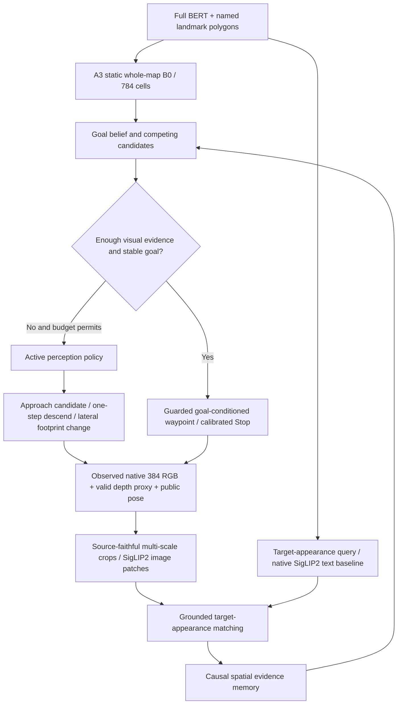

# GraphNav 多尺度与主动感知：架构集成及预注册实验计划

> 状态：已提交独立主动观测策略、观测帧 ROI 工具、闭环评测开关与 CPU 回归用例；**没有训练新权重，也没有新增语义匹配或 SR/SPL 改善证据。** 本文是可执行的实验设计，并不把目标投影、像素支持或源高度代理视为真实可辨识性/避障真值。
>
> 基于：`2027-CVPR/graphnav-relational-visual-belief`；保持父分支最强 A3 权重、统一 Episode 清单以及 SBF 对照不变。

## 1. 整体闭环结构

- A3 只产生**静态目标假设**，其权重及直接几何控制不依赖该扩展。
- 视觉编码器只接受真实已经观测的像素，不接受目标 GT、专家未来帧、全图正射影像或预渲染目标 gallery。
- 目标外观匹配只在实际有效像素支持上更新信念；无人观察的区域保持未知。
- 主动感知器只观察 `B_t`、候选世界坐标、历史实际覆盖、当前公共位姿/地图边界、语言中的粗目标尺度提示、动作预算。没有 GT 与将来的图像。
- 导航/Stop 依然由已有 guarded 控制负责；主动动作是**可选** XY/Z waypoint 的替换，原控制器执行最后限幅。
- 研究性外观与空间关系训练必须使用真实目标属性监督，**不能把跨帧同名地标检索准确率误当成目标识别**。

## 2. 当前相机/世界限制必须前置

1. 当前 `CityNavObservedViewRenderer.current_rgbd` 输出 `384x384`，图像来自源正射 RGB 与高度表的垂直俯视投影；不是 3D 第一视角透视、遮挡或光照变化模拟器。
2. `ObservedRGBMemory.view_corners` 中的方形视野边长约 `2 * (z - public_ground)` 米。相机朝向 yaw 只改变俯视纹理的取样旋转，不能视为真实不同侧面/三维视角。**仅 yaw 旋转不得计入有效多视角语义提升。**
3. 理想原生物体宽度代理：`n_pixels ≈ object_size_m * 384/(2*h)`；只衡量采样尺度。源影像真实 GSD、模糊、正射拼接伪影和目标遮挡可能使有效信息远低于理想公式。
4. 从已有 384 帧裁出的 32m/64m/128m ROI，再上采样至 384 只实现**数字多尺度感受野**，不会产生额外物理细节。真正物理尺度改善必须移动/下降后重新渲染实际观察。
5. 当前共享航行协议：20 宏动作、每步水平最多 50m、垂直最多 10m、公共地面高度以上 10–100m；源初始位置可异常。主控制器负责限幅、异常高度恢复；主动模式不得绕过，且不代表具备 swept collision 或真实 3D 飞行安全。

## 3. 代码状态（2026-10-10）

| 文件 | 工作 | 默认行为 |
|---|---|---|
| `graphnav/observed_scales.py` | 从**当前**观测用世界坐标裁剪 32/64/128m ROI；拒绝视野外、过小、缺失 RGB/Depth 支持的区域；输出原生有效面积 | 不自动调用 SigLIP2，不修改信念 |
| `graphnav/active_observation.py` | 以未确认高概率候选和视觉粗尺度为信号，产生 Approach / Descend / Lateral 受限下一航点 | 完全不启用 |
| `graphnav/target_runtime.py` | 在已经更新的 `B_t` 和已有 Stop 决策后，按预算决定是否执行一次主动观测动作，记录行为与理想采样尺度 | `active_observation=False` |
| `scripts/evaluate_closedloop.py` | 增加 `--model target-evidence --evidence-checkpoint ... --active-observation --active-max-actions 2`，评测标签继续与策略隔离 | 老模型与评测入口不变 |
| `tests/test_active_observation.py` | 动作预算、物理步长、离开视野 ROI 拒绝、当前帧唯一来源、数字放大不等同新信息 | 仅回归，尚未声称本地测试通过 |

**仍未实现：** 真正融合多尺度 ROI 的独立目标外观训练头（不能直接把未训练 crop vector 接入 belief）；训练样本构造及人工可辨识标注；基于校准预期信息增益的学习型观察策略；具有真实摄像头俯仰、侧视和遮挡的 3D 渲染环境。已有主动决策是可消融的保守启发式，并非已证明的最优信息增益策略。

## 4. 必须先做的实验：语义视觉可辨识性

**P0：原生像素审查（不训练模型）。**
- Train 内部开发与 Val Seen 固定随机种子，按地图/目标类别（房屋、车辆、屋顶、道路/停车场）、相对高度（10–30/30–60/60–100m）、距离、当前实际支持率分层抽样。保留 384 原帧、目标及相似竞争候选的局部可见裁剪和输入语言；禁止从未看到的位置裁剪全局原图。
- 对每张记录真实源影像 GSD（若有 GeoTIFF transform）、物体原图像素宽高、被裁剪/遮挡/无数据比例、边缘模糊指标、实际可辨认属性。人工盲评是否能读出灰/棕屋顶、车辆数量/颜色、建筑轮廓、次序等。
- GT 仅用于**离线标注诊断**，不进入模型前向与策略。几何 FOV 与 nonblack support **不是**语义可见或人工识别正确的保证。
- 先输出目标种类 x 高度 x 距离 x 像素宽度的可辨识率分布；在不可辨识子集中停止增加视觉网络复杂度。

**P1：固定同帧多尺度与 SigLIP2 匹配（不改航线）。**
- 固定一套自然训练观测，依次测试原生整帧 384 Patch、当前帧裁剪 128/64/32m ROI，以及相同 ROI 上采样对照；每组使用同一实际观测、不修改候选地图或动作。
- 比较 SigLIP2 **原生文本塔–视觉塔**零样本/小量训练与当前 BERT + 可训练投影。现有 BERT 与 SigLIP2 vision 并无默认跨模态对齐，需验证而非假定。
- 按真正可见/人可辨认子集报告：属性识别 Acc/F1、成对目标-同地图困难负例 Top1、AUPRC/Recall@K、灰↔棕/红↔白词替换反事实的一致性、候选 `log P(GT)` 变化，按高度和像素支持分桶。
- P1 必须先证明相同图像的真实 feature 优于零/同类打乱向量，然后才能宣称语义匹配头具有价值。

## 5. 主动感知控制实验（先冻结感知模型）

**P2：固定相机观测轨迹诊断，分离“图像质量提升”与“导航接近”效应。**
- 从相同 Train internal-dev 公开起点，对选定可见/模糊候选分别重放原策略、固定下降一步、固定水平靠近一步、等预算随机水平动作、启发式主动观察。
- 记录干预前后相同候选的**实际可辨识准确率**和物理像素尺寸、有效像素质量、目标 ranking 与视觉置信度。不允许因“距离变近”而直接视为“RGB 理解提升”。
- 视觉检测器权重在所有动作策略间保持完全相同；主动策略不能以未来图像、GT 成功或 GT 目标坐标选择动作。
- 在当前正射影像环境不把 yaw 旋转称为侧视。真实相机俯仰/遮挡比较是独立未来 Stage P5。

**P3：完整同协议闭环，逐级开关。**

| 实验 | 观测 | 额外动作 | 目的 |
|---|---|---|---|
| C0 | A3/GAT 原有输入 | 无 | 锚点几何基线 |
| C1 | 目标条件 RGB（当前单尺度） | 无 | 是否新增可靠外观证据 |
| C2 | C1 + 实际当前帧多尺度 ROI | 无 | 纯数字多尺度效果（新训练头才可比较） |
| C3 | C1 + 固定下降/定距前进 | 匹配预算 | 物理尺度提升基线 |
| C4 | C1 + 随机/固定同预算探查 | 匹配预算 | 排除“多走动作自然提升”的混淆 |
| C5 | C1 + 主动靠近/下降 | 最多 2 步 | 检验主动选择是否优于 C3/C4 |
| C6 | C5 + 水平换位/新覆盖 | 最多 2 步 | 检验真实额外观察区域而非伪 3D 视角 |
| C7 | C2 + 最佳已验证主动策略 | 最多 2 步 | 评估是否可组合（条件于 P1/P3 结果） |

- 所有组固定相同原始 Episode manifest（Seen 2470，之后冻结 Unseen 2697）、20 步 horizon、50m XY/10m Z、Stop/轨迹设置、传感器来源和数据切分。
- 每个动作包括主动观察动作在内都占 20 步配额。**不能**给主动策略额外 2 步而不计入 SPL。
- 必须同时报告 SR/SPL/OSR/NE、进入过真实 20m 的次数、false Stop、policy 步数、观察动作数、累计轨迹长度、平均推理时延、实际目标可辨识率、视觉 hard negative 识别率、候选信念校准，以及 95% paired episode / equal-map bootstrap。至少多个训练 seed；成功案例与恶化案例均保留。
- 诊断使用 GT 仅在完整 rollout 之后；不允许在 Val Unseen 根据指标选择模型。先在 Train internal-dev / Val Seen 设定权重、门槛和动作预算；冻结 source/checkpoint/config SHA 后评估 Unseen。

## 6. 因果检验与升格门槛

“主动感知有效”必须至少满足：
1. 有相当数量的策略选择了新的合法动作，而且确实获取了之前不存在的有效像素/更小物理 m/px；**仅数字裁剪不算**。
2. 同一冻结目标外观模型在真实 newly observed frames 上的语义匹配比动作前更准确，并优于高度/动作次数匹配对照。
3. 真实 RGB 证据优于零 RGB 与同类交换，属性反事实可引起**可解释且正确**的目标重新排序。
4. 闭环 SR/SPL 优势在已声明的相同动作预算中保持；至少报告是否只在特殊地图/特定高度有效。若 SR 改善但视觉性能不改善，只能解释为移动轨迹效果。

如果 P1/P2 显示车辆、颜色、局部关系在正射影像里常常无法识别：停止盲目堆 SigLIP 参数，改用 GSD-aware 保守视觉门控、主动取得更近的实际图像和多尺度几何分类。避免把不可观测区域当负证据。

## 7. 未来真实视角扩展（P5，不属于当前可比基准）

若后续提供可交互透视渲染/第一视角真实数据，新增摄像机姿态（pitch/roll/gimbal）、FOV/intrinsics、3D 遮挡、运动安全边界与同步位姿历史。再比较 yaw、俯仰和侧视的有效性，并训练 Information-Gain / cost-constrained active view policy。P5 是单独数据/环境条件，不能与现有 CityNav 正射 benchmark 混称。
