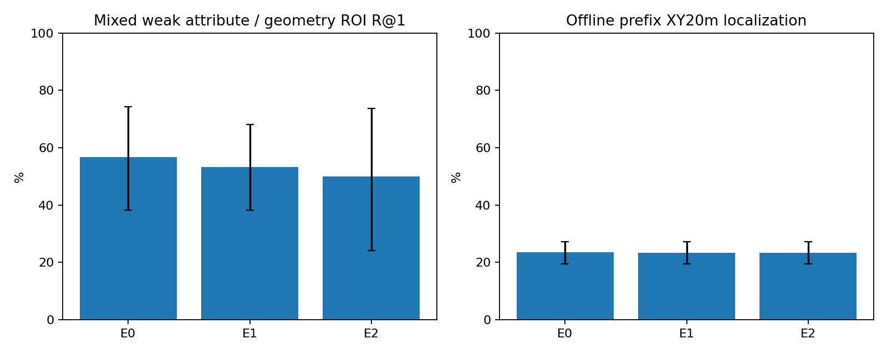
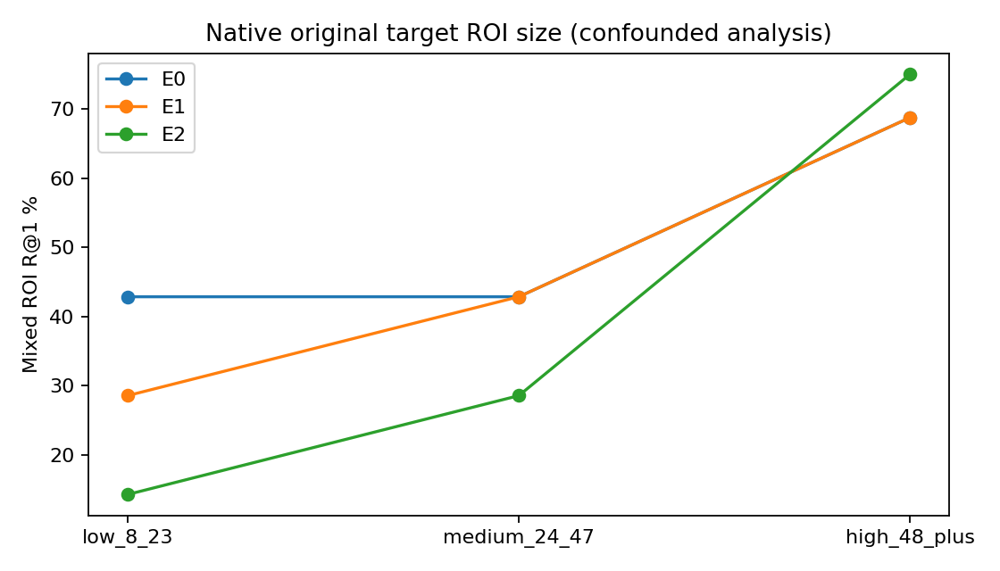
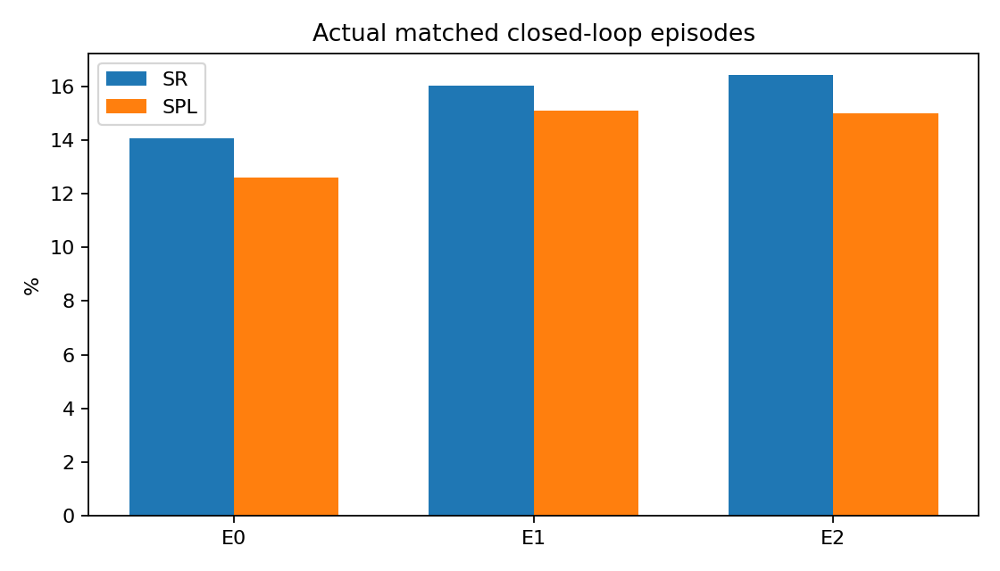
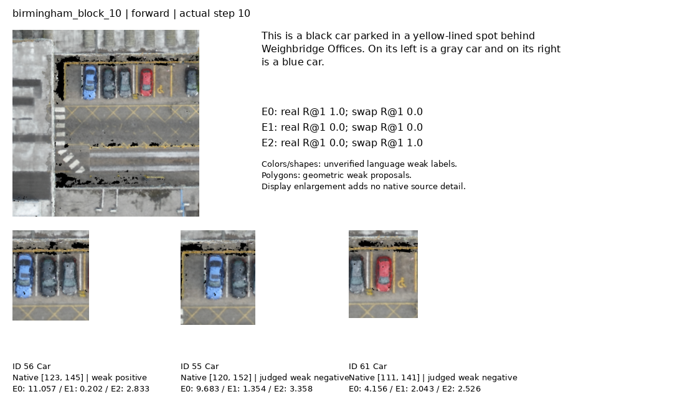
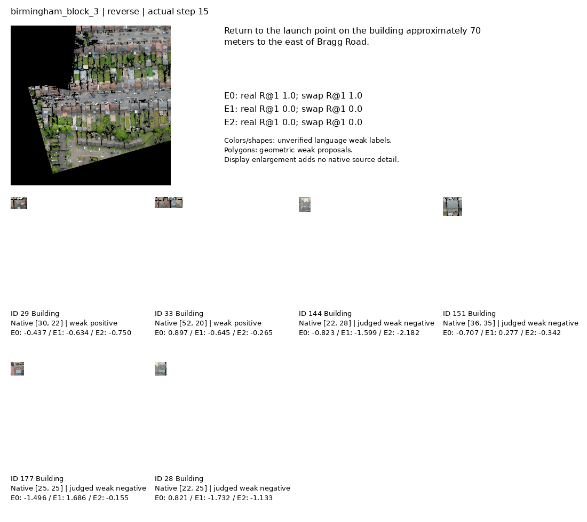

# 双向核心验证：三组固定预算真实实验

本轮是按 family 哈希、地图 round-robin 固定选取的 **pilot**，Seen 128 families / 256 个前向与合成返程 episode，**不是完整 Seen 验证集**。E0 为前向状态重复到同等预算；E1 加入原测量轨迹反向状态；E2 在 E1 上加入保守多正例区域–文本损失。A3、SigLIP2、BERT 冻结，仅轻量视觉匹配、Trajectory 和 Stop 头训练。固定最终第 3 Epoch，不按 Seen 选最佳 checkpoint。

反向轨迹是原已访问 XYZ 点的合成返程，朝向按反向运动重算，并非真实录制返程。当前 RGB 由原正射图按当前 XYZ/yaw 原生 nadir 视场生成，非透视摄影；AGL≤0 保持 Unknown。没有把目标、未来轨迹或目标 ID 传入模型。

## 实际完成阶段

- E0：完成 epoch 3 checkpoint 的 1280 个固定 Seen 缓存状态评价，2.60 s；SHA256 `d5a01f21d9106b5d7b0b95384b1a9b6878b69b2ba56ba198cfd79e401ccff911`。
- E1：完成 epoch 3 checkpoint 的 1280 个固定 Seen 缓存状态评价，1.95 s；SHA256 `4fc607ddc7a854e24c8c0f87b6dfecefdea00ca8f5f35018a92f7f2bb491453f`。
- E2：完成 epoch 3 checkpoint 的 1280 个固定 Seen 缓存状态评价，1.93 s；SHA256 `be6939fe4d29f0508559faf58bdcab0204f2eab336e45b9cd666ffea0ef3383a`。

## 全量已生成 metadata 与真实 GPU pilot 的区分

| 全量数据项 | Train Seen | Val Seen |
| --- | --- | --- |
| 原始源 Episode | 21878 | 2470 |
| 前向 Episode | 21878 | 2470 |
| 合成返程 Episode | 21878 | 2470 |
| 自动几何语言返程 | 20601 | 2332 |
| 具体对象语言返程 | 6273 | 745 |
| 前向 prefix | 109296 | 12337 |
| 返程 prefix | 109296 | 12337 |
| 独立原目标对象 | 3941 | 449 |
| 地图 | 24 | 23 |

Train 内部 family/对象/200 m访问区域连通分区：Train 19567 families，internal Dev 2311 families，24 个连通组件，node overlap=0，family_object_region_disjoint=True。原地图 Split 保持不变。

上述全量 metadata 已生成；真实 GPU 缓存/训练只采用预先固定的 Train 2048 与 Seen 128 families pilot，没有训练全量 21878 个 family，也没有用内部 Dev/Seen 选择 epoch。

| 实际数据检查 | Train Seen | Val Seen |
| --- | --- | --- |
| XYZ精确反向检查 | 21878 | 2470 |
| 几何语言检查 | 20601 | 2332 |
| 因果waypoint/Stop检查 | 218592 | 24674 |
| 预算对齐row检查 | 218592 | 24674 |

matched_total_steps/private_coordinate_fields_separate/no_reverse_mismatched_camera_as_current：两 Split 均为 True；Train internal_family_object_region_overlap=0。


## 实际数据覆盖

| 数据项 | Train pilot | Seen pilot |
| --- | --- | --- |
| 独立源 family | 2048 | 128 |
| 自动验证 point-anchor 几何返程语言 | 1904 | 119 |
| 唯一具体启动对象 S | 571 | 30 |
| 几何语言且具体 S | 546 | 29 |
| 真实源端点附近前向 ROI 对 | 1197 | 61 |
| 真实源端点附近反向 ROI 对 | 382 | 25 |
| 前向语言弱属性对 | 761 | 42 |
| 反向语言弱属性对 | 207 | 16 |
| 独立人工视觉核验 | 0 | 0 |

以上是源端点配对统计，不是本轮 current-yaw 缓存有效 VL 状态数。Seen 128 个返程中自动几何语言 119、泛化 trajectory-only 9；不能将 128 全部解释为可靠语言定位样本。返程 source-camera 端点 crop 需重新渲染当前反向 yaw 后才能作当前观察。


Seen 当前观测缓存实际完成：1280 states、22463 原生 ROI、30 有效 VL states，56 个非正 AGL Unknown，原始缓存构建 94.58 s，FP16 全 ROI 重编码 50.52 s；正式缓存图像精度 `fp16_backbone_fp32_head`。这些不是训练或导航结果。


正式固定 Seen 预测逐样本复核的有效语言区域监督（非端点 pair 总量）：

| 方向 | 有效 state | 独立 family | 独立正例对象（map＋ID） | 地图 |
| --- | --- | --- | --- | --- |
| forward | 19 | 14 | 30 | 10 |
| reverse | 11 | 10 | 15 | 7 |


返程原始启动目标 AGL>100 m 有 51/128（39.84%），对应 255 个 prefix。共享 controller 合法 AGL 10–100 m，超限 teacher_z 已屏蔽，原 source altitude 未篡改。因此本轮 XY20m SR/SPL 是水平返程指标，不能宣称精确原 XYZ 回程成功。


## 原生 ROI 数值精度检查

原 BF16 编码在 16 个真实 frame / 340 个 native ROI 上，相对 FP32 最低图像 cosine=0.99071676、最大图文 cosine 分数误差=0.00725378；预声明门限 cosine≥0.995、误差≤0.01，结果 **未通过**。未降低门限。

修复诊断：FP16 vision backbone + FP32 native attention pooling 的最低 cosine=0.99949569、最大分数误差=0.00080589，通过同一门限。诊断通过不替代正式全源 ROI 缓存重编码；正式使用的缓存路径和 SHA 固定在离线 provenance。


最终重编码缓存 FP32 对照数值门禁（实际原始 JSON，保留通过/失败状态）：

```json
{
  "actual_frames": 16,
  "actual_rois": 340,
  "cached_precision": "fp16_backbone_fp32_head",
  "reference_precision": "FP32 encoder and native ROI attention head",
  "minimum_image_cosine": 0.9998372793197632,
  "minimum_text_cosine": 0.9999690055847168,
  "maximum_score_error": 0.0008299723267555237,
  "thresholds_predeclared": {
    "minimum_cosine": 0.995,
    "maximum_cosine_score_error": 0.01
  },
  "pass": true
}
```


## 已完成轻量训练

| 组 | Epoch | 优化 steps | 每 Epoch 状态 | 可训练参数 | Epoch 优化阶段 s | 完整训练进程 wall s | 冻结资源不变 | 观察到 matcher 梯度 |
| --- | --- | --- | --- | --- | --- | --- | --- | --- |
| E0 | 3 | 1920 | 20450 | 325587 | 84.06 | 133.03 | True | True |
| E1 | 3 | 1920 | 20450 | 325587 | 87.28 | 136.72 | True | True |
| E2 | 3 | 1920 | 20450 | 325587 | 87.30 | 137.91 | True | True |

损失仅供训练诊断；核心收益根据下方真实指标、样本量与配对差值判断。


可靠人工视觉属性标签 **0**。前向 ROI 指标来自属性短语一致性弱标签；反向来自公开语言可表达的几何关系与弱 Polygon 投影。两者分开报告，不将混合 ROI 分数称作可靠颜色理解。

## Seen 缓存与视觉匹配

| 指标 | E0 | E1 | E2 |
| --- | --- | --- | --- |
| 混合语言→区域 R@1 | 56.67 (n=30) | 53.33 (n=30) | 50.00 (n=30) |
| 前向弱属性 R@1 | 47.37 (n=19) | 57.89 (n=19) | 36.84 (n=19) |
| 反向几何语言 R@1 | 72.73 (n=11) | 45.45 (n=11) | 72.73 (n=11) |
| 同类 Hard R@1 | 56.67 (n=30) | 53.33 (n=30) | 50.00 (n=30) |
| 真实 RGB R@1（相同交换子集） | 56.67 (n=30) | 53.33 (n=30) | 50.00 (n=30) |
| 交换 RGB 后原标签 R@1 | 36.67 (n=30) | 43.33 (n=30) | 20.00 (n=30) |
| 真实 RGB − 交换 RGB R@1 (pp) | 20.00 (n=30) | 10.00 (n=30) | 30.00 (n=30) |
| 交换后视觉源身份跟踪 R@1（补充） | 53.33 (n=30) | 50.00 (n=30) | 46.67 (n=30) |
| 原目标−同类负例 Pair 真实 R@1 | 70.00 (n=30) | 53.33 (n=30) | 70.00 (n=30) |
| 同 Pair 固定标签交换 R@1 | 33.33 (n=30) | 50.00 (n=30) | 33.33 (n=30) |
| Pair 真实−交换 Δ pp | 36.67 (n=30) | 3.33 (n=30) | 36.67 (n=30) |
| A3 static XY20m R@1 | 23.44 (n=1280) | 23.44 (n=1280) | 23.44 (n=1280) |
| 视觉融合 XY20m R@1 | 23.52 (n=1280) | 23.44 (n=1280) | 23.44 (n=1280) |
| Recovery | 0.31 (n=980) | 0.00 (n=980) | 0.00 (n=980) |
| Damage | 0.67 (n=300) | 0.00 (n=300) | 0.00 (n=300) |

多视图同对象按 mean-logit 排名，未知属性与未知几何候选排除评判。RGB swap 原正例固定为当前真实可见、judged positive 的原始目标对象（私有 ID 只在评价干预选择），负例为固定字典序同类 known negative，三模型共享同计划；移植真实缓存图像特征；保留目的区域 geometry/quality/grid，不生成假颜色标签。完整 gallery 保留多正例；另做原目标＋固定同类负例 Two-object pair 子集，其他正例只排除，不改作负例，避免其他未交换正例掩盖效应。主差值保持原标签、几何、语言、质量和有效性，比较真实 RGB 与交换 RGB 的 R@1；正差值说明该干预下正确源图提供有效证据。补充 source-tracking 指标按已移位的源身份重标正例，较高或不变代表跟随图像内容，不能当作原目标位置准确率。交换仍带有位置/上下文混杂，不能解释为纯反义属性理解。未观察 grid 分数逐元素严格保持冻结 A3 原值。

Bootstrap 固定 seed 20261010、2000 次，同时保存 state IID、family 和地图聚类区间；配对比较使用完全相同 sample_id。重复状态 IID 可能乐观，地图/家族聚类优先。

原生目标 ROI 最短边按 8–23 / 24–47 / ≥48 px 分组：私有 episode 目标 ID 只在评估后关联当前已观察 target ROI，未观察或没有具体 S 对象时单列 Unknown。其他同色多正例的最大 min-side 仅作附加审计，不能掩盖实际目标的小尺寸。该分组与对象类别、地图、可见性和监督类型混杂，不能自动归因分辨率。

### E0 原生像素分组
| 组 | 混合 R@1 % | 有效状态 | 独立 family | 地图 95% CI |
| --- | --- | --- | --- | --- |
| high_48_plus | 68.75 | 16 | 13 | 52.93 / 83.33 |
| low_8_23 | 42.86 | 7 | 7 | 14.29 / 75.00 |
| medium_24_47 | 42.86 | 7 | 7 | 11.11 / 83.33 |
| unknown | N/A | 0 | 0 | N/A |

### E1 原生像素分组
| 组 | 混合 R@1 % | 有效状态 | 独立 family | 地图 95% CI |
| --- | --- | --- | --- | --- |
| high_48_plus | 68.75 | 16 | 13 | 47.62 / 92.31 |
| low_8_23 | 28.57 | 7 | 7 | 0.00 / 57.14 |
| medium_24_47 | 42.86 | 7 | 7 | 14.29 / 71.43 |
| unknown | N/A | 0 | 0 | N/A |

### E2 原生像素分组
| 组 | 混合 R@1 % | 有效状态 | 独立 family | 地图 95% CI |
| --- | --- | --- | --- | --- |
| high_48_plus | 75.00 | 16 | 13 | 50.00 / 93.75 |
| low_8_23 | 14.29 | 7 | 7 | 0.00 / 50.00 |
| medium_24_47 | 28.57 | 7 | 7 | 0.00 / 66.67 |
| unknown | N/A | 0 | 0 | N/A |


## 同类型建筑困难负样本 R@1

从既有逐样本预测筛选：全部当前有效且可判正例均为 Building，仅排序真实可见同类已知负例；未知对象排除。保留语言弱/几何弱监督性质，不重新运行模型，不按结果挑建筑样本。

| 组 | Building Hard R@1 % | state n | 独立 family | 正例独立对象 | 地图 n | 地图 95% CI |
| --- | --- | --- | --- | --- | --- | --- |
| E0 | 66.67 | 12 | 10 | 17 | 7 | 45.45 / 87.50 |
| E1 | 50.00 | 12 | 10 | 17 | 7 | 22.22 / 72.73 |
| E2 | 66.67 | 12 | 10 | 17 | 7 | 37.50 / 85.71 |

| 配对 | Δ pp | state n | family 95% CI | 地图 95% CI |
| --- | --- | --- | --- | --- |
| E0_to_E1 | -16.67 | 12 | -50.00 / 14.29 | -50.00 / 14.29 |
| E1_to_E2 | 16.67 | 12 | 0.00 / 36.36 | 0.00 / 37.50 |
| E0_to_E2 | 0.00 | 12 | -27.27 / 21.43 | -28.61 / 21.43 |

## 三组配对结果

### E0_to_E1
| Δ 指标 (pp) | 点估计 | 配对 state n | family 95% CI | 地图 95% CI |
| --- | --- | --- | --- | --- |
| weak_attribute_text_region_r1 | 10.53 | 19 | -15.00 / 35.29 | -8.33 / 29.41 |
| geometry_text_region_r1 | -27.27 | 11 | -60.00 / 10.00 | -57.14 / 14.29 |
| same_class_hard_r1 | -3.33 | 30 | -25.81 / 17.86 | -23.08 / 18.18 |
| rgb_pair_real_minus_fixed_swap_r1 | -33.33 | 30 | -86.67 / 21.43 | -82.05 / 35.30 |
| rgb_real_minus_fixed_label_swap_r1 | -10.00 | 30 | -44.44 / 25.00 | -43.75 / 34.62 |
| rgb_swap_source_tracking_r1 | -3.33 | 30 | -25.81 / 17.86 | -23.08 / 18.18 |
| reranked_r1_xy20m | -0.08 | 1280 | -0.47 / 0.23 | -0.48 / 0.30 |

### E1_to_E2
| Δ 指标 (pp) | 点估计 | 配对 state n | family 95% CI | 地图 95% CI |
| --- | --- | --- | --- | --- |
| weak_attribute_text_region_r1 | -21.05 | 19 | -45.00 / 0.00 | -36.01 / -5.00 |
| geometry_text_region_r1 | 27.27 | 11 | 8.86 / 50.00 | 0.00 / 45.45 |
| same_class_hard_r1 | -3.33 | 30 | -24.14 / 16.13 | -25.02 / 15.80 |
| rgb_pair_real_minus_fixed_swap_r1 | 33.33 | 30 | -7.14 / 73.33 | -8.00 / 66.67 |
| rgb_real_minus_fixed_label_swap_r1 | 20.00 | 30 | -7.14 / 50.00 | -11.12 / 47.62 |
| rgb_swap_source_tracking_r1 | -3.33 | 30 | -24.14 / 16.13 | -25.02 / 15.80 |
| reranked_r1_xy20m | 0.00 | 1280 | 0.00 / 0.00 | 0.00 / 0.00 |

### E0_to_E2
| Δ 指标 (pp) | 点估计 | 配对 state n | family 95% CI | 地图 95% CI |
| --- | --- | --- | --- | --- |
| weak_attribute_text_region_r1 | -10.53 | 19 | -28.57 / 9.52 | -24.00 / 10.53 |
| geometry_text_region_r1 | 0.00 | 11 | -30.00 / 27.27 | -28.57 / 28.57 |
| same_class_hard_r1 | -6.67 | 30 | -21.43 / 9.38 | -21.88 / 10.71 |
| rgb_pair_real_minus_fixed_swap_r1 | 0.00 | 30 | -40.00 / 40.03 | -48.81 / 50.00 |
| rgb_real_minus_fixed_label_swap_r1 | 10.00 | 30 | -12.91 / 33.33 | -12.12 / 38.10 |
| rgb_swap_source_tracking_r1 | -6.67 | 30 | -21.43 / 9.38 | -21.88 / 10.71 |
| reranked_r1_xy20m | -0.08 | 1280 | -0.47 / 0.23 | -0.48 / 0.30 |

## A3 重排序：去重与状态重复

| 组 | 状态 / Episode / family | 已观察 / 可判 / 正例独立对象 |
| --- | --- | --- |
| E0 | 1280 / 256 / 128 | 4949 / 128 / 45 |
| E1 | 1280 / 256 / 128 | 4949 / 128 / 45 |
| E2 | 1280 / 256 / 128 | 4949 / 128 / 45 |

### E0 固定最早 prefix（每 Episode 一条）

| 指标 | 点估计 % | Episode n | 事件数 / 分母 | 地图 95% CI |
| --- | --- | --- | --- | --- |
| static_r1_xy20m | 23.44 | 256 | 60/256 | 19.51 / 27.20 |
| reranked_r1_xy20m | 23.44 | 256 | 60/256 | 19.51 / 27.20 |
| recovery | 0.00 | 196 | 0/196 | 0.00 / 0.00 |
| damage | 0.00 | 60 | 0/60 | 0.00 / 0.00 |

### E1 固定最早 prefix（每 Episode 一条）

| 指标 | 点估计 % | Episode n | 事件数 / 分母 | 地图 95% CI |
| --- | --- | --- | --- | --- |
| static_r1_xy20m | 23.44 | 256 | 60/256 | 19.51 / 27.20 |
| reranked_r1_xy20m | 23.44 | 256 | 60/256 | 19.51 / 27.20 |
| recovery | 0.00 | 196 | 0/196 | 0.00 / 0.00 |
| damage | 0.00 | 60 | 0/60 | 0.00 / 0.00 |

### E2 固定最早 prefix（每 Episode 一条）

| 指标 | 点估计 % | Episode n | 事件数 / 分母 | 地图 95% CI |
| --- | --- | --- | --- | --- |
| static_r1_xy20m | 23.44 | 256 | 60/256 | 19.51 / 27.20 |
| reranked_r1_xy20m | 23.44 | 256 | 60/256 | 19.51 / 27.20 |
| recovery | 0.00 | 196 | 0/196 | 0.00 / 0.00 |
| damage | 0.00 | 60 | 0/60 | 0.00 / 0.00 |

最早 prefix 按固定 cutoff 排序，不按目标可见性选图；额外 episode_mean_available_prefix 保存每 Episode 可用前缀平均，不是 oracle 最佳帧成功率。上方 1280 state 指标与下方每 Episode 一条的数量不能混作独立样本。

## 实际闭环导航

| 子集 | 指标 | E0 | E1 | E2 |
| --- | --- | --- | --- | --- |
| Forward Seen | SR | 25.78 (n=128) | 25.78 (n=128) | 25.78 (n=128) |
| Forward Seen | SPL | 23.02 (n=128) | 24.85 (n=128) | 24.90 (n=128) |
| Reverse Seen 全部 | SR | 2.34 (n=128) | 6.25 (n=128) | 7.03 (n=128) |
| Reverse Seen 全部 | SPL | 2.17 (n=128) | 5.34 (n=128) | 5.06 (n=128) |
| Reverse Seen 自动几何语言 | SR | 2.52 (n=119) | 6.72 (n=119) | 7.56 (n=119) |
| Reverse Seen 自动几何语言 | SPL | 2.34 (n=119) | 5.74 (n=119) | 5.45 (n=119) |


### 闭环方向配对差值（百分点）

| 配对 | 方向 | 指标 | 配对 Episode n | Δ pp | family 95% CI | 地图 95% CI |
| --- | --- | --- | --- | --- | --- | --- |
| E0_to_E1 | forward | SR | 128 | 0.00 | -9.38 / 9.38 | -7.20 / 7.44 |
| E0_to_E1 | forward | SPL | 128 | 1.83 | -6.96 / 10.75 | -5.14 / 8.87 |
| E0_to_E1 | reverse | SR | 128 | 3.91 | -0.78 / 9.38 | -1.53 / 9.17 |
| E0_to_E1 | reverse | SPL | 128 | 3.16 | -1.04 / 7.78 | -1.46 / 7.95 |
| E1_to_E2 | forward | SR | 128 | 0.00 | 0.00 / 0.00 | 0.00 / 0.00 |
| E1_to_E2 | forward | SPL | 128 | 0.05 | -0.11 / 0.23 | -0.12 / 0.22 |
| E1_to_E2 | reverse | SR | 128 | 0.78 | -1.56 / 3.14 | -1.63 / 3.82 |
| E1_to_E2 | reverse | SPL | 128 | -0.27 | -2.15 / 1.02 | -1.99 / 1.08 |
| E0_to_E2 | forward | SR | 128 | 0.00 | -9.38 / 9.38 | -7.20 / 7.44 |
| E0_to_E2 | forward | SPL | 128 | 1.88 | -6.91 / 10.75 | -5.15 / 8.86 |
| E0_to_E2 | reverse | SR | 128 | 4.69 | -0.02 / 10.16 | -0.78 / 10.08 |
| E0_to_E2 | reverse | SPL | 128 | 2.89 | -1.34 / 7.16 | -1.65 / 7.55 |
E2−E1 SR 为次要指标，不替代预声明 E1−E0 方向导航或 E2−E1 观察区域匹配主门槛。

## 四个核心问题：基于已完成实测

1. 双向训练是否改善真实导航？
   E1−E0 forward SR：Δ=0.00 pp，n=128，独立 family=128，地图 CI=[-7.20, 7.44]，未证明稳定正向增益。
   E1−E0 reverse SR：Δ=3.91 pp，n=128，独立 family=128，地图 CI=[-1.53, 9.17]，未证明稳定正向增益。
2. E2 辅助损失是否改善已观察区域语言匹配？
   E2−E1 weak_attribute_text_region_r1：Δ=-21.05 pp，n=19，独立 family=14，地图 CI=[-36.01, -5.00]，表现下降，区间完全低于 0。
   E2−E1 geometry_text_region_r1：Δ=27.27 pp，n=11，独立 family=10，地图 CI=[0.00, 45.45]，未证明稳定正向增益。
   前者为语言弱标签，后者为自动几何语言及弱区域投影；独立人工视觉属性核验仍为 0。
3. 模型是否使用真实图像证据？
   E0 Two-object pair 真实 RGB−固定原标签交换 RGB：Δ=36.67 pp，n=30，独立 family=23，地图 CI=[0.00, 65.22]，未证明稳定正向增益。
   E0 完整多正例 gallery 真实−交换：Δ=20.00 pp，n=30，独立 family=23，地图 CI=[-8.33, 42.86]，未证明稳定正向增益。
   E0 诊断：Pair 源身份跟踪=66.67% (n=30)；gallery top-object 改变=46.67% (n=30)；Pair 原分数同分=3.33% (n=30)。
   E1 Two-object pair 真实 RGB−固定原标签交换 RGB：Δ=3.33 pp，n=30，独立 family=23，地图 CI=[-32.35, 46.68]，未证明稳定正向增益。
   E1 完整多正例 gallery 真实−交换：Δ=10.00 pp，n=30，独立 family=23，地图 CI=[-11.11, 38.72]，未证明稳定正向增益。
   E1 诊断：Pair 源身份跟踪=50.00% (n=30)；gallery top-object 改变=43.33% (n=30)；Pair 原分数同分=3.33% (n=30)。
   E2 Two-object pair 真实 RGB−固定原标签交换 RGB：Δ=36.67 pp，n=30，独立 family=23，地图 CI=[-14.30, 81.48]，未证明稳定正向增益。
   E2 完整多正例 gallery 真实−交换：Δ=30.00 pp，n=30，独立 family=23，地图 CI=[3.12, 53.85]，有初步正向证据。
   E2 诊断：Pair 源身份跟踪=66.67% (n=30)；gallery top-object 改变=43.33% (n=30)；Pair 原分数同分=3.33% (n=30)。
   结合 source-tracking、top-object 改变与 Pair 同分比例判断图像依赖；高源跟踪说明预测随图像内容移位，不能当作固定原标签交换正确率。多正例未交换证据可掩盖 gallery Δ≈0，因此不能直接据此断言模型不看 RGB。
4. 原生像素尺寸是否限制性能，是否值得增大网络？
   E0：低像素 42.86% (n=7)，高像素 68.75% (n=16)；类别、地图、可见性与监督类型混杂，不是分辨率因果对照。
   E1：低像素 28.57% (n=7)，高像素 68.75% (n=16)；类别、地图、可见性与监督类型混杂，不是分辨率因果对照。
   E2：低像素 14.29% (n=7)，高像素 75.00% (n=16)；类别、地图、可见性与监督类型混杂，不是分辨率因果对照。
   E2 视觉主比较没有清晰正向证据时停止复杂 GAT；先处理观察覆盖与弱监督质量。

## Unseen 与模型扩展门槛

当前没有预声明主比较通过正提升且配对地图 95% CI 下界大于 0 的门槛，不开展 Unseen。E2 视觉收益不清晰时停止复杂 GAT；E1 若有独立导航收益可满足自己的正式 Unseen 验证门槛。

完整逐状态预测、原像素分组、同类候选、RGB 交换计划、A3 Unknown 不变量与完整配对 CI 保存在本报告对应 runs 目录。导航逐 episode 保存真实政策 pose、termination、diagnostics；目标与参考轨迹仅用于 rollout 后评分。

局限：弱语言属性未人工核验；正射纹理无法证明真实透视跨视角鲁棒性；返程不是录制飞行；稀疏 current-only ROI 不能代替未来可见性。无清晰 E2 收益时保留负结果，不扩展网络。

## 可复核对比图







小型统计与完整配对导航区间：[review_metrics.json](assets/bidirectional_core/review_metrics.json)。高维缓存和逐样本预测保留本地 runs。


## 执行与审计证据

实际回归：265 passed / 1 warning，6.54 s；warning=rasterio PendingDeprecationWarning existing native RGB transform。

训练完整性审计 passed=True，三组同初始 head SHA `effb207527f15c74411fc68d01ee7010698a1821b689d605f14cc725c7dfda3c`、同 Train cache manifest SHA `37934ddafaf5d1a9f17c0907af67c8148b0929bef5f8e8eea10b6afbab58969a`、同容量 325587；frozen backbones in optimizer=False。

实际完整命令、退出码及分阶段耗时索引：`executed_commands.json`, `reencode_commands.json`, `training_commands.json`, `evaluation_commands.json`（本地 `runs/bidirectional_core_test/`）。

已生成 12 组真实 current-frame 候选图：`runs/bidirectional_core_test/cases/manifest.json`。候选正确性来自上述弱/几何标签，不能当作人工视觉核验。case_00 的汽车 Polygon bbox 含邻车，展示区域边界与重叠标注噪声，不能将表观失误全部归因编码器语义能力。

案例清单：[cases_manifest.json](assets/bidirectional_core/cases_manifest.json)；全部真实current-frame候选图已同步。





case_06 返程楼顶候选原生尺寸约20–30 px，小ROI与几何/可见性混杂，不能从此例单独推导分辨率因果效应。

审计与命令 JSON 已同步至 `docs/assets/bidirectional_core/`，可随代码 review。
