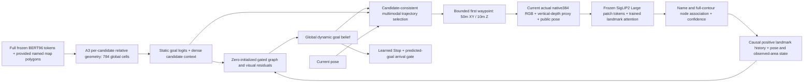

# GraphNav full system report — work in progress

This report is not a completion claim. The expanded closed-loop goal is active; Level1/2/3 acceptance is not yet met. Unified SBFNav full Seen/Unseen, all GraphNav Seen controls and ten frozen full Unseen controls, including the Seen-selected primary Full seed1, are complete; remaining visual/history and seed/static controls are running. Static recall and visual retrieval are never substituted for SR/SPL. The selected final architecture and acceptance table will be populated after the predeclared controls finish.

## Implemented architecture and boundaries

Evaluator/private labels contain target coordinates and expert trajectories; public policy inputs do not. Teacher future is used only in trajectory training labels and post-rollout diagnostics. The current head receives static A3 dense context with updated belief probability/entropy; updated GAT latent features are not directly fused into it. History records poses but is not recurrent pose attention. These are remaining architecture limitations.

The simulator is the local SBFNav macro-action benchmark with observed orthophoto regions and source height-derived depth. It does not support faithful perspective3D occlusion or swept-path collision physics. Original episode starts and20m XY success rules remain unchanged.

## Completed results and effective changes

Local SBFNav full Seen2470:SR43.5223%,SPL36.1184%; full Unseen2697:SR21.5054%,SPL15.8907%. All5167 paths exactly reproduce the historical trained-source/checkpoint replay. Level2 thresholds are SR20.4301%,SPL14.3016%, subject to pipeline/Seen/Stop/safety checks. See `SHARED_CLOSEDLOOP_PROTOCOL_20261009.md` and `reports/sbf_protocol/baseline_table.csv`.

P0/native projection:54 visual examples and actual384 RGB/depth coordinate checks exist; confidence filters reject holes/clipped/invalid polygons. Projected ROIs are weak geometric proposals, not segmentation GT. P1 matched G0/G1 pretraining does not improve Seen selection; Unseen navigation transfer is mixed, with v3 SR/SPL intervals containing zero and lower NE. Scratch remains selected under the original Seen-only rule. P2 controlled Large384 versus Base224 gives Unseen landmark retrieval73.04/93.91% versus72.17/92.17% R@1/R@5, only one net identity gain with wide paired uncertainty. This is landmark retrieval, not target localization or navigation.

Same learned trajectory/Stop full Seen: A3 SR40.8502/SPL39.6139%; GAT42.0648/40.7956%; current visual41.5385/39.3911%. GAT has a modest aggregate Seen SR/SPL gain but worse NE and no established map-uniform gain. Visual has no broad benefit. Joint-current full Seen SR42.4291/SPL40.4542%; history41.9433/40.5579%; history has no additional aggregate gain. Candidate-recovery Stop preserves GAT SR42.0648/SPL40.7956% while reducing movements7.8138→7.3607. Top4 exploration adds only2 successes with lower SPL. Fresh public-altitude Stop confirmations for all five module rows now reproduce these displayed SR/SPL values. Their paired/map bootstrap and complete action audits are in `P3_P4_ALTITUDE_GUARD_SEEN_20261010.md`; all five have zero new illegal states and legal final heights. The independent full seed0 confirmation is complete: SR41.7004%, SPL40.3309%, NE31.3305m, with zero new illegal states or invalid final heights. Earlier Stop-recovery controls and original results remain in `P3_P4_FULL_SEEN_INITIAL_20261010.md`.

Verified engineering improvements include exact-output native rendering/static-GAT caching (Seen12869.12s→14.14s), atomic checkpoint/resume and immutable source/input hashes, causal pixel-keyed feature reuse, node-to-contour binding, no-observation invariance and consistent candidate/path/Stop selection. Earlier harmful rank/trajectory/Stop experiments remain recorded rather than erased. Current Graph regression suite:145passing tests; external SBF test compatibility/config-glob failures are separately disclosed.

## Remaining acceptance work

Three independent A3 scratch seeds and their five-epoch downstream dynamic/trajectory/Stop training are complete. Full Seen Seed1 SR42.6721/SPL40.8949/NE30.7278m and Seed2 SR41.5789/SPL39.2060/NE31.3440m use the altitude-corrected Runtime; Seed0 corrected confirmation SR41.7004/SPL40.3309/NE31.3305m is complete. Three-seed Seen means are SR41.9838%, SPL40.1440%, NE31.1341m; sample standard deviations0.5991/0.8598percentage points and0.3519m, conditional on the shared frozen P2 model. Corrected CSV/JSON are in `reports/altitude_guard_seen_20261010`. All three measured epoch budgets/configuration/Checkpoint SHA are in `reports/full_system_training_20261010`; old trajectory epochs lack absolute timestamps and their GPU utilization cannot be reconstructed. Current full Graph regression suite145passed.

Matched P1v2 lowers Seen R@1 from40.8904 to39.1179%. The final hard-negative P1v3 lowers it further to36.8508%, with R@8 75.0618→73.2894% and NE31.5274→32.6913m. Seen128 bounded navigation SR41.4063→36.7188%,SPL40.6522→36.1198%. These negative results and the additional67.42s pretraining budget are preserved in `P1_MATCHED_V3_HARD_20261010.md`; neither pretraining variant is promoted. Fair learned-trajectory heads and full Seen navigation controls are complete: G0/v2/v3 SR41.3765/38.2591/36.6397%, SPL40.2144/37.1665/35.5842%. Both P1 variants also harm Seen navigation, with paired SR CIs below zero; frozen Unseen v3 has a small positive SR/SPL point difference with intervals containing zero, while v2 has a small negative point difference; see `P1_MATCHED_TRAJECTORY_20261010.md`.

Actual/zero/shuffled ROI vectors give identical Seen128 SR40.625%, so image-vector benefits remain unproven. Public-altitude Stop confirmations are complete; final candidates and SHA were committed/pushed as fdd9a3d before new GraphNav Unseen. Complete the remaining fixed evaluations, paired/map/seed reports and final architecture/weights/config commands. Query-conditioned target appearance in observed regions remains a valuable untested hypothesis: named-landmark retrieval does not directly ground color/roof/shape descriptions to unnamed target houses. No improvement from that proposed mechanism is claimed.

Current input/processing audit: `GRAPHNAV_SBF_INPUT_PROCESSING_AUDIT_20261010.md`. Native SBF spatial RGB features interact directly with its SigLIP language tokens and candidate crops; current Graph landmark retrieval supervision does not directly supervise query-specific target appearance. Public pose+map projection already supplies region identity, explaining why good landmark retrieval need not add navigation information. This is a tested mechanism limitation plus an untested improvement hypothesis, not a new performance claim.

Action audit found4 Graph episodes stopping before source-invalid height recovered. Runtime now requires public ground+10..100m before Stop; original source starts and XY20m success are unchanged. All old results remain available. Pointwise source-DEM clearance proxy found204 SBF versus6 A3/8 joint Seen episodes below a known sampled surface; unknown pixels remain unknown. This does not measure swept collision or establish physical flight safety. Reproducible scripts/reports are committed; final acceptance awaits all frozen final evaluations and checks.

Actual A3 altitude-Stop repair check: all4 previously invalid final-altitude episodes now end inside public ground+10..100m; full2470 Seen has0invalid final heights. Individual SR outcomes are preserved, while the four cases take bounded extra recovery moves. Full A3 SR40.8502/SPL39.6139/NE31.4762m is unchanged at displayed precision. The paired original/current manifest, public heights and post-rollout NE are in `reports/sbf_protocol/altitude_stop_guard_actual_a3_seen.json`; no private target coordinates were used for the correction. All module confirmations completed before final freezing.

Execution scheduling: following user authorization, final independent evaluations run at most2GPU processes; training was serialized. Unique atomic checkpoint/vector temporary files and call-private ROI PNG directories fix demonstrated concurrent-cache races. The parallel-cache revision passed144tests; the subsequent controller-path fix raised the completed full suite to145passing tests. Phase22 and phase22b have completed; their original outcomes and scheduler handover evidence are preserved. Concurrent latency and device-wide GPU telemetry are labeled and are not isolated speedup evidence against historical SBF timing. See `PARALLEL_EVALUATION_20261010.md`.

Actual on-policy Seen evidence coverage: Full seeds1/2 have trusted regions on70.02%/69.22% of decisions, referenced-node updates on35.78%/35.33%, and any trusted region in98.18%/98.14% of episodes. History raises retained-evidence coverage but not corresponding aggregate SR. These public telemetry statistics are distinct from human-prefix exposure and target visibility; see `ONPOLICY_VISUAL_EVIDENCE_SEEN_20261010.md`.

First complete frozen Unseen control: A3 + trajectory SR23.3222%, SPL22.6725%, OSR32.3693%, NE48.7174m on2697episodes. It exceeds SBF point estimates in SR/SPL but episode-bootstrap SR CI crosses zero; OSR worsens and False-Stop76.6345%. It is not the Seen-preselected full primary. See `FINAL_A3_TRAJECTORY_UNSEEN_20261010.md` and the explicit outstanding requirements in `GRAPHNAV_REQUIREMENT_AUDIT_20261010.md`; final acceptance remains pending.

## Frozen primary Full seed1 Unseen result — acceptance still pending

| Model | Seen SR (%) | Seen SPL (%) | Unseen SR (%) | Unseen SPL (%) | Unseen OSR (%) | Unseen NE (m) | Unseen nDTW (%) | Unseen sDTW (%) |
|---|---:|---:|---:|---:|---:|---:|---:|---:|
| Local SBFNav | 43.5223 | 36.1184 | 21.5054 | 15.8907 | 38.7468 | 47.5653 | 23.5093 | 7.5936 |
| GraphNav Full seed1 (Seen-selected primary) | 42.6721 | 40.8949 | 22.1728 | 21.2317 | 32.6288 | 51.5006 | 25.7345 | 8.2637 |

All2697 episodes are included and four actual checkpoint hashes match the pre-Unseen frozen plan. Primary SR difference+0.6674percentage points has paired episode95% CI[-1.1874,+2.6706]; SPL+5.3410points has CI[3.6849,7.0715]. Primary numerical SR/SPL thresholds pass, but reliable SR superiority, three-seed consistency and complete architectural/Stop/safety acceptance remain unproven. Primary OSR declines6.1179points and NE worsens3.9353m. No secondary higher-Unseen-SR row replaces the primary.

Cold primary evaluation took2019.66s with79367 actual visual encodes and4.020GiB peak allocation; overlapping policy latency73.990ms is not an isolated comparison. All22807 movements pass public action constraints, preserving1261 source-invalid starts. Source-backed post-rollout pointwise clearance finds26 primary episodes/44 later known points below surface, versus463/2539 SBF;3257/5823 sampled points remain unknown. These are proxy counts, not swept collision or physical-flight guarantees.2099 primary failures include1817 with no observed target-near pose,263 after legal observed arrival and19 after only illegal observed arrival;2054 are failed policy Stops. No private diagnosis changes inference.

Frozen GAT-only Unseen control worsens same-backbone SR by2.1505points,CI[-3.1516,-1.1123], reversing the Seen gain. Frozen P1 matched-head SR is20.8750/20.0593/21.8391% for Scratch/v2/v3; v3 SR/SPL intervals include zero, so this is mixed evidence rather than uniform harm or validated improvement. Independent reports: `FINAL_FULL_SEED1_UNSEEN_20261010.md`, `FINAL_GAT_UNSEEN_20261010.md`, `P1_MATCHED_TRAJECTORY_20261010.md`. Remaining frozen controls and final requirement audit are pending.
