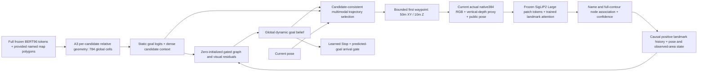

# GraphNav full system report — work in progress

This report is not a completion claim. The expanded closed-loop goal is active; Level1/2/3 acceptance is not yet met. Unified SBFNav full Seen/Unseen and initial GraphNav full Seen controls are complete; new GraphNav Unseen results remain unmeasured. Static recall and visual retrieval are never substituted for SR/SPL. The selected final architecture and acceptance table will be populated after the predeclared controls finish.

## Implemented architecture and boundaries

Evaluator/private labels contain target coordinates and expert trajectories; public policy inputs do not. Teacher future is used only in trajectory training labels and post-rollout diagnostics. The current head receives static A3 dense context with updated belief probability/entropy; updated GAT latent features are not directly fused into it. History records poses but is not recurrent pose attention. These are remaining architecture limitations.

The simulator is the local SBFNav macro-action benchmark with observed orthophoto regions and source height-derived depth. It does not support faithful perspective3D occlusion or swept-path collision physics. Original episode starts and20m XY success rules remain unchanged.

## Completed results and effective changes

Local SBFNav full Seen2470:SR43.5223%,SPL36.1184%; full Unseen2697:SR21.5054%,SPL15.8907%. All5167 paths exactly reproduce the historical trained-source/checkpoint replay. Level2 thresholds are SR20.4301%,SPL14.3016%, subject to pipeline/Seen/Stop/safety checks. See `SHARED_CLOSEDLOOP_PROTOCOL_20261009.md` and `reports/sbf_protocol/baseline_table.csv`.

P0/native projection:54 visual examples and actual384 RGB/depth coordinate checks exist; confidence filters reject holes/clipped/invalid polygons. Projected ROIs are weak geometric proposals, not segmentation GT. P1 matched G0/G1 pretraining shows no transfer improvement; retained strongest historical A3. P2 controlled Large384 versus Base224 gives Unseen landmark retrieval73.04/93.91% versus72.17/92.17% R@1/R@5, only one net identity gain with wide paired uncertainty. This is landmark retrieval, not target localization or navigation.

Same learned trajectory/Stop full Seen: A3 SR40.8502/SPL39.6139%; GAT42.0648/40.7956%; current visual41.5385/39.3911%. GAT has a modest aggregate Seen SR/SPL gain but worse NE and no established map-uniform gain. Visual has no broad benefit. Joint-current full Seen SR42.4291/SPL40.4542%; history41.9433/40.5579%; history has no additional aggregate gain. Candidate-recovery Stop preserves GAT SR42.0648/SPL40.7956% while reducing movements7.8138→7.3607. Top4 exploration adds only2 successes with lower SPL. These results precede the newly diagnosed public-altitude Stop fix, whose fresh fair Seen confirmations are queued separately. Detailed CSV, paired uncertainty and failure analysis are in `P3_P4_FULL_SEEN_INITIAL_20261010.md`.

Verified engineering improvements include exact-output native rendering/static-GAT caching (Seen12869.12s→14.14s), atomic checkpoint/resume and immutable source/input hashes, causal pixel-keyed feature reuse, node-to-contour binding, no-observation invariance and consistent candidate/path/Stop selection. Earlier harmful rank/trajectory/Stop experiments remain recorded rather than erased. Current Graph regression suite:137passing tests; external SBF test compatibility/config-glob failures are separately disclosed.

## Remaining acceptance work

Three independent A3 scratch seeds are complete (Seen R@1 40.8904/42.5392/40.9728%). Full downstream residual/trajectory/Stop seed replications, fair P1 v3 hard-negative transfer and altitude-Stop confirmations are running/queued. Full Seed0 preliminary Seen SR41.7004/SPL40.3309/NE31.3305m is complete but uses its pre-altitude-fix immutable source. Matched P1 v2 lowers Seen R@1 from40.8904 to39.1179% despite improving direction response; it is not promoted. Actual/zero/shuffled ROI vectors give identical Seen128 SR40.625%, so image-vector benefits remain unproven. Freeze final candidates and Commit their SHA before any new GraphNav Unseen evaluation. Produce full paired/map/seed results and final architecture/weights/config commands. Query-conditioned target appearance in observed regions remains a valuable untested hypothesis: the current named-landmark visual matching module does not directly ground color/roof/shape descriptions to unnamed target houses. No improvement from that proposed mechanism is claimed.

Current input/processing audit: `GRAPHNAV_SBF_INPUT_PROCESSING_AUDIT_20261010.md`. Native SBF spatial RGB features interact directly with its SigLIP language tokens and candidate crops; current Graph landmark retrieval supervision does not directly supervise query-specific target appearance. Public pose+map projection already supplies region identity, explaining why good landmark retrieval need not add navigation information. This is a tested mechanism limitation plus an untested improvement hypothesis, not a new performance claim.

Action audit found4 Graph episodes stopping before source-invalid height recovered. Runtime now requires public ground+10..100m before Stop; original source starts and XY20m success are unchanged. All old results remain available. Pointwise source-DEM clearance proxy found204 SBF versus6 A3/8 joint Seen episodes below a known sampled surface; unknown pixels remain unknown. This does not measure swept collision or establish physical flight safety. Reproducible scripts/reports are committed; final acceptance awaits all frozen final evaluations and checks.
