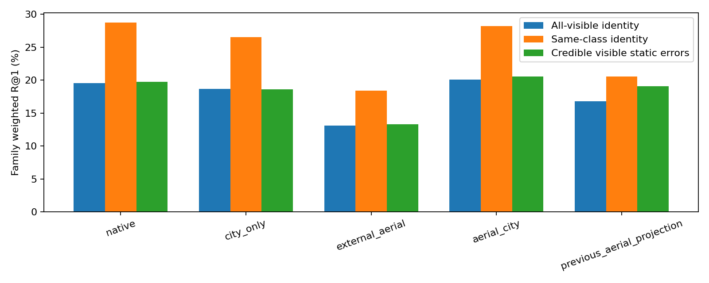
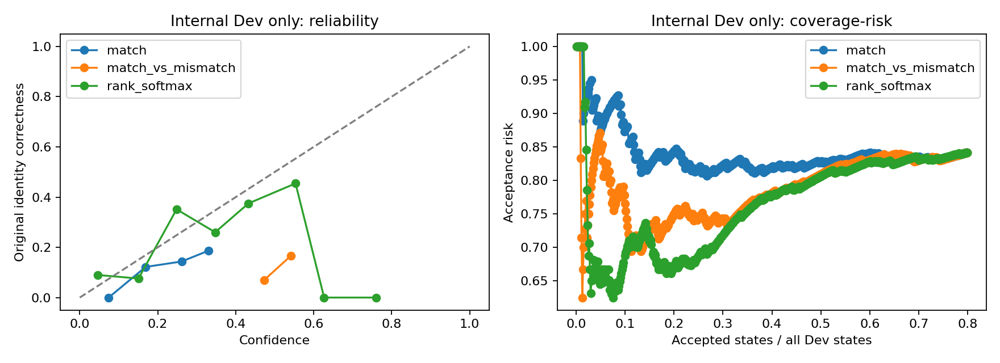
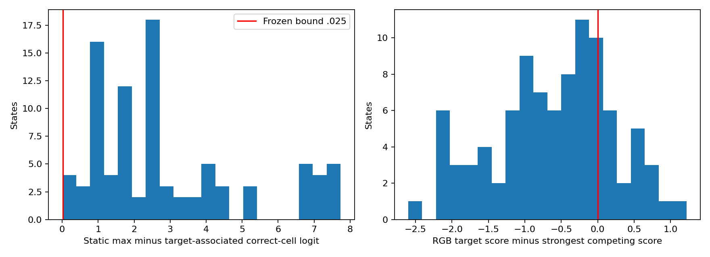
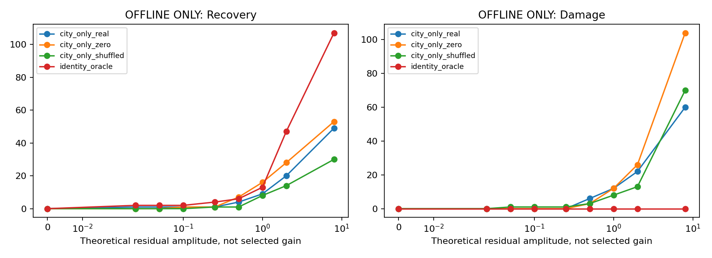
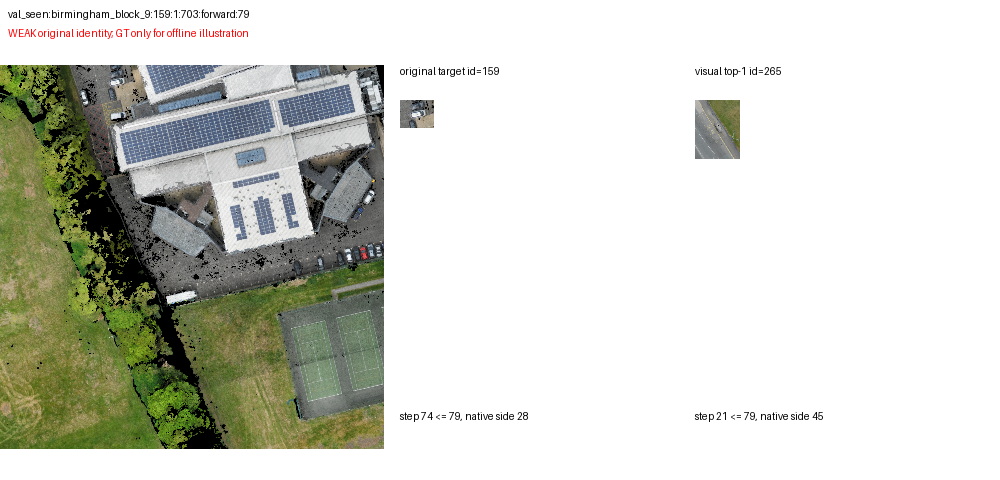
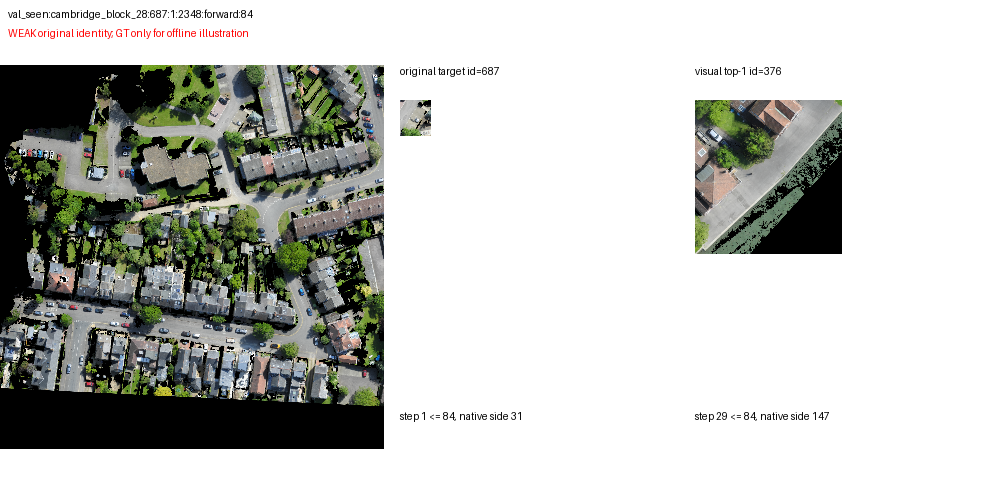
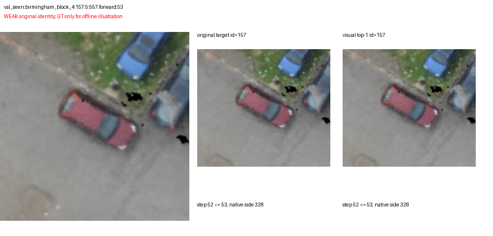
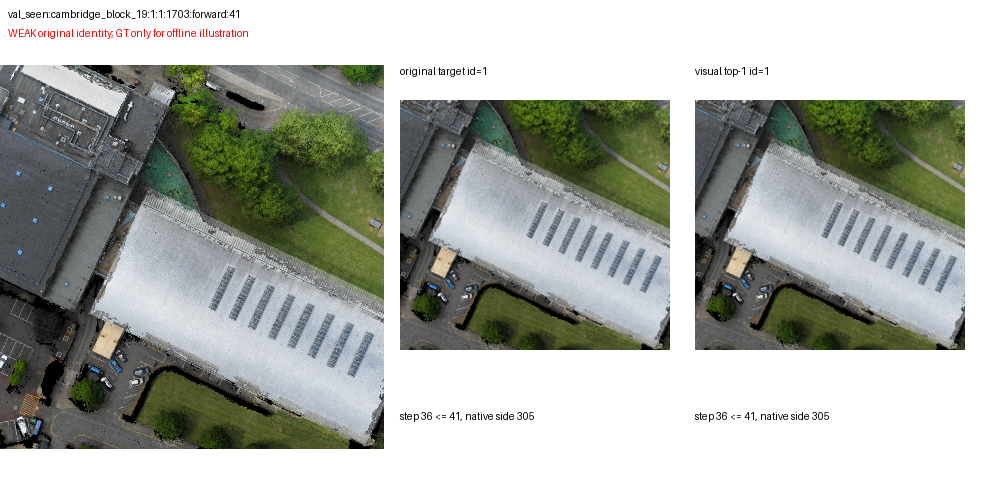
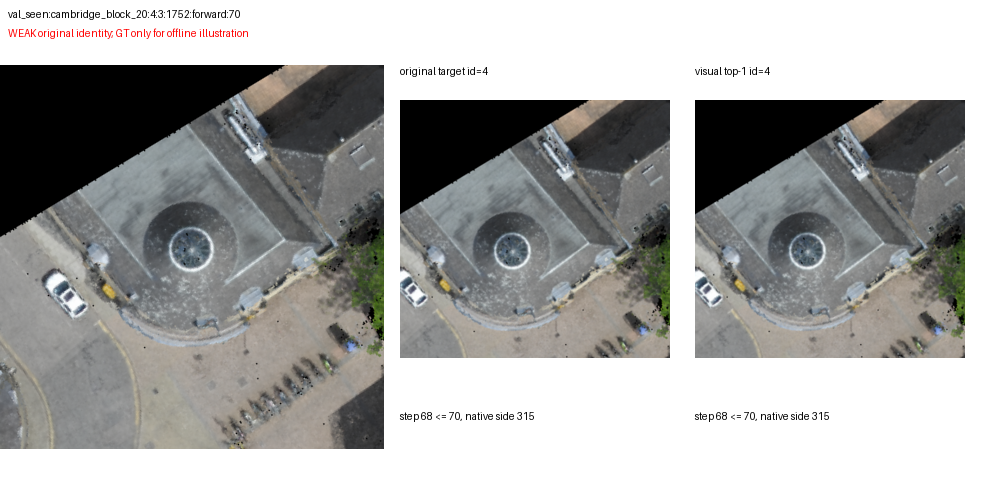

# P2.5：RGB语义纠错可行性诊断

**本阶段只诊断：训练0、图像编码0、闭环0、Unseen0。正式gain=0.025和阈值1.01保持不变。理论幅度表均为离线反事实，不能部署或据Seen选参数。**

## 1. 结论与证据优先级

原始RGB独立身份信号：成立；Dev具有统计支持的非零安全接受区间：未发现；强Identity Oracle的映射上界空间：存在（不可部署）；正常0.025的上界仍只有2/640。

**三项条件未全部成立：停止RGB网络训练，将RGB降为辅助视觉验证模块，不推进目标残差融合或导航训练。**

1. **身份与语言唯一性不足**：冻结主模型的完整指令RGB-only身份R1为18.68%（family等权）；可信可见静态错误子集18.61%。有属性信号不等于原目标身份。
2. **置信度失效**：Dev三分类真实类别数量[267, 848, 34731]（Match/Mismatch/Unknown），混淆矩阵[[0, 0, 267], [0, 0, 848], [0, 0, 34731]]；原概率、去Unknown的Match-vs-Mismatch和排名代理分别检查安全覆盖，未将全部弃权的零Damage当作有效纠错。
3. **融合界限确实限制上界**：同一观测支持的固定0.025身份Oracle恢复2 /640，不能达到至少7个净恢复所需的+1pp。在当前单原实例选择与Centroid传播规则下，即使身份完全正确，正常界限仍不可达+1pp；扩大幅度的Oracle只估理论空间，不能弥补Real身份错误。
4. **数据覆盖不足**：可信可见错误为94prefix /36独立family /33对象；人工视觉语义核验0。不满足50family，不能靠重复prefix宣称稳定成功。

## 2. 固定协议、资源与正常推理边界

基于 `06ebf5398d051ecfc105298821ce3b12eced0131`，独立分支 `research/rgb-feasibility-20261011`。复用原Train/Dev/Seen和Dense Causal History缓存，单RTX PRO6000 96GB。本轮补编码的只有属性/交换文本，图像塔不执行；所有图像、patch、context和Black特征来自P2缓存。

主模型固定为P2内部Dev选定city_only；Native、原Aerial Projection、外部完整caption Head及Aerial→City全部作为预先列出的对照，不能按Seen重选。模型文件及原P2源文件SHA不变。Dev完成后冻结run/core/协议SHA，再运行Seen一次诊断。Seen幅度曲线不生成新配置或模型。

RGB-only把City VEN已有相对位置bias输入置零，保留真实context/patch；Geometry-only按当前观测同一Centroid/FOV支持，从冻结完整指令A3 logits提取实例分数，无FOV关联的已观察实例用静态最小值作几何排名占位（不是语义否决，也不改变Goal）；几何实例R1必须结合这一关联局限解释；RGB+Geometry按固定等权percentile rank组合，只做区域排名分析，不是新Goal更新器。黑图/同类循环交换保持候选、观测几何、质量和语言不变。

Attribute只替换完整查询为保守目标短语；没有可审核短语的查询回退原文，单独报告支持短语的共同人口。Attribute+Spatial只增加指令明确命名、实际已观察参考物的方向/near约束；方向±10m、near≤25m/far≥50m，不能用GT选择anchor。未支持关系回退属性分数；attribute_spatial含公开关系几何，不能称纯RGB。正常模型不接收GT身份/坐标，标签与Oracle另行使用。

多ROI同Cell、Black等并列分数采用均匀选择期望R1和并列期望排名，避免索引赢目标。离线残差仍保留固定torch argmax，报告所选实例。属性及身份监督均为CityRefer语言/关联弱标签，没有当作人工真值。

Seen：640状态、128family、23地图。可信错误36family；可见错误（含低质量）110状态/42family；可用已观察命名关系39状态，其中可判定候选39状态。

## 3. 视觉身份与困难负例

| 冻结模型Full RGB-only | 全可见身份R1：family等权 | 身份状态/family | 同类Hard R1 | 可信错误身份R1 | 可信错误目标排名均值 |
|---|---|---|---|---|---|
| native | 19.56% | 190/76 | 28.78% | 19.77% | 13.85 |
| city_only | 18.68% | 190/76 | 26.53% | 18.61% | 16.71 |
| external_aerial | 13.11% | 190/76 | 18.45% | 13.33% | 16.20 |
| aerial_city | 20.07% | 190/76 | 28.22% | 20.60% | 16.68 |
| previous_aerial_projection | 16.82% | 190/76 | 20.59% | 19.07% | 14.17 |

在同一支持属性短语的96个可见状态/40独立family中，Attribute相对Full的原身份R1变化（state等权）为+7.29pp；地图CI [+2.86,+12.94]；familyCI [+2.15,+13.86]。这是完整指令噪声/未落实参考物会拖累匹配的证据，但属性后身份准确率仍不足以可靠纠错；不能把该差当作细粒度关系理解成功。

| 主模型语言/模态 | 全可见身份R1 | 支持属性短语人口R1（状态/family） | 支持已观察关系人口R1（状态/family） | 属性多正例R1（n） |
|---|---|---|---|---|
| full/rgb | 18.68% | 21.29% (96/40) | 25.00% (20/8) | 63.41% (82) |
| full/combined | 15.89% | 15.10% (96/40) | 8.75% (20/8) | 65.24% (82) |
| attribute/rgb | 22.63% | 28.79% (96/40) | 25.00% (20/8) | 60.98% (82) |
| attribute/combined | 18.74% | 20.52% (96/40) | 8.75% (20/8) | 66.46% (82) |
| attribute_spatial/rgb | 21.84% | 26.29% (96/40) | 18.75% (20/8) | 57.32% (82) |
| attribute_spatial/combined | 18.69% | 19.27% (96/40) | 8.33% (20/8) | 65.24% (82) |

Geometry-only：身份R1 12.12%，同类Hard 23.03%。这是已观察实例条件排名，和640状态的Goal R1不是同一指标。

属性到原目标身份不能自动升级：多个对象满足颜色/形状时允许多正例；本轮属性多正例数量≥2的状态为64，其中参考物是否消除歧义仍缺人工验证。Full与Attribute的身份差值只在相同可见人口内解释；可见目标且支持显式关系只有20状态/8families，未支持或样本不足不能声称关系模型已经验证。

主模型完整查询 Real−Black：+17.18pp；地图CI [+9.24,+26.26]；familyCI [+11.02,+24.20]；Real−Shuffled：+12.19pp；地图CI [+3.96,+21.65]；familyCI [+4.98,+19.39]。正差说明RGB有身份信息，不能由此声称能安全接纳或优于Native。

## 4. 属性交换与像素/类别

| 模型 | 可交换弱标签查询/独立family | 原属性正确 | 交换属性正确 | 两者同时正确 | 分数方向正确 |
|---|---|---|---|---|
| native | 84/28 | 58.33% | 47.62% | 30.95% | 88.10% |
| city_only | 84/28 | 47.62% | 41.67% | 8.33% | 88.10% |
| external_aerial | 84/28 | 50.00% | 52.38% | 19.05% | 92.86% |
| aerial_city | 84/28 | 60.71% | 58.33% | 32.14% | 95.24% |
| previous_aerial_projection | 84/28 | 58.33% | 61.90% | 35.71% | 86.90% |

只交换保守目标短语中的一个属性，必须有真实已观察候选的可信语言弱标签支持两边；未审查像素属性、不假定唯一新目标。该表不足以证明目标身份理解。

| 组别：Full RGB-only主模型 | 身份R1（状态） | 同类Hard R1 | 可信错误R1 | 独立对象 |
|---|---|---|---|---|
| pixels_8_15 | 0.00% (1) | 100.00% | — | 1 |
| pixels_16_31 | 0.00% (23) | 13.04% | 0.00% | 15 |
| pixels_32_63 | 2.13% (47) | 4.26% | 4.17% | 25 |
| pixels_64_plus | 32.77% (119) | 37.61% | 35.59% | 64 |
| type_Building | 20.56% (107) | 18.56% | 24.59% | 33 |
| type_Car | 22.97% (74) | 36.49% | 25.00% | 34 |
| type_Ground | 0.00% (4) | 0.00% | 0.00% | 1 |
| type_Parking | 20.00% (5) | 40.00% | 20.00% | 1 |

按像素分组不是同一目标受控降采样，不能单独归因分辨率；类别/地图/对象分布不同。全部分组CI及目标排名在原始metrics.json。

## 5. 内部Dev原始Logits、校准与弃权

| VEN | 原始Match-vs-Mismatch AUC：排除Unknown | 三分类Brier | 最高类别置信ECE | Top1 P(Match) ECE/Brier | Dev安全区间 |
|---|---|---|---|---|---|
| city_only | 0.7612 | 0.2299 | 0.3175 | 0.1232/0.1495 | 未发现 |
| aerial_city | 0.7673 | 0.4627 | 0.0917 | 0.2637/0.1986 | 未发现 |
| external_aerial | 0.5800 | 1.2475 | 0.5239 | 0.2887/0.2159 | 未发现 |

Brier三分类定义sum((p-onehot)²)，二分类为mean((p-y)²)；ECE用固定10等宽bins，完整classwise分开存档。多数量Unknown可让overall ECE低，同时Match召回为0，不能当作校准成功。known AUC只用已观察可判断Match/Mismatch，不把目标未观察的ROI充当Mismatch。Top1接受风险统计全部Dev查询，目标不在图库时接受是错误验证，并非新增训练负例。

1.01是“没有任何预声明阈值通过安全检查”的弃权哨兵，不是概率。原检查要求≥10独立接受family，且按family任何已接受prefix错误记为坏family，Wilson95正确率下界≥0.9（完美样本也至少约35families）。除固定阈值网格外，还遍历Dev置信度全部实际接受阶梯，避免粗网格遗漏区间；confidence_exact_dev.json保存完整结果。多个代理检查仅用于Dev诊断，未写入正式配置或Seen参数。

| 主模型代理 / 阈值 | 接受状态 / family | 覆盖率 | state风险 | family-any-error风险 | 正确率Wilson下界 |
|---|---|---|---|---|---|
| match/0 | 511/128 | 79.84% | 84.15% | 92.97% | 3.74% |
| match/0.01 | 511/128 | 79.84% | 84.15% | 92.97% | 3.74% |
| match/0.1 | 497/128 | 77.66% | 83.70% | 92.97% | 3.74% |
| match/0.5 | 0/0 | 0.00% | — | — | 0.00% |
| match/0.8 | 0/0 | 0.00% | — | — | 0.00% |
| match/0.9 | 0/0 | 0.00% | — | — | 0.00% |
| match/1.01 | 0/0 | 0.00% | — | — | 0.00% |
| match_vs_mismatch/0 | 511/128 | 79.84% | 84.15% | 92.97% | 3.74% |
| match_vs_mismatch/0.01 | 511/128 | 79.84% | 84.15% | 92.97% | 3.74% |
| match_vs_mismatch/0.1 | 511/128 | 79.84% | 84.15% | 92.97% | 3.74% |
| match_vs_mismatch/0.5 | 468/126 | 73.12% | 83.33% | 92.86% | 3.80% |
| match_vs_mismatch/0.8 | 0/0 | 0.00% | — | — | 0.00% |
| match_vs_mismatch/0.9 | 0/0 | 0.00% | — | — | 0.00% |
| match_vs_mismatch/1.01 | 0/0 | 0.00% | — | — | 0.00% |
| rank_softmax/0 | 511/128 | 79.84% | 84.15% | 92.97% | 3.74% |
| rank_softmax/0.01 | 511/128 | 79.84% | 84.15% | 92.97% | 3.74% |
| rank_softmax/0.1 | 222/77 | 34.69% | 75.23% | 89.61% | 5.36% |
| rank_softmax/0.5 | 16/10 | 2.50% | 68.75% | 80.00% | 5.67% |
| rank_softmax/0.8 | 0/0 | 0.00% | — | — | 0.00% |
| rank_softmax/0.9 | 0/0 | 0.00% | — | — | 0.00% |
| rank_softmax/1.01 | 0/0 | 0.00% | — | — | 0.00% |
| score_gap_sigmoid/0 | 511/128 | 79.84% | 84.15% | 92.97% | 3.74% |
| score_gap_sigmoid/0.01 | 511/128 | 79.84% | 84.15% | 92.97% | 3.74% |
| score_gap_sigmoid/0.1 | 511/128 | 79.84% | 84.15% | 92.97% | 3.74% |
| score_gap_sigmoid/0.5 | 511/128 | 79.84% | 84.15% | 92.97% | 3.74% |
| score_gap_sigmoid/0.8 | 9/6 | 1.41% | 100.00% | 100.00% | 0.00% |
| score_gap_sigmoid/0.9 | 1/1 | 0.16% | 100.00% | 100.00% | 0.00% |
| score_gap_sigmoid/1.01 | 0/0 | 0.00% | — | — | 0.00% |

## 6. Margin、映射与离线融合上界

| 可信错误的Margin | n | min / p10 / p25 / median / p75 / p90 / max |
|---|---|---|
| associated_centroid_margin | 94 | 0.0053 / 0.9832 / 1.1624 / 2.4618 / 3.8909 / 6.6940 / 7.7327 |
| associated_correct_cell_margin | 91 | 0.0053 / 1.0744 / 1.2486 / 2.4618 / 3.8909 / 6.6940 / 7.7327 |
| gt_correct_grid_margin | 94 | 0.0053 / 0.3582 / 0.5166 / 1.1529 / 2.3302 / 3.4014 / 5.4011 |
| rgb_identity_margin | 94 | -2.6003 / -1.8491 / -1.1363 / -0.4883 / -0.0261 / 0.4589 / 1.2170 |

可信错误中91/94有目标关联cell处在原20m成功半径内；0.025能跨越正确支持cell margin的状态只有2。该Oracle只界定当前单实例传播链路，不是所有可想象的间接关系/多实例融合机制的绝对上界；本轮没有测试或训练那些机制。GT正确grid margin、原实例centroid margin和RGB score margin分别保存，前两者是离线标签分析，不输入正常模型。

| 离线policy / 理论幅度 | GoalR1 | Recovery / Damage / Net | 相对冻结Geometry的配对差与95CI |
|---|---|---|---|
| city_only_real/0 | 44.53% | 0/0/0 | +0.00pp；地图CI [+0.00,+0.00]；familyCI [+0.00,+0.00] |
| city_only_real/0.025 | 44.69% | 1/0/1 | +0.16pp；地图CI [+0.00,+0.49]；familyCI [+0.00,+0.47] |
| city_only_real/0.05 | 44.69% | 1/0/1 | +0.16pp；地图CI [+0.00,+0.49]；familyCI [+0.00,+0.47] |
| city_only_real/0.1 | 44.69% | 1/0/1 | +0.16pp；地图CI [+0.00,+0.49]；familyCI [+0.00,+0.47] |
| city_only_real/0.25 | 44.69% | 1/0/1 | +0.16pp；地图CI [+0.00,+0.49]；familyCI [+0.00,+0.47] |
| city_only_real/0.5 | 44.22% | 4/6/-2 | -0.31pp；地图CI [-1.36,+0.61]；familyCI [-1.56,+0.78] |
| city_only_real/1 | 44.06% | 9/12/-3 | -0.47pp；地图CI [-2.56,+1.45]；familyCI [-2.50,+1.56] |
| city_only_real/2 | 44.22% | 20/22/-2 | -0.31pp；地图CI [-3.23,+2.42]；familyCI [-3.44,+2.81] |
| city_only_real/8 | 42.81% | 49/60/-11 | -1.72pp；地图CI [-6.20,+3.18]；familyCI [-6.88,+3.44] |
| city_only_real/strong | 28.12% | 49/154/-105 | -16.41pp；地图CI [-24.19,-8.27]；familyCI [-23.75,-9.06] |
| city_only_zero/0 | 44.53% | 0/0/0 | +0.00pp；地图CI [+0.00,+0.00]；familyCI [+0.00,+0.00] |
| city_only_zero/0.025 | 44.53% | 0/0/0 | +0.00pp；地图CI [+0.00,+0.00]；familyCI [+0.00,+0.00] |
| city_only_zero/0.05 | 44.53% | 0/0/0 | +0.00pp；地图CI [+0.00,+0.00]；familyCI [+0.00,+0.00] |
| city_only_zero/0.1 | 44.69% | 1/0/1 | +0.16pp；地图CI [+0.00,+0.48]；familyCI [+0.00,+0.47] |
| city_only_zero/0.25 | 44.69% | 1/0/1 | +0.16pp；地图CI [+0.00,+0.48]；familyCI [+0.00,+0.47] |
| city_only_zero/0.5 | 45.16% | 7/3/4 | +0.62pp；地图CI [-0.17,+1.56]；familyCI [-0.31,+1.72] |
| city_only_zero/1 | 45.16% | 16/12/4 | +0.62pp；地图CI [-1.38,+2.83]；familyCI [-1.72,+2.97] |
| city_only_zero/2 | 44.84% | 28/26/2 | +0.31pp；地图CI [-2.27,+2.97]；familyCI [-2.66,+3.44] |
| city_only_zero/8 | 36.56% | 53/104/-51 | -7.97pp；地图CI [-13.69,-2.11]；familyCI [-14.37,-1.88] |
| city_only_zero/strong | 17.66% | 53/225/-172 | -26.88pp；地图CI [-36.00,-17.78]；familyCI [-35.63,-18.28] |
| city_only_shuffled/0 | 44.53% | 0/0/0 | +0.00pp；地图CI [+0.00,+0.00]；familyCI [+0.00,+0.00] |
| city_only_shuffled/0.025 | 44.53% | 0/0/0 | +0.00pp；地图CI [+0.00,+0.00]；familyCI [+0.00,+0.00] |
| city_only_shuffled/0.05 | 44.38% | 0/1/-1 | -0.16pp；地图CI [-0.48,+0.00]；familyCI [-0.47,+0.00] |
| city_only_shuffled/0.1 | 44.38% | 0/1/-1 | -0.16pp；地图CI [-0.48,+0.00]；familyCI [-0.47,+0.00] |
| city_only_shuffled/0.25 | 44.53% | 1/1/0 | +0.00pp；地图CI [-0.46,+0.47]；familyCI [-0.47,+0.47] |
| city_only_shuffled/0.5 | 44.22% | 1/3/-2 | -0.31pp；地图CI [-0.93,+0.30]；familyCI [-0.94,+0.31] |
| city_only_shuffled/1 | 44.53% | 8/8/0 | +0.00pp；地图CI [-1.92,+2.09]；familyCI [-2.03,+1.88] |
| city_only_shuffled/2 | 44.69% | 14/13/1 | +0.16pp；地图CI [-2.58,+2.95]；familyCI [-2.03,+2.34] |
| city_only_shuffled/8 | 38.28% | 30/70/-40 | -6.25pp；地图CI [-10.00,-1.69]；familyCI [-11.56,-1.25] |
| city_only_shuffled/strong | 21.72% | 30/176/-146 | -22.81pp；地图CI [-29.16,-16.06]；familyCI [-30.16,-15.31] |
| identity_oracle/0 | 44.53% | 0/0/0 | +0.00pp；地图CI [+0.00,+0.00]；familyCI [+0.00,+0.00] |
| identity_oracle/0.025 | 44.84% | 2/0/2 | +0.31pp；地图CI [+0.00,+0.98]；familyCI [+0.00,+0.94] |
| identity_oracle/0.05 | 44.84% | 2/0/2 | +0.31pp；地图CI [+0.00,+0.98]；familyCI [+0.00,+0.94] |
| identity_oracle/0.1 | 44.84% | 2/0/2 | +0.31pp；地图CI [+0.00,+0.98]；familyCI [+0.00,+0.94] |
| identity_oracle/0.25 | 45.16% | 4/0/4 | +0.62pp；地图CI [+0.00,+1.56]；familyCI [+0.00,+1.56] |
| identity_oracle/0.5 | 45.47% | 6/0/6 | +0.94pp；地图CI [+0.00,+2.34]；familyCI [+0.16,+2.03] |
| identity_oracle/1 | 46.56% | 13/0/13 | +2.03pp；地图CI [+0.65,+3.72]；familyCI [+0.78,+3.75] |
| identity_oracle/2 | 51.88% | 47/0/47 | +7.34pp；地图CI [+4.32,+10.88]；familyCI [+4.38,+10.78] |
| identity_oracle/8 | 61.25% | 107/0/107 | +16.72pp；地图CI [+11.45,+22.34]；familyCI [+11.87,+21.72] |
| identity_oracle/strong | 61.25% | 107/0/107 | +16.72pp；地图CI [+11.45,+22.34]；familyCI [+11.87,+21.72] |
| credible_identity_oracle/0 | 44.53% | 0/0/0 | +0.00pp；地图CI [+0.00,+0.00]；familyCI [+0.00,+0.00] |
| credible_identity_oracle/0.025 | 44.84% | 2/0/2 | +0.31pp；地图CI [+0.00,+0.98]；familyCI [+0.00,+0.94] |
| credible_identity_oracle/0.05 | 44.84% | 2/0/2 | +0.31pp；地图CI [+0.00,+0.98]；familyCI [+0.00,+0.94] |
| credible_identity_oracle/0.1 | 44.84% | 2/0/2 | +0.31pp；地图CI [+0.00,+0.98]；familyCI [+0.00,+0.94] |
| credible_identity_oracle/0.25 | 45.16% | 4/0/4 | +0.62pp；地图CI [+0.00,+1.56]；familyCI [+0.00,+1.56] |
| credible_identity_oracle/0.5 | 45.47% | 6/0/6 | +0.94pp；地图CI [+0.00,+2.34]；familyCI [+0.16,+2.03] |
| credible_identity_oracle/1 | 45.94% | 9/0/9 | +1.41pp；地图CI [+0.16,+2.88]；familyCI [+0.31,+2.81] |
| credible_identity_oracle/2 | 50.94% | 41/0/41 | +6.41pp；地图CI [+3.49,+9.77]；familyCI [+3.59,+9.69] |
| credible_identity_oracle/8 | 58.75% | 91/0/91 | +14.22pp；地图CI [+8.85,+20.33]；familyCI [+9.69,+18.91] |
| credible_identity_oracle/strong | 58.75% | 91/0/91 | +14.22pp；地图CI [+8.85,+20.33]；familyCI [+9.69,+18.91] |

| 离线policy / 幅度 / 指标 | 配对差值及地图/family95CI |
|---|---|
| city_only_real/0.025/recovery | +0.16pp；地图CI [+0.00,+0.49]；familyCI [+0.00,+0.47] |
| city_only_real/0.025/damage | +0.00pp；地图CI [+0.00,+0.00]；familyCI [+0.00,+0.00] |
| city_only_real/0.025/net_recovery | +0.16pp；地图CI [+0.00,+0.49]；familyCI [+0.00,+0.47] |
| city_only_real/1/recovery | +1.41pp；地图CI [+0.46,+2.67]；familyCI [+0.47,+2.81] |
| city_only_real/1/damage | +1.88pp；地图CI [+0.48,+3.66]；familyCI [+0.47,+3.59] |
| city_only_real/1/net_recovery | -0.47pp；地图CI [-2.56,+1.45]；familyCI [-2.50,+1.56] |
| city_only_real/8/recovery | +7.66pp；地图CI [+4.55,+11.64]；familyCI [+4.84,+10.78] |
| city_only_real/8/damage | +9.38pp；地图CI [+6.40,+12.73]；familyCI [+5.94,+13.12] |
| city_only_real/8/net_recovery | -1.72pp；地图CI [-6.20,+3.18]；familyCI [-6.88,+3.44] |
| city_only_real/strong/recovery | +7.66pp；地图CI [+4.55,+11.64]；familyCI [+4.84,+10.78] |
| city_only_real/strong/damage | +24.06pp；地图CI [+18.04,+30.31]；familyCI [+18.12,+30.16] |
| city_only_real/strong/net_recovery | -16.41pp；地图CI [-24.19,-8.27]；familyCI [-23.75,-9.06] |
| identity_oracle/0.025/recovery | +0.31pp；地图CI [+0.00,+0.98]；familyCI [+0.00,+0.94] |
| identity_oracle/0.025/damage | +0.00pp；地图CI [+0.00,+0.00]；familyCI [+0.00,+0.00] |
| identity_oracle/0.025/net_recovery | +0.31pp；地图CI [+0.00,+0.98]；familyCI [+0.00,+0.94] |
| identity_oracle/1/recovery | +2.03pp；地图CI [+0.65,+3.72]；familyCI [+0.78,+3.75] |
| identity_oracle/1/damage | +0.00pp；地图CI [+0.00,+0.00]；familyCI [+0.00,+0.00] |
| identity_oracle/1/net_recovery | +2.03pp；地图CI [+0.65,+3.72]；familyCI [+0.78,+3.75] |
| identity_oracle/8/recovery | +16.72pp；地图CI [+11.45,+22.34]；familyCI [+11.87,+21.72] |
| identity_oracle/8/damage | +0.00pp；地图CI [+0.00,+0.00]；familyCI [+0.00,+0.00] |
| identity_oracle/8/net_recovery | +16.72pp；地图CI [+11.45,+22.34]；familyCI [+11.87,+21.72] |
| identity_oracle/strong/recovery | +16.72pp；地图CI [+11.45,+22.34]；familyCI [+11.87,+21.72] |
| identity_oracle/strong/damage | +0.00pp；地图CI [+0.00,+0.00]；familyCI [+0.00,+0.00] |
| identity_oracle/strong/net_recovery | +16.72pp；地图CI [+11.45,+22.34]；familyCI [+11.87,+21.72] |

实例折叠审计：190个目标可见状态全部具有合法FOV关联，其中94个目标cell同时包含其他实例（47个独立family），最多8个实例共cell；本次不存在无合法支持而使用几何排名占位的观察实例。cell级排名不能表达同cell唯一身份，但正常/Oracle仍使用相同关联。

在当前0.025上界下绕过弃权、假设Real置信度=1，仅有1个原身份正确恢复、Damage=0；Goal差为+0.16pp；地图CI [+0.00,+0.49]；familyCI [+0.00,+0.47]，CI下界为0，未达到可靠+1pp。理论幅度1的Real恢复9/误伤12；幅度8恢复49/误伤60。真实模型的排序错误不能由放大幅度解决。

Real/Black/Shuffled理论policy假定置信度=1、绕过弃权，选择各自RGB-only Full Top1及depth可信实例；不按GT是否可见筛选，因此错误接受也产生Damage。Oracle允许GT身份只选择实际观察的原实例，保持同样候选与FOV支持，目标未观察时不更新；可信Oracle进一步只选depth可信目标。strong用静态logit range+1，完全是不可部署的映射上界。各幅度列不是新的正式gain，也不将最好的Seen点推荐为配置。

正式P2部署配置仍全部弃权，GoalR1=44.53%、Recovery=Damage=0。上表无置信度Real结果不可写成已获得的正式定位增益。逐样本的身份恢复与偶然恢复分别记录。

## 7. 真实案例与下一步

样本 `val_seen:cambridge_block_21:92:4:2135`：目标原生边45px，原实例排名102.0，实际sourceStep 76≤cutoff 76。指令：One floor white building with a dark gray roof off King Street near the edge of the map across the street from the Wesley Methodist Church

样本 `val_seen:birmingham_block_9:159:1:703`：目标原生边28px，原实例排名76.0，实际sourceStep 74≤cutoff 79。指令：The white car that is between a black car and a dark gray car in the small parking lot at the entrance to the West Midlands Police Custody Suite. There is a white car parked along the grass behind it.

样本 `val_seen:cambridge_block_28:687:1:2348`：目标原生边31px，原实例排名72.0，实际sourceStep 1≤cutoff 84。指令：Parking lot at the widest part of Woodvale Lodge road. There is a single-storey building with a green roof on the left back of this park area and two trees on the right back.

样本 `val_seen:birmingham_block_4:157:5:557`：目标原生边328px，原实例排名1.0，实际sourceStep 52≤cutoff 53。指令：The magenta car parked perpendicular to a blue car in the bottom left corner of the large parking lot above Wellington Street and to the left of Birchfield Road.

样本 `val_seen:cambridge_block_19:1:1:1703`：目标原生边305px，原实例排名1.0，实际sourceStep 36≤cutoff 41。指令：A white roofed building with a car park behind it . It is next to Kelsey &kerridge sports centre building along Gonville place road.

样本 `val_seen:cambridge_block_20:4:3:1752`：目标原生边315px，原实例排名1.0，实际sourceStep 68≤cutoff 70。指令：A building with cone shaped grey roof Situated at the opposite side of  New Square Dental And Chiropody building.

GT实例只用于该离线示意，成功案例是区域身份匹配成功，不能把它解释成正式Goal纠错。

不提出新的RGB训练或gain方案。将RGB保留为可视化/弱属性辅助验证，不自动否决、提升或改变目标候选，Unknown时保留Geometry；最值得补充的是人工核验唯一目标与参考物身份、同颜色真困难负例及足够独立family。当前不能由属性信号或Oracle有空间推导出安全纠错。

## 8. 复现、预算与交付

配置见[protocol.json](../experiments/rgb_feasibility/protocol.json)；原始结果、未经取整逐样本分数、Dev raw logits、bootstrap结果和日志在`runs/rgb_feasibility/`；提交gzip预测与小统计图，不提交Checkpoint和大型feature文件。所有对照使用同一640状态及观察实例；sourceStep≤cutoff，候选与标签一致，原P2Checkpoint/配置/源文件SHA在结束时再次核验。

测试结果见[regression_tests.log](assets/rgb_feasibility/evidence/regression_tests.log)。既有318项不退化；新增针对并列排名、family独立性、公开关系和offline-only残差的测试。执行命令、真实耗时、异常修复和完整环境见[execution.json](assets/rgb_feasibility/evidence/execution.json)。本轮没有新的SR/SPL数值。提交SHA在最后交付消息及本地commit.json记录，避免自引用。

实际text-only编码20条：22.97s，GPU分配峰值3.32GiB；完整Dev诊断135.65s，Seen诊断147.75s，因果/关联审计33.28s。这些是含缓存加载和CPU统计的进程耗时，不能称为GPU训练时间。诊断时Head GPU峰值Dev/Seen为105.0/104.0MiB。
