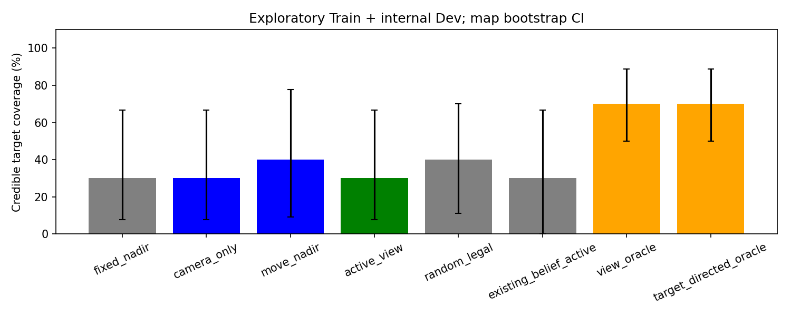
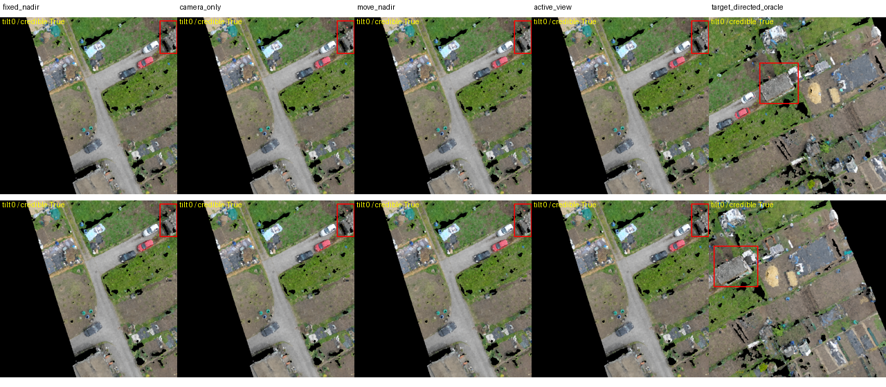

# P3.5 主动视角选择：停止结论

本轮没有训练模型。固定 Internal Dev 中，Active View 的可信目标覆盖为 **1/6**，Fixed Nadir 为 **1/6**，Random Legal View 为 **2/6**。Active−Fixed 为 **0 pp**，地图/family 配对 Bootstrap 95% CI 均为 [0, 0]，未达到预注册 ≥8 pp 且地图 CI 下界 >0 的门槛，也未优于相同预算 Random。因此停止阶段 B 视觉推理，不开展融合、闭环或 Unseen；转入 P4 的公开地标语义绑定审计。

## 协议与样本

从 P3 提交 `043d3897a97af8f35ee60889fa3640f59393c4ad` 建立独立研究分支。4 Train family、6 Internal Dev family，共 10 family、8 地图；以地图分层及确定性哈希选择原缓存中间状态，选择时不使用目标身份、静态错误标签或 RGB 质量。公开起始位姿合法性过滤后 Train 199/256、Dev 98/128 family 可用，过滤的 87 family 未进入本实验，结果不能推广至这些起始状态。

每种方法共享起始状态、原因果历史和两次额外曝光预算。单步 XY≤50m、Z≤10m、AGL 10–100m，公开建筑轮廓约束采用保守路径检查。UAV Yaw 保持独立于 Camera Yaw，Camera Tilt 为 0/20/40/60°。512²、水平 FOV 90° 是本次模拟传感器配置，不宣称具有 CityFlight 真实云台标定。

策略仅接收公开地图、冻结 Geometry Belief、当前位姿及过去已观察 ROI。真实 SensatUrban XYZ/RGB 点云仅供模拟器生成已选定并到达的观测，不供规划器提前查询。颜色为原始点颜色；Depth、遮挡和有效性来自三维投影与 z-buffer，不使用二维变换或生成纹理。Polygon/包围盒实例关联是弱几何标注，不是人工语义分割。

## 实测覆盖

| 方法 | Train 可信目标 | Internal Dev 可信目标 | 合计 |
|---|---:|---:|---:|
| Fixed Nadir | 2/4 | 1/6 | 3/10 |
| Camera-only | 2/4 | 1/6 | 3/10 |
| Move + Nadir | 3/4 | 1/6 | 4/10 |
| Active View | 2/4 | 1/6 | 3/10 |
| Random Legal View | 2/4 | 2/6 | 4/10 |
| Existing Belief-active | 3/4 | 0/6 | 3/10 |
| 有限视角目录 Oracle | 4/4 | 3/6 | 7/10 |

逐 family、FOV、点支持、ROI 像素、覆盖、动作成本及地图/family CI 见 [comparison.csv](assets/active_view_selection/comparison.csv)、[完整指标](assets/active_view_selection/metrics.json)及压缩逐样本预测。仅 4 个 Dev 地图，Bootstrap 不确定性不稳定；[0,0] 仅表示这个小样本中逐样本差值完全相同，不证明总体等效。

全体 10 family 只有 **1 个静态定位错误 family，Dev 为 0**。不能把这些主要已正确定位的目标覆盖率解释为 Goal Recovery，也不能重复 Prefix 凑足 50 个独立错误目标。阶段 B 所需样本覆盖门槛同时不满足。

## 主动策略为什么没有收益

20 个 Active 决策中，18 次与原地俯视效用相同；实际 UAV 移动为 0，18 次俯视、2 次 20° 云台调整。平均未覆盖 Top-8 概率质量为 0.743，全部决策均存在未覆盖候选，所以不能简单归因于“历史已完全覆盖”。公开几何 FOV/像素代理没有可靠表达点云空洞、遮挡、弱实例关联与真实屋顶支持，预测效用倾向维持原视角。

相同两次曝光下，Random 平均 XY 移动 9.6m、Z 调整 8m，Existing Belief-active 平均 XY 41.90m、Z 1m。Active 允许移动但没有选择移动；不能声称充分搜索了连续动作空间。

有限视角目录 Oracle 仅是已评估合法轨迹目录的最优值，**不是全部连续两步动作的全局上界**。另保存预注册的 GT 定向相机/两步靠近 Oracle 实验及其逐样本数据，GT 仅在离线诊断中使用，不进入正常策略。详见 [Oracle 原始结果](assets/active_view_selection/oracle_extra_predictions.json.gz)及 [运行记录](assets/active_view_selection/oracle_extra_execution.json)。这些覆盖证据不能证明唯一实例语义识别，更不能证明安全目标纠错。

## 质量与回归

120 个正常策略决策全部从公开输入及因果历史重新复现；原始缓存 SHA 未变。动作、观察预算、坐标、GT 隔离和相机控制测试通过。全部 **348 项回归测试通过**，包含原有测试；实际缓存帧的原始颜色、Depth、Mask、重投影和裁剪渲染等价性结果见 [geometry_checks.json](assets/active_view_selection/geometry_checks.json)。

运行命令见 [README](../experiments/active_view_selection/README.md)。两次 CPU 性能优化前的中断、配置及部分预测保存在 `runs/active_view_selection/`，未修改队列样本或质量门槛。最终主实验约 682 秒，额外离线 Oracle 约 200 秒；包括早期尝试、实际视角数量和 SHA 的资源统计见 [resource_audit.json](assets/active_view_selection/resource_audit.json)。没有新增 GPU 编码、训练或模型权重。

## 决策

现有点云能在部分合法视角生成有支持的真实目标 ROI，但本次主动策略没有取得预注册覆盖收益，独立错误目标样本也远不足。因此终止当前点云主动多视角路线，不自动训练 RL、视觉网络或导航模型。保存负结果。P4 首先检查语言参考地标是否已可靠绑定、是否确有可独立评估的歧义，以及正确参考绑定是否存在 Goal 纠错上界；不将目标身份识别失败通过增加残差幅度掩盖。
