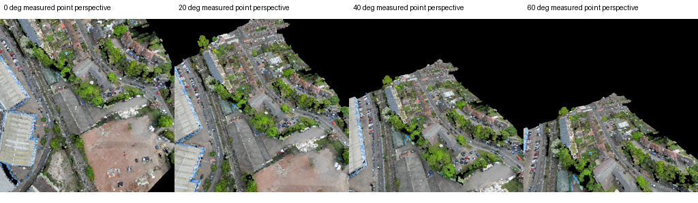
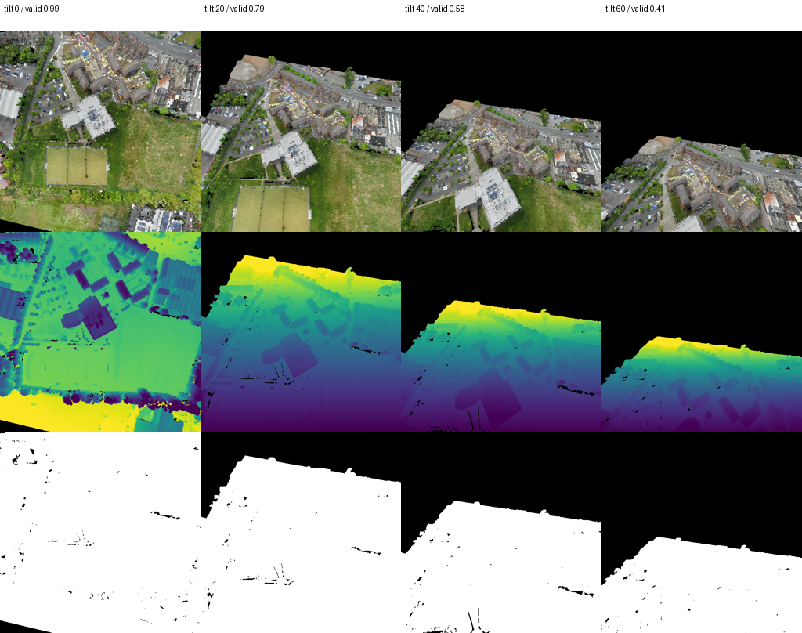
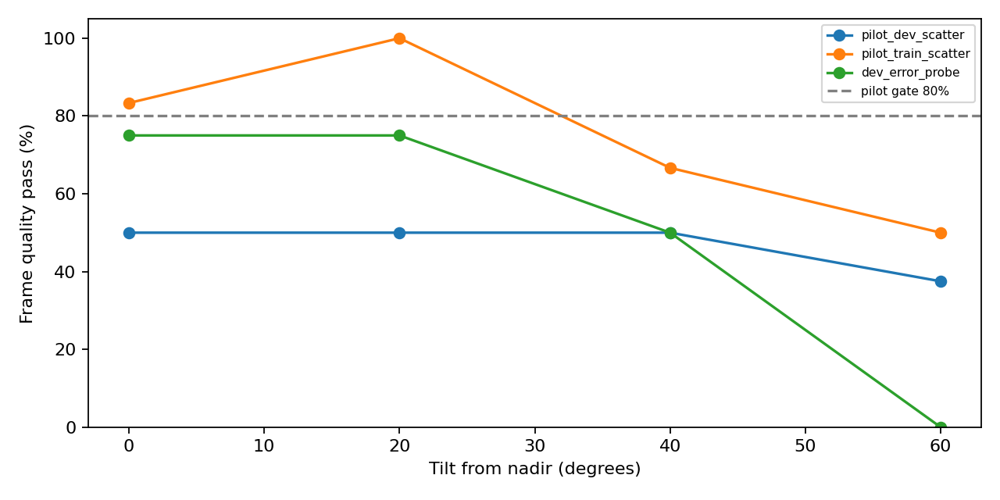

# P3 多视角 RGB–Language Grounding 诊断报告

日期：2026-10-11。起点：`research/rgb-feasibility-20261011` / `62044c124c2a188e15358cd8c412115c04209590`。独立分支：`research/multiview-rgb-grounding-20261011`。

## 结论与执行边界

**完成 P3-A 实际资源检查、真实点云透视渲染，以及有界的 P3-B 冻结模型探索。未证明新增视角具有可靠实例身份增益，停止 P3-C/D/E。** 没有训练 Backbone、Head、GAT、Trajectory/Stop，没有改变 Checkpoint、Gain、弃权阈值、成功半径、原始候选网格或数据划分；没有运行 Seen、Unseen、闭环或正式 Goal Fusion。

SensatUrban 的实测 XYZ/RGB 能生成具有真实透视和点级遮挡的斜视图；部分高空 20° 图像具有可利用的屋顶、街道和立面点。然而当前真实轨迹姿态、测绘边界、点云稀疏性与弱实例关联共同限制了可靠目标覆盖，不能直接构成满足验收要求的多视角数据集。

22 个独立 family / 22 个姿态，实际渲染 144 帧。仅 3 个静态错误 family 在至少一个视角具有可信目标 ROI；严格 Nadir+20° 对照只剩 2 个错误 family、2 张地图，远低于 ≥50 门槛。两种冻结编码器纯 RGB 的完整指令身份匹配均为 **0/2**，双视角没有改善。这是有限样本下的负结果，不能证明所有斜视方法无效，也不能宣称视觉纠错成功。

## 1. 资源可用性、许可与迁移价值

以下区分“元信息/链接可达”“实际数据下载和解码”“模型实际 CUDA 推理”。没有将导航轨迹或普通图文数据称为实例级 Grounding 真值。原始网页快照、下载包及样本保存在本地 ignored runs，公开资产仅保留审计摘要。

|资源|实际验证|标注、视角和迁移价值|许可与限制|
|---|---|---|---|
|[3DG-VLN](https://github.com/xuefanfu/3DG-VLN)|下载 instructions.json：489 条指令；Train 场景元信息：13 场景、2,228 trajectory ID；下载权重索引，16,584,333,312 字节，未下载模型张量/图像全集|前视+下视、三维导航。部分语言含初始方向提示；不能将这些方向提示作为 CityNav 独立视觉证据。不是直接实例 BBox Grounding|HF 数据/模型卡 Apache-2.0；仓库根许可证文件缺失，代码授权需进一步核实|
|[SkyFind](https://github.com/wangkunyu241/SkyFind)|实际读取前 100 行，733 个对象/表达，BBox 均为正面积；下载并解码一张 1080×1920 图片|原生 referring BBox 值得继续，样例以人物为主；没有在检查字段中发现跨视角 Pose/身份。官方约 101.6 万表达/35,599 图，语言扩写不能算独立对象|CC-BY-NC-ND-4.0；不公开重分发转换图片/原始标注。本轮未训练；地理重叠尚未核验|
|[AnyVisLoc](https://github.com/UAV-AVL/Benchmark)|下载真实数据许可；OneDrive 返回门户 HTML，未验证具体数据文件下载|约 1.8 万真实俯视/斜视 UAV 图和 2.5D 参考，适合跨视角可视性审计；不提供已核实的目标语言实例监督|研究/非商业、禁止再分发；第三方卫星/DSM 另有条款|
|[AerialVLN](https://github.com/AirVLN/AirVLN)|直连下载 Kaggle 标注 ZIP：66,720,431 字节，6.76 秒；检查 Train 首条 schema 和小体积文件结构|25 个合成城市场景、AirSim/Unreal 相机控制；字段含起点、旋转、目标、reference_path/actions，检查字段没有实例 BBox。约 35GB 环境未下载或启动|标注包元数据 CC-BY-4.0；仓库根代码许可证未发现；环境/资产不能自动继承标注包授权|
|[TravelUAV](https://github.com/prince687028/TravelUAV)|官方 HF `wangxiangyu0814/TravelUAV` 和 `_env` 可达；未下载大体积环境包|三维模拟导航资源，需部署后验证斜视与对象标签|检查卡片未发现明确许可证，暂不用于训练|
|[Qwen3-VL](https://github.com/QwenLM/Qwen3-VL)|4B-Instruct 配置与索引下载成功；权重总量 8,875,631,616 字节；未下载张量、未推理|值得作为可靠观测条件下的候选验证器；本轮没有其准确率结果|官方模型与代码 Apache-2.0|
|[Grounded SAM 2](https://github.com/IDEA-Research/Grounded-SAM-2)|官方 SAM2.1 tiny 权重 URL HEAD 200；未加载、未推理|检测/分割/跨帧跟踪组件；不能直接等同于空间关系与唯一身份推理|仓库 Apache-2.0，各检测器/模型资产分别核实|

对应仓库 Commit、HF revision、HTTP 结果见 [资源快照](assets/multiview_rgb_grounding/resource_repositories.json) 和 [实际链接探测](assets/multiview_rgb_grounding/probes_corrected.json)。3DG-VLN 数据 revision `f296bbdcf3a3cb4203d973abe5c05714de5c2247`；SkyFind `d03731e406a5450b747c3d88819b0b1e81a4d7b8`；Qwen3-VL-4B `ebb281ec70b05090aa6165b016eac8ec08e71b17`。数据规模为官方说明，下载检查数量单独列出，未把抽样下载称为全集验证。

## 2. CityNav 三维渲染与质量审计

共享 DATA 中的 [SensatUrban](https://github.com/QingyongHu/SensatUrban) 彩色 PLY 只读使用。原始 XYZ 与 CityNav 对象几何直接对齐，没有通过 GT 拟合相机。使用原始 Prefix 的真实 UAV XYZ/Yaw，固定俯仰角 0°、20°、40°、60°，512×512 pinhole、HFOV90°、near0.5m/far400m。此内参是预注册的实验相机设置，**不是已验证的真实 CityFlight 相机标定**。

每帧保存 RGB、轴向 Depth、有效像素 Mask、相机基、胜出原始点 ID、实例投影和统计。Depth 缺失为 NaN；点级 z-buffer 保留最近的实测点，RGB 原样复制。分别检查零半径与统一 1px splat；缺失区域保留 Unknown，不补全立面，不做二维旋转、拉伸或图像生成。遮挡只覆盖实际采集的点，缺失表面不能保证完整物理遮挡。

这些图像是**在已记录当前姿态上新增相机曝光的反事实点云渲染**，不是声称 CityFlight 已经拍摄过斜视 RGB。标准导航协议和原有真实观测缓存保持不变。完整点云仅用于模拟传感器；模型只读取裁剪后的当前可见 ROI。GT 目标身份/坐标用于离线覆盖、错误子集和标签，不决定相机方向、Pose、候选筛选或语言输入。

预注册质量标准：全帧有效像素≥60%；实例框支持≥70%；原生最短边≥16px、实测支持≥64px；1px splat 最大投影误差≤2.13px；试验斜视帧通过率≥80%。2.13 是运行前确定的欧氏 splat 几何界限，没有根据结果放宽。

|采样组|独立 family|实际帧|采样姿态|斜视帧通过率|整体门槛|
|---|---:|---:|---|---:|---|
|Train hash pilot|6|48|原始最早 Prefix|72.22%|失败|
|内部 Dev hash pilot|8|64|原始最后 Prefix|45.83%|失败|
|内部 Dev 错误目标 probe|8|32|原始五个 Prefix 的中间状态|41.67%|失败|

错误 probe 在渲染与编码前固定选择 8 个静态错误 family。GT 仅定义离线错误评估子集，语言中的 building/house/road/parking 类别用于预定抽样限制；没有目标导向运动或调相机。每 family 仅一个姿态，三个组无 family 重复。







必须区分两种黑区：Train 四角度“已测像素凸包内部有效率”约 95.1/95.0/94.6/94.1%，其损失主要来自测绘区域外/有限覆盖；晚期 Dev 约 44.1/46.9/56.5/70.5%，存在明显内部点云空洞。局部实测建筑点 PCA 检查确实发现斜视新增点及 facade-like 点，但这些是几何代理，不是人工立面标签。初始 Dev 2/8 姿态低于附近 1m 内点云表面高度 p95，属于姿态可用性风险，不能单凭此断言碰撞。

88 个半径1质量记录的目标失败归因：视野外38、弱实例关联缺失/歧义17、原生像素或支持不足13、可用11、全帧质量不足7、没有胜出点/遮挡2。Polygon+3D BBox 是弱实例投影，重叠区域标 Unknown，不当作语义分割真值。当前瓶颈同时涉及 FOV、采样密度和关联；不能全部归因于编码器。

全内部 Dev 的几何代理审计有42个独立静态错误 family；40°在历史原始姿态中的中心 FOV 代理覆盖42个，像素尺度代理40个。**这些不是可信 RGB ROI**，不证明≥50覆盖，也不证明没有遮挡。未读取 Seen 做扩大或调参。完整逐样本 QA、family/map 配对 CI 见资产与本地 runs。

## 3. 冻结模型实际匹配

整体渲染门槛失败，正式大规模 P3-B 未启动。为了回答可用斜视是否呈现初步信号，额外固定小规模 Train/内部 Dev 探索协议：同一姿态/共同可信实例，Nadir+20°或四角度交集；最多20个已观测实例按冻结几何分数选取。这里是 **20个已观测实例，不是原A3 Top20 Goal网格**；原28×28网格和完整候选集合未改变，也没有进行 Goal 更新。

同一 scope 下所有模型、视角、Real/Black/Shuffled 完全相同候选。每个实例取 tight ROI；上下文模式统一扩大框25%。多视角使用归一化 embedding 均值；Shuffled 按同类别确定性循环置换且跨视角保持对应。Black 是实际编码黑图；并列分数按均匀随机打破的期望准确率计算，避免 ID 排序伪造成功。未观测目标为 Unknown，四角度没有有效目标时指标为 null。

|组别/模型（完整指令、纯RGB）|可信目标 family|Nadir R@1|Oblique20 R@1|Dual R@1|Hard R@1（Dual）|
|---|---:|---:|---:|---:|---:|
|Train / SigLIP2|1|0/1|0/1|0/1|1/1|
|Train / RemoteCLIP|1|0/1|0/1|0/1|1/1|
|Dev错误 / SigLIP2|2|0/2|0/2|0/2|0/2|
|Dev错误 / RemoteCLIP|2|0/2|0/2|0/2|0/2|
|四角度共同目标|0|不适用|不适用|不适用|不适用|

Train 双视角在同类别子集中命中1/1，但跨全部候选未命中，不能将类别限定检索解释为唯一身份成功。

同批 Geometry-only **实例** R@1：Train1/1、Dev0/2；Dev目标排名5、15。属性短语及上下文纯RGB模式也没有身份Top1命中；保守解析不能支持的属性短语使用回退语言并记录 `phrase_supported=false`，不作为人工属性真值。本实验没有真正的 token–patch 关系推理或 Qwen 推理，不能把扩框称为语言空间关系理解。

Dev 完整指令纯 RGB：Dual−Nadir=0pp，Real−Black=−5pp，Real−Shuffled=0pp；地图配对95%CI分别[0,0]、[−5,−5]、[0,0]pp。仅2张地图，离散/退化 bootstrap 区间不能说明总体确定性。RemoteCLIP 的固定等权 percentile RGB+Geometry 实例排名有 +16.67pp Dual−Nadir，CI[0,33.33]pp；Real−Shuffled=−8.33pp，CI[−16.67,0]pp，包含并列排名的期望分数，**不是成功纠错整数，也不通过独立RGB收益门槛**。

两个 Dev 正例的 SigLIP2 Nadir 原目标排名明显落后（逐样本分数保留）；几何排名已有近邻错误，说明新增信息未被当前冻结图文匹配可靠转化为唯一目标身份。小样本不能判定视觉表征、语言歧义与背景污染的唯一因果。未采用旧 gain=0.025 的2/640 Oracle限制否决新视角；本次失败发生在覆盖与实例识别阶段，尚未进入残差接口。

## 4. CUDA、模型与成本

实际设备：单张 RTX PRO 6000 Blackwell Max-Q 96GB；没有假定双5090。仅执行冻结推理。

|模型|权重SHA256|维度|Dev峰值显存|实际图像编码（含black/context）|
|---|---|---:|---:|---:|
|SigLIP2 Large384|`11bdb3cf00c4dc4f87e437c9c75087ca16fa21aea437b3576c103670ee3c73be`|1024|3.60GiB|481图/5.282秒≈91图/秒|
|RemoteCLIP ViT-L14|`fcc2a7e21e171f4ffcb7a9c0206b8b74ac0c9eb83c67b576958b7a4ed6c8cecb`|768|1.71GiB|481图/1.608秒≈299图/秒|

以上是本次小批量图像编码统计，包含预处理/CUDA同步，不是部署端单候选总延迟；文本、加载、渲染另计。SigLIP2 revision `1b426889ea62b5a72bf9839009a1b184bfc9c178`；RemoteCLIP 官方接口明确 strict-load 官方 checkpoint，OpenCLIP创建骨架时的“randomly initialized”日志不是最终随机模型。

CUDA Smoke 使用真实 Train ROI，finite embedding、维度、范数及来源cutoff检查通过。低精度相对 FP32 余弦：SigLIP2 0.999998、RemoteCLIP0.999874，均超过预注册0.995。全部权重冻结。实际完整渲染耗时：Train785.35秒、初始Dev793.01秒、错误Dev298.88秒；冻结模型完整运行Train28.83秒、Dev16.85秒。没有将 CPU 点云读取/渲染开销计为编码器延迟。

## 5. 验收与下一步

|门槛|本次判定|
|---|---|
|真实3D/投影/点级遮挡|几何一致性通过；总体观测质量未通过|
|≥50可信可见错误family|仅3个至少单视角，双视角2个；失败|
|Dual身份R1 ≥+5pp、CI下界>0|纯RGB差值0pp；失败|
|Real−Black/Shuffled地图CI下界均>0|失败|
|Recovery>Damage、GoalR1+1pp|未运行；不能以0 Damage声明安全|
|Seen SR/SPL、主动观察|未运行|

**停止当前点云大规模造数据、训练与融合/闭环扩展。** 不把该小样本结果写成“斜视一定无效”或“正式停止所有RGB研究”。若继续，最值得优先验证的是可下载真实斜视图上的 **Geometry Top-K + VLM可弃权验证**：先核实真实图像覆盖/唯一身份标签和许可证，再在内部Train/Dev锁定协议；仍必须达到≥50独立错误family、Dual+5pp且CI下界>0、Real相对Black/Shuffled独立贡献，通过后才研究替代融合Oracle和Goal安全纠错。当前不自动下载大模型或启动这条下一阶段路线。

## 6. 可复现性、修复与回归

代码：`experiments/multiview_rgb_grounding/`；预注册：`protocol.json`、`pilot_matching_protocol.json`、`dev_probe_protocol.json`，Seed20261011。全部真实源帧Pose、cutoff、模型SHA、逐样本分数、地图/family bootstrap CI 保存在 `runs/multiview_rgb_grounding/`；小体积可审阅预测、图表、指标保存在 [资产目录](assets/multiview_rgb_grounding/audit_summary.json)。大模型、PLY、geometry NPZ、features.pt 和外部ZIP不提交。

初版诊断误把 `public.grid_xy` 的[0,1]坐标当成世界坐标，造成错误静态错误标记与候选实例筛选；修复为 bounds 反归一化，**640个内部Dev状态错误标记全部逐样本复现P2.5**。弃用初版输出但保留原始文件。实际渲染Pose与图像不受该错误影响。加了坐标回归单测。

初版点云关联/9倍splats过慢，保留中断日志，优化为8m空间索引及逐像素scatter最近点。合成排序一致性通过，30个实际帧RGB/winner/depth与原始实现逐位一致；无补绘或图像变换。其他缺失/失败结果不删除、不当作成功实验。

实际命令（项目根目录，使用既有 remoteclip/.venv python）：

```bash
python -m experiments.multiview_rgb_grounding.resource_audit
python -m experiments.multiview_rgb_grounding.probe_resources
python -m experiments.multiview_rgb_grounding.inspect_aerialvln
python -m experiments.multiview_rgb_grounding.render --help
python -m experiments.multiview_rgb_grounding.quality --output runs/multiview_rgb_grounding/quality_final
python -m experiments.multiview_rgb_grounding.coverage_proxy
python -m experiments.multiview_rgb_grounding.match_pilot --render runs/multiview_rgb_grounding/render_pilot_train_scatter --output runs/multiview_rgb_grounding/matching_train_pilot_world
python -m experiments.multiview_rgb_grounding.dev_probe
python -m experiments.multiview_rgb_grounding.match_pilot --render runs/multiview_rgb_grounding/render_dev_error_probe --output runs/multiview_rgb_grounding/matching_dev_error_probe --allow-internal-dev
python -m experiments.multiview_rgb_grounding.deliver
python -m experiments.multiview_rgb_grounding.geometry_baseline
python -m pytest -q
```

资源首次直连，失败再走环境代理；AerialVLN实际直连成功。完整运行配置及原始日志保留本地，渲染参数和各manifest的source_plan可复现真实样本。依赖复用既有环境：Python3.10.22、PyTorch2.8.0、Transformers4.57.6、OpenCLIP3.3.0、NumPy1.26.4、OpenCV4.10.0；完整版本见 [environment.json](assets/multiview_rgb_grounding/environment.json)。无改动环境安装或旧模型文件。

完整原始渲染命令见实验 README。未另运行语言属性交换、真实检测器/跨帧跟踪、Current+History/主动观察或外部训练，因为总体质量和身份覆盖门槛未通过；这些项目不得按已完成计入结论。

最终回归：**337 passed，1个已有 rasterio PendingDeprecationWarning，7.57秒**。包括原有326项和新增11项；原318项要求无退化。未修改旧GraphNav公共实现。最终Commit SHA以提交后回执为准，避免报告自引用SHA。
