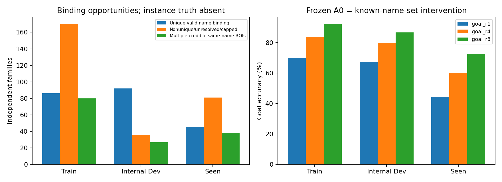
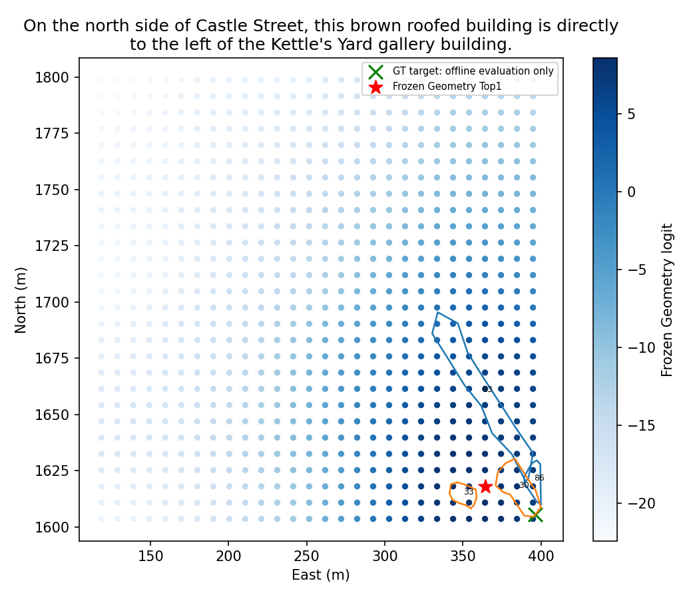
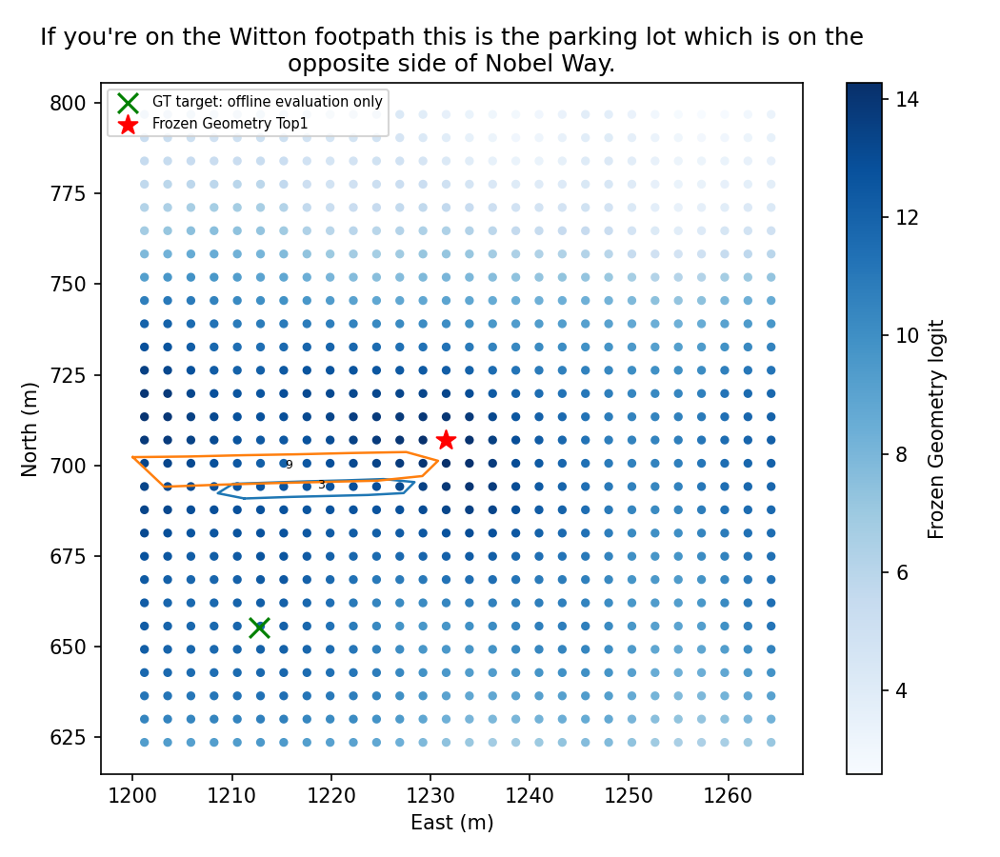

# P4：RGB 辅助语义—地图轮廓绑定审计

## 结论与停止条件

**完成数据审计、冻结 A0 缓存评估及可核验的名称集合 Oracle，停在新模块开发之前。** 不是证明 RGB 没有语义价值，而是现有数据无法独立验证“语言指的是同名候选中的哪个参考实例”。不能用最终目标 GT 的距离替代参考实例真值。

1. 地标名称基本已可解析：完整 Train 的参考名称提及 99.61% 可以解析；完整 Seen 的 3,947 次参考名称提及全部精确匹配。大量非唯一 ID 是道路、人行道和复合地标分片，不代表名称语义需要 RGB 重新识别。
2. 325 个同名名称组中，230 个包含道路与人行道，50 个仅道路，17 个仅建筑。223 组的 Polygon 在接触/交叠关系上构成一个连通分量；这个几何事实不能当作人工实体身份标签。
3. 固定 Seen 128 family 中，81 个有同名候选，但仅 **1 个 family 有多个同名建筑，且两处都有可信历史 ROI**；它的屋顶颜色描述属于最终目标，不是参考 Gallery 的颜色描述。Train/Internal Dev 的对应建筑 family 仅 6/2。
4. `processed_descriptions.json` 共 35,196 条记录，只提供 `target/landmarks/surroundings`，没有逐参考实例 ID。当前**独立可评估的歧义参考实例真值为 0 family**，未达到 ≥50 的首个门槛。
5. A3 已使用同一组弱处理标注中的参考名称，保留所有同名 Polygon。可核验的名称集合 Oracle 与 A0 输入完全一致，Goal 增益 0；**更强的正确参考实例 Oracle 无法评估，记为 null，不伪造 0 或正向结果**。

因此不运行 A2–A5、不训练绑定模块、不新增 RGB 编码，不改变 Geometry、Trajectory、Stop 或 Gain；不执行闭环、Unseen。P3.5 的负结果已先记录于 [P3.5 报告](P3_5_ACTIVE_VIEW_SELECTION_REPORT.md)，并提交推送 `1b85adb90debb911869ab64a08a0ebd2c9fe2a41`。P4 独立分支为 `research/semantic-polygon-grounding-20261011`。

## 数据身份与公开信息边界

| 审计项目 | 实际数量 |
|---|---:|
| CityRefer 地图 | 34 |
| objects 对象 | 26,274 |
| map_name / 字典 key / 实例 ID 一致 | 26,274 |
| 有名称对象 | 1,850 |
| 未命名对象 | 24,424 |
| 几何合法 Polygon | 26,251 |
| 有名称且几何合法 Polygon | 1,838 |
| landmarks.json 命名 Polygon | 1,850 |

`landmarks.json` 与 `objects.json` 的全部命名对象 ID/轮廓一致。以该已有命名地标表作为本轮公开候选白名单；只保留 ID、名称、类型和轮廓，不把其对象描述字段作为推理属性标签。这里“有名称、几何合法、ID 一致”只是结构可靠性，不等于人工核验了颜色、用途或语言指代。

命名对象类型：Building 654、TrafficRoad 718、Footpath 392、Ground 32、Water 15、Bridge 15、Rail 18、HighVegetation 6。Car、Parking 等类型在本表中没有命名实例。没有外部公共地图来源证明的未命名目标轮廓，不能从 `objects.json` 直接加入正常候选来提高定位。

| 信息 | 本轮用途与边界 |
|---|---|
| 指令、公开地图边界、命名地标名称/类型/轮廓 | 公开输入，候选生成和描述解析 |
| 当前 Pose、时间戳、因果历史 ROI、原始观测像素 | 可公开观察，未来帧禁止 |
| 命名实例 ID | 地图关联与审计键，不作为文本或模型数值特征 |
| processed 的参考名称列表 | 现有冻结 A3 使用的弱预处理语言标注；不是本轮开发的在线指令解析器 |
| target object ID、描述索引、目标位置 | 仅离线关联标注、分组和 Goal 评价 |
| 未证明公开的目标轮廓、对象描述中的属性标签 | 不作为 P4 正常候选/属性真值 |
| 正确参考实例身份 | 数据没有提供，保持 Unknown |

处理标注需要通过原始目标 ID/描述索引离线读取。网络不接收这些键，但不能把这种预处理名称列表不加说明地称为“仅从原始指令自动提取”。完整 Train/Seen 分别有 3,028/264 条名称不是字面完整子串，包含别名、修订、拼写等原因；这个统计不能直接断言泄漏，也不能默认均为正确别名。

当前缓存的大量 ROI 来自全部 `objects.json` 的弱几何投影。在每 family 的最终合法历史状态上，Train/Dev/Seen 分别有公开命名 ROI 条目 4,096/2,140/1,972，非白名单标注 ROI 条目 20,625/7,931/10,259。它们是条目数，存在跨 family 重复，不是独立实例数。P4 不将后者偷偷用于公开 Polygon 绑定。

## 名称与语言审计

完整数据只审计 Train Seen / Val Seen，未打开 Unseen 轨迹或目标标签。公共地图元数据审计包含已有 34 个地图。

| 原始 Split | 独立地图—目标—指令 | 全部参考唯一且 Polygon 合法 | 有同名多 ID | 有未解析名称 | 无命名参考 | 未命名关系触发 |
|---|---:|---:|---:|---:|---:|---:|
| Train Seen | 21,878 | 9,388 | 12,269 | 124 | 59 | 3,942 |
| Val Seen | 2,470 | 986 | 1,470 | 0 | 0 | 455 |

类别会重叠，不能相加。Train 名称匹配提及为 exact 33,859、typed 16、fuzzy 62、未解析 132；Seen 为 exact 3,947。typed/fuzzy 沿用原先冻结的别名规则，没有 GT-nearest 匹配。

以下是**全文词汇触发比例**，不是属性语义真值，类别也会重叠。颜色可能属于车辆、目标、参考物或背景，绝不把指令出现 white 当作目标屋顶标签。

| 表达 | Train | Seen |
|---|---:|---:|
| 颜色 | 86.56% | 86.52% |
| 对象类型 | 98.37% | 99.03% |
| 形状/长宽词 | 14.38% | 13.89% |
| 大小 | 18.12% | 16.72% |
| 距离/near/next to | 24.38% | 24.90% |
| 方位/left/right/front 等 | 71.94% | 72.47% |
| between | 18.69% | 19.11% |
| 材质 | 1.55% | 1.78% |
| 至少两个处理标注命名参考 | 48.49% | 51.34% |

未命名关系触发规则保守，可能漏掉 between 的第二个描述或复杂指代；不能据此给所有匿名参考赋身份。Train 唯一的“颜色紧邻名称”触发案例本身仍有指代歧义，例如 Gallery 后的 brown roof building 可能是另一个建筑，因此也不是可用真值。

## 代码审计：参考、目标与实例关联

- `landmark_alias.py` 只按名称、类型兼容后缀及已冻结 fuzzy 规则匹配，保留所有同名 ID，没有按 GT 选择最近者。精确匹配时不会自动消除道路/人行道等同名类型碰撞。P4 不把这些多片区域随机指定为一个正确实例。
- `landmark_projection.py` 根据当前相机 footprint 将世界 Polygon 投影到已观察 RGB；是几何弱 ROI，不是语义分割。已有 crop 保留背景上下文，没有把 Polygon 外像素自动当作可靠背景标签。
- `semantic_geometry.py` 将完整 Polygon 保留为区域实体，TrafficRoad 面轮廓不会冒充中心线。方向、near、along 和两个命名参考的 between 有显式规则；同名参考用 OR/max，未利用 GT 消歧。
- 显式关系依赖已匹配名称；left/right/front、复杂指代、匿名 white church 等不是完整支持的组合解析。固定 Dev 仅 12/128 family 生成显式关系，Seen 24/128，其中 between 分别 1/2。**这不等于 BERT/Geometry 模型完全不会学习关系**，只是当前显式规则覆盖不足。
- `a3_runtime.public_static_record` 通过参考名称取公开命名 Polygon；`target_xy=[0,0]` 是打包占位。`_batch_inputs` 只取几何/语言特征，GT target 不进入模型。未发现本轮静态推理按 GT 目标轮廓直接定位的代码路径。
- 但该 runtime 打包参考时**没有保留公共实例 ID**，构造的 entity ID 因而为空；Polygon 节点仍不同，网络输入不依赖 ID，所以不是直接的目标 GT 混入，却不适合未经补充就做显式 Instance-to-Polygon 后验回传。本轮审计外置保留 ID，没有修改冻结接口。
- 几何距离使用 Polygon 边界，但部分方向/相对特征的中心采用顶点均值，不是面积质心。大型不规则 Polygon 的中心误差可能影响推理；未通过扩大视觉残差处理，也未修改原评估。

完整 Train/Seen 中，目标自身也是命名参考候选的查询为 99/6；固定缓存为 Train 2、Dev 1、Seen 0。这可能是目标名称确实公开，也可能是处理标注角色混杂，必须逐例审查；不能自动称为泄漏或正确参考。正常代码没有读取真实目标 ID 去选择它。

## 冻结定位评估及 Oracle

沿用 P2 的 Train/Internal Dev/Seen 缓存，Train 与 Dev 地图、对象及 family 完全隔离。主结果取每 family 最大因果截止时间，选择只根据公开时间戳；所有 Prefix 另存诊断结果，不增加独立样本量。目标 RGB 不可见也不作为负例。

| Split | Family | 独立目标对象 | 地图 | 全 Prefix |
|---|---:|---:|---:|---:|
| Train | 256 | 242 | 20 | 1,280 |
| Internal Dev | 128 | 85 | 4 | 640 |
| Seen | 128 | 107 | 23 | 640 |

Protocol 在固定 Seen 回放前写入，未按 Seen 更改阈值、配置或模型。保留 784 个原候选网格、20m XY 定位成功阈值和原排序规则；这里只是离线 Goal 评价，不是导航 SR。

| Split | A0 Goal R@1 | R@4 | R@8 | NE (m) | A1 名称集合 R@1 | Recovery / Damage / Net |
|---|---:|---:|---:|---:|---:|---:|
| Train | 69.92% | 83.59% | 92.19% | 18.36 | 69.92% | 0 / 0 / 0 |
| Dev | 67.19% | 79.69% | 86.72% | 21.00 | 67.19% | 0 / 0 / 0 |
| Seen | 44.53% | 60.16% | 72.66% | 33.98 | 44.53% | 0 / 0 / 0 |

**A1 在这里仅是“标注提供的名称集合不变”的身份干预回放**。512 个独立公开查询的名称、类型、别名和归一化轮廓全部与原 A3 输入逐项核对一致，因此复用原模型 logits，不重复推理。它不是选对具体同名参考建筑的强 Oracle。名称集合干预的配对 Goal 差值及 Recovery/Damage 的地图/family 95% CI 均为 [0,0]，是相同输入的必然结果，不是有效视觉纠错。

全部参考唯一且 Polygon 合法的 family 为 Train 86、Dev 92、Seen 45，其中仍有定位错误 27/29/27。至少这些错误不能简单归因于“同名实例没有唯一选择”。这里唯一性仅在名称标注层面成立，不宣称通过人工视觉审核。

| 可疑绑定子集 | Train family / 错误 | Dev family / 错误 | Seen family / 错误 |
|---|---:|---:|---:|
| 同名/未解析/16参考上限 | 170 / 50 | 36 / 13 | 81 / 43 |
| 同名候选至少两个可信历史 ROI | 80 / 24 | 27 / 11 | 38 / 23 |
| 多个同名建筑且可信可见 | 2 / 1 | 2 / 1 | 1 / 1 |

可信 ROI 统计使用原缓存合法因果 ROI、Depth 支持≥0.9、原生最小边≥16px，仍是弱几何证据，不是语义正确性。16 参考上限截断的 family 为 Train 2、Dev 1、Seen 2；只有 Seen 的两例静态错误。这个容量现象是诊断事实，不通过修改上限改变本轮协议。

### 理论空间必须分层

**纯名称解析修复**在固定 Seen 没有未解析名称，已经匹配的名称集合保持不变时理论新增收益为 0。没有必要重新用 RGB 识别所有明确命名地标。

如果极度乐观地假设“同名/未解析/截断子集里的每个静态错误都能纠正且没有 Damage”，则绑定敏感子集的**资格计数上限**为 Train +19.53pp、Dev +10.16pp、Seen +33.59pp。对应地图 Bootstrap CI 为 [+13.90,+25.60]、[0,+16.05]、[+25.56,+42.42]pp。它只统计哪些错误被允许改变，不证明有正确绑定可选，也不是实际 Anchor Oracle 成绩。

扩大到匿名参考触发的资格计数为 +22.27/+11.72/+37.50pp；规则会漏指代，因此它更不是全局 RGB 收益上界。**这些乐观计数不能满足 Oracle 纠错空间验收。** 正确参考实例标签缺失，强 A1 的 R@1/Recovery/Damage 均为 null；禁止按 GT 目标选择最近参考、禁止将不同理论约束直接冒充冻结模型结果。

## 为什么不运行新 RGB 与联合模块

A2 Geometry Joint、A3 RGB Attribute、A4 RGB+Geometry、A5 Black/Shuffled 均记为 **未运行**，不是 0 分。原始 Polygon ROI、前景剔除、HSV/Lab、冻结 SigLIP2/RemoteCLIP 及新概率 Shape Prior 的正式比较也未启动。

原因是当前绑定评估没有可核验的参考实例标签，颜色多数只属于最终目标。同一名称的多片道路或一个 Gallery 建筑群可共同构成正确参考，不能强行构造唯一正例。现有对象自己的描述可产生弱颜色标签，但不能因此知道另一条导航指令指的是哪个参考 Polygon；也不能将 Polygon 掩码作为人工屋顶分割。

保存的候选包含公共实例 ID、类型、名称、面积、旋转长宽比、方向、位置、真实历史可见性。名称集合的概率均匀，仅表示未消歧；语义实例后验与 RGB 属性置信度均为 Unknown。**这不是已训练的 P(o|l,I,G)**，不会覆盖原 Geometry Belief。

没有公开目标 Polygon 时，本轮保持原冻结 Geometry 热图；不把私有目标轮廓加入候选、不伪造精确 Polygon。后续只有在绑定门槛通过后，才值得开发类型/尺度/关系组成的弱概率区域先验。

## 失败案例与可视化

下图只绘公开参考 Polygon 和原 Geometry 分数；绿色 GT 点仅作离线评价，不参与绑定或产生目标轮廓。候选名称、概率和像素支持均保存在逐 family 文件。

Seen 的 Kettle's Yard Gallery 有两个命名建筑 Polygon；指令中的 brown roofed building 是最终目标，不能把 brown 绑定为 Gallery 的标签。Dev 的 17 Mill Lane 有六个命名建筑，另一条指令指向其停车场中的 silver car；同名建筑群并不自动成为六选一语义任务。

唯一参考绑定仍出现错误，说明还需区分语言关系、目标尺度、方位指代和 Geometry 推断误差。完整失败案例见 [failure_cases.json](assets/semantic_polygon_grounding/failure_cases.json)。

## 资源、测试、交付与下一步

初次实际审计/统计约 **41.3 秒 CPU**，没有 GPU 训练、视觉编码或新观测。模型不变，A3 SHA 为 `9d9be861bf7e9cac986d747867990de3d409ccb9bc1545862d71a620448380d7`。最终执行耗时、输入缓存 SHA、协议 SHA、数据来源和跨划分隔离检查见 [运行记录](assets/semantic_polygon_grounding/execution.json)、[输入等价核验](assets/semantic_polygon_grounding/oracle_input_equivalence.json)。

最初一次执行因关键字命名语法错误未启动审计。随后与旧 P2 基线逐样本核对发现，负号排序的稳定并列顺序与原先升序后反转不同，影响 1 个 Seen family 的 NE（不改变 Seen R@1）；Train 有 1 个 family 的 R@1 受并列影响。已修正为原有排序实现，最终派生统计计算约 **43.4 秒 CPU**，核对全部 640 个 Seen 状态的 Top1、R@1/4/8 和 NE；修正前结果完整保存在 `runs/semantic_polygon_grounding_before_rank_parity/`。这是保持旧协议的实现修复，没有按 Seen 选择模型、阈值或增益。

**355 项回归通过**，包含原有 348 项及新增 7 项：同名候选保留、GT 坐标不能影响参考选择、命名/匿名描述隔离、无效轮廓、原 Grid/成功半径/排序、几何不读取目标位置。报告图为现有数据离线诊断，未改变任何模型输入。

复现命令见 [README](../experiments/semantic_polygon_grounding/README.md)。`runs/semantic_polygon_grounding/` 保存完整原始查询审计、全部 Prefix/逐 family 候选与排序、配置和日志；大型源数据不提交。仓库提交 [汇总指标与 CI](assets/semantic_polygon_grounding/metrics.json)、[比较表](assets/semantic_polygon_grounding/comparison.csv)、逐 family 压缩预测与代表案例。

**下一步唯一值得先验证的最小事项：补充真实参考实例评估，而不是训练网络。** 在合法公开命名 Polygon 与真实因果俯视观测之间，审核原始指令确实存在语义歧义的参考描述；允许多 Polygon 共同为正例，保留无法确定的指代。必须有 ≥50 独立 family，不能靠切分一个命名道路或重复 Prefix 凑数。先运行真参考绑定 Oracle；只有能提供明确 Goal 纠错空间，才开发保留联合假设的轻量概率绑定。之后仍要求绑定提升≥5pp且配对 CI 下界>0、Real−Black/Shuffled 地图 CI 下界>0、Recovery>Damage、Goal≥+1pp且地图 CI 下界>0。

当前证据支持把 RGB 作为辅助验证候选，不支持已证明其能通过语义绑定改善最终定位。停止本轮新模块及训练，保留未知和负结果，不通过增大残差、改 Split 或制造单一身份标签继续推进。
