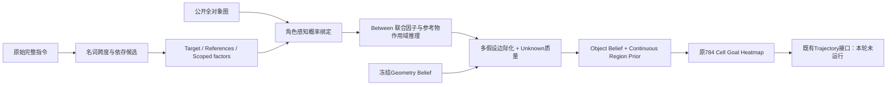
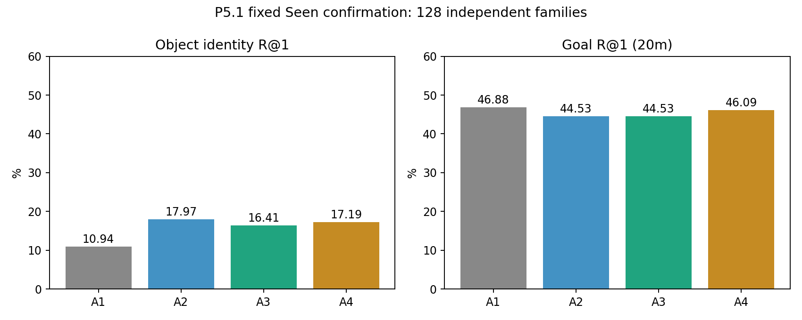
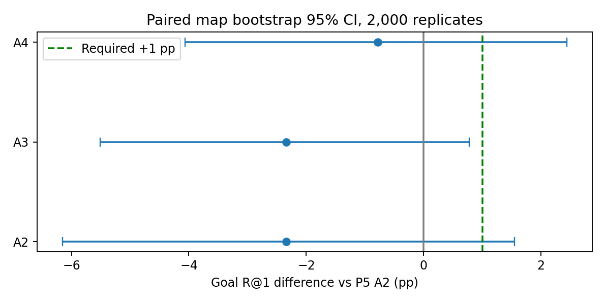
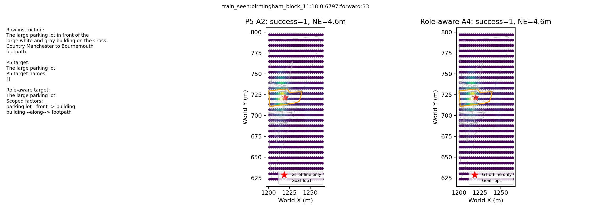
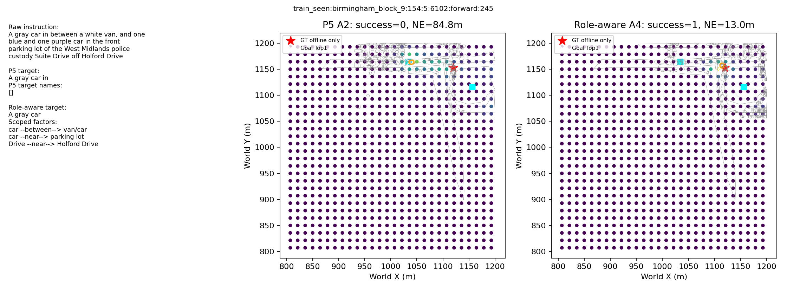
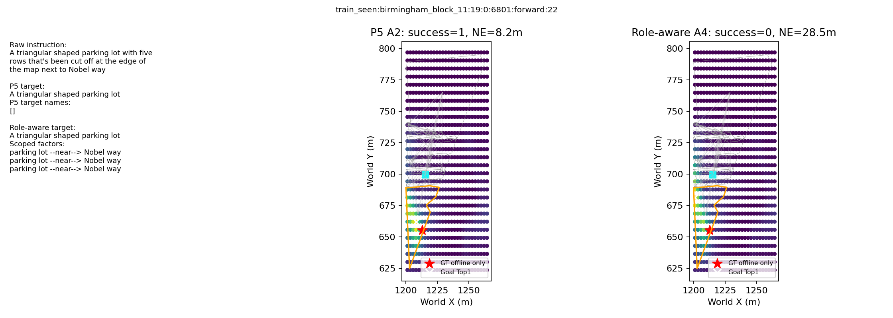

# P5.1 — Role-aware Language–Object Graph Grounding

日期：2026-10-11。源分支 `research/language-object-graph-20261011`，源提交 `2cf62d2ac1f4cb8fe607af99ba781b3e4fde35e5`；独立开发分支 `research/role-aware-object-graph`。本报告为真实缓存推理和离线评估结果，不是计划或训练 Loss。

## 结论及停止判定

Target/Reference 混淆确实存在，修复后对象级身份排名改善，但不足以改善最终 Goal 定位。Seen 128 个独立 family 中，A2 Object R@1 从 10.94% 提升至 17.97%（+7.03 pp，地图配对 CI [+1.49, +12.70] pp）。最终 A4 Goal R@1=46.09%，低于 P5 的 46.88%（−0.78 pp，地图 CI [−4.07, +2.44] pp）。相对 P5 直接纠正 3、误伤 4、净纠正 −1；定位门槛未通过。

不继续训练 GAT、RGB、Trajectory/Stop，不运行闭环或 Unseen。文本审核尚未经独立人工复核，因此也不宣称阶段一正式通过。保留修复实现、负结果、逐样本记录和所有历史 Checkpoint。对象级改善不能替代定位验收。

## 输入、划分与预注册

复用 34 张地图的 26,274 节点 / 543,308 有向边公开对象图。节点类型、名称、轮廓、位置、面积、方向、形状公开；目标 ID 只用于离线关联/评估，不进入语言解析或可学习特征。正常输入严格为 raw instruction + public graph + `static_logits, grid_xy, bounds, pose_world`，拒绝额外 GT 字段。`processed_descriptions.json` 仅由独立准备脚本依据离线 sealed label 读取，不传入 forward。GT 坐标不用于选择角色、关系、方向或参考物。

只用既有 P2 plan 的每 family 最大合法 cutoff 状态：Train 256 family / 242 object / 20 map，Internal Dev 128 / 85 / 4，Seen 128 / 107 / 23。对象数按 map+ID 去重；五个 Prefix 不被重复视作独立样本。保持原 784 Cell、28×28 接口和 20m 成功半径。原冻结 Geometry 的候选 Logits 原样复用，不修改导航控制器。

Seed=20261011；每项指标保留 family/map 聚类 2,000 次 Bootstrap，配对比较使用相同样本。四张 Dev 地图的置信区间不稳定，不作强推广解释。该限定缓存子集不代表完整 CityNav 性能。

开发前冻结 `protocol.json`：比较规则名词跨度解析和冻结依存模型；权重只从 {0,0.25,0.5} 在 Dev 选择，以 R@1、少 Damage、小权重排序。实际 backend 的弱角色得分相同，按规则优先打破平局；协议文字原写弱分后比较 Goal，规则的 Dev Goal 也不劣于依存，选出方案一致，此实现细节透明记录。最终 A2 weight=0，A3/A4 weight=0.5，backend=rule；0 权重是 Dev 安全回退，不是有效纠错。Seen 仅在配置 SHA 冻结后进行一次五组主实验确认。此前 P5 已查看 Seen，故本次不是全新盲测，可能存在历史探索性影响。诊断控制在读取新 Seen 结果前声明，不用于再次选参数。

## 实现架构

Target 由局部名词实体识别，类型/颜色/形状/大小仅属于该实体；公开命名地标只在它自己的跨度匹配，不能把整个指令出现的名称赋给 Target。完整原始指令保留，每个实体输出 span/head_span、角色和属性，每个关系输出 subject、anchors、trigger span、scope probability、参考系假设。

A2 只修复角色，仍将因子主体归到 Target；A3 按局部/依存作用域把参考物间关系作用于参考分布，再推断目标。Between 对多个不同实例联合评分，不能拆成两个 Near。Reference 候选最多 12 个、组合最多 144；两次同步参考更新从固定 unary 重新计算，避免重复累乘同一证据。目标对象后验与连续空间先验各占一半，不强行把目标压进 Polygon。它是有限候选的近似显式推理，不是精确全图推断；目前未双向完整求解所有关系。

A4 最多保留 8 个目标/作用域组合；剪掉的概率质量退回 Geometry，不能归一化成确定。左右/前后保留 world/current-UAV/opposite-UAV 等假设，GT 不选择方向。Unknown 或没有支持的语义/关系时 Heatmap 保留原 Geometry。公开类型/大小支持仍可影响已解析样本，因此角色正确不保证参考实例正确。

未训练任何新参数。现有 RGB、GAT、Geometry、Trajectory/Stop 保持冻结；不把无视觉输入的本轮结果称为 RGB 收益。

## 语言解析能力与证据边界

实际比较规则与 spaCy `en_core_web_sm` 3.8.0（冻结统计依存解析，非大型生成模型）。官方模型独立环境加载；没有微调。40 条 Dev 原始复杂指令在查看预测前由单个分析者仅凭文本标记。它们可逐条审核，但并非独立人工真值，不能据此认证完整 Target/Reference ≥90% 门槛。下面角色数字主要检查目标名词跨度，参考角色另由弱名称指标检查，不是完整实例身份真值。

|方法|目标跨度角色正确|关系作用域正确|Unknown|多角色/作用域假设|
|---|---|---|---|---|
|规则|39/40=97.50%|22/24=91.67%|1/40|22/40|
|冻结依存辅助|39/40=97.50%|23/24=95.83%|1/40|22/40|

全部 40 条都在角色分母中，包括 Unknown。作用域只标了 24 个可文本核查的关系，**不是所有指令/所有边的完整准确率**，不能忽略未标或复杂关系。合成回归句仅用于正确性测试，不纳入上述数据准确率。依存方法的局部作用域略好，未显示更好的完整 Goal，最终仍选规则。

Dev 自动弱监督：目标公开类型 122/128=95.31%；原文精确出现的弱参考名称 127/128 occurrence 被分到 Reference，条件准确率 99.22%。完整名称分母为 168，只有 125 个名称字面出现，43 个未字面出现，不能把 99.22% 当作全部地标绑定成功率。Train：407 个声明名称，361 字面出现、46 非字面、387 occurrence。私有 processed 名称也可能与公开别名不同，不能用其推理时补全别名。

|全分母解析统计|Train256|Dev128|Seen128|
|---|---|---|---|
|Target Unknown|3|1|2|
|多 Target 假设|16|2|6|
|多作用域假设|185|86|88|
|多参考系假设|104|52|45|
|没有关系因子|11|13|6|
|含 across/opposite 词（当前未完整支持）|40|12|25|
|含序数词（当前未完整支持）|22|6|17|

上述 Unknown 只指输出显式弃权，不代表其他成功解析都语义正确。属性并列、roof 属性归属、代词指代、跨道路/序数、公开名称别名与匿名参考实例仍是明显缺口。例如 “white and gray building” 局部跨度可能仅保留 gray，不能据高角色准确率宣称属性已完整理解。

## 原始角色混淆的数量与因果影响

用离线目标 ID 仅检查 P5 原 Target.named_ids 是否包含正确目标：

|Split|P5 Target 被赋名称|名称排除真实目标|同时 P5 Goal 错误|仅清理错作用域名称后的纠正/误伤|Goal差值（pp）及地图CI|
|---|---|---|---|---|---|
|Train256|93|92|36|7/2|+1.95 [0.00,+4.21]|
|Dev128|30|30|17|1/0|+0.78 [0.00,+2.00]|
|Seen128|45|45|26|2/1|+0.78 [−1.60,+3.20]|

“同时错误”是关联数量，不是全都被角色混淆造成。额外纯名称干预保持 P5 类型、尺寸、关系因子、Geometry、weight=0.5 完全不变，仅由原始名词跨度移除不属于 Target 的名称；GT 不决定删哪个名称。Seen 只纠正 2、误伤 1，因此可直接证明部分名称作用域有害，却无法把全部 26 例都归因于它。完整角色和作用域修复还改变局部属性与关系建模，所以不以完整 A4 的差值当成纯角色因果效果。

## 固定定位消融

A0 为原冻结 Geometry；A1 为 P5 原 A2；A2 为角色修复；A3 为 scoped single；A4 为多假设。表内 Recovery/Damage **直接相对 P5 A1**，而原逐样本 `metrics.recovery/damage` 定义相对 A0，`analysis.json` 同时保存两种口径。原 A0 没有原生 Object Belief，日志中的对象数值仅为明确标注的 P5 shadow probe，此处写 N/A。

### Train

|方法|Object R@1/4/8 (%)|Goal R@1/4/8 (%)|NE (m)|Recovery / Damage / Net（相对 P5）|
|---|---|---|---|---|
|A0|N/A|69.92 / 83.59 / 92.19|18.36|11 / 4 / 7|
|A1|17.19 / 52.34 / 70.70|67.19 / 82.81 / 91.02|19.42|0 / 0 / 0|
|A2|30.86 / 66.41 / 80.08|69.92 / 83.59 / 92.19|18.36|11 / 4 / 7|
|A3|32.03 / 65.62 / 81.25|70.70 / 83.98 / 91.02|18.35|13 / 4 / 9|
|A4|32.81 / 66.02 / 81.64|70.31 / 83.98 / 91.02|18.58|12 / 4 / 8|

### Internal Dev

|方法|Object R@1/4/8 (%)|Goal R@1/4/8 (%)|NE (m)|Recovery / Damage / Net（相对 P5）|
|---|---|---|---|---|
|A0|N/A|67.19 / 79.69 / 86.72|21.00|3 / 5 / -2|
|A1|29.69 / 71.09 / 78.12|68.75 / 79.69 / 85.16|19.72|0 / 0 / 0|
|A2|39.06 / 74.22 / 85.94|67.19 / 79.69 / 86.72|21.00|3 / 5 / -2|
|A3|39.06 / 76.56 / 84.38|70.31 / 80.47 / 86.72|18.24|5 / 3 / 2|
|A4|39.84 / 75.00 / 85.94|69.53 / 80.47 / 86.72|18.31|4 / 3 / 1|

### Seen：冻结后一次确认

|方法|Object R@1/4/8 (%)|Goal R@1/4/8 (%)|NE (m)|Recovery / Damage / Net（相对 P5）|
|---|---|---|---|---|
|A0|N/A|44.53 / 60.16 / 72.66|33.98|2 / 5 / -3|
|A1|10.94 / 44.53 / 60.94|46.88 / 64.06 / 75.78|32.34|0 / 0 / 0|
|A2|17.97 / 51.56 / 66.41|44.53 / 60.16 / 72.66|33.98|2 / 5 / -3|
|A3|16.41 / 51.56 / 66.41|44.53 / 62.50 / 74.22|33.87|1 / 4 / -3|
|A4|17.19 / 51.56 / 67.19|46.09 / 63.28 / 74.22|32.55|3 / 4 / -1|

Seen A4 相对原 Geometry A0 为 Recovery6、Damage4、Net2（+1.56 pp），但净改善地图 CI [−3.13,+6.72] pp；不能因点估计超过 +1 pp 就判定通过。相对用户指定的 P5 A2，A4 为 Recovery3、Damage4、Net−1，明确不通过。

|Seen 相对 P5|Object R@1 差值 / 地图95%CI（pp）|Goal R@1 差值 / 地图95%CI（pp）|Goal Family95%CI（pp）|
|---|---|---|---|
|A2|7.03 / [1.49, 12.70]|-2.34 / [-6.16, 1.55]|[-6.25, 1.56]|
|A3|5.47 / [0.00, 11.19]|-2.34 / [-5.51, 0.78]|[-6.25, 0.78]|
|A4|6.25 / [0.00, 12.98]|-0.78 / [-4.07, 2.44]|[-4.69, 3.12]|

A2 weight=0 导致 Goal 与 A0 完全相同，Object Belief 则改善；这反映 Dev 选出的安全弃权，不是成功接入定位。A3/A4 Train、Dev 相对原 Geometry 没有系统性总体退化，但 A2 Dev 相对 P5 下降 2 个 family，全部负变体保留。对象身份最高仍不足 18%，参考物正确实例未人工核实，不足以进入学习式图/RGB融合。

## 多假设是否优于单一绑定

相同 alpha=0.5 的 A3 与 A4：Train R@1=70.70% vs70.31%，Dev70.31% vs69.53%，Seen44.53% vs46.09%。Seen +1.56 pp 的地图 CI [−1.53,+4.58]、family CI [−1.56,+4.69] 均跨零；Dev反而下降，因此没有稳定优势。

同 alpha 且同保留/弃权概率质量的 `A4_damped_single`：Train70.31%、Dev70.31%、Seen44.53%。Seen A4仍高1.56 pp，表明这两个增益案例并非仅靠额外弃权，但统计不显著、Dev不支持。控制只用于归因，不能用 Seen 替换已冻结的正式方案。

## 真实案例与失败分析

以下为真实 Dev 指令、公开对象图/Polygon、旧/新784 Cell热图；红星GT仅用于离线展示，白叉为Top1、橙色Polygon为Top对象、青色为解析到的命名参考。局部图边从既有稀疏图抽样绘制，不生成新地图。所有参考概率和解析保存在逐样本缓存。

案例元数据和全部文本审核失败在 `assets/role_aware_object_graph/cases.json` 与 `parse_failures.json`。即使 Target 名词正确，匿名 Building/Car/Parking 多实例仍有歧义；公开名称与道路长名称不精确相同可能无法绑定。Reference-reference 作用域、语义属性并列、参照系和连续目标位置不可由简单名词角色修复解决。节点最高身份准确率低，热图额外先验可能把正确 Geometry 拉向语义相似实例，这解释“Object排名改善但Goal无显著收益”。没有独立参考身份真值时，不能断言所有剩余损失来自某一个模块。

## 环境、成本、回归与复现资产

Python3.10.22 / torch2.8.0+cu128 / NumPy1.26.4；全程CPU推理，新增可训练参数0，GPU训练时间0，新增GPU峰值显存0。Geometry缓存对应冻结权重SHA `9d9be861bf7e9cac986d747867990de3d409ccb9bc1545862d71a620448380d7`。公开图全部复用，没有覆盖旧结果。

NLP独立venv：spaCy3.8.7，官方 `en_core_web_sm`3.8.0，[模型官方文档](https://spacy.io/models/en/)、[官方release](https://github.com/explosion/spacy-models/releases/tag/en_core_web_sm-3.8.0)。模型许可证MIT，wheel SHA `1932429db727d4bff3deed6b34cfc05df17794f4a52eeb26cf8928f7c1a0fb85`。先直连下载成功；初次导入缺少click，仅在隔离venv补装click8.1.8，未修改主环境。冻结小模型是语言解析对照，不声称完成大型LLM研究。

Train/Dev全部两种backend×三种方法×三个权重及两基线真实运行共201.56s；Seen主确认20.76s，含统计开销。NLP批量导出Train/Dev/Seen分别0.588/0.263/0.234s（不含初始加载）。Seen平均CPU单例A1/A2/A3/A4为4.64/11.38/10.56/29.10ms，P95为14.01/24.72/19.88/104.47ms，含解析与推理；A0 shadow probe冷启动开销不代表Geometry Backbone时延。没有重跑视觉编码；这些数字不能当作完整导航延迟。图表首轮在analysis.json尚未写完时启动而失败，待依赖完成后重跑成功；只重绘，不重评Seen。

全回归 **388 passed，1条既有rasterio仿射测试NotGeoreferencedWarning，7.91s**；包括此前376项及新增12项。验证名称角色隔离、局部属性、嵌套作用域、三元Between、多参考系、Unknown保留Geometry、概率裁剪、依存文本一致性、GT输入拒绝与784候选有限数值；没有退化既有测试。

实际命令见 `experiments/role_aware_object_graph/README.md`。完整本地结果：`runs/role_aware_object_graph/`（public_texts、独立weak_roles、官方dependency caches、全部训练/Dev变体、固定Seen、匹配控制、纯名称干预）。每条预测含sample/family/map/cutoff、实体/factor/假设、全部对象ID关联及概率、参考候选分布、全部784 logits/排名、离线GT与指标、耗时。`analysis.json` 包括分地图/类型统计、所有指标的map/familyCI、直接相对P5的纠正/误伤；`comparison.csv` 可直接核对汇总。小型完整统计、配置SHA、环境、文本审计与图表已版本化；大型缓存/NLP权重留本地。

提交与Push验收的实际SHA由提交后本地 `runs/role_aware_object_graph/commit.json` 和最终交付消息记录，避免在报告中伪造自引用SHA。仅推送独立P5.1分支，源P5分支及main不变。

## 四个问题的明确回答

1. **角色混淆造成多少错误？** Seen45例错误Target名称，26例与P5定位错误共同出现；严格只清理名称的干预恢复2、误伤1。可证明部分因果影响，无法把26例全部归因于角色。
2. **Object Belief是否改善？** 是，A2 Object R@1 +7.03pp且地图CI下界为正；但精确身份仍只有17.97%，最终A4 Goal相对P5下降0.78pp，无安全定位增益。
3. **多假设是否优于单绑定？** Seen点估计+1.56pp，匹配弃权控制后仍在，但CI跨零且Dev下降；不能宣布稳定优于单绑定。
4. **是否继续GAT/RGB？** 当前不值得进入训练或闭环。最值得下一步做的是独立人工核验新的Train/Dev目标名词、完整关系作用域和参考实例，针对并列属性/序数/跨道路/匿名参考做最小解析修复。必须重新预注册、使用未用于当前Seen选参的新确认集；只有独立角色≥90%、完整作用域≥85%，且相对非GNN基线Goal≥+1pp/mapCI下界>0、Recovery>Damage后，才讨论GAT和动态RGB。当前实现作为可审计语言工具保留，不以角色高分替代导航证据。
