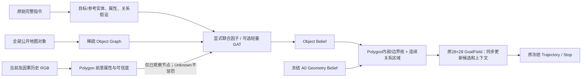
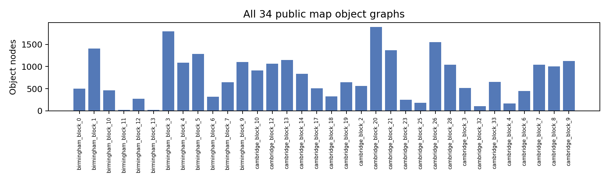
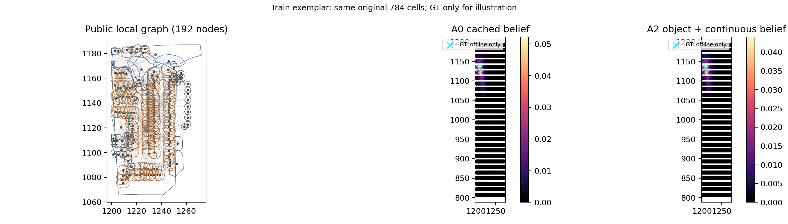
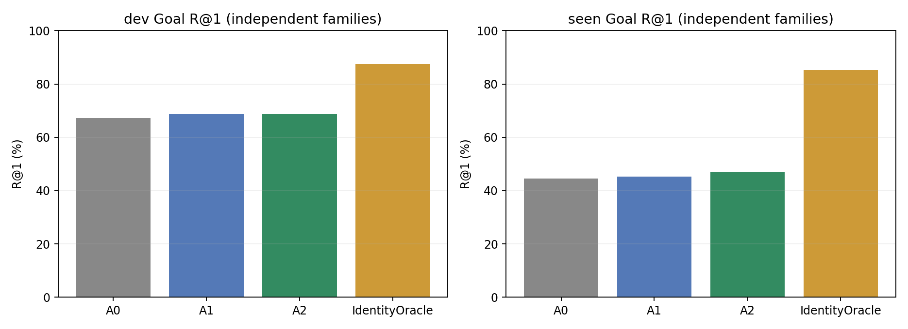
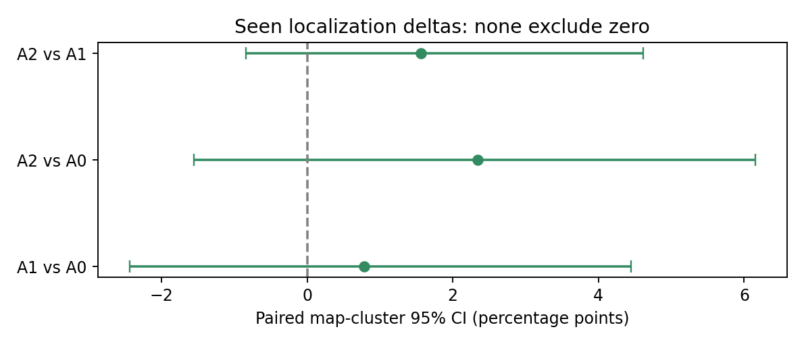
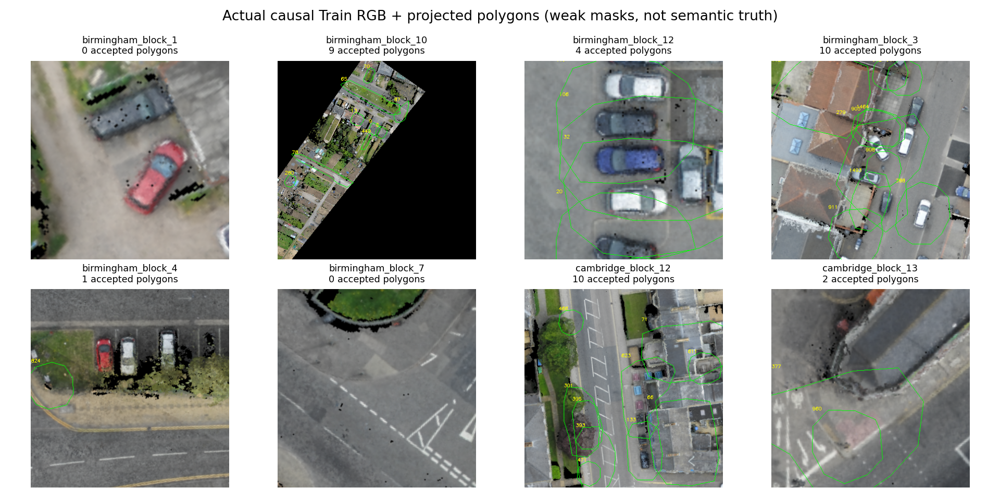
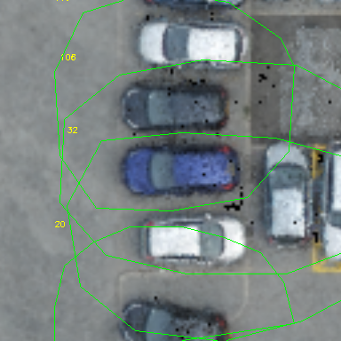

# P5：Language-guided Object Graph Navigation 实验报告

日期：2026-10-11。分支：`research/language-object-graph-20261011`，基于 P4 提交 `4c5449bae8084acb9d956dc62e95ba0b78aea01c`。

**结论：全对象几何与显式关系获得了小规模正向 Goal 均值，但未获得统计支持。固定 Seen 中 A2 R@1 为 46.875%，相对冻结 A0 的 44.53125% 提升 2.34375 pp；地图级配对 95% CI 为 [−1.5507, +6.1550] pp。纠错 5 个、误伤 2 个，未达到“CI 下界 >0”的门槛。停止后续 GAT/RGB 训练、闭环及 Unseen。不能据此宣布图推理或 RGB 已改善导航。**

同时发现显著的语言角色绑定问题：Train 中 93 条解析将公开名称放入“目标”实体，仅 1 条名称候选包含真实目标；Dev 为 0/30，Seen 为 0/45。类型识别大体正确，参考名称与目标角色却经常混淆。该诊断使用 GT 身份作离线核验，正常模型不读取它；没有根据 Seen 修正解析器或选择新配置。当前实现应保留为失败基线，不能直接升级为导航模型。

## 1. 四个问题的回答

1. **完整 Polygon 对象图能否改善定位？** A1 Seen +0.78125 pp，A2 +2.34375 pp，均未获得正向地图 CI 支持。公开对象身份 Oracle 显示可利用的几何空间很大，正常语言绑定尚未可靠兑现。
2. **多地标关系是否更有效？** A2–A1 Seen +1.5625 pp，地图 CI [−0.8403, +4.6154] pp；Dev 差值为 0，Train −1.953125 pp。不能认定有稳定额外收益。
3. **GAT 是否带来额外提升？** 未训练、未做性能评估。单层语言条件 GAT、同输入无消息传递对照及训练代码已实现并通过梯度测试；A2 的 Dev 门槛失败，按协议停止。
4. **RGB 节点属性是否进一步纠错？** 未做 A4/A5 性能评估。因果属性更新、Polygon/侵蚀前景、HSV/Lab、冻结编码器与 Black/Shuffled 控制接口已实现；仅运行独立 Train 工程检查。不能把“未启动”解释成“RGB 效果为零”。

## 2. 输入权限、样本和固定协议

P5 的新输入协议明确允许全部 **26,274** 个对象的公开 `contour/position/dimension/object_type/name`；这与 A0 的命名地标协议不同。对象 ID 只用于图节点、观测和评价关联，不进入可学习特征、语言描述符或 ID embedding。所有 `descriptions`、目标 ID/坐标、未来帧及 processed reference-name 标注均从新推理路径隔离。

A0 完全复用冻结 Geometry A3 的缓存；这里“原模型 A3”与实验表的“A3=GAT”是不同称谓。原 Checkpoint SHA256：

`9d9be861bf7e9cac986d747867990de3d409ccb9bc1545862d71a620448380d7`

| 数据 | 独立 family | 独立目标对象 | 地图 | 原缓存 Prefix 状态 | 本轮主评价状态 |
|---|---:|---:|---:|---:|---:|
| Train | 256 | 242 | 20 | 1,280 | 256 |
| Internal Dev | 128 | 85 | 4 | 640 | 128 |
| Seen | 128 | 107 | 23 | 640 | 128 |

每个 family 仅选公开时间戳最大的因果 cutoff，不将五个 Prefix 视为五个独立样本。Train/Dev 沿用已有按地图/对象隔离；Seen 沿用原 Seen 协议。主统计是这组缓存 pilot，并非全量 CityNav 或 GraphNav-V1 正式导航结果。

固定原 784 个网格候选、20 m XY 成功半径、原坐标转换及排序规则 `np.argsort(logits, kind='stable')[::-1]`。Seen A0 在 128/128 family 的 R@1/4/8、NE 与原冻结结果完全一致。没有修改目标、候选或半径。

在首次 P5 运行前冻结 [protocol.json](assets/language_object_graph/protocol.json)：Dev 只搜索概率混合权重 `{0, 0.25, 0.5}`，按 R@1、误伤更少、权重更小的顺序选择。A1/A2 均选 0.5。该接口是对象/连续区域后验与 A0 概率的混合，**没有改变旧 Visual Residual Gain**。冻结文件写入后才计算固定 Seen；之后没有调参或重新选模型。完整热图分数导出仅复原这些冻结分数，并核对与已保存排名完全一致。

配对 bootstrap 2,000 次，Seed=20261011，报告 family 与地图聚类 CI。Dev 仅 4 张地图，地图不确定性估计不稳定；family CI 同样跨零，不能以这一局限忽略门槛失败。

## 3. 架构与实现



- **Object Graph**：STRtree 查询，25 m Polygon 距离，每节点至多 16 个主动近邻，再对称化并添加自环。26 维节点特征由类型 one-hot、公开位置、面积、周长、长宽、朝向、高度与 Polygon 有效性组成；10 维边特征包括方向、距离、Near/Adjacent/Overlap/Contain/Within/道路相接。局部子图上限 192 个对象。
- **全图审计**：34 张地图，26,274 个节点，543,308 条有向边（含自环）；26,251 个有效 Polygon，23 个无效 Polygon 使用公开位置点回退；24,424 个匿名对象。不能把回退点当作精确轮廓。Road Connectivity 是同近似高度相接道路表面的拓扑代理，未验证车辆可达性/路由真值。
- **Language Graph**：只读原始指令与公开名称，提取目标/参考类型、颜色、大小、形状和关系。Between 保留 2–3 个参考实例的联合组合，最多 144 个假设；不是拆成两个 Near。Left/Right/Front/Behind 对世界方向、当前 UAV 及反向框架边缘化，未确定指代保持 Unknown。颜色跨多个名词或多个颜色的短语不强行绑定。
- **非 GNN 推理**：A1 使用全对象 unary 与冻结先验；A2 加入联合关系场，边缘化参考对象概率。对象 Polygon 内部及边界使用固定 10 m 距离核；另保留 `A0 × relation field` 连续区域分支，以表示对象之间、道路旁和无对象覆盖的目标。
- **轻量模型**：GATv2-style 动态加性注意力，1 层、32 隐藏维、2 头，共 8,513 参数；96 维固定词法哈希/语言图描述符，无新文本 Backbone。匹配的无消息传递 head 使用相同输入、训练数据与步数。训练函数采用 3 epoch、lr=3e−4、batch=8、20 m 多正例 Goal NLL。该设计及合成梯度测试可运行，但没有训练 CityNav head，没有 GAT 性能结果。
- **控制器接口**：变更热图后重新生成 Top-K ID、坐标，并从原 dense context 取得匹配上下文；禁止沿用旧候选上下文。冻结 Trajectory/Stop 没有改动。本轮没有执行该接口的闭环导航。




[语言与公开 Polygon 联合绑定实例](assets/language_object_graph/language_binding_example.json) 保存原始指令、实体、Between 假设和节点 ID 对应；图中的 GT 标记仅用于离线展示。

## 4. A0/A1/A2 与离线 Oracle

所有正常方法使用同一 family 和原 784 个候选。以下 R 指标为百分比，NE 为 m；Recovery/Damage 是独立 family 数量。

| Split | 方法 | Goal R@1 | R@4 | R@8 | NE | Recovery | Damage | Net |
|---|---|---:|---:|---:|---:|---:|---:|---:|
| Train | A0 | 69.9219 | 83.5938 | 92.1875 | 18.3573 | 0 | 0 | 0 |
| Train | A1 | 69.1406 | 85.1562 | 92.1875 | 18.8784 | 3 | 5 | −2 |
| Train | A2 | 67.1875 | 82.8125 | 91.0156 | 19.4202 | 4 | 11 | −7 |
| Dev | A0 | 67.1875 | 79.6875 | 86.7188 | 20.9956 | 0 | 0 | 0 |
| Dev | A1 | 68.7500 | 81.2500 | 85.9375 | 20.2533 | 3 | 1 | +2 |
| Dev | A2 | 68.7500 | 79.6875 | 85.1562 | 19.7166 | 5 | 3 | +2 |
| Seen | A0 | 44.5313 | 60.1563 | 72.6563 | 33.9840 | 0 | 0 | 0 |
| Seen | A1 | 45.3125 | 63.2813 | 73.4375 | 32.6390 | 3 | 2 | +1 |
| Seen | A2 | 46.8750 | 64.0625 | 75.7813 | 32.3430 | 5 | 2 | +3 |
| Seen | Identity Oracle + A0 (0.5) | 85.1563 | 93.7500 | 96.0938 | 15.3942 | 52 | 0 | +52 |

| 对比 | R@1 差值 pp | Family 配对 95% CI pp | 地图配对 95% CI pp |
|---|---:|---|---|
| Dev A1−A0 | +1.5625 | [−1.5625, +4.6875] | [0.0000, +3.9216] |
| Dev A2−A0 | +1.5625 | [−2.3438, +6.2500] | [−3.5088, +6.4286] |
| Seen A1−A0 | +0.7813 | [−2.3438, +3.9063] | [−2.4395, +4.4453] |
| Seen A2−A0 | +2.3438 | [−1.5625, +6.2500] | [−1.5507, +6.1550] |
| Seen A2−A1 | +1.5625 | [−1.5625, +4.6875] | [−0.8403, +4.6154] |

**Dev 决策发生在 Seen 前：** A2 虽然均值超过 +1 pp 且 Recovery>Damage，但地图 CI 下界不大于零。因此没有进入 GAT 训练。Seen 固定验证同样未通过；不能事后放松门槛。




A2 的连续网格定位与原目标实例识别必须分开：

| Split | A1 Object R@1 | A2 Object R@1 | A1 Object R@8 | A2 Object R@8 |
|---|---:|---:|---:|---:|
| Train | 18.3594 | 17.1875 | 75.7813 | 70.7031 |
| Dev | 32.0313 | 29.6875 | 82.0313 | 78.1250 |
| Seen | 10.9375 | 10.9375 | 58.5938 | 60.9375 |

这是原目标 ID 的离线实例评价，不是属性识别。A0 没有原生 Object Belief，主表不报告 A0 Object R；原始 evaluator 中 A0 `object_*` 是 A1 unary 影子探针，不可当作 A3 的实例预测。A2 的边仅为后续 GAT 提供结构，当前非 GNN 增益来自显式关系因子，未证明稀疏邻接消息传递本身有效。

## 5. Oracle、语言解析与失败原因

**对象覆盖不再是主要上界限制。** 主 Train/Dev/Seen 的目标均存在公开节点及有效 Polygon：256/256、128/128、128/128；每个样本的原网格都至少有一个 20 m 正例。Oracle GT 只在离线标签层选择对应公开节点。

除表中固定 0.5 Oracle，还分开运行纯身份 Polygon 核诊断：Seen R@1=92.96875%，Recovery=64、Damage=2，Net=+62。它与 0.5 混合不是同一方法；不是可部署模型或严格的最优形状上界。纯 Polygon 内部平坦概率及边界/终点差异仍会误伤。使用 GT 坐标选最近网格的覆盖上界为 128/128，仅说明候选存在，不能作为正常推理。

| 解析审计 | Train | Dev | Seen |
|---|---:|---:|---:|
| 成功解析目标类型 | 236/256 | 123/128 | 119/128 |
| 已解析类型与目标类型一致 | 230/236 | 119/123 | 115/119 |
| 解析中声明目标名称绑定 | 93 | 30 | 45 |
| 名称候选包含真实目标 | 1/93 | 0/30 | 0/45 |
| 至少一个有效关系因子 | 184/256 | 91/128 | 88/128 |
| 多参考实体解析 | 97 | 46 | 58 |
| Between 关系出现次数 | 41 | 23 | 20 |
| 存在相对方向歧义 | 143 | 63 | 63 |

当前弱解析将首个关系触发词之前的文本作为目标短语；当真正的参考名称出现在未覆盖的介词/嵌套表达中时，名称会错误归属于目标。形状/类型判别准确并不保证角色和唯一身份准确。这是明确失败原因，不应靠增加 GAT 层数或训练时间掩盖。复杂嵌套关系的主语/指代尚未可靠解析，当前 target-centered 因子只是弱假设，不能声称完整理解自然语言。

Relative frame 的边缘化降低误判风险，也降低关系辨识力；Between 使用中心间线段/凸包，长道路和复杂轮廓仍存在近似。**没有参考实例 ID 或人工关系真值，几何关系匹配语义准确率为 N/A。** 合成几何测试验证运算正确性，不冒充真实数据的关系理解准确率。没有用“离 GT 最近的对象”伪造参考标签。

全部 5 个 Seen Recovery 和 2 个 Damage 的指令、关系假设、目标排名保存在 [失败/纠错案例](assets/language_object_graph/recovery_damage_cases.json)。分地图数据和完整微调前消融，包括 Train 退化，均保留在本地结果，未删掉负结果。

## 6. RGB 动态属性：完成工程检查，未跨越性能门槛

8 个 Train 地图各按公开 family 顺序选择一个已有因果相机帧，未依据目标可见性挑选。相机 pose 和 source_step 来自已观测缓存，所有 source_step≤cutoff；不新增导航动作。使用已有 CityNav 原始正射 RGB 的合法当前裁剪，384×384，与俯视投影约定一致。Depth 是垂直表面高度代理，不能当作透视遮挡深度或人工分割。

8 个帧共接收 36 个对象观察（**不是 36 个独立有效目标**），2 个帧没有可信对象 ROI。有效像素比例约 27.7%–99.3%。Polygon 完整度≥0.9、RGB/Depth 支持≥0.9、投影面积≥256 px、最短边≥16 px 后，才保存原 Polygon 和 5×5 侵蚀前景的颜色比例、HSV/Lab 中位数、亮度/色度及质量。真实、Black、Shuffled 采用同样对象、几何、资格判断和时间戳；控制图像在原始资格判断之后替换。低纯度、低质量及未观测节点保持 Unknown/零证据。




车辆轮廓包括大面积停车路面，简单侵蚀无法可靠剥离背景；HSV/Lab 的灰色比例可能来自路面而非车辆。**几何 Polygon 有效不等于语义前景正确**，高颜色纯度也不是经过校准的 Match 置信度。这些观测只证明工程链路可运行，不能当作屋顶/车身颜色监督或绑定准确率。

`evaluate_rgb.py` 提供原 Polygon/前景 ROI、官方冻结 SigLIP2/RemoteCLIP 图文编码器接口、含模型指纹和像素内容的缓存键、参考与目标节点属性更新，以及相同观测预算的 Real/Black/Shuffled runner。没有 Dev 支持的接受阈值时冻结向量全部弃权，不伪称可用视觉证据。本轮没有新编码、没有属性监督训练，也未计算 A4/A5 的 Goal 或导航收益。

## 7. 阶段状态与停止判定

| 阶段 | 状态 | 证据/原因 |
|---|---|---|
| 全对象图/投影/因果接口 | 完成 | 全 34 地图缓存、公开字段隔离、合成与真实帧检查 |
| A0/A1/A2 | 实际完成 | Train/Dev 固定消融、冻结 Seen、逐样本排名与完整热图 |
| GT Oracle | 离线完成 | 身份公开 Polygon 混合/纯核及独立网格覆盖诊断 |
| A3 GAT + 同输入无消息 head | 实现与 smoke 完成；训练停止 | A2 Dev 地图 CI 下界≤0 |
| A4/A5 RGB 性能消融 | 接口实现；正式实验未启动 | 不越过几何门槛；无可靠属性置信度校准结论 |
| Seen 闭环 SR/SPL | 未启动 | 定位的地图 CI 未通过 |
| Unseen | 未启动 | Seen 定位/闭环条件未满足 |

下一步最值得验证的是**语言目标/参考角色与关系作用域**，而不是新 Backbone、GAT 深度或 Residual Gain。应先在 Train 内部建立可核验的小规模角色/关系标签，测试“含参考名称的目标短语是否应弃权/保留多角色假设”，再预注册独立验证。当前 Seen 已使用，不能根据本次结果继续修规则并重复选其最优模型。尚不建议投入 RGB 网络训练或闭环联合微调。

## 8. 耗时、资源、测试与文件

- 全对象图构建累计 36.54 s；完整主实验及 bootstrap 88.42 s。
- 8 地图 RGB 工程检查 21.05 s；初版同地图检查另行保留，不合并独立样本量。
- Seen A1 增量推理均值 2.87 ms，A2 5.24 ms（CPU 单线程、图/核已缓存，不含冻结 A3 编码器、读取 RGB 或序列化）。不能与原模型端到端时延等同。
- 单张 RTX PRO 6000 Blackwell Max-Q 96GB；GAT 使用真实 Train 公共输入进行随机 head CUDA forward smoke：157 个局部节点、3,135 条边、输出 784 维且有限。峰值分配 11,265,024 bytes；含初始 CUDA 开销的十次均值 43.55 ms，不是训练后 A3 时延或导航指标。没有 GPU 训练。
- Python 3.10.22、PyTorch 2.8.0+cu128、NumPy 1.26.4、CUDA 12.8。未更改主环境。现有 A3、GraphNav-V1、P0–P4 模型/结果保持原状。
- 回归测试 **376 passed**（已有 355 + 新增 21），7.86 s；仅已有 rasterio PendingDeprecationWarning。涵盖公开字段/ID 隔离、Between/方向、稀疏边、连续网格、零混合精确复现、GAT 反向梯度、控制器候选上下文对齐、未来帧拒绝、Unknown、Black/Shuffled 资格一致性及冻结缓存。
- 修复了合成梯度测试发现的注意力原位归一化问题；没有以失败反向传播进行 CityNav 训练。原始失败与修复记录保存在 execution/logs。

运行命令与停止条件见 [README](../experiments/language_object_graph/README.md) 和 [execution.json](assets/language_object_graph/execution.json)。模型 SHA、缓存 SHA、协议、冻结配置、环境见 [model_manifest](assets/language_object_graph/model_manifest.json)、[frozen_config](assets/language_object_graph/frozen_config.json)、[environment](assets/language_object_graph/environment.json)。

本地结果位于 `runs/language_object_graph/`：

```text
graphs/                         # 全部34地图稀疏图/公开几何缓存
protocol.json, frozen_config.json, provenance.json, model_manifest.json
{train,dev,seen}_*_w*.jsonl.gz    # 逐family对象概率、Goal全排名、离线标签和关系假设
{train,dev,seen}_*_goal_scores.jsonl.gz # 同一冻结结果的784维分数/概率
{train,dev,seen}_pure_identity_oracle.jsonl.gz
metrics.json, analysis.json, comparison.csv, oracle_ceilings.json
semantic_parse_diagnostic.json, graph_audit.json, gat_smoke.json
rgb_qa/, rgb_qa_initial_single_map/ # 实际RGB、validity、投影及三组弱属性
execution.json, environment.json, *.log, final_report.md, commit.json
```

大型缓存、源数据和权重不提交；图表、摘要 CSV/JSON、代码、测试和本报告提交到独立研究分支。Commit SHA 在提交后本地 `commit.json` 和交付消息中记录，避免报告自引用改变提交哈希。
