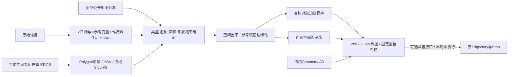
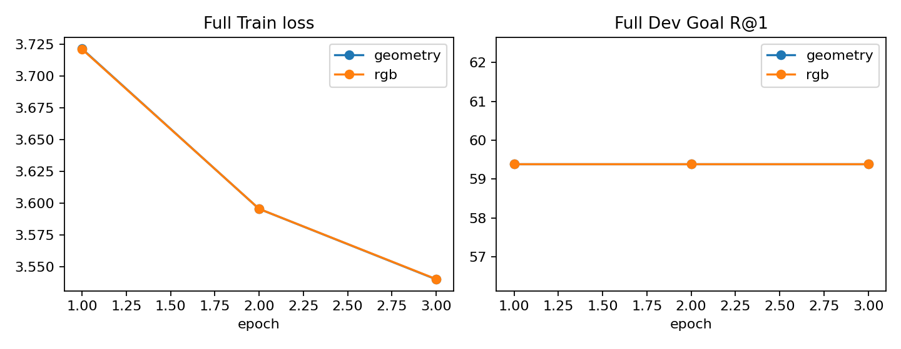
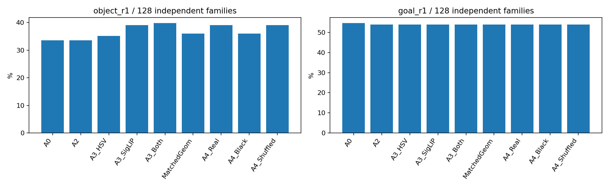
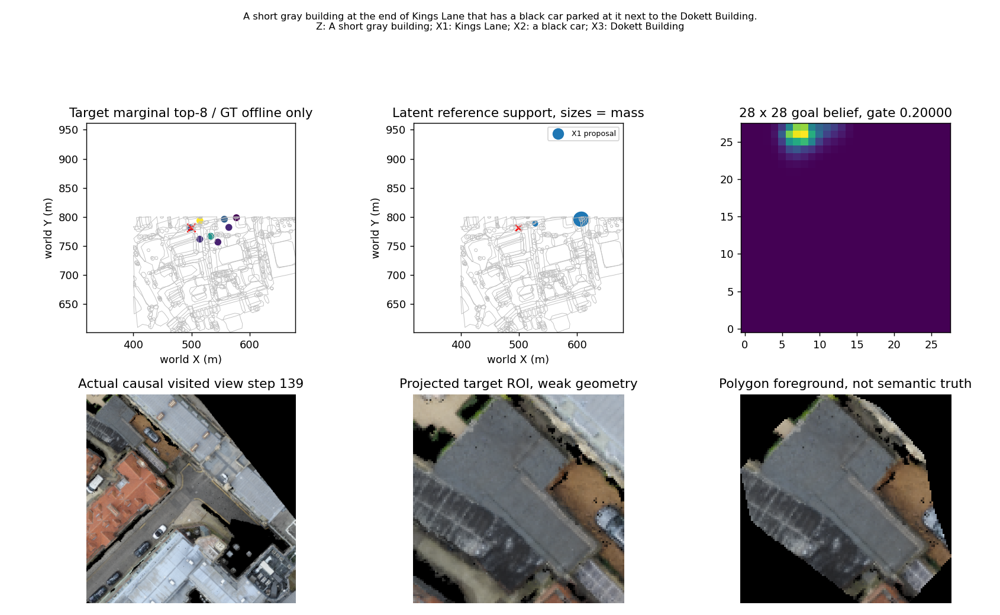
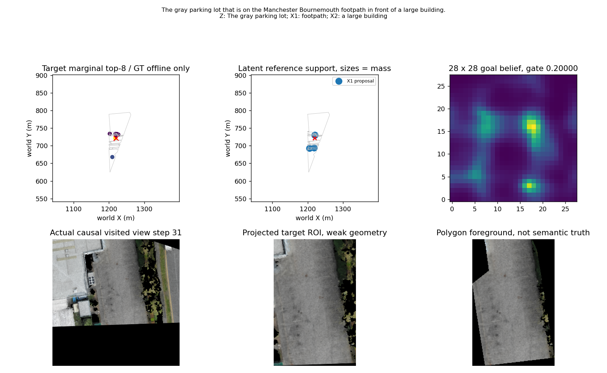
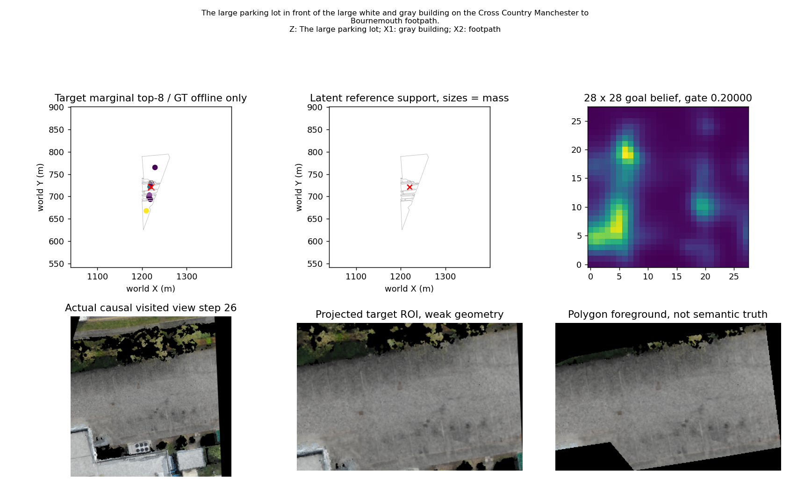
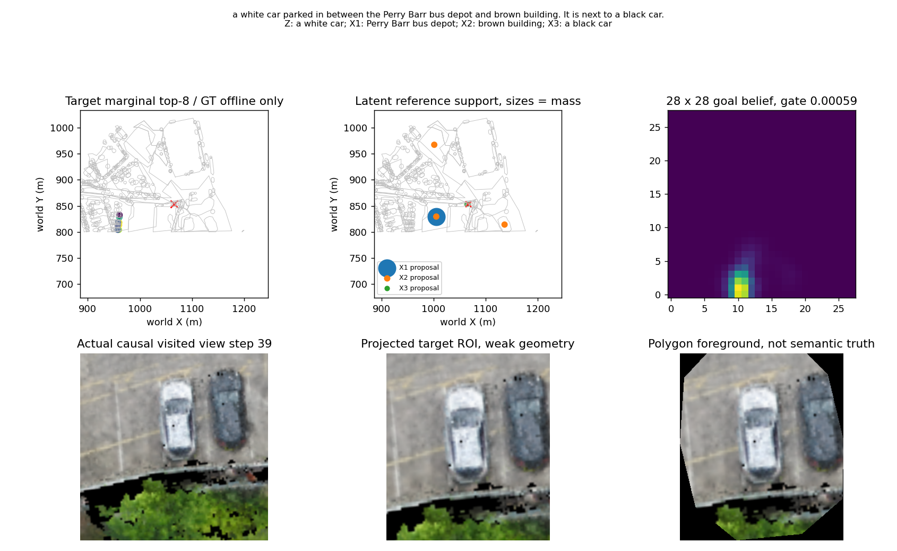

# P6：Latent Object Binding & Geometric Reasoning 实验报告

结论：已经实现并实际运行语言变量、公开 Polygon 概率绑定、空间因子边缘化及 28×28 Goal 输出；完整 Train 上完成两组 3 Epoch 轻量校准。**几何结构带来定位点估计改善，但未通过独立 Dev 的地图级统计门槛；RGB 带来部分对象排序变化，却没有产生 Goal 纠错，Real 对 Shuffled 的独立贡献不成立。不能宣布 P6 成功。**

## 1. 冻结协议与输入权限

从 `research/role-aware-object-graph` / `868b1386dc432f2b308bb302d4f42dbd5dc5a6cd` 创建独立 `research/latent-object-binding-20261011`。原始数据、旧 Checkpoint、P0–P5 结果、20m 成功半径、784 个网格候选及控制器均保留。正式 Geometry A3、SigLIP2、Trajectory、Stop 冻结。本轮没有 Seen、Unseen、闭环或 GAT/RL 训练。

新增输入协议允许同地图全部公开对象的类型、轮廓、名称和位置，比旧命名地标协议提供更多公共信息；A3 基线保持原输入与已验证 logits。因此增益属于“新增公开对象输入+推理”的离线对照，不能直接写成标准导航 SR/SPL 改善。对象 ID 只做缓存关联、训练标签和离线评价，没有 ID embedding。私有描述、目标 ID/XY 不进入正常推理。

Train/Internal Dev 地图沿用既有固定隔离；不根据 Seen 选择参数。Seed=20261011，参考支持8、联合赋值16、最多8个连通变量、输出混合系数0.25，遗漏支持和未解析假设保持 Unknown。3 Epoch、AdamW 0.001、有效 batch32；以完整 Dev Goal R@1 选 Checkpoint，平分取较早 Epoch。Bootstrap 2000次，分别重采样独立查询/family及地图。Dev只有4地图，置信区间不稳定；严格使用下界>0而不是下界≥0。

A3 权重必须严格载入并核对缓存 SHA；历史未正确载入 A3 的监督试验数据没有用于本轮。正常推理入口仅接受 `static_logits / grid_xy / bounds / pose_world` 和已验证因果视觉属性。完整样本按“地图×原始指令”去重；重复轨迹/Prefix不增加独立样本数，多正例全部保留。

## 2. 架构与近似边界

P(Z=o) 对保留的参考联合赋值求和，不能先固定 X/Y 再寻找 Z。目标候选从不以 GT 或局部 Top-K 过滤；参考变量采用有预算的提议支持，遗漏概率进入 Unknown。已知公共名称直接使用原对应关系，不要求 RGB 再识别名称。不同独立变量不能无依据绑定同一对象；明确同一公开命名实体可共指。与 Z 无关的语言对象不稀释目标置信度。

Near/Along 使用实际参考 Polygon 距离，参考—参考距离使用边界距离；世界方向比较真实轮廓边界；Between 使用两个参考轮廓的联合凸包减去参考内部，交换 X/Y 后几何场严格一致。目标对象属性评估在其公开位置，连续目标场直接在网格位置计算，而不是只用参考物中心。Left/Right/Front/Behind 没有可信参考系时保持 Unknown。

目标对象条件分布与连续空间分布各自边缘化后按固定接口结合，再以 0.25×已知概率质量混入原 A3。该实现保留公开 object.position 的10m核及连续关系场；不伪造精确目标 Polygon。参考联合后验另外通过对 Z 求和输出，提议分布与联合后验分别保存。

**实现限制：**不是所有角色/作用域假设与全城参考组合的精确推断。当前采用首个角色/作用域解释，其余质量记 Unknown；匿名参考提议主要依赖 unary特征，空间因子在提议截断后应用。超过预算的变量、细形状、遮挡关系和不明确指代没有被假装解决。全图边缓存复用为公开节点资源，本轮没有边消息神经网络。

## 3. 真实数据与监督审计

| 数据 | 地图 | 独立地图–指令查询 | 原始标签/轨迹记录 | 独立目标对象 | 多目标正例查询 |
|---|---:|---:|---:|---:|---:|
| train | 20 | 18895 | 19567 | 3521 | 46 |
| dev | 4 | 2285 | 2311 | 420 | 2 |

公共地图资源共 26,274 节点、543,308 条既有边；每条查询使用本地图全部目标对象，候选 Recall=100%。匿名参考物没有独立实例真值，Reference Recall@K 不可识别；公开名称的候选匹配不当作学得的参考识别准确率。Target 变量的 Recall@K 由下文 Object R@K 给出。

| 数据 | GT在Polygon内/边界 | GT在外部 | GT等于公开object.position | 轮廓退化为Point的标签 | 最大中心偏差(m) |
|---|---:|---:|---:|---:|---:|
| train | 18564 | 1003 | 19567/19567 | 11 | 48.74 |
| dev | 2202 | 109 | 2311/2311 | 6 | 16.80 |

本轮原始目标 XY 全部等于相应公开对象 position；这仅解释离线身份 Oracle 的高上界，不允许将其目标 ID 传给模型。Polygon 外目标和几何中心偏差说明“正确对象→中心点”不总可靠；本实现使用公开位置与连续关系场，未训练新的 Goal Head。

| 数据 | 含目标连通参考变量 | 含公开命名参考 | 含匿名参考 | 未确定相对方向 | Between可交换赋值对 |
|---|---:|---:|---:|---:|---:|
| train | 13506 | 8859 | 7626 | 8294 | 3635 |
| dev | 1550 | 1009 | 884 | 854 | 280 |

全部保留的同一 Between 无序对象对交换后，空间 log-factor 最大差值为 **0**（真实 Train 3,635 对、Dev 280 对）。因此辨别“哪栋是X、哪栋是Y”不一定有导航价值；只有改变无序对象集合或非对称关系的绑定，才可能改变 Goal。匿名参考身份缺少真值，不能声称准确区分全部有价值/无价值歧义。

## 4. 完整 Train/Internal Dev 几何与训练对照

A0只输出Goal，没有原生Object Belief；表中A0对象指标若出现在机器结果里，是A2的shadow诊断，不能当作A3对象基线。A1是独立变量/公开Polygon unary匹配，A2加概率空间因子，Hard仅取一个参考赋值。TrainedGeom与TrainedRGB分别为同预算训练组。

| 数据/方法 | Object R@1/4/8 (%) | Goal R@1/4/8 (%) | NE(m) | Recovery/Damage/Net(例) |
|---|---|---|---:|---|
| train/A0 | — | 63.21/81.01/87.25 | 29.94 | 0/0/0 |
| train/A1 | 25.26/55.88/71.49 | 64.56/81.62/87.65 | 29.09 | 364/108/256 |
| train/A2 | 24.40/51.71/66.44 | 64.27/81.53/87.61 | 29.26 | 314/113/201 |
| train/Hard | 23.85/50.84/65.59 | 64.22/81.47/87.60 | 29.32 | 319/128/191 |
| train/Trainedgeometry | 25.25/53.85/69.27 | 64.45/81.48/87.59 | 29.15 | 342/108/234 |
| train/Trainedrgb | 25.24/53.83/69.29 | 64.45/81.48/87.59 | 29.15 | 342/108/234 |
| dev/A0 | — | 56.98/77.55/85.12 | 35.39 | 0/0/0 |
| dev/A1 | 31.73/61.97/75.89 | 59.43/78.91/85.82 | 34.14 | 72/16/56 |
| dev/A2 | 31.07/59.56/72.47 | 59.04/78.95/85.43 | 34.31 | 60/13/47 |
| dev/Hard | 30.94/59.08/71.55 | 59.04/78.95/85.43 | 34.58 | 60/13/47 |
| dev/Trainedgeometry | 32.17/60.88/73.79 | 59.39/78.95/85.47 | 34.13 | 67/12/55 |
| dev/Trainedrgb | 32.30/61.05/73.83 | 59.39/78.95/85.47 | 34.13 | 67/12/55 |

| 完整Dev配对比较 | Goal R@1差值(pp) | family95%CI(pp) | 地图95%CI(pp) |
|---|---:|---|---|
| A1−A0 | 2.45 | [1.71, 3.24] | [0.00, 3.19] |
| A2−A0 | 2.06 | [1.36, 2.84] | [0.00, 2.64] |
| A2−Hard | 0.00 | [-0.13, 0.13] | [0.00, 0.00] |
| A2−A1 | -0.39 | [-0.88, 0.13] | [-0.55, 0.00] |
| TrainedGeom−A0 | 2.41 | [1.66, 3.20] | [0.00, 2.97] |
| TrainedGeom−A1 | -0.04 | [-0.57, 0.53] | [-0.22, 0.07] |

Dev中点估计满足+1pp且Recovery>Damage，但地图CI下界为0，**正式定位门槛未通过**。概率边缘化在完整Dev与Hard的Goal结果相同，且不优于更简单A1；不能因为架构更复杂就宣称更有效。完整Train上的CI是训练数据描述性统计，不是独立泛化证明。

## 5. 轻量训练已经完成

完整Train每Epoch18,895查询；目标实例多正例负对数概率 + 0.5×20m有效Goal网格概率损失，不需要参考物实例标签。两组储存9个标量参数，几何组屏蔽2个RGB系数（有效7），RGB组有效9；不是新的视觉Backbone/Cross-Attention网络。参考提议支持由预先缓存冻结，学习只能重加权保留假设；无RGB样本的视觉增量始终为0。

| 模型/Epoch | Train loss | Dev Object R@1(%) | Dev Goal R@1(%) | 秒 | 峰值GPU(MiB) |
|---|---:|---:|---:|---:|---:|
| geometry/1 | 3.7217 | 32.17 | 59.39 | 197.7 | 131.2 |
| geometry/2 | 3.5957 | 32.69 | 59.39 | 107.8 | 131.2 |
| geometry/3 | 3.5403 | 33.09 | 59.39 | 122.5 | 131.2 |
| rgb/1 | 3.7214 | 32.30 | 59.39 | 125.6 | 131.2 |
| rgb/2 | 3.5958 | 32.78 | 59.39 | 103.5 | 131.2 |
| rgb/3 | 3.5405 | 33.17 | 59.39 | 102.7 | 131.2 |

几何/RGB总训练耗时分别451.1/336.7s，两组均选Epoch1。Train实际RGB覆盖255查询（256family中有重复原始指令），仅占1.35%；Dev有128查询可复用RGB。**完整Train几何监督不等于完整Train视觉训练。**最后Epoch对象指标继续小幅变化，Goal无额外改善，预算内已结束，没有延长训练。

## 6. 合法观测及RGB属性对照

复用Dense Causal History，每family仅保留最后一个合法Prefix；ROI源step≤cutoff、同episode/map，native side≥10、depth support≥0.9。公开变量类型与质量选择已到达帧，最多2帧/family、128帧/split；GT不选择观察。实际重裁256个已观察位姿，共2,489个Polygon HSV/Lab ROI，耗时48.5s，bbox一致性和投影失败0。复用所有冻结SigLIP2图像特征，只新增101条变量文本特征（23.9s），没有重复大规模图像编码。

**图像真实性边界：**这些是CityNav在真实轨迹已到达位姿的正射RGB裁图，Depth为垂直代理；不是记录的机载透视照片，也不能验证立面遮挡。Polygon前景仍是几何弱标注，颜色规则不是人工标签，可靠物理属性Oracle数量=0。ROI可信度仅为几何/像素代理，不把它写成人工语义可信。

| 数据 | family/独立对象 | 静态错误 | 目标有效ROI可见 | 错误且可见family/对象 | 有HSV观测family |
|---|---|---:|---:|---|---:|
| train | 256/242 | 96 | 112 | 40/39 | 92 |
| dev | 128/85 | 58 | 90 | 42/31 | 77 |

所有Real/Black/Shuffled使用同样的family、地图全对象候选、cutoff与观察有效性。Black是实际编码黑图及黑像素属性；Shuffled在同类型、同family合法观察内置换，像素支持保持一致。未观测物体从不因无图像变成视觉负样本。明确公共命名绑定不被RGB覆盖。

| 128 Dev family 方法 | Object R@1/4/8(%) | Goal R@1/4/8(%) | NE(m) | Recovery/Damage |
|---|---|---|---:|---|
| A0 | — | 54.69/71.09/79.69 | 26.34 | 0/0 |
| A2 | 33.59/71.88/77.34 | 53.91/71.09/80.47 | 25.89 | 0/1 |
| Hard | 32.81/70.31/75.00 | 53.91/71.09/80.47 | 25.89 | 0/1 |
| A3_HSV | 35.16/72.66/77.34 | 53.91/71.09/80.47 | 25.92 | 0/1 |
| A3_SigLIP | 39.06/74.22/80.47 | 53.91/71.09/80.47 | 25.89 | 0/1 |
| A3_Both | 39.84/75.78/79.69 | 53.91/71.09/80.47 | 25.89 | 0/1 |
| A3_References | 37.50/74.22/79.69 | 53.91/71.09/80.47 | 25.89 | 0/1 |
| A3_Target | 36.72/71.88/76.56 | 53.91/71.09/80.47 | 25.89 | 0/1 |
| A5_Black | 33.59/71.88/77.34 | 53.91/71.09/80.47 | 25.89 | 0/1 |
| A5_Shuffled | 37.50/74.22/80.47 | 53.91/71.09/80.47 | 25.89 | 0/1 |
| MatchedGeom | 35.94/73.44/80.47 | 53.91/71.09/80.47 | 25.89 | 0/1 |
| A4_Real | 39.06/76.56/81.25 | 53.91/71.09/80.47 | 25.92 | 0/1 |
| A4_Black | 35.94/73.44/80.47 | 53.91/71.09/80.47 | 25.89 | 0/1 |
| A4_Shuffled | 39.06/74.22/82.03 | 53.91/71.09/80.47 | 25.89 | 0/1 |

| Dev配对比较 | Object差值/地图95%CI(pp) | Goal差值/地图95%CI(pp) |
|---|---|---|
| hsv_minus_geometry | 1.56 / [0.00, 3.92] | 0.00 / [0.00, 0.00] |
| siglip_minus_geometry | 5.47 / [3.85, 6.90] | 0.00 / [0.00, 0.00] |
| rgb_minus_black | 6.25 / [3.85, 8.62] | 0.00 / [0.00, 0.00] |
| rgb_minus_shuffled | 2.34 / [-1.23, 6.38] | 0.00 / [0.00, 0.00] |
| learned_rgb_minus_geom | 3.12 / [1.23, 4.29] | 0.00 / [0.00, 0.00] |
| learned_real_minus_black | 3.12 / [1.23, 4.29] | 0.00 / [0.00, 0.00] |
| learned_real_minus_shuffled | 0.00 / [-1.84, 2.31] | 0.00 / [0.00, 0.00] |

原始冻结属性匹配对Black有对象排序信号，但对同类Shuffled没有统计支持。训练后Real与Shuffled的Object R@1完全相同；所有视觉方法的Goal结果相同，均0 Recovery/1 Damage。只更新参考变量或只更新目标变量也未改变Goal，因此不能将对象排序改善宣布为RGB导航价值。完整Train/Dev的训练RGB组与匹配几何组Goal亦相同。

## 7. Oracle与实际分数影响

区分全局私有身份上界与相同可见支持的身份上界。Global Oracle可知道未观测目标，只诊断Object→Goal转换；Observed Oracle仅在目标已有可信几何ROI时使用身份，否则回退对应几何推理。SameInterface保留本轮固定门控，其余Oracle用完美身份核作为强上界，不能算真实模型成绩。

| Dev Oracle | Object R@1(%) | Goal R@1(%) | Recovery/Damage |
|---|---:|---:|---|
| GlobalIdentityOracle | 100.00 | 100.00 | 58/0 |
| SameInterfaceGlobalIdentityOracle | 100.00 | 71.88 | 22/0 |
| ObservedIdentityOracle | 79.69 | 87.50 | 42/0 |
| SameInterfaceObservedIdentityOracle | 79.69 | 66.41 | 15/0 |

同可见支持、同固定接口的Identity Oracle仍能恢复15例，说明该接口并非绝对禁止纠错。强可见身份Oracle能恢复42例；这个差距同时包含门控/混合约束。真实RGB恢复0例，不能把全部失败归因于旧gain=0.025；本轮没有改变旧Gain，也没有用Dev/Seen增大残差。

七条语义明确真实指令另外执行文本审读结构干预，正确结构仅由原始句子确定，不利用GT坐标选择。它是研究者文本审读，非独立专家真值；Current与同置信度正确结构的Object/Goal差值均0，理想置信度只改变少量NE。样本太少且结构相近，不能证明完整语言已无问题。全局变量解析Oracle和物理属性Oracle缺少可靠真值，明确不可识别，没有伪造其成绩。

| 训练RGB Dev实际变化 | 对象Top1改变(例) | Goal Top1改变(例) | 目标对象排名改善/退化/不变 | 最大热图差值中位数/最大值 |
|---|---:|---:|---|---|
| real_minus_black | 22 | 1 | 25/10/93 | 0.0000235/0.0137969 |
| real_minus_shuffled | 18 | 1 | 13/8/107 | 0.0000190/0.0020898 |

上述比较只分析冻结输出，没有幅度搜索或参数放宽。逐family保存目标概率、目标排名、热图L1变化、Known质量和Gate；Dev有1例Top1网格变化，但没有改变Goal成功/失败。训练RGB的50例Object Top1正确中有9例Goal失败（Geometry为8例）；对象识别与最终目标网格成功不能混同。

## 8. 典型完整链路案例

案例同时保存原始语言、变量、参考候选概率、联合赋值、目标对象概率、最终热图和已观察RGB/Polygon前景。GT只用于离线选取/标注案例，图中Polygon前景不能当作人工mask。

### 案例 0：cambridge_block_7

A short gray building at the end of Kings Lane that has a black car parked at it next to the Dokett Building.

Object R@1=0，Goal R@1=0；Recovery=0，Damage=1。

### 案例 1：birmingham_block_11

The gray parking lot that is on the Manchester Bournemouth footpath in front of a large building.

Object R@1=1，Goal R@1=0；Recovery=0，Damage=0。

### 案例 2：birmingham_block_11

The large parking lot in front of the large white and gray building on the Cross Country Manchester to Bournemouth footpath.

Object R@1=0，Goal R@1=0；Recovery=0，Damage=0。

### 案例 3：birmingham_block_9

a white car parked in between the Perry Barr bus depot and brown building. It is next to a black car.

Object R@1=0，Goal R@1=0；Recovery=0，Damage=0。

## 9. 耗时、环境、权重与工程验证

单卡RTX PRO6000 Blackwell Max-Q 96GB。Python 3.10.22 / torch 2.8.0+cu128 / NumPy 1.26.4；两组参数训练峰值约131.2MiB，冻结SigLIP2文本编码峰值3.36GiB。全几何准备86.8s，384family观测版本准备52.2s。

| 预计算后单线程CPU方法 | mean(ms) | p95(ms) |
|---|---:|---:|
| independent | 0.254 | 0.411 |
| joint | 0.314 | 0.428 |
| hard | 0.314 | 0.410 |
| hsv_siglip | 0.307 | 0.441 |

这些延迟只含缓存后的概率推理，不包括数据I/O、地图构图、裁图、视觉编码或相机/飞行动作；原始阶段耗时分别记录。训练耗时包括每Epoch完整Dev评估与CI，两组可在同卡并发小任务，不能将总和当墙钟。

- A3 Checkpoint SHA256：`9d9be861bf7e9cac986d747867990de3d409ccb9bc1545862d71a620448380d7`。
- A3 logits SHA256：`0e4575ed4586f9d813f6f64498d04a61a88f5d94bd34cdca0730884b191ca9ca`。
- SigLIP2 revision：`1b426889ea62b5a72bf9839009a1b184bfc9c178`；文本缓存 SHA256：`96d5dd8f76deee977744ef3f6550d825f1ac5828530fa9107a39aabd1ae0caf6`。
- 几何轻量 Head SHA256：`ea3fe27b30c9d6b895b4fd9fd69594550846b32a32691f89644e182216b07dc5`。
- RGB轻量 Head SHA256：`69384bf196d20b3de067f23d1f46205e6671e2c9307c6af410de4db76c75145c`。

完整参数、每Epoch指标、模型/数据SHA见本报告旁 evidence JSON；9个标量系数也在history里。Checkpoint与25GiB级输入缓存只存本地。输入准备源码SHA和最终源码SHA分别保存；准备后仅补充正确的联合参考后验统计，不改变目标/热图/损失。

工程修复：早期多进程Torch tensor传输触发文件描述符/BrokenProcessPool，改为NumPy返回+单writer Tensor化；旧中间chunk的NumPy标量触发weights_only校验，限定安全旧标量读取并转换Python标量。统计退化Point边界距离为NaN改为明确None，未伪造Polygon。与目标无关变量和Between等价赋值预算问题均按语义约束修复，旧原型结果/部分训练仍在prototype目录保存，未混入本报告最终指标。

回归 **405 passed，1个既有rasterio弃用警告，8.32s**；包含关系对称性、变量置换、不同ID不改变特征、Unknown回退、遮挡/Future ROI隔离、坐标平移、半精度缓存/训练梯度、公开命名共指、目标全候选与28×28兼容接口、正确联合参考后验。实际命令见 `experiments/latent_object_binding/README.md`，日志在 `runs/p6_latent_object_binding/logs/`；最终Git SHA由Commit/Push后本地commit.json及交付消息记录，避免报告自引用SHA。

## 10. 五个问题的回答与下一步

1. **变量与几何关系是否足够？** 能提供完整Dev约+2pp的定位点估计，但不能满足地图95%CI下界>0，且结构/参考实例真值不足；不能据此声称较可靠定位。
2. **概率绑定是否优于硬绑定？** 完整Dev Goal相同，观察子集同样没有优势；训练子集有小幅差异但不构成独立证明。更简单A1在完整Dev还更高。
3. **RGB能否消除真正影响Goal的歧义？** 当前没有证明。它改变匿名参考提议和部分对象排名，但Real−Shuffled不成立，Goal差值为0；Between同一无序对象对的换名歧义本就不需视觉消除。
4. **位置改善来自哪里？** 本轮所有Goal改善来自公共对象几何/结构与原A3混合；RGB没有额外恢复。接口仍存在可见身份Oracle恢复空间，不能将失败完全归于融合幅度。
5. **是否需要训练视觉模型？** 当前9参数训练没有改善Goal，不能支持扩大视觉模型；简单HSV弱于冻结SigLIP2的对象排序，但两者均未证明独立导航价值。

**下一步只推荐：公开几何条件化的匿名参考提议召回。** 当前匿名参考Top8主要按unary排序，空间因子在截断后才生效；正确参考若被截掉，校准器无法恢复。只用原A3公开目标先验与语言关系，对全部同类参考候选计算预期空间相容性再提议，保持目标全候选、预算、Unknown质量和输出Gate不变；优先在Train/Dev的小型独立文本+参考绑定核验集验证，不扩大RGB/网络。优先覆盖Dev含匿名参考的884查询；这是待验证范围，不是预期改善884例。

预注册验收：固定独立核验参考集合，Top8召回提高≥10pp且配对95%CI下界>0；同预算概率推理必须超过Hard/A1；完整Internal Dev Goal相对A0≥+1pp、Recovery>Damage且地图95%CI下界>0。再谈RGB时必须同时Real−Black与Real−Shuffled具有地图统计支持且Goal有正增益。未通过就保留辅助语义验证，不进入GAT、RL、Trajectory/Stop、Seen闭环或Unseen。
