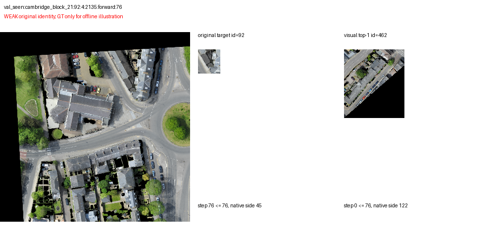
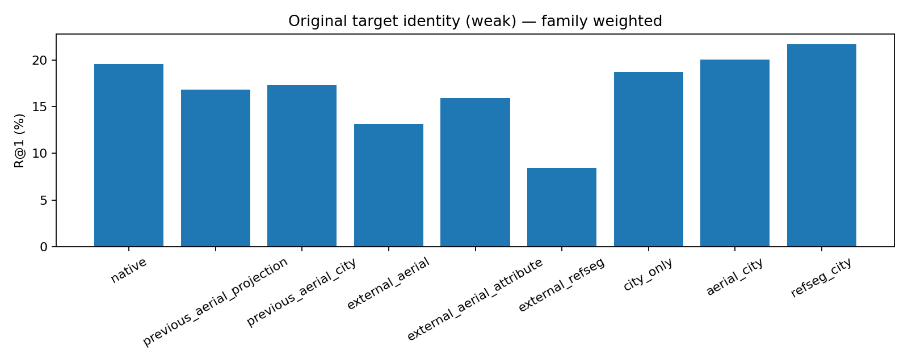
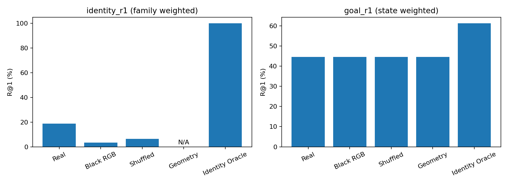
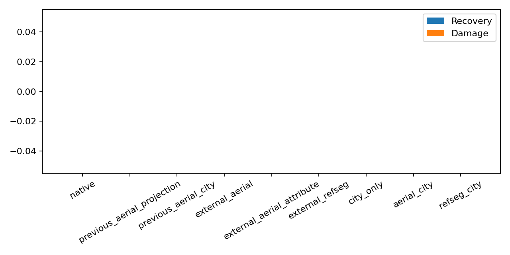
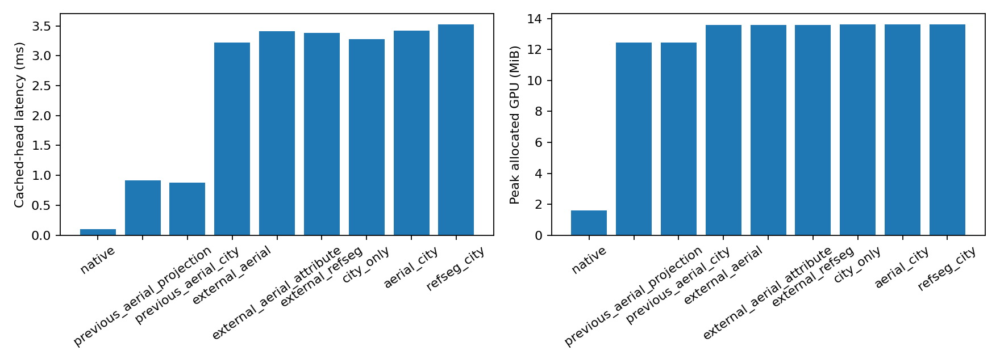

# P2：可靠实例级 RGB–Language Grounding（2026-10-11）

本轮没有打通可靠Goal纠错。预先选定的city_only在Seen的family等权身份R1为18.68%，Native为19.56%；Goal R1仍为44.53%。全部验收门槛未通过，停止后续训练与闭环。

**本报告基于实际编码、6组轻量Head训练及冻结Seen对照。是否进入导航由预先声明的门槛决定，不能用外部或属性准确率代替CityNav唯一目标身份与安全纠错。**

## 1. 协议与硬件

从 `research/visual-goal-association-20261011` / `4a69bdf73fabaa931ee92354b52eb6672430ccd3` 新建 `research/instance-rgb-grounding-20261011`。复用冻结 A3 和 SigLIP2、旧外部 Projection，保留全部 Checkpoint/原始数据/旧产物。实机为单张 RTX PRO6000 96GB；CPU数据准备并行，不假设双GPU。

[固定协议](../experiments/instance_grounding/protocol.json)：Train按确定性SHA选256 families，内部Dev128 families/4 maps，与Train整地图和对象身份隔离；Seen固定原128 families/640正向prefix/23maps。不改原地图Split、28×28候选或XY20m判断，不运行Unseen调参。Head最多3 Epoch；外部属性、主目标、RefSeg分别训练，City-only/Aerial→City/RefSeg→City三组同Seed、同City训练单位和Epoch。

外部接口核查前声明5组Head，官方主目标接口核实后、任何新Seen评分前将总预算明确为6组，以增加独立的完整caption主目标训练，保留属性Head。CPU/GPU预算分别60分钟；没有延长任何失败Head的Epoch。

Dev在预先声明的三组City Head中按family等权原始实例身份R1选择 `city_only`；每组各自Dev温度/弃权校准。正式Seen前保存[冻结配置](assets/instance_grounding/evidence/calibration_dev/frozen_config.json)及Checkpoint/代码/协议SHA，评价入口拒绝变化。没有根据Seen修改模型或选择参数。

正常残差 gain 固定0.025、绝对残差≤0.025；无强度搜索。Confidence不足则Unknown，未接受/未观察网格logit逐位保持原值。Oracle可用真实身份选择已观察实例，但不读取目标坐标选择cell，仅离线诊断。GT坐标只用于事后NE/R@K。

## 2. 关键标注问题与外部数据

P0/P1中的64.29%是属性多正例，不是原始目标身份；同图库原目标身份42.86%，全部可见图库21.43%。本轮从损失、图库、评价字段到报告都分开两者。

重要修正：AerialVG ODVG文件包含主目标和参考区域。实际下载检查[官方固定commit的eval.py第149行](https://github.com/Ideal-ljl/AerialVG/blob/db33e1dc733911853c5e132394d2e00b024334db/eval.py#L149)，正式评价用`targets.boxes[0]`作为GT主目标，完整指令用`targets.anno`。此前把所有mention当多正例的属性训练无法替代该任务。本轮按这个可验证的官方角色构建主目标监督；相同完整caption和bboxIoU>0.5的别名proposal保留多正例。

AerialVG仍使用原来已审核的源视频隔离Train/Dev（官方Train与Val图像重叠不作为独立验证），来自VisDrone中国城市，和CityNav英国来源不同。只使用已有480张已下载图像，复用区域向量、补编码真实上下文及完整caption；gated非商业使用条件与原图权利分开记录，不提交原图或大缓存。

RefSegRS原始[论文](https://arxiv.org/html/2306.08625)说明从SkyScapes产生模板表达和mask；原始[SkyScapes论文Section2](https://arxiv.org/html/2007.06102#S2)明确16张源影像来自慕尼黑。因而本轮补做独立mask-grounding训练与City适配，不与Aerial混训。它是64个固定RGB tiles上的多正例presence辅助任务，不能写成唯一建筑身份或精细mask IoU。当前DLR页面泛指欧洲来源，逐tile GPS缺失，地理依据与局限均保存。发布镜像CC BY4.0与底层DLR CC BY-NC-ND3.0权利有区别；只进行本地非商业实验、不再分发图像。

DIOR-RSVG已经实读官方XML排序/member顺序/从0递增表达索引，核对[官方reader](https://github.com/ZhanYang-nwpu/RSVG-pytorch/blob/main/data_loader.py#L43)。全球来源缺逐图GPS，不能排除英国区域，仍隔离为冻结模型诊断，不将相关训练权重混入正式CityNav；镜像未被官方原包SHA认证，官方CC BY-NC4.0。实际96图/246表达、annotated-bbox proposals条件下诊断，不是端到端BBox定位。

## 3. 因果历史与有效监督

| Split | Prefix / Family / 地图 | 目标可见状态 / family | 几何可信family | 可训练排序family | 同颜色弱负例ROI | 64 token截断状态 |
|---|---|---|---|---|---|---|
| train | 1280 / 256 / 20 | 423 / 152 | 113 | 59 | 13 | 10 |
| dev | 640 / 128 / 4 | 294 / 99 | 90 | 46 | 4 | 10 |
| seen | 640 / 128 / 23 | 190 / 76 | 63 | 32 | 10 | 5 |

全部Dense History只重放当前cutoff以前的人类实际访问pose，由既有CityNav环境渲染其局部RGB/Depth；不是新飞行，也不是任意目标附近完整正射图输入。每实例按depth支持/native像素/ROI质量选择最佳因果视图，当前ROI优先，最多128已观察实例。ID只用于来源和关联，VEN不接收身份字符串。全部来源step≤cutoff，审核future违规为0；Train/Dev地图、family与目标对象重叠均为0。

训练每family只取确定的最新prefix；可见/不可见不决定这个采样。目标没有观察时所有候选Unknown；不能用未来终点补正例。候选为当前及历史已经观察的真实实例，不把没有图像的目标作为负例。

同类同颜色困难负例要求：指令明确命名了已观察参考物，目标满足关系且竞争实例明显违反它（方向±10m buffer；near≤25m而far≥50m）。只出现“near”等词不够。未能证实的候选Unknown。颜色一致性来自语言描述，只是弱标签；未进行人工RGB语义核验，可信几何ROI也不是人工语义真值。

Seen的静态错误且目标几何可信：94个prefix，**36个独立family / 33个目标对象**。人工核验语义案例0，不能将重复prefix冒充≥50独立可靠监督。

| 缓存 | 独立视图键 | 复用 / 新编码 | 规划重放时间 | 编码时间 | GPU编码峰值 |
|---|---|---|---|---|---|
| train | 44631 | 312 / 44319 | 1476.5s | 1355.5s | 3.34GiB |
| dev | 18226 | 2557 / 15669 | 642.2s | 458.3s | 3.34GiB |
| seen | 21485 | 2856 / 18629 | 570.0s | 644.8s | 3.34GiB |

CUDA Smoke检查维度1024/有限值/主干全部冻结，实际ROI FP16对FP32余弦>0.995通过。只按各模型官方384预处理已有真实局部RGB；没有高分辨率原图捷径。

## 4. VEN及真实训练

结构：已有1024维图文Projection作为基础，完整指令与保守目标短语联合评分；64维Word–Patch Cross Attention读取真实4×4 patch tokens，Context Reference Attention读取已观察实例上下文，City三组加入由完整语言调制的公开相对观察位置attention bias；只有实例间相对差值，图像交换时保持相同，不含GT目标位置/绝对坐标；最后输出身份score和Match/Mismatch/Unknown三分类。局部上下文可学习参考物共现，但不声称它已经掌握所有全局方向关系。模型正常输入不含GT身份、目标坐标、地图名、静态logits或规则field。

Loss = 多正例region-text ranking + 0.2 hard-negative margin + 0.2三分类CE（City在每batch按已观察类别均衡，外部原训练保留原CE） + 0.05损坏证据Unknown CE。排序只使用可判定正负，Unknown不进入negative denominator，ROI质量用于加权。外部旧缓存的损坏训练为zero feature sentinel；City三组统一使用实际全黑RGB经SigLIP2编码的特征。正常Zero RGB评价同样是实际黑图编码，并非简单清空图文特征。

外部Head为520,198参数；City三组增加12,300个语言条件相对关系参数。实际收到梯度的参数另存训练manifest（复用base旧confidence头未用于新loss）。Backbone、A3和导航控制器冻结。所有Epoch Checkpoint保留在本地，未提交大权重。

| Head | Epoch / Steps | 实际训练单位 | 用于选模型的Dev family R1 | 时间 | 峰值分配显存 |
|---|---|---|---|---|---|
| aerial_instance | 3 / 471 | 1255 | 88.47% | 15.67s | 70.7MiB |
| aerial_primary | 3 / 546 | 1452 | 62.07% | 25.08s | 70.6MiB |
| refseg_instance | 3 / 72 | 191 | 89.20% | 6.94s | 248.4MiB |
| city_only | 3 / 96 | 256 | 27.39% | 49.29s | 477.1MiB |
| aerial_city | 3 / 96 | 256 | 22.47% | 51.15s | 477.1MiB |
| refseg_city | 3 / 96 | 256 | 26.63% | 49.51s | 477.1MiB |

外部Dev用于选Epoch，不是独立Test。属性Head与主目标Head训练任务不同，不能将外部mask或属性百分比当作CityNav唯一身份指标。GPU峰值是各进程PyTorch分配峰值，不含其他并行进程或完整导航开销。

## 5. 外部完整caption主目标结果

| 模型 | Real | Black RGB | 同类 Shuffled |
|---|---|---|---|
| native | 36.03% | 17.32% | 24.86% |
| previous_aerial_projection | 40.22% | 17.32% | 23.74% |
| attribute_ven | 50.56% | 17.32% | 25.98% |
| primary_ven | 60.34% | 17.32% | 29.61% |

主目标Head相对Native：+24.30 pp; 地图CI [+18.99, +31.12]。这是假定可用同图标注bbox proposals的区域选择（358查询/96独立图像，24源视频组）；不是检测器召回或最终Goal纠错。

RefSegRS固定tile Dev：native 76.56%, mask_ven 85.94%；DIOR冻结proposal条件原身份R1 42.68%。外部监督形式和数据域不同，没有把这些比例合并成总准确率。

## 6. 固定Seen原始身份与属性（弱监督）

| 模型 | 身份R1：family等权 | 身份状态/独立family | 同类R1 | 同颜色R1 | 属性多正例R1 |
|---|---|---|---|---|---|
| native_real | 19.56% | 190 / 76 | 28.89% | 60.61% | 68.29% |
| previous_aerial_projection_real | 16.82% | 190 / 76 | 22.22% | 45.45% | 73.17% |
| previous_aerial_city_real | 17.30% | 190 / 76 | 22.22% | 48.48% | 70.73% |
| external_aerial_real | 13.11% | 190 / 76 | 18.89% | 45.45% | 64.63% |
| external_aerial_attribute_real | 15.92% | 190 / 76 | 22.78% | 48.48% | 80.49% |
| external_refseg_real | 8.46% | 190 / 76 | 13.89% | 33.33% | 52.44% |
| city_only_real | 18.68% | 190 / 76 | 26.11% | 57.58% | 63.41% |
| aerial_city_real | 20.07% | 190 / 76 | 26.11% | 60.61% | 62.20% |
| refseg_city_real | 21.71% | 190 / 76 | 23.89% | 54.55% | 58.54% |

Dev选定 `city_only`，相对原始SigLIP2的family等权身份变化：-0.88 pp; 地图CI [-5.27, +2.91]。Real−Zero：+15.39 pp; 地图CI [+9.24, +22.32]；Real−Shuffled：+12.19 pp; 地图CI [+3.96, +21.65]。

这里主身份图库是全部当前+历史有效实例，和此前14条属性查询不同，不能将总体数字直接减64.29%。属性、多正例、身份、高低像素分组各自报告有效人口，不将同一建筑跨帧检索算作理解颜色。

## 7. Goal纠错与受控RGB独立贡献

| 模型/控制 | Goal R1 / R4 / R8 | NE(m) | Recovery / Damage / Net | 接受残差状态 |
|---|---|---|---|
| geometry_only | 44.53% / 60.16% / 72.66% | 33.98 | 0 / 0 / 0 | 0 |
| native_real | 44.53% / 60.16% / 72.66% | 33.98 | 0 / 0 / 0 | 0 |
| city_only_real | 44.53% / 60.16% / 72.66% | 33.98 | 0 / 0 / 0 | 0 |
| city_only_zero | 44.53% / 60.16% / 72.66% | 33.98 | 0 / 0 / 0 | 0 |
| city_only_shuffled | 44.53% / 60.16% / 72.66% | 33.98 | 0 / 0 / 0 | 0 |
| identity_oracle | 61.25% / 74.22% / 83.28% | 24.58 | 107 / 0 / 107 | 0 |

冻结Geometry的640个逐状态Top1与R1/4/8均与P0完全一致。NE使用同一XY公式，本轮JSON恢复后为float64，旧P0为float32；聚合差仅3.85×10⁻⁶m，逐状态差及检查记录见integrity_checks.json。没有改变成功半径、候选或标签。

选定VEN对Geometry：+0.00 pp; 地图CI [+0.00, +0.00]；Goal Real−Zero：+0.00 pp; 地图CI [+0.00, +0.00]；Goal Real−Shuffled：+0.00 pp; 地图CI [+0.00, +0.00]。

置信度温度只用Dev三分类NLL选择；候选阈值0.8/0.9/0.95/1.01。要求至少10独立接受family且全部接受prefix正确率的Wilson95%下界≥0.9，否则阈值1.01弃权。此为避免误伤的保守检查，不是人工标签正确率保证。绝不为了Goal数字降低门槛或增大gain。

| 模型 | Dev温度 / 阈值 | Dev family身份R1 |
|---|---|---|
| native | 4 / 1.01 | 29.81% |
| previous_aerial_projection | 4 / 1.01 | 31.52% |
| previous_aerial_city | 4 / 1.01 | 24.33% |
| external_aerial | 4 / 1.01 | 28.32% |
| external_aerial_attribute | 0.5 / 1.01 | 35.13% |
| external_refseg | 4 / 1.01 | 26.90% |
| city_only | 0.5 / 1.01 | 27.39% |
| aerial_city | 0.5 / 1.01 | 22.47% |
| refseg_city | 1 / 1.01 | 26.63% |

强Identity Oracle用离线真实身份将已观察目标关联cell提到静态最大值之上，只估映射上界；它的赋分不受正常0.025界限，不能作为Real可部署结果。下面另给同正常界限的Oracle。

选定VEN三分类在Seen的真实Match共161个ROI中，预测Match为0个；弱监督Macro-F1=0.3296。Unknown占主导，即使每batch类别均衡仍未形成可校准的实例置信度；不把拒绝所有证据的零Damage解释为有用的安全纠错。

后验链路诊断：静态错误且原目标可见的110个prefix中，选定VEN原实例Top1正确25个（15 families），其中25个被安全校准弃权。固定0.025残差最多能越过静态margin的可见错误状态只有2个。使用同样0.025和实际FOV支持的离线身份Oracle，Goal R1=44.84%，Recovery=2。这项诊断不调gain、不重新选Seen阈值，区分实例失败、弃权和保护界限。

## 8. 验收门槛与停止判断

| 门槛 | 固定Seen判断 |
|---|---|
| credible_independent_error_families | 未通过 |
| instance_improvement | 未通过 |
| real_zero | 未通过 |
| real_shuffled | 未通过 |
| safe_net_recovery | 未通过 |
| goal_improvement | 未通过 |

**未达到全部门槛，因此本轮停止：完整Seen闭环、Unseen、GAT/导航/Backbone训练次数均为0。没有SR/SPL新增收益可报告。**

门槛要求≥50独立可信可见错误family、身份提升≥10pp且配对CI下界>0、Real−Zero/Shuffle地图CI下界>0、Recovery>Damage、Goal R1≥+1pp且地图CI下界>0。本实现同时报告身份与Goal的RGB差值，Goal独立贡献不通过就不声称安全纠错；几何可信只是候选上界，人工语义标签仍缺失。

## 9. 像素、失败案例与解释

- identity_high_pixels（目标native最小边≥32 / <32）：24.10%，有效状态166，独立family 74。
- identity_low_pixels（目标native最小边≥32 / <32）：0.00%，有效状态24，独立family 16。

| 失败family | 指令 | 目标原生最小边 / 身份排名 | 因果source/cutoff |
|---|---|---|---|
| val_seen:cambridge_block_21:92:4:2135 | One floor white building with a dark gray roof off King Street near the edge of the map across the street from the Wesley Methodist Church | 45px / 102 | 76 / 76 |
| val_seen:birmingham_block_9:159:1:703 | The white car that is between a black car and a dark gray car in the small parking lot at the entrance to the West Midlands Police Custody Suite. There is a white car parked along the grass behind it. | 28px / 76 | 74 / 79 |

此为不同目标分组观察，不是同一实例受控分辨率实验，不能据此独立断定清晰度因果。形状/颜色弱标签、参考物是否在context内、完整指令64-token截断及跨域车/建筑外观仍是限制。

代表性实际历史ROI案例见 [cases.json](assets/instance_grounding/cases/cases.json)；图中原目标只用于离线说明，不进入模型。全部未经人工语义核验。

## 10. 实测缓存Head计算成本

Seen特征加载14.06s。延迟仅含已加载候选的Head，不含RGB编码、渲染、磁盘IO或控制器；10次warm-up、100次测量。

| 模型 | 候选数 | median / p95 (ms) | 峰值分配显存 |
|---|---|---|---|
| native | 17 | 0.104 / 0.159 | 1.6MiB |
| previous_aerial_projection | 17 | 0.918 / 1.129 | 12.5MiB |
| previous_aerial_city | 17 | 0.877 / 0.912 | 12.5MiB |
| external_aerial | 17 | 3.221 / 3.581 | 13.6MiB |
| external_aerial_attribute | 17 | 3.413 / 4.257 | 13.6MiB |
| external_refseg | 17 | 3.384 / 4.457 | 13.6MiB |
| city_only | 17 | 3.280 / 3.656 | 13.6MiB |
| aerial_city | 17 | 3.422 / 3.926 | 13.6MiB |
| refseg_city | 17 | 3.528 / 4.236 | 13.6MiB |

## 11. 产物、限制与下一步

完整逐样本分数、三分类概率、候选ID/source-step、每个Epoch、原始精度特征和日志在`runs/instance_grounding/`本地保留。报告资产保留所有模型预测的gzip审计副本（分数round到6位、三分类argmax，完整概率/精度在本地；日志副本只修剪行尾空格，原日志保留本地），配置/Seed/输入SHA/地图及family CI/失败日志一并提交；大权重、CityNav原图和外部原始图像不提交。

本轮确认外部完整caption主目标监督可以改善冻结表示上的实例选择，但是否能改善CityNav要看上述实际固定Seen结果。不能仅通过扩大残差、堆GAT或增加Epoch解决唯一身份歧义。下一步最值得验证的是：在至少50个独立错误family上人工核验原目标、命名参考物和同颜色竞争实例，用目标身份而非属性满足构成判断集，再检查固定表示是否能区分它们。当前只59个Train family有可判定排序监督，外部整句目标训练又未迁移到CityNav，暂不能把问题仅归为分辨率或映射。补足可判断负例后，先验证Match/Mismatch/Unknown的宏平均判别与校准；若身份和安全门槛未通过，继续冻结导航，不进入闭环。

实际命令与耗时见[command_manifest.json](assets/instance_grounding/evidence/command_manifest.json)，回归结果见[regression_tests_p2_final.log](assets/instance_grounding/evidence/regression_tests_p2_final.log)。提交SHA在提交完成后写入本地commit.json及交付消息，避免报告自引用。
