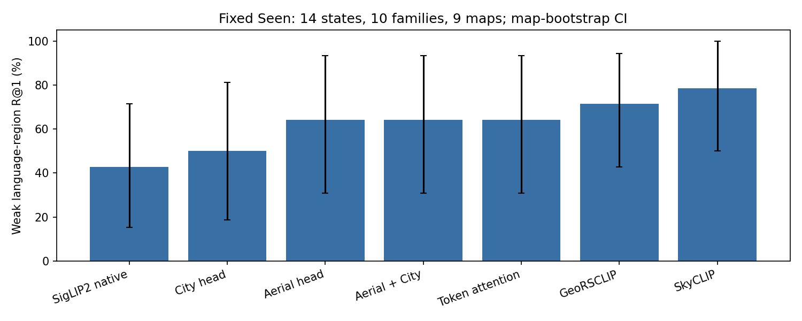
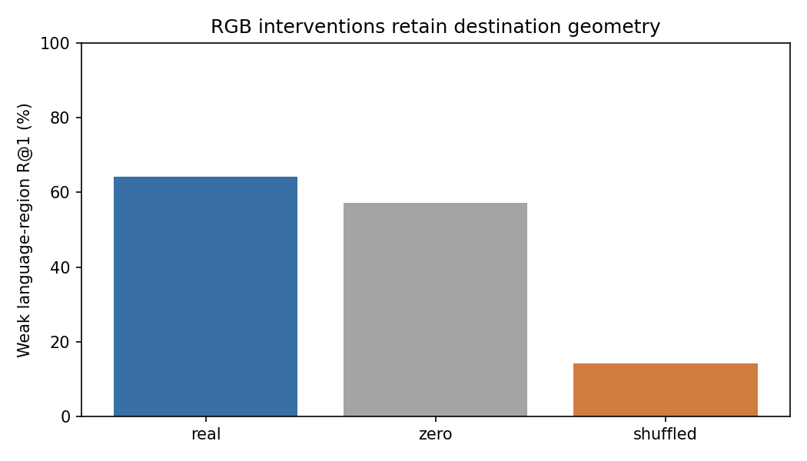
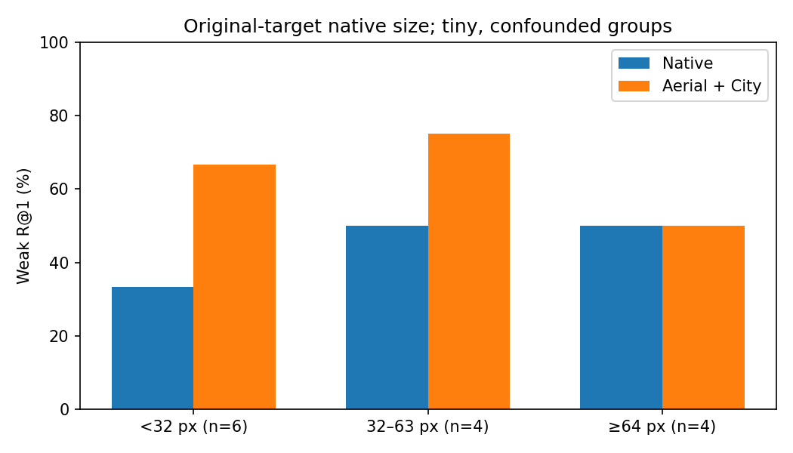
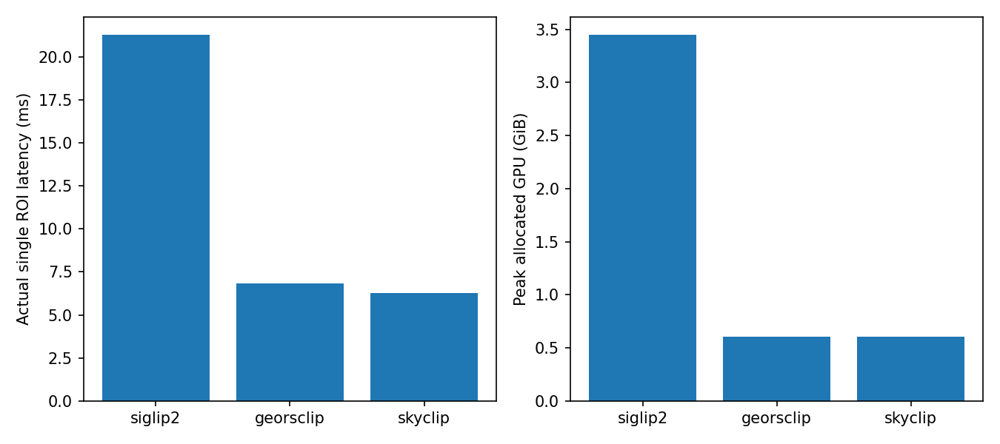

# GraphNav RGB–Language Grounding 分阶段验证（2026-10-10）

本轮实际完成了真实 CityNav 当前视域 ROI 编码、三种冻结视觉基础模型对照、AerialVG 轻量预训练、CityNav 适配、Token–Patch Attention、RGB/Language 反事实、冻结 A3 视觉残差及历史观测诊断。**有区域匹配收益，但没有证明目标定位或导航收益；停止新的闭环、Unseen、GAT 和大规模联合微调。**

代码位于独立分支 `research/rgb-language-grounding-20261010`，基于远端 main `0c2584421f812821791091f734371380b759c24d`。原有 A3、GraphNav-V1、A/B/C、双向实验及所有 Checkpoint 未覆盖。结果根目录为 `runs/rgb_language_grounding/`；可随代码审阅的小型指标、逐样本 CityNav 匹配预测和图片在 [evidence](assets/rgb_language_grounding/evidence/) 与 [案例索引](assets/rgb_language_grounding/cases.json)。完整高维缓存、权重、外部数据保留本地。

## 1. 结论与证据

1. **RGB 能提供部分语言匹配信号，但独立语义证据仍不充分。** AerialVG 内部视频隔离 Dev 上，冻结 SigLIP2 原生区域 R@1 为 77.04%，轻量预训练 Head 为 88.05%，配对视频聚类差值 +11.01pp，95% CI `[7.83, 15.75]`。这是用于选择 Epoch 的内部 Dev，不是独立外部 Test。CityNav 固定 Seen 弱监督小样本上，AerialVG＋CityNav Head 为 64.29%，原生 SigLIP2 为 42.86%，但 +21.43pp 的地图 CI 为 `[0, 41.67]`，尚不稳健。
2. **必须保留形状后再做 RGB 消融。** 适配 Head 在同一批 Seen 查询上，真实 RGB 64.29%、同类交换 RGB 14.29%、零 RGB 57.14%。真实−交换 +50.00pp，地图 CI `[8.33, 86.67]`；真实−零仅 +7.14pp，CI `[-14.29, 36.36]`。Polygon 形状、语言先验与弱标签仍可解释较多表现，不能把交换下降全部解释为颜色理解。
3. **检索命中不等于唯一目标定位。** Seen 有效语义查询只有 14 个状态、10 个指令/原始目标、9 张地图，其中建筑仅 3 个状态；允许多正例的弱属性候选平均 6.43 个。颜色相同的另一辆车可计语义正确，却不是原指令对应的唯一目标。
4. **所有候选方案均未达到闭环门槛。** 冻结 A3 的 Seen 正向 640 个 prefix 上，Geometry-only 和各方案 R@1 均为 44.53%；全部双向 1280 个 prefix 均为 23.44%。选定非零残差的纠错/误伤都是 0。提高残差的内部 Dev 诊断产生 9 次误伤、0 次纠错。没有新导航 SR/SPL 增益可报告。
5. **GeoRSCLIP/SkyCLIP 是值得进一步核验的轻量检索参照，暂不能据此替换现有 SigLIP2。** Dev 预先选定的 SkyCLIP tight/phrase 在 Seen 为 78.57%；统一tight/phrase诊断中GeoRSCLIP为85.71%，不能用Seen改选其表示。仅14个弱监督状态，且各冻结Goal残差没有增益。模型更快不代表已能改善GraphNav闭环。

## 2. 固定协议、数据与因果边界

[protocol.json](../experiments/rgb_grounding/protocol.json) 在新结果前声明：单 Seed=0、冻结所有基础模型、初轮 3 Epoch、最多四种轻量训练配置、GPU 预算 6 小时、外部下载预算 40GB。实际硬件为**单张 RTX PRO 6000 Blackwell Max-Q 96GB**，不是两张 5090；多项 CPU/小显存任务使用互不覆盖的目录并行执行。

Train 内部 Dev 继续按完整 family、对象及全部访问区域连通分量隔离；本轮内部 Dev 的 128 families 来自原 Train 内部 Dev，与训练 pilot 的 family/map 重叠均为 0。CityNav 原地图 Split 不变。Seen 使用原先固定的 128-family pilot；**没有运行任何新 Unseen**。模型 Epoch、基础模型 ROI/语言表示及残差配置只用内部 Dev 选择，Seen 不更新参数、Prompt、阈值或模型。

| 数据层 | Train | 内部 Dev | Seen |
|---|---:|---:|---:|
| 原 pilot 全部双向状态 | 20,450 | 1,280 | 1,280 |
| 可用弱语言/区域配对状态 | 597 | 43 | 原缓存 30 |
| 其中原生正向弱配对 | 409 | 27 | 原缓存 19 |
| 本轮公开语言解析＋已知正负候选交集 | 训练沿用 597 | 表示诊断沿用 43 | **14** |
| 弱配对 ROI 总数 | 15,634 | 968 | 340（14-state 交集） |
| 弱配对独立 families / maps | 386 / 20 | 28 / 3 | 10 / 9 |
| 弱配对原始目标对象数 | 323 | 22 | 10 |
| 人工核验外观标签 | **0** | **0** | **0** |

Train 的 597 配对包含 **188 条回程几何语言关联**，这些仅是区域/关系弱监督，不是颜色真值。409 条正向中，公开文本可保守绑定属性的只有 304 条，其余 105 条保留完整指令；分别有车辆颜色 249、建筑颜色 32、屋顶颜色 12、建筑形状 11 条。内部 Dev 的 27 条正向只有 25 条可绑定属性；Seen 14 条为车辆颜色 11、屋顶颜色 2、建筑形状 1。材质及复杂空间关系没有可靠视觉属性真值，未伪造标签。详见 [语言/监督审计](assets/rgb_language_grounding/evidence/language_supervision_audit.json)。

真实 RGB 来源是 CityNav/CityFlight 数据的当前位姿观测渲染：使用真实人类轨迹的当前 pose，在已验证的 renderer 中取得 384×384 当前视域，再投影 CityRefer Polygon。**没有增加目标附近完整原始正射图、未来视域或更高分辨率源细节作为推理输入。** Polygon 是几何弱 mask，不是人工语义分割；支持率、可见率、面积和最短边过滤继承已有协议。非正 AGL 等无效观测维持 Unknown。

Grounding Head 只接收文本、观测区域特征、真实 token、ROI quality 和 observed mask。对象 ID、目标坐标及属性标注仅用于离线关联/监督/统计，不进入视觉编码器。Goal 残差适用性由**公开指令＋实际有效 ROI**决定，不能用“真实目标已可见”筛选推理状态：Dev 269、Seen 242 个状态实际编码，Seen 为 4,929 ROI。语义评分再取其中 14 个有弱标签的状态，**Goal 评估仍覆盖所有 1280 状态**。

历史只取同 episode 中 cutoff 不超过当前的已观测区域，按公开质量保留视图；源 pose、cutoff、地图和候选顺序校验，不能把未来特征重标为当前。未观察/未接受区域的静态 logits 逐位保持不变，没有把缺图候选当负例。

## 3. 外部数据与来源审计

| 数据 / 模型来源 | 实际审计与规模 | 许可证/来源边界 | 本轮用途 |
|---|---|---|---|
| [DIOR-RSVG 官方](https://github.com/ZhanYang-nwpu/RSVG-pytorch) | 下载镜像后实读 17,402 XML/图像、38,320 对象表达；Train/Val/Test 索引 26,991/3,829/7,500，无无效 BBox | 官方 CC BY-NC 4.0；[HF 镜像](https://huggingface.co/datasets/LittleCollections/DIOR-RSVG)不是官方原包哈希认证 | **审计，不训练**：全球场景无逐样本 GPS，无法排除英国验证区域；split 索引对应表达而非直接图片名 |
| [RefSegRS](https://github.com/zhu-xlab/rrsis) / [论文](https://arxiv.org/html/2306.08625v2) | 4,420 表达/mask 对，官方 2172/431/1817；实读 RGB 和二值 mask，pilot Train 192、Val 64，191/64 具有有效固定 tile 正负例 | HF/发布 README 标 CC BY 4.0；表达模板化、mask 从语义标注派生，不是全部自由文本人工标注；原始影像权利需与发布许可区分 | **仅冻结跨域评估**：64 个等分 RGB tiles 先生成，再用 mask coverage ≥2%/≤0.1% 标记正/负，中间 Unknown；不冒充精细分割 IoU |
| [RRSIS-D](https://github.com/Lsan2401/RMSIN) | 官方另一个数据集，不能与 RefSegRS 合并计数 | 本轮未获得足够明确的逐样本地理与数据许可证明 | 来源调查，不训练、不报告虚构指标 |
| [AerialVG 官方](https://github.com/Ideal-ljl/AerialVG) / [HF](https://huggingface.co/datasets/IPEC-COMMUNITY/AerialVG) | 获授权后实下载 Train 37,788、Val 4,723 表达；5k/50k 为论文全库量级，实际该 HF Train/Val 镜像数单独记录 | gated 非商业用途；[VisDrone 官方源](https://aiskyeye.com/visdrone-2020/)是中国 14 城市，与本轮 UK CityNav 地域来源不同 | **唯一外部预训练数据**；不用官方图像重叠 Val 选择模型 |
| [RefDrone 官方](https://github.com/sunzc-sunny/refdrone) / [论文](https://arxiv.org/html/2502.00392v1) | HF 元数据核实；VisDrone 跨域多目标/空查询与生成文本需要单独协议 | HF CC BY 4.0；原始 VisDrone 权利另计 | 调查；不与 AerialVG 重复混入训练 |
| [RS5M / GeoRSCLIP](https://github.com/om-ai-lab/RS5M) | 实下载官方 B/32 权重，严格加载图文两塔 | HF 当前 license 为 `cc`，CC 子类型未明确；不能擅自写成确定的 CC BY 4.0 | 已有预训练模型对照；不训练 RS5M 全库 |
| [SkyScript / SkyCLIP](https://github.com/wangzhecheng/SkyScript) | 官方 5.2M OSM/多源遥感图文量级；实下载 SkyCLIP B32 top50pct | 仓库代码 MIT，底层影像按源许可；OSM/生成文本不是人工颜色真值 | 已有预训练模型对照；不下载混训全库 |

**AerialVG 官方 HF Train/Val 不能直接作为图像独立验证。** 两者分别有 4,876/2,946 独立图像，其中 **2,936 张重叠**，Val 仅 10 张不在 Train。保留官方文件并完整记录审计，另在官方 Train 内按原 VisDrone 源视频名 SHA 划分 Train/Dev，固定图像与表达哈希抽样 384/96 图像，视频组/图像重叠均为 0。实际图像下载 480 张全部成功；编码冻结时 Train 有 1 张尚未下载，因此已训练的缓存明确是 **383 图像**，没有把后续补下载伪装成原训练输入。对应 1,255 Train / 318 Dev 有可信相反颜色同类别候选的区域查询。

所有目标同表达的实际区域都可为正例；只有同保守类别、显式一致相反颜色的区域作为负例，其他 Unknown。未利用完整 caption 中关系锚点随机指定单一目标。当前预训练主要验证车辆颜色区域匹配，**尚不证明 AerialVG 全部多对象空间推理能力**。

对实际 480 Aerial 图像、RefSegRS 全部 Train/Val 2603 图片及 640 个 CityNav Train/Dev 已观测图像做 decoded-pixel SHA 和 pHash≤4 检查：分组间和与 CityNav 观测之间均无命中。详见 [审计](assets/rgb_language_grounding/evidence/data_audit.json)。这仅排除该检查范围的像素/感知重复，不能证明所有裁剪或地理无重叠。[DLR 原始说明](https://www.dlr.de/en/eoc/about-us/remote-sensing-technology-institute/photogrammetry-and-image-analysis/public-datasets/dlr-skyscapes)覆盖德国及其他欧洲国家，RefSegRS 包内无逐 tile GPS；因此本轮不将其用于 CityNav 前置训练。GeoRSCLIP/SkyCLIP 原始全球预训练地理足迹仍不可完全核实。

## 4. 冻结视觉表示与轻量训练

SigLIP2 比较 whole、原有 contextual patch pooling、tight ROI、Polygon-masked ROI、1.5倍 context ROI、tight＋context 多尺度，分别配完整指令/公开保守视觉短语。各模型使用相同 RGB 源、区域 ID 顺序、弱标签和候选；只允许官方预处理差异。16 个 patch tokens 是真实视觉塔 token 的 4×4 池化，不是新造的区域特征。

Dev 原有 patch/full 正向 R@1 为 51.85%，masked/phrase 为 81.48%（27 状态、20 families、3 maps）；因此 SigLIP2 主表示冻结为 masked/phrase。GeoRSCLIP 选 context/full（74.07%），SkyCLIP 选 tight/phrase（77.78%）。**Seen 不重新选择表示。** 在同 14 条 Seen 查询上：

| 方法（Dev 选择或预声明诊断） | Seen 弱区域 R@1 | 建筑困难 R@1（n=3） |
|---|---:|---:|
| SigLIP2 原生 masked/phrase | 42.86% | 33.33% |
| City-only Projection | 50.00% | 66.67% |
| AerialVG Projection | 64.29% | 66.67% |
| AerialVG＋CityNav Projection | 64.29% | 66.67% |
| AerialVG＋CityNav Token Attention | 64.29% | 66.67% |
| GeoRSCLIP context/full | 71.43% | 详见逐类型指标 |
| SkyCLIP tight/phrase | 78.57% | 详见逐类型指标 |

GeoRSCLIP 相对 SigLIP2 +28.57pp：地图 CI `[6.24,58.82]`，family CI `[-7.69,62.50]`，两种聚类估计不一致；SkyCLIP +35.71pp：地图 CI `[8.33,62.50]`，family CI `[7.69,64.75]`。样本及地图仍很少，没有据此声称建筑/屋顶普适优势或进行新的模型选择。所有完整分类型、分像素组和配对指标见 [metrics.json](assets/rgb_language_grounding/evidence/metrics.json) / [comparison.csv](assets/rgb_language_grounding/evidence/comparison.csv)。

上述是**Dev选定配置**的对照，同时改变了ROI表示和语言输入，不能把差值全部归因于Backbone。统一同一tight源BBox/同一查询的冻结诊断如下；所有组合原先已声明、只编码/评分一次，不根据Seen改选：

| 相同源ROI / 语言 | SigLIP2 | GeoRSCLIP | SkyCLIP |
|---|---:|---:|---:|
| tight / full | 64.29% | 78.57% | 64.29% |
| tight / phrase | 57.14% | 85.71% | 78.57% |
| 同一Polygon-masked / full | 35.71% | 71.43% | 57.14% |
| 同一Polygon-masked / phrase | 42.86% | 85.71% | 78.57% |

这些小样本诊断提示遥感预训练值得保留参照，但本轮不从其最高Seen单元格选新模型、Prompt或Goal残差。

附加冻结诊断：SigLIP2 tight/full 64.29%、context/full 57.14%、多尺度/full 64.29%、原 patch/full 50.00%。whole/full 为 50.00%，**但候选分数 100% 并列**，同一整图复制给每个 ROI 的排序没有区域信息；随机打破并列的期望 R@1 为 39.29%。不能将这个确定性对象 ID tie-break 数字称作视觉语义能力。

**VEN 实际结构：**1024维同 Checkpoint 图文向量分别经过 D→64→D 残差 Projection，末层零初始化，归一化后计算学习温度余弦相似度。置信分支接收 3维 ROI quality、cosine、相对均值差及分数离散度，输出 confidence/observed。Token 版本增加 64维四头 word-query / 16个 patch-token attention，token score 零初始化。模型不接收地图坐标、目标 ID 或目标坐标；只有后续公共 ROI→候选格关联使用地图几何。

实际 Loss：多正例 `logsumexp(all judged)-logsumexp(positives)`，乘正例可见/支持质量；加 `0.2 × max-negative margin loss` 和 `0.1 × known-label confidence BCE`。未知候选不参与损失，不能拿无法判断的建筑当负例。四配置均 AdamW lr=3e-4、batch8、Seed0、3 Epoch；Epoch 只按内部 Dev 正向语义 R@1 选：

| 训练配置 | 实际步数 | 参数 | 完整运行耗时 | 选择 Epoch / Dev R@1 |
|---|---:|---:|---:|---:|
| City-only Projection（597/43 弱配对） | 225 | 264,578 | 8.46s | 1 / 85.19% |
| AerialVG Projection（1255/318 查询） | 471 | 264,578 | 7.81s | 3 / 88.05%（外部 Dev） |
| AerialVG→CityNav Projection | 225 | 264,578 | 7.90s | 1 / 92.59% |
| AerialVG→CityNav Token Attention | 225 | 416,579 | 8.39s | 1 / 92.59% |

这些时间是**复用冻结特征后**的 Head 训练，不能冒充端到端大模型训练时间。CityNav Train 原生 crop 编码 496.86s，Seen公开适用视图编码157.24s；基础模型全部冻结。Token Head 没有比 Projection 增加 Seen 命中，未开展 LoRA、跨帧一致性额外训练、Graph/GAT 传播或全参数优化。

外部跨域控制：RefSegRS 64 个固定-tile mask 查询上，原生 SigLIP2 / City Head 76.56%、Aerial Head 62.50%、Aerial＋City Projection 56.25%、Token 57.81%。这是查询 mask 的区域 presence R@1，不是分割 IoU，也不是 CityNav 属性准确率。车辆颜色适配会退化道路/建筑/植被跨域 tile 定位，不能随意混合所有数据。

## 5. 反事实、原生像素和 ROI 污染

RGB 交换选同当前视图、同类别的其他**真实 ROI**，按公开对象顺序循环，缩放到目的 ROI 原始尺寸，再施加目的 Polygon；不选择目标 GT 或未来图像。零 RGB 将 Polygon 内置0、外部置127。geometry、quality、candidate availability、语言不变。Seen 4,929 ROI 中 4,574 有不同同类 donor，singleton 原样保留并标记。GeoRSCLIP/SkyCLIP 使用其冻结 tight/context 矩形的同类内容交换和零值，目的 BBox/质量/观测边界不变。

语言反事实枚举所有已有一致弱属性且当前候选确有相应对象的交换；没有假设每种反义词都存在。14 个状态支持 29 个换色/换形查询：原生 SigLIP2 R@1=48.28%，适配 Projection=62.07%，差 +13.79pp，地图 CI `[-4.77,28.00]`。这些29条并不是29个独立对象或人工真值；不加入训练，也不调整 Prompt。

| 原始目标原生最短边 | 状态数 | 原生 SigLIP2 | Aerial＋City |
|---|---:|---:|---:|
| <32px | 6 | 33.33% | 66.67% |
| 32–63px | 4 | 50.00% | 75.00% |
| ≥64px | 4 | 50.00% | 50.00% |

没有单调“高像素必然更好”的证据。每组仅4–6条，建筑/车辆、地图与可见性混杂，**不能认定分辨率是主要瓶颈**。放大为384/224模型输入不增加原生细节；官方 resize/center-crop 还会改变目标形状表达。

全部14条案例都已保存；抽查显示明显区域污染和语义歧义。例如 [case_00](assets/rgb_language_grounding/case_00.png)：black-car 原目标 crop 同时含邻车，选另一辆黑车仍满足弱多正例标签；[case_03](assets/rgb_language_grounding/case_03.png)：40px原生短边的 white-car bbox 含两辆车；[case_08](assets/rgb_language_grounding/case_08.png)：29px square-building 靠视域边缘且 ROI 背景污染，选了51px长条建筑。**图片审查没有把自动弱颜色标签升级成人工真值。**

## 6. 冻结 A3 残差与因果历史

Goal 使用保存的 A3 `9d9be861bf7e9cac986d747867990de3d409ccb9bc1545862d71a620448380d7`，XY20m标准不变。它是本轮控制定位器，不是 Stage C 微调后的正式 GraphNav-V1。更新只覆盖实际已观察候选；公共 centroid 格关联中每状态平均3.57个 ROI碰撞，身份区域排名与Goal格排名并不等价。

正向640状态中A3 Top1错355个，正确Goal仍在Top8的有180个；其中当前真实目标ROI有效可见的仅18个（10%）。全部双向对应980/215/21个。可进入视觉纠错的小集合远小于静态Top8可恢复集合，不能把其余缺图候选降权。

内部 Dev 先审查130组较高 confidence 阈值，发现学习 confidence 中位数约0.30–0.41，0.5会拒绝大部分证据；**在任何新的 Seen Goal 评分前**扩展为250组固定网格（gain=0/.025/.05/.1/.2，threshold=0/.1/.25/.5/.7/.9，current/history）。仍然最优为 gain0 fallback。为避免“关闭视觉所以没改善”的循环结论，另外固定每模型最佳**非零且低阈值**离线诊断，连同 real/zero/shuffle、current/history 一次执行；不把它当部署选择。

| 固定 Seen 正向 Goal（n=640） | R@1 | Recovery / Damage | 对Geometry差值 |
|---|---:|---:|---:|
| Geometry-only | 44.53% | — | — |
| SigLIP2 原生非零残差 | 44.53% | 0 / 0 | 0pp |
| City-only / Aerial / Aerial＋City / Token 各固定残差 | 各44.53% | 各0 / 0 | 各0pp |
| GeoRSCLIP / SkyCLIP 同一固定非零gain诊断 | 各44.53% | 各0 / 0 | 各0pp |

双向1280状态 Geometry-only R@1/4/8=23.44/32.03/40.23%，NE=67.12m；正向 NE=33.98m。所有 real-minus-geometry R@1 配对地图 CI均为 `[0,0]`，这是本 pilot 未改变成功判定的事实，不是总体效果精确为零的保证。Token 仅有极小连续 NE 变化，不能当成功率增益。全量逐状态预测和所有 control 指标保留各独立目录。

作为力度不足的排查，内部 Dev 已存在最大gain0.2的 Aerial＋City/history试验：正向 R@1下降 **1.406pp**，纠错0、误伤9；地图CI `[-2.571,0]`，仅4张Dev地图，不能过度解读。GeoRSCLIP/SkyCLIP 也用保存的 Dev 原生分数审查同样0–0.2网格，最优均为gain0；**没有据Seen检索排名为它们新增调参或重复Seen评估**。

| 离线 oracle（只用于上界，不可执行） | 当前 | 当前＋历史 |
|---|---:|---:|
| 双向目标真实可见率 | 10.63%（136/1280） | 15.78%（202/1280） |
| 正向目标真实可见率 | 14.84%（95/640） | 25.00%（160/640） |
| 完美对象身份＋现有centroid关联，正向R@1 | 52.97% | 58.91% |

Oracle 使用 evaluator-only 目标对象身份，不是模型结果；理想已观察目标格 oracle 双向R@1=30.78%。当前目标centroid到GT平均7.62m，93.38%落在XY20m内；大的道路/建筑仍会关联到错误位置。历史确实扩大视觉证据上界，但真实模型没有兑现它。

**闭环/Unseen门槛**仍为 real−geometry Goal R@1 地图配对95%CI下界>0、Net Recovery>0、且real>shuffled。全部不通过，所以没有新Trajectory/Stop训练、Seen导航或Unseen。正式主结果继续是冻结 GraphNav-V1 C Epoch1：既有完整Seen 2470 episodes SR47.61%、SPL46.00%；本报告不把旧结果写成新VEN的提升。

## 7. 当前 GraphNav 问题定位

不能只归因于门控接近零：早期双向E2 gate约−0.000611，但当前正式GraphNav-V1的 `visual_gain=0.416814`，不是零。当前Stage1仍使用有界 `0.5*tanh(gain)*tanh(centered/5)`，在相近区域分数上可能很弱；这与数据/关联问题共同作用。既有C Epoch1 Seen128实测 real/zero/no-belief SR=50.00/50.78/50.78%、shuffle47.66%，不能声称真实RGB相对无视觉提升SR。该旧zero控制是编码后的特征置零，与本轮保留Polygon的像素置零不同。本轮保留该Checkpoint，没有重训或覆盖。

主要证据指向：

- **监督和开放候选脱节。** 小型已知属性 gallery 可学；推理有全部可见候选和未标注同色对象，不能强行当负例，颜色命中不足以唯一定位。仅有少量可靠语言弱配对，建筑/屋顶验证尤其薄弱。
- **ROI并不纯净。** bbox 混入邻车、阴影、视域黑边；Polygon本身可给形状先验，零RGB表现较高。投影通过不代表语义分割正确。
- **语义与几何语言混杂。** Train适配含188条几何回程关联；生成“40m北侧”等关系不等于RGB属性监督。105条正向仍需完整指令，当前保守first-noun短语解析会遗漏 `building with ... roof` 或复杂关系，应保留审计，不能猜标签。
- **观测覆盖、格关联和校准不足。** 大部分真实目标未被当前观察，多个ROI落同格；confidence受稀疏正例先验影响，默认0.5无效。扩大residual导致误伤，不能仅调大gain。
- **不是主要由文本截断解释。** 弱配对389个Train独立指令仅1条超过SigLIP2的64-token上限；本Seen10条均不超过64。Token Attention也未带来额外命中。

下一步值得投入的是**人工审核的同类目标属性＋唯一空间关系、明确Unknown、多视图ROI纯度与公共候选关联**，而不是继续堆GAT或依赖合成属性。AerialVG有用的车辆颜色预训练不足以补齐CityNav屋顶/建筑定位监督。现有证据不支持直接替换SigLIP2或继续大规模联合训练。

## 8. 权重、精度、资源与复现

| 模型 | 官方版本/权重 | 参数 | 实际单ROI / 8-ROI gallery | 峰值已分配显存 |
|---|---|---:|---:|---:|
| SigLIP2 Large/384 | [官方模型](https://huggingface.co/google/siglip2-large-patch16-384)，revision `1b426889ea62b5a72bf9839009a1b184bfc9c178`；Apache 2.0 | 881.85M | 21.27 / 60.96ms | 3.447GiB |
| GeoRSCLIP ViT-B/32 | `Zilun/GeoRSCLIP` revision `4920188e6eba4e711ef9848cfd7cb77e874ee33f`，`RS5M_ViT-B-32.pt` | 151.28M | 6.83 / 13.72ms | 0.604GiB |
| SkyCLIP ViT-B/32 top50pct | 官方S3 checkpoint，文件SHA绑定，GELU | 151.28M | 6.28 / 14.46ms | 0.604GiB |

暖启动 wall latency包含官方图片预处理、传输及视觉编码，20次实际当前ROI；不含冷启动模型和地图首次加载。原始ROI不是演示图。8-ROI Head-only为 City0.87 / Aerial1.02 / Aerial＋City1.14 / Token1.48ms，**不包括视觉Backbone**。首次观测renderer0.549s、14条评估缓存读取0.085s，不能把Head-only毫秒数当导航延迟。

环境：Python3.10.22、PyTorch2.8.0/CUDA12.8、Transformers4.57.6、OpenCLIP3.3.0、NumPy1.26.4、OpenCV4.10.0、huggingface-hub0.36.2。官方权重的实际SHA、下载耗时、训练参数/步数/峰值/所选Epoch、全部cache/result SHA见 [model_manifest.json](assets/rgb_language_grounding/evidence/model_manifest.json)。没有修改现有主环境或Checkpoint；复用既有独立venv。

实际精度检查：SigLIP2 当前Seen16个ROI，FP16视觉Transformer＋FP32原生pooling vs FP32最低image cosine0.999993、text0.999952、最大score误差0.000492；GeoRSCLIP/SkyCLIP真实ROI同样通过 cosine≥0.995、score error≤0.01。所有实际训练有限Loss/梯度检查通过。

已修复并保留失败记录：直连超时后代理下载；单张Aerial图片ReadTimeout后独立补下载；Sky官方optimizer NumPy scalar只做数值类型allowlist，保持 `weights_only=True`；Geo使用OpenAI QuickGELU、Sky B32使用LAION GELU（[官方Notebook](https://github.com/wangzhecheng/SkyScript/blob/main/test_scene_and_fine_grained_classification.ipynb)仅L14启用QuickGELU），同参数形状不能证明函数等价；初始错误激活输出不纳入正式对照；校准配置自引用JSON、OpenCV包metadata名差异、审计计数及语法错误已修复。旧错误输出目录保留，不改写成成功记录。

最终回归：**275 passed，1个既有 rasterio PendingDeprecationWarning**，5.62s；额外真实RGB精度与CUDA有限数值检查见各运行产物，编译检查通过。测试覆盖私有目标字段拒绝、Unknown无负梯度、多正例、未观察logits不变、名词属性绑定、目的Polygon保持、无标签不产生语义指标、未来特征不能重标为当前。

运行入口与命令说明见 [README](../experiments/rgb_grounding/README.md)。完成后Commit SHA记录于 `runs/rgb_language_grounding/commit.json` 及交付回复；该记录在提交完成后写入，避免报告内自引用提交哈希。没有提交数据、模型权重或大型缓存。
