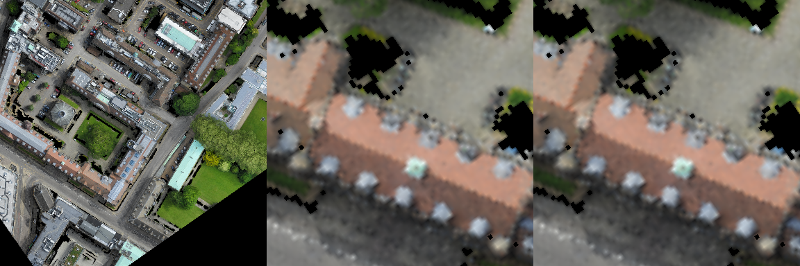
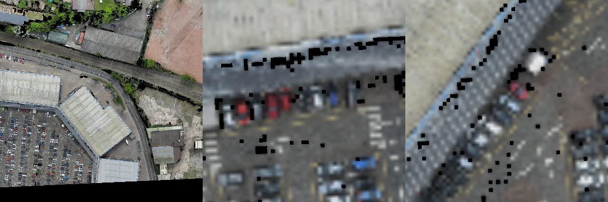

# 并行 RGB 诊断：Seen32（2026-10-10）

本机支持与冻结特征准备并行执行本次 RGB 诊断。测试已完成，耗时193.78秒，诊断进程峰值分配显存3.61GiB；两个进程同时存活的采样中，总显存峰值8.70GiB，GPU平均利用率36.5%。这是共享资源下实测，不是独占编码吞吐量。未改变正在准备的第一轮联合训练配置。

## 数据与方法

源代码Commit：`ebb7c1bc6b361b34a1598eab5b2d4d204d1c7ea0`。脚本：`scripts/evaluate_observed_rgb_matching.py`。原始结果、参数、数据SHA256、模型revision及32个固定Episode索引见[summary.json](../reports/active_perception_20261010/rgb_seen32/summary.json)。没有重新运行SBFNav或HETT。

使用Val Seen固定32 Episode的实际人类轨迹三个固定时间比例观测，并对满足高度条件的位姿单独测试下降10m后的观测。相机选择不使用目标信息；仅使用各观察时刻图像，历史轨迹帧不输入之前时刻。目标ID仅供离线评估标签。此处属于离线传感器诊断，不是20步闭环轨迹试验。观测高度遵循原始轨迹，未把所有原始人类位姿宣称为导航控制器合法高度。

全164次观测中18次同时满足目标可见、ROI有效和至少两个同类别候选，覆盖率10.98%，来自6个去重地图–指令Query。所有方法在相同候选上比较，候选类别条件由评估标签决定，因此结果是**条件地标身份检索**，不是无条件定位、颜色分类准确率或导航SR。保留全部失败/不合格观测于cases.jsonl；不合格观测不进入条件检索分母。

冻结SigLIP2 Large/384，microbatch16。单尺度为当前图像32m ROI；裁剪多尺度分别编码32/64/128m ROI后平均匹配；Patch多尺度为当前完整384图像的区域Patch池化，尚未经过本次任务匹配模块训练。数字裁剪放大不增加原始信息。三者共享同一原生图文空间，并列最高分采用公平分摊命中率。

## 结果

| 方法 | 18观测 R@1 | 6 Query宏平均 R@1 | 配对下降前 R@1 | 配对下降后 R@1 |
|---|---:|---:|---:|---:|
| 原生单尺度32m | 50.00% | 48.61% | 85.71% | 71.43% |
| 原生裁剪多尺度 | 44.44% | 40.28% | 71.43% | 71.43% |
| 原生Patch多尺度 | 8.33% | 4.17% | 28.57% | 7.14% |

下降配对只有7组，每组固定下降前后共同候选集合。禁止用不配对的11个原始观测与7个下降观测均值推断增益。样本很小且同Query重复，不能当作18个独立Query的统计结论。

建筑6观测的单尺度/裁剪多尺度/Patch R@1为66.67%/66.67%/25.00%；车辆12观测为41.67%/33.33%/0%。18个描述均含颜色词，但这不是人工标注颜色识别测试；形状描述有效样本为0，未验证。换成同城市、同类别的其他实际语言描述后，单尺度R@1仍38.89%，提示小样本不能排除候选与外观偏置。

## 视觉检查与局限

18组对照图保存在本地`runs/rgb_matching_parallel_seen32_20261010/comparisons/`；逐图SHA256见local_visualization_manifest.json。每图依次是实际384观测、标签地标32m数字裁剪、单尺度预测地标32m数字裁剪。仓库保存两个代表案例：

该建筑投影可见区域838像素。屋顶整体颜色可辨，但裁剪明显模糊，无法由此确认“三层”“钟楼”等精细语义。数字放大不能证明下降取得新细节。

该车辆投影可见区域177像素。停车场有密集同类目标，局部颜色粗略可见，单尺度预测失败。描述还含“从左第14辆”，需要关系与计数，不能把全部失败归因于RGB清晰度。图中黑色缺口与模糊也说明当前几何/深度有效性掩码及采样有信息损失；尚未隔离其具体因果影响。Polygon只是几何候选，不是真实语义分割。

原生Patch池化零样本表现差，可能涉及空间分辨率、区域池化与全局图文预训练的适配问题；本次未证明具体原因，也不能据此断言训练后的轻量匹配头无效。已有P2头以跨帧身份/类别对齐训练，尚未完成可靠的全语言匹配对照。本测试未覆盖所有用户要求的最终消融，不含Unseen，不产生SR/SPL或主动策略增益结论。

## 决策与复现

本次没有证据表明多尺度或下降稳定改善语义检索；保持完整联合方案不变，先完成已授权的第一轮训练和Seen128闭环验证，再决定修改。记录负结果，不据此调整Unseen方案。

完整启动参数见summary.json的args；使用原Python环境、`PYTHONPATH=.`、离线已缓存模型，运行上述脚本并指定新的output目录，避免覆盖现有结果。CSV/JSON位于`reports/active_perception_20261010/rgb_seen32/`。本报告只归档诊断，主任务实时进度以`runs/joint_active_first_epoch_20261010/workflow_status.json`和存活进程为准。
