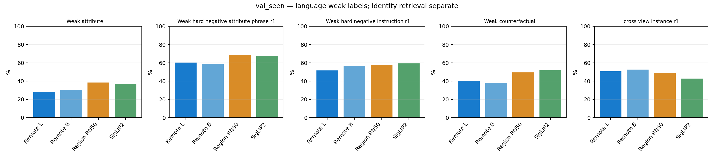
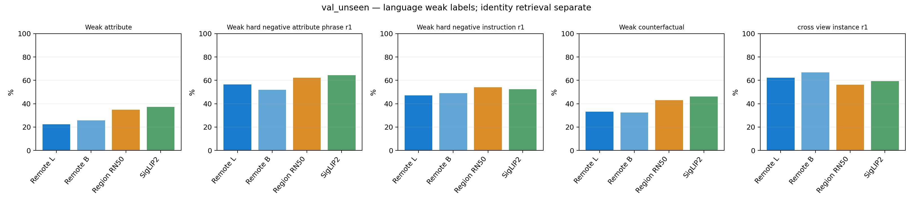
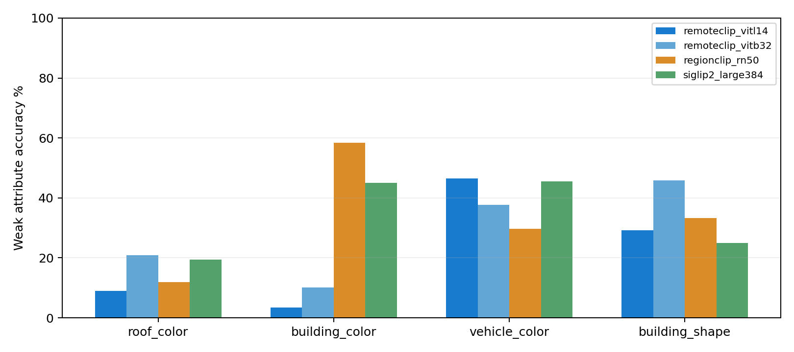
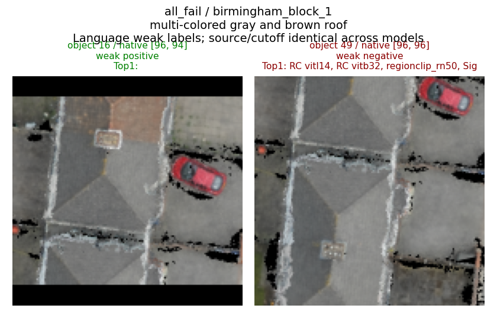
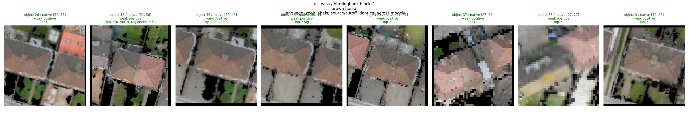
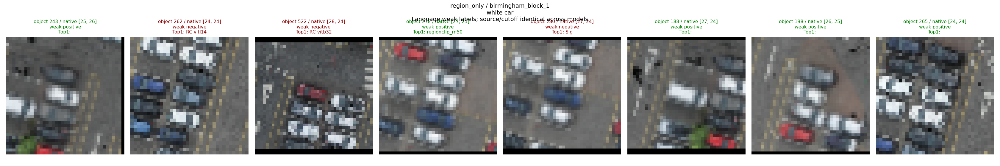
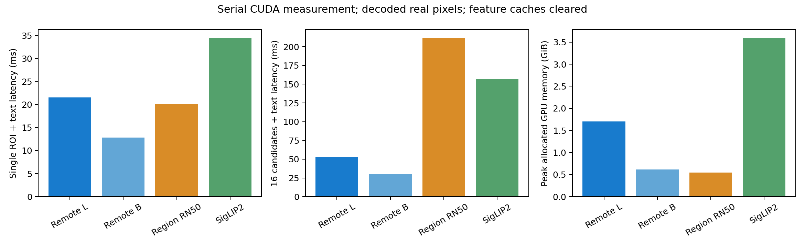

# CityNav 视觉基础模型真实运行报告（2026-10-10）

## 1. 已完成结果与结论边界

本轮实际运行 RemoteCLIP ViT-L/14、ViT-B/32、真正 RegionCLIP RN50 区域头和 SigLIP2 Large/384，完成 Train 零样本审计、Seen 开发评价、冻结后的单次 Unseen 正式评价、区域 Proposal、反事实、实例检索、数值精度、速度及冻结 A3 离线重排序。没有开展新的端到端导航训练。

**尚不能证明哪一个模型最理解细粒度颜色与形状。** 当前标签全部来自指令中的保守属性绑定，独立人工视觉核验标签为 **0**。因此下文语义指标均为“语言弱标签一致性”，可靠语义 Attribute Accuracy / Macro-F1、可靠语义候选排序与可靠属性反事实指标应记为 **N/A**，不能把弱标签数字替代可靠结果。

已有证据支持：RemoteCLIP B/32 的原生跨观察实例检索较强且成本低；SigLIP2 的弱语义总体较稳，RegionCLIP 在给定几何区域时有竞争力，但自身 Proposal 覆盖很低；RemoteCLIP 遥感预训练没有在本轮弱语义排序中显示优势。四个模型的 A3 弱标签重排序均损害 Seen 定位，可信属性门控下没有可重排证据。P3 因可靠监督不足停止，不能宣称完成了新 Adapter 或 LoRA 训练。

真实 RGB 来自 CityFlight/CityNav 轨迹时刻对应的原生正射图 nadir 视场，通过已验证投影路径生成。这是**原人类轨迹前缀的离线观测模拟**，并非无人机透视照片或 A3 政策闭环观测。模型只看该时刻或此前视场内 ROI；没有读取未来视场，也没有把目标附近完整正射图作为推理捷径。此源图局限限制向真实摄影航拍部署的外推。

## 2. 官方模型、权重与环境

RemoteCLIP 使用[官方仓库](https://github.com/ChenDelong1999/RemoteCLIP)和[官方权重](https://huggingface.co/chendelong/RemoteCLIP)，图像塔和文本塔严格加载同一 Checkpoint。RegionCLIP 使用[官方仓库及 Model Zoo](https://github.com/microsoft/RegionCLIP/blob/main/docs/MODEL_ZOO.md)中的 RN50 预训练模型，不是将普通 CLIP RN50 改名。SigLIP2 使用[官方模型卡](https://huggingface.co/google/siglip2-large-patch16-384)中的原生双塔。

| 模型 | 官方 Commit / Revision | 参数量 / 维度 / 输入 | 许可 |
| --- | --- | --- | --- |
| RemoteCLIP L/14 | a6a4787507e441f444c20404c90dd18520a8960d；HF bf1d8a3ccf2ddbf7c875705e46373bfe542bce38 | 427,616,513 / 768 / 224 | 代码 Apache-2.0；HF 未单独声明权重许可 |
| RemoteCLIP B/32 | 同上 | 151,277,313 / 512 / 224 | 同上 |
| RegionCLIP RN50 | 4b8513b56e24827e3d6468e1f2105869f35c2d0b | 101,953,888 / 1024 / 原生源帧区域 | 代码 Apache-2.0；权重未单独声明 |
| SigLIP2 L/384 | HF 1b426889ea62b5a72bf9839009a1b184bfc9c178 | 881,854,466 / 1024 / 384 | Apache-2.0 |

权重文件实测 L14 1.593 GiB、B32 0.564 GiB、Region 0.626 GiB、SigLIP2 3.285 GiB。参数行表示用于图文特征的编码器，Region checkpoint 还包含独立 offline RPN 权重；Proposal 成本单列。

权重 SHA256：

```text
RemoteCLIP L14 fcc2a7e21e171f4ffcb7a9c0206b8b74ac0c9eb83c67b576958b7a4ed6c8cecb
RemoteCLIP B32 60014e395d930a3f2963d1d89c8522bf4ad56775571e4356e866864789af85c4
RegionCLIP RN50 afbc58d7d4bd96e2b10cc0d1928a912ed519c3b3215df7e5f3285e4bb09c7c58
SigLIP2 11bdb3cf00c4dc4f87e437c9c75087ca16fa21aea437b3576c103670ee3c73be
```

实际设备为单张 **RTX PRO 6000 Blackwell Max-Q 96 GiB**，按空闲显存安排作业，未按双 5090 假设运行。共同评估环境：Python 3.10.22、PyTorch 2.8.0+cu128、torchvision 0.23.0+cu128、OpenCLIP 3.3.0、Transformers 4.57.6、NumPy 1.26.4、OpenCV 4.10.0、Pillow 12.3.0。RegionCLIP 另建独立兼容环境与官方源码适配，没有修改原 GraphNav 环境；其单独验证环境 Python 3.10.21、NumPy 2.2.6、OpenCV 5.0.0.93、PyTorch 2.8.0。精确版本、官方源文件哈希和加载状态保存在各模型 provenance 与 model_manifest.json。

RemoteCLIP 正式前向使用 BF16 autocast、归一化 FP32 特征与余弦分数，RegionCLIP 区域提取使用 FP32。RemoteCLIP 文本上下文 77 token，SigLIP2 为 64 token；完整指令可能被官方 tokenizer 截断，属于模型能力接口差异，未针对 Unseen 调整提示词。

## 3. P0 数据链路、划分与审计

复用 appearance_matching、observed_landmarks、landmark_projection、observed_patch_scales、landmark_visual_pretrain 和 prepare_joint_active_data 的投影与清洗约束，并阅读 BIDIRECTIONAL_VISUAL_LOCAL_VALIDATION_20261009、GRAPHNAV_SBF_INPUT_PROCESSING_AUDIT_20261010、ACTIVE_PERCEPTION_LOCAL_VALIDATION_20261010。对象 ID 只用于关联、分组和评估，不进入文本或视觉推理。

建立 instruction → target object → geometry → observed ROI；以原 CityNav 地图 Split 为准，原始 episode index 精确关联。每 episode 使用固定步骤 0、round(0.5×末步)、round(0.8×末步)，各步 cutoff 等于自身步骤，选择不依赖目标可见性或模型分数。Polygon 是几何弱标注；无法可靠投影、过小、RGB 空洞均记录失败而非补造标签。目标属性与周边汽车属性分别绑定，尺寸与周边上下文缺少可审核规则，列为 unsupported。

| 全量原始审计项 | Val Seen | Val Unseen |
| --- | --- | --- |
| Episode / 独立指令 / 目标对象 | 2470 / 2426 / 449 | 2697 / 2679 / 510 |
| 地图 / 固定观察帧 | 23 / 7319 | 4 / 7974 |
| 有效几何 ROI / 物化 ROI | 212798 / 26745 | 114733 / 8161 |
| 有效 ROI 独立对象 / 可见目标对象 | 4397 / 369 | 524 / 379 |
| 目标 ROI / 目标可见 Episode | 2097 / 1389 (56.23%) | 2107 / 1392 (51.61%) |
| 建筑 / 车辆 / 停车场 / 地面 ROI | 79347 / 118142 / 6875 / 8434 | 53309 / 47571 / 5795 / 8058 |
| 几何小/截断/无效失败；RGB 空洞 | 495622；36889 | 279552；39568 |
| 每可见对象平均有效观察 | 48.40 | 218.96 |
| 独立人工视觉核验标签 | 0 | 0 |

重复观察仍常来自同一正射纹理，不能当作独立属性监督。原生 ROI 最短边 ≥24 px 仅表示分辨率代理：Seen 建筑 81.06%、车辆 58.60%；Unseen 建筑 81.77%、车辆 62.40%。屋顶/建筑颜色的可辨认比例未经人工审核，不能等同这些比例。

| 冻结比较集合 | Seen | Unseen |
| --- | --- | --- |
| 原生有效共享图像 | 16427 | 4576 |
| 困难查询 / 独立目标查询对象 | 528 / 172 | 471 / 153 |
| 候选数范围 / 平均 | 2–156 / 19.34 | 2–31 / 8.95 |
| 多正例查询 | 431 | 299 |
| 实际跨观察检索对象 | 4294 | 506 |
| 弱属性对象-属性行 / 独立对象 | 2640 / 2194 | 281 / 226 |
| 屋顶色 / 建筑色 / 形状 / 车色独立属性实例 | 568 / 670 / 233 / 1169 | 67 / 89 / 24 / 101 |

候选必须在同地图、同类别且截止该步已观察；至少两候选，有语言支持的同属性对象允许多正例，不把未知标签对象当语义负例。实例检索使用两个不同观察 footprint，同源纹理重复的问题单独保留。不支持或目标指代不明确的属性记录 Train 6258、Seen 733、Unseen 956；Seen 另有 1349 条查询 native 过小、115 条目标属性不明确/冲突、92 条缺少支持的不同属性负例。低置信记录保留审计，不强行用于监督。ROI 内容固定为原生裁剪及固定上下文，模型仅使用自己的官方预处理。RegionCLIP 的完整观察帧 C4 感受野和区域 ROIAlign 上下文与整图 crop 不完全一致，这是区域架构差异而非严格像素内容等价实验。

Seen 先开发并固定配置；Unseen 锁定后只进行一次正式测试。协议 SHA256 为 `1edb6dc6402625482c1066a18cc264672a634dd113e9b9df977ebbb1520c43bd`，Seen 冻结索引 `38f90af92146e6570ee4b09667c0ee7a5c53874cce23ddc0ff72556aeedf08ec`，Unseen 为 `d4e8f42ad142df080406bdc0f84041ef2af650d216fb8897dd77f938c38ce9bf`。Train/Seen/Unseen 冻结集内四模型均完成相同有效输入；相对全量有效几何 ROI，Seen 编码覆盖 16427/212798（7.72%）、Unseen 4576/114733（3.99%）、Train 92780/1894967（4.90%）。这是本轮稀疏物化/索引范围，不是模型编码失败率；可继续扩充观察视图。可靠属性/可靠匹配覆盖仍为 0。所有模型输入、查询、正负标签与候选完全共享；任何事后审计发现均未用于重调 Unseen。

事后审计发现邻接短语绑定会将 “gray and brown roof” 压为 brown，将 “white and red car” 压为 red。这是未验证单颜色标签的具体缺陷：Train 197 查询及 230 属性行、Seen 18 查询及 224 属性行、Unseen 10 查询及 18 属性行被标记，保留原指标并保存 binding_limitations.json。不以合成标签修补结果。

### Train 全量几何审计与稀疏编码范围

Train Seen 实际完成 21878 Episode、21180 独立指令、3941 目标对象、24 地图、64754 固定观察帧；21779 Episode 有观察源。有效几何 ROI 1894967、物化原生 PNG 172645、目标 ROI 17973、可见目标对象 3294/3941（83.58%），全部可见对象 4564。建筑/车辆/停车场/地面 ROI 分别 688366/1071445/61481/73675；屋顶色/建筑色/形状/车色弱标签 ROI 分别 226767/260389/94207/280279。几何投影失败 4319450、源 RGB 空洞 325495。

本轮稀疏物化预算保留首两不同 footprint 和符合目标候选要求的视图，不是把全部 1894967 ROI 编码。冻结 Train 编码索引包含 92780 个共享原生 ROI、4936 个有效弱标签候选查询、4516 个跨观察实例和 2753 个对象–属性行。4936 个有效弱标签候选查询进入冻结训练审计，另有 9094 条 query_unmaterialized 为已可用几何元数据但未在本轮预算下物化，**不能解释为不可见或数据本身不足**。2625 条 native 边长不足、628 条目标属性不明确/冲突、741 条缺少可信不同属性候选分别记录。

Train 内部按 200m 地图区域哈希和对象身份划分：训练/内部开发对象 3938/626、区域 62/6，身份与区域 overlap 都为 0；4936 候选集合全部同分区。但有 5328 共享源帧，所以 frame family 不独立、外围上下文可能共享，不能声称内部开发集完全独立。不同 footprint 也不等价真实透视跨视角。Train 有目标几何可见 Episode 12198/21878（55.75%），每可见对象平均有效观察 415.20；最短边 ≥24 px 建筑 556462/688366（80.84%）、车辆 630419/1071445（58.84%），同样只是可辨认性代理。独立弱属性实例（屋顶色/建筑色/形状/车色）608/696/243/1206，困难查询分属性 377/718/146/3695。独立人工属性核验仍为 0，不进行新微调。

## 4. P2 零样本统一比较

下表语义行全部为语言弱标签指标，单位 %；Macro-F1 为 0–1。多正例随机 R@1 已有 Train 37.93%、Seen 41.31%、Unseen 43.11%，R@5 较高还受小候选集影响，不能直接视作理解能力。

### train_seen：额外零样本数据审计（无新训练）

四模型实际编码全部 92780 个相同冻结原生 ROI，此表只评价原预训练模型，**不是微调收益**。内部 Train/Dev 仅作分区审计，未用其错误弱标签训练。跨观察检索实际可用 4507 对象（冻结元数据 4516 中 9 个不满足有效多候选 gallery），困难查询 4936 条/1530 独立目标对象，候选 2–159、平均 20.53；对象–属性行 2753。

| 指标 | n | RemoteCLIP L/14 | RemoteCLIP B/32 | RegionCLIP RN50 | SigLIP2 L/384 |
| --- | --- | --- | --- | --- | --- |
| 弱属性 Accuracy | 2753 | 29.68 | 31.24 | 37.38 | 38.47 |
| 弱反事实 Accuracy | 13533 | 39.20 | 37.35 | 49.26 | 52.89 |
| 视觉短语困难 R@1 | 4936 | 57.56 | 56.54 | 63.96 | 66.63 |
| 完整指令困难 R@1 | 4936 | 48.08 | 51.01 | 53.75 | 57.50 |
| 视觉短语 R@5 | 4936 | 95.20 | 94.55 | 96.23 | 96.58 |
| 完整指令 R@5 | 4936 | 92.85 | 93.33 | 94.45 | 94.69 |
| 视觉短语 Pairwise | 4936 | 65.40 | 64.44 | 69.09 | 71.16 |
| 完整指令 Pairwise | 4936 | 58.74 | 60.45 | 62.48 | 64.78 |
| 跨观察实例 R@1 | 4507 | 51.74 | 54.56 | 46.22 | 45.60 |
| 跨观察实例 R@5 | 4507 | 75.22 | 79.05 | 67.14 | 69.91 |
| 弱属性 Macro-F1 | 2753 | 0.2432 | 0.2387 | 0.2325 | 0.3011 |

| 模型 | 短语 R@1 IID 95% CI | 地图聚类 95% CI | 实际图像编码 s / ROI每秒 |
| --- | --- | --- | --- |
| RemoteCLIP L/14 | 56.22 – 58.89 | 54.12 – 61.57 | 413.82 / 224.20 |
| RemoteCLIP B/32 | 55.15 – 57.92 | 52.91 – 61.28 | 192.97 / 480.81 |
| RegionCLIP RN50 | 62.64 – 65.28 | 59.34 – 69.41 | 250.35 / 370.60 |
| SigLIP2 L/384 | 65.38 – 67.89 | 63.53 – 70.53 | 988.93 / 93.82 |

Train 冻结索引 SHA256 `d299009c9fb012fd726841098d3b2c4ac570ab999039e5680cc5db4608851831`；主评价参数与 Seen/Unseen 一致。Train 属性实例分布与精确逐地图指标保存在 train/metrics_development.json。

### val_seen

| 指标 | n | RemoteCLIP L/14 | RemoteCLIP B/32 | RegionCLIP RN50 | SigLIP2 L/384 |
| --- | --- | --- | --- | --- | --- |
| 弱属性 Accuracy | 2640 | 28.03 | 30.49 | 38.48 | 36.74 |
| 弱反事实 Accuracy | 1354 | 39.88 | 38.18 | 49.48 | 51.92 |
| 视觉短语困难 R@1 | 528 | 60.42 | 58.71 | 68.56 | 67.80 |
| 完整指令困难 R@1 | 528 | 51.70 | 56.63 | 57.39 | 59.28 |
| 视觉短语 R@5 | 528 | 94.32 | 95.45 | 97.54 | 96.40 |
| 完整指令 R@5 | 528 | 93.94 | 93.37 | 95.45 | 96.02 |
| 视觉短语 Pairwise | 528 | 67.12 | 65.38 | 72.04 | 70.54 |
| 完整指令 Pairwise | 528 | 59.80 | 59.64 | 64.49 | 64.11 |
| 跨观察实例 R@1 | 4294 | 50.70 | 52.59 | 48.72 | 42.90 |
| 跨观察实例 R@5 | 4294 | 74.69 | 77.36 | 71.15 | 68.84 |
| 弱属性 Macro-F1 | 2640 | 0.2370 | 0.2298 | 0.2270 | 0.2601 |

| 模型 | 视觉短语 R@1 配对样本 IID 95% CI | 地图聚类 95% CI |
| --- | --- | --- |
| RemoteCLIP L/14 | 56.06 – 64.58 | 53.15 – 68.53 |
| RemoteCLIP B/32 | 54.55 – 62.88 | 52.17 – 66.08 |
| RegionCLIP RN50 | 64.58 – 72.54 | 60.49 – 76.51 |
| SigLIP2 L/384 | 63.83 – 71.78 | 60.47 – 76.17 |

### val_unseen

| 指标 | n | RemoteCLIP L/14 | RemoteCLIP B/32 | RegionCLIP RN50 | SigLIP2 L/384 |
| --- | --- | --- | --- | --- | --- |
| 弱属性 Accuracy | 281 | 22.42 | 25.62 | 34.88 | 37.37 |
| 弱反事实 Accuracy | 1169 | 33.28 | 32.42 | 43.11 | 46.19 |
| 视觉短语困难 R@1 | 471 | 56.48 | 52.02 | 62.21 | 64.33 |
| 完整指令困难 R@1 | 471 | 47.13 | 49.04 | 54.14 | 52.44 |
| 视觉短语 R@5 | 471 | 96.60 | 92.57 | 97.24 | 97.66 |
| 完整指令 R@5 | 471 | 93.63 | 93.42 | 95.54 | 98.09 |
| 视觉短语 Pairwise | 471 | 60.06 | 58.42 | 63.79 | 65.67 |
| 完整指令 Pairwise | 471 | 52.33 | 57.15 | 56.21 | 59.94 |
| 跨观察实例 R@1 | 506 | 62.25 | 66.80 | 56.13 | 59.29 |
| 跨观察实例 R@5 | 506 | 87.75 | 90.51 | 78.66 | 84.19 |
| 弱属性 Macro-F1 | 281 | 0.2268 | 0.2290 | 0.2512 | 0.2432 |

| 模型 | 视觉短语 R@1 配对样本 IID 95% CI | 地图聚类 95% CI |
| --- | --- | --- |
| RemoteCLIP L/14 | 51.80 – 61.15 | 52.34 – 67.26 |
| RemoteCLIP B/32 | 47.56 – 56.48 | 47.72 – 59.36 |
| RegionCLIP RN50 | 57.75 – 66.45 | 57.04 – 66.49 |
| SigLIP2 L/384 | 60.08 – 68.79 | 62.56 – 69.03 |

Seen RegionCLIP 短语 R@1 比 SigLIP2 高 0.76 个百分点，配对地图聚类差值 CI 为 [-6.79, 8.38]，不能证明胜出；RemoteCLIP L/B 分别低 7.39/9.09 个百分点。RemoteCLIP B32 原生实例检索比 SigLIP2 高 9.69 点，配对地图 CI [7.29, 11.88]。检索证据只说明实例相似性，不说明白色屋顶理解。

Macro-F1（总体和分属性）本轮为弱标签点估计，未另计算 F1 Bootstrap 区间；准确率的 CI 不能代替 F1 CI。可靠语义 F1 仍为 N/A。2000 次配对 Bootstrap 对共享样本重采样；地图聚类另对地图重采样以揭示空间相关性。Unseen 仅 4 张地图，聚类区间仍不稳定。反事实事件可能同对象重复；独立对象权重分析另外保存在 comparisons/object_balanced_metrics.json，不能把 1354/1169 个事件当同数独立对象。





## 5. 分属性、地图与对象类别

### val_seen：弱属性识别

| 属性 | n | RemoteCLIP L/14 | RemoteCLIP B/32 | RegionCLIP RN50 | SigLIP2 L/384 |
| --- | --- | --- | --- | --- | --- |
| building_color | 670 | 2.39 | 7.46 | 41.79 | 29.55 |
| building_shape | 233 | 37.34 | 38.63 | 28.76 | 27.90 |
| roof_color | 568 | 8.63 | 23.24 | 19.54 | 18.31 |
| vehicle_color | 1169 | 50.30 | 45.59 | 47.73 | 51.58 |

### val_seen：跨观察实例 R@1 分类型

| 类型 | 独立对象 n | RemoteCLIP L/14 | RemoteCLIP B/32 | RegionCLIP RN50 | SigLIP2 L/384 |
| --- | --- | --- | --- | --- | --- |
| Building | 1382 | 56.30 | 56.80 | 56.95 | 52.17 |
| Car | 2509 | 42.45 | 45.52 | 38.74 | 32.40 |
| Ground | 194 | 80.41 | 79.38 | 81.44 | 79.38 |
| Parking | 209 | 85.17 | 84.69 | 83.73 | 73.68 |

### val_seen：困难短语 R@1 分地图

| 地图 | 查询 n | RemoteCLIP L/14 | RemoteCLIP B/32 | RegionCLIP RN50 | SigLIP2 L/384 |
| --- | --- | --- | --- | --- | --- |
| birmingham_block_1 | 66 | 48.48 | 43.94 | 66.67 | 51.52 |
| birmingham_block_10 | 6 | 50.00 | 33.33 | 33.33 | 16.67 |
| birmingham_block_12 | 41 | 46.34 | 51.22 | 34.15 | 56.10 |
| birmingham_block_3 | 40 | 75.00 | 75.00 | 77.50 | 87.50 |
| birmingham_block_4 | 31 | 80.65 | 70.97 | 90.32 | 90.32 |
| birmingham_block_7 | 11 | 81.82 | 100.00 | 100.00 | 100.00 |
| birmingham_block_9 | 25 | 64.00 | 60.00 | 72.00 | 68.00 |
| cambridge_block_12 | 35 | 62.86 | 68.57 | 77.14 | 54.29 |
| cambridge_block_13 | 50 | 46.00 | 50.00 | 54.00 | 64.00 |
| cambridge_block_17 | 4 | 100.00 | 50.00 | 100.00 | 100.00 |
| cambridge_block_18 | 20 | 25.00 | 50.00 | 45.00 | 85.00 |
| cambridge_block_19 | 6 | 83.33 | 33.33 | 100.00 | 83.33 |
| cambridge_block_20 | 33 | 51.52 | 54.55 | 60.61 | 60.61 |
| cambridge_block_21 | 61 | 77.05 | 68.85 | 78.69 | 81.97 |
| cambridge_block_23 | 2 | 0.00 | 100.00 | 100.00 | 100.00 |
| cambridge_block_28 | 30 | 66.67 | 73.33 | 83.33 | 80.00 |
| cambridge_block_33 | 8 | 75.00 | 50.00 | 75.00 | 62.50 |
| cambridge_block_7 | 32 | 46.88 | 34.38 | 62.50 | 59.38 |
| cambridge_block_9 | 27 | 77.78 | 66.67 | 74.07 | 44.44 |

### val_unseen：弱属性识别

| 属性 | n | RemoteCLIP L/14 | RemoteCLIP B/32 | RegionCLIP RN50 | SigLIP2 L/384 |
| --- | --- | --- | --- | --- | --- |
| building_color | 89 | 3.37 | 10.11 | 58.43 | 44.94 |
| building_shape | 24 | 29.17 | 45.83 | 33.33 | 25.00 |
| roof_color | 67 | 8.96 | 20.90 | 11.94 | 19.40 |
| vehicle_color | 101 | 46.53 | 37.62 | 29.70 | 45.54 |

### val_unseen：跨观察实例 R@1 分类型

| 类型 | 独立对象 n | RemoteCLIP L/14 | RemoteCLIP B/32 | RegionCLIP RN50 | SigLIP2 L/384 |
| --- | --- | --- | --- | --- | --- |
| Building | 168 | 67.26 | 70.24 | 62.50 | 67.86 |
| Car | 251 | 53.39 | 60.56 | 43.43 | 45.42 |
| Ground | 55 | 72.73 | 76.36 | 85.45 | 81.82 |
| Parking | 32 | 87.50 | 81.25 | 71.88 | 84.38 |

### val_unseen：困难短语 R@1 分地图

| 地图 | 查询 n | RemoteCLIP L/14 | RemoteCLIP B/32 | RegionCLIP RN50 | SigLIP2 L/384 |
| --- | --- | --- | --- | --- | --- |
| birmingham_block_5 | 249 | 51.81 | 46.59 | 62.25 | 63.45 |
| cambridge_block_10 | 87 | 68.97 | 57.47 | 70.11 | 66.67 |
| cambridge_block_2 | 26 | 61.54 | 61.54 | 53.85 | 76.92 |
| cambridge_block_3 | 109 | 55.96 | 57.80 | 57.80 | 61.47 |

### train_seen：分属性 Macro-F1（语言弱标签）

| 属性 | L14 | B32 | Region | SigLIP2 |
| --- | --- | --- | --- | --- |
| roof_color | 0.1054 | 0.1205 | 0.1069 | 0.1412 |
| building_color | 0.0250 | 0.0679 | 0.1556 | 0.1226 |
| building_shape | 0.2585 | 0.2183 | 0.1558 | 0.3357 |
| vehicle_color | 0.3071 | 0.3277 | 0.3221 | 0.3192 |

### val_seen：分属性 Macro-F1（语言弱标签）

| 属性 | L14 | B32 | Region | SigLIP2 |
| --- | --- | --- | --- | --- |
| roof_color | 0.1074 | 0.1247 | 0.1029 | 0.1342 |
| building_color | 0.0255 | 0.0491 | 0.1148 | 0.1018 |
| building_shape | 0.2315 | 0.2338 | 0.1545 | 0.2613 |
| vehicle_color | 0.3217 | 0.2837 | 0.2991 | 0.3027 |

### val_unseen：分属性 Macro-F1（语言弱标签）

| 属性 | L14 | B32 | Region | SigLIP2 |
| --- | --- | --- | --- | --- |
| roof_color | 0.2535 | 0.2118 | 0.0711 | 0.1737 |
| building_color | 0.0484 | 0.0848 | 0.3747 | 0.2222 |
| building_shape | 0.2345 | 0.3849 | 0.1975 | 0.1333 |
| vehicle_color | 0.2629 | 0.2150 | 0.2116 | 0.3128 |

完整各类别、地图、指标 CI、独立实例数及候选规模在各模型 metrics_development.json / metrics_unseen.json 和总 metrics.json 中；逐样本 predictions 已保存。类别样本不平衡，不能用车辆数量掩盖屋顶/形状弱项。



## 6. RegionCLIP 区域表示与 Proposal

官方预训练 checkpoint 的 C4 → ROIAlignV2 14×14 → res5 → attention pool 与官方 Meta-Architecture 在真实帧两区域上 FP32 最大绝对误差 0、余弦 1，输出 2×1024，接口等价验证通过。独立适配仅支持本实验轴对齐区域，旧 Detectron2 旋转算子不受支持时显式失败。Polygon 只转换为其真实投影区域 bbox，并非人工语义分割。

| 自身 RPN Top100 指标 | Seen | Unseen |
| --- | --- | --- |
| ROI / 帧 | 16427 / 2731 | 4576 / 1095 |
| Proposal Recall IoU≥0.5 | 8.44% | 11.95% |
| IoU≥0.5 地图 95% CI | 6.11–12.34% | 8.60–21.33% |
| Proposal Recall IoU≥0.75 | 2.48% | 4.33% |
| 建筑 / 车辆 Recall IoU≥0.5 | 17.05% / 4.04% | 16.96% / 7.73% |
| 有可匹配 Proposal 的完整查询 | 25/528 (4.73%) | 28/471 (5.94%) |

| 相同 Proposal-covered 子集短语 R@1 | L14 | B32 | Region Polygon | SigLIP2 | Region Proposal |
| --- | --- | --- | --- | --- | --- |
| Seen n=25 | 60.00 | 52.00 | 68.00 | 60.00 | 64.00 |
| Unseen n=28 | 35.71 | 39.29 | 60.71 | 50.00 | 53.57 |

Proposal 配对用标注 Best-IoU 做诊断关联，属于已知几何条件下上界分析，不能把标注辅助匹配称作部署检测。Seen Proposal 统计阶段实测 226.35 s、峰值约 0.98 GiB、0 异常，正式命令与独立环境配置保存于 regionclip_rn50/setup_notes.md。子集小、CI 宽，不能将其准确率和 528/471 个全体查询直接比较。区域生成失败应归因覆盖瓶颈，不能全部归因编码器语义失败。给定区域时 RegionCLIP 具有竞争力，现有证据未证明优于 SigLIP2；自身 RPN 不适合直接替代 CityNav 几何区域来源。

## 7. 真实属性交换与视觉反事实

只在候选中存在语言标签支持的其他颜色/形状时交换短语与 ROI，未知属性不生成负例或反义词正例。弱反事实 Seen 的四模型为 39.88/38.18/49.48/51.92%，Unseen 为 33.28/32.42/43.11/46.19%。完整指令和短语使用相同基础表达，无模型专属 Prompt 优化混入主结果。

Seen 固定 150 个查询另做原 ROI 与中心遮挡、纯黑无效 ROI 对比：

| 原 ROI 得分更高比例 | L14 | B32 | Region | SigLIP2 |
| --- | --- | --- | --- | --- |
| 中心遮挡 | 50.00% | 52.00% | 83.33% | 80.00% |
| 纯黑无效 ROI | 59.33% | 94.00% | 97.33% | 98.00% |

中心遮挡平均分数变化分别 -0.00102/-0.00142/-0.02624/-0.02275，RemoteCLIP 地图区间包括零，显示本轮扰动敏感性不足；语言噪声与外围上下文也可能影响该结果，不能单凭此断言其纯语义能力失败。无效图只作诊断，不参与训练，不用来惩罚没有观察图像的 A3 Unknown 候选。

## 8. SigLIP2 既有 Patch/Adapter 与 P3 停止条件

| 实例检索方法 | Seen R@1 / R@5 | Unseen R@1 / R@5 |
| --- | --- | --- |
| 原生 SigLIP2 | 42.90 / 68.84 | 59.29 / 84.19 |
| 有效 Patch 均值 | 58.62 / 82.53 | 72.92 / 95.06 |
| 原有 P2 视觉 Adapter | 60.22 / 83.98 | 74.70 / 94.27 |

旧 Adapter SHA256 `f3e7e93c8644c8905884f36f2ca16f35f6b79ab776fee33a53091217a90892c4`，1024→256 维，为身份匹配训练头；没有同空间文本塔，不能将实例检索提升写为属性识别提升。仅聚合真实有效观察 patch，旧权重与缓存保留。该比较为已存在模型复用，不是本轮训练。

P3：所有当前属性监督为语言弱标签，独立图像核验为 0，未满足可靠标签门槛，因此停止新 Adapter/LoRA 可行性训练。实际 gate.json 记录新 Adapter/LoRA Epoch 均 0、已训练参数 0、训练时间 0 s；新模型训练收益与推理性能 N/A。Train 内部对象与地图区域隔离审计保留，但不能靠隔离解决错误属性标签。下一阶段先获取跨区域/对象独立审核监督；语义微调首轮选择 **SigLIP2 与给定几何区域的 RegionCLIP** 两类方法，使用同一 Train/Dev 集验证冻结 Backbone 的轻量 Adapter。RemoteCLIP B32 的廉价实例检索属于独立路线，不能因为实例最强便认定最值得语义微调；没有可用收益证据支持当前直接 LoRA 或全参数微调。

## 9. P4 冻结 A3 离线接入负结果

实际冻结定位器为 Seed1 Epoch14 best.pt，SHA256 `9d9be861bf7e9cac986d747867990de3d409ccb9bc1545862d71a620448380d7`，strict 加载原配置，未修改任何权重。锁定协议中的旧 geometry_best 文件描述为历史文案，以实际 SHA 与 provenance 为准。2426 个 map+instruction 查询选取原始首条记录，真实目标只用于成功率评价，不用于观测/候选选择。

静态 20m R@1=48.47%、R@8=78.03%、R@20=89.32%，NE=29.22m。1250 个 Top1 错误中，717 (57.36%) 在 Top8 可恢复，991 (79.28%) 在 Top20 可恢复；其中正确 dense slot 已观测仅 130/717 (18.13%) 和 221/991 (22.30%)。目标几何可见率 56.27%，足够分辨率物化 ROI 覆盖 21.60%。Top1/8/20 已知区域覆盖 13.27/27.25/32.65%。

可信视觉属性门控下可重排覆盖 **0**，所有模型 R@1 保持 48.47%，Recovery/Damage 都为 0。这不代表视觉有效，而是没有可信证据可接入。

探索性弱语言重排序共享 341 个有缓存查询、3857 查询–ROI 对，256 个允许同类不同对象置换的查询（10.55%）。仅在已知同类别 dense slots 内重排静态分数的原有多重集合，Unknown 分数逐元素完全不变，不因没有图像降分。

| 模型 | 完整指令 R@1 | 短语 R@1 | 完整指令 Recovery | 完整指令 Damage | 完整指令 ΔR1 地图 CI (pp) |
| --- | --- | --- | --- | --- | --- |
| RemoteCLIP L/14 | 47.61 | 47.77 | 0.32 | 2.13 | -1.34 – -0.39 |
| RemoteCLIP B/32 | 47.86 | 47.69 | 0.48 | 1.79 | -1.08 – -0.17 |
| RegionCLIP RN50 | 47.77 | 47.57 | 0.48 | 1.96 | -1.30 – -0.18 |
| SigLIP2 L/384 | 48.02 | 47.86 | 0.64 | 1.62 | -0.83 – -0.06 |

最佳完整指令 SigLIP2 也仅恢复 8/1250、损害 19/1176，净下降 0.45 个百分点。全部八个模型×文本方案的 IID 和地图聚类差值 CI 均小于零。保留负结果，不进行联合训练或闭环扩展。dense logits、784 网格世界坐标、逐查询证据/分数/重排预测与完整性检查均保存于 a3_reranking/。

## 10. 代表性可视化与标注风险

保存 150 组投影审计案例及 12 组基于 Seen 缓存的四模型候选对照；未重新筛选 Unseen 图像或重推理。成功/失败标题对应弱标签，仅是复查索引，不是人工确定的语义真值。



该案例两个对象可能裁到同一屋顶的相邻或重叠部分，原描述为并列多色而被单颜色绑定。四模型均选另一对象时，不能归因纯模型语义失败。裁剪后的建筑色也可能主要由屋顶而非立面占据，车辆 Polygon 可能含邻车；这些是监督及几何噪声。





原生源帧、cutoff、对象身份、ROI 像素尺寸和候选关联存于案例 manifest，方便后续人工核验。展示一致案例不构成整体标签审核。

## 11. 延迟、显存、精度与工程验证

隔离速度实验预解码、预加载权重、2 次预热、10 次重复，清理区域特征缓存；下表为单查询文本及 1/16 真实 ROI 的实测，不包含下载、模型加载和磁盘 I/O。

| 模型 | 1 ROI 中位数 ms | 16 ROI 中位数 ms | 16 ROI 吞吐 /s | 峰值分配 GiB |
| --- | --- | --- | --- | --- |
| L14 | 21.53 | 52.86 | 302.71 | 1.706 |
| B32 | 12.85 | 30.45 | 525.50 | 0.619 |
| Region | 20.09 | 212.15 | 75.42 | 0.544 |
| SigLIP2 | 34.52 | 156.83 | 102.02 | 3.602 |

Region 16 个区域常来自不同帧，完整 C4 提取多次；同帧共享特征缓存时主评价可更快，不能只用权重大小预测成本。Seen 全图编码包含读取开销，四模型分别 90.30/38.75/122.99/274.34 s（181.92/423.90/133.56/59.88 ROI/s），部分作业并行，吞吐受竞争影响。独立延迟优先用于模型成本比较；实际串行读取+OpenCV 解码 1000 个 ROI、1000 个完整观察 PNG，各重复 3 次，OS 页缓存已热；中位吞吐分别 **2153.11 ROI/s、471.26 源帧/s**，平均文件 32.2/285.0 KB，排除模型及 resize。这是 warm-cache I/O，不能外推冷盘或网络数据速度。完整 I/O 分解见 data_audit/io_benchmark.json 与 telemetry，不能把编码器 kernel 吞吐称作端到端效率。



精度检查在相同冻结 Seen 前 16 个真实 ROI 和 16 个文本上，固定容差：图像/文本余弦 ≥0.995、最大分数误差 ≤0.01、归一化误差 ≤0.002，FP32 参考关闭 TF32。生产 BF16 适配器与 FP32 对比：

| 模型 | 最小图像余弦 | 最小文本余弦 | 最大分数误差 | Top1 变化 / 结果 |
| --- | --- | --- | --- | --- |
| L14 | 0.999470 | 0.999983 | 0.001922 | 0 / PASS |
| B32 | 0.999836 | 0.999942 | 0.001527 | 0 / PASS |
| SigLIP2 | 0.999799 | 0.999963 | 0.001700 | 0 / PASS |

Region FP32 官方路径等价检查通过。所有模型实际 CUDA Smoke、有限值、维度、归一化检查通过；precision_check.json 保存源文件与 BGR 像素哈希、文本与 cutoff。缓存/微批次顺序可产生微小数值差异，未声称 BF16 与 FP32 位级一致。

完整测试 **212 passed，1 warning，5.81 s**（原 200 + 数值精度 4 + P4 输入长度/身份完整性 8）；compileall 通过。P4 missing/mismatched 输入会显式失败，防止 zip 静默截断。全部已存模型与数据哈希、有限值、Unknown 不变、冻结 Unseen 检查见 comparisons/final_integrity_audit.json。

下载与兼容修复均留日志：用户指定先直连，L14 直连 HF 探测在 10.002 s 超时后使用代理续传，保留已下载部分；Xet 失败后改 HTTP resume；官方源码 clone TLS 失败改 pinned raw 源文件。Region Google Drive 下载在 29164095 字节中断后用 6 路 8 MiB Range 请求恢复，检查 672111099 字节总量及 SHA；旧 CUDA 11.3 依赖无法用于 sm120，改复用既有 Blackwell 兼容二进制。没有覆盖旧 A3、A/B/C Checkpoint、P2 缓存或原环境。Region 老接口以官方源码可验证提取方式兼容现代轴对齐算子，未伪造不兼容接口结果。

A3 来源关联曾误将 episode_id 最后一步号当原始 episode index，经 map assert 修复为公共 map+instruction 的原始首记录；不改 dense logits。BF16 同分 topk 的 CPU tie 顺序曾造成无证据虚假增益，已固定原 Top1 及原 Top20 tie 优先级、重新跑全部重排序，历史输出独立归档。报告数值只来自修复后的最终产物。

实际执行零样本 Seen 命令如下（OMP_NUM_THREADS=1、MKL_NUM_THREADS=1、HF_HUB_OFFLINE=1）；完整 Unseen / 反事实 / Proposal / Patch / runtime 命令、退出状态与 wall time 见 [zero_shot_commands.json](../runs/visual_grounding_benchmark/zero_shot_commands.json) 和 [execution_commands.jsonl](../runs/visual_grounding_benchmark/execution_commands.jsonl)，数据构建与冻结入口见实验 README。部分环境/检查阶段由独立脚本执行，日志与 JSON 分别保留。

```bash
../visual-grounding-assets/remoteclip/.venv/bin/python -m experiments.visual_grounding.evaluate_zero_shot --model remoteclip_l14 --data runs/visual_grounding_benchmark/data_audit/frozen_seen --output runs/visual_grounding_benchmark/remoteclip_vitl14/seen --checkpoint ../visual-grounding-assets/remoteclip/weights/RemoteCLIP-ViT-L-14.pt

../visual-grounding-assets/remoteclip/.venv/bin/python -m experiments.visual_grounding.evaluate_zero_shot --model remoteclip_b32 --data runs/visual_grounding_benchmark/data_audit/frozen_seen --output runs/visual_grounding_benchmark/remoteclip_vitb32/seen --checkpoint ../visual-grounding-assets/remoteclip/weights/RemoteCLIP-ViT-B-32.pt

../visual-grounding-assets/remoteclip/.venv/bin/python -m experiments.visual_grounding.evaluate_zero_shot --model siglip2 --data runs/visual_grounding_benchmark/data_audit/frozen_seen --output runs/visual_grounding_benchmark/siglip2_large384/seen

../visual-grounding-assets/regionclip/.venv/bin/python -m experiments.visual_grounding.evaluate_zero_shot --model regionclip --data runs/visual_grounding_benchmark/data_audit/frozen_seen --output runs/visual_grounding_benchmark/regionclip_rn50/seen --checkpoint ../visual-grounding-assets/regionclip/regionclip_pretrained-cc_rn50.pth --official-repo ../visual-grounding-assets/regionclip/microsoft-RegionCLIP-4b8513b
```

大型权重、数据、embedding 和缓存仅本地保存。代码与报告最终 main Commit SHA 由提交后本地 commit.json 记录，避免报告自指哈希。

## 12. 下一阶段选择与产物索引

便于 GitHub 直接复核的小型证据副本：[比较表](assets/visual_grounding/comparison.csv)、[模型来源与配置](assets/visual_grounding/model_manifest.json)、[实际零样本命令](assets/visual_grounding/zero_shot_commands.json)、[A3 重排序表](assets/visual_grounding/a3_comparison.csv)、[随机候选基线](assets/visual_grounding/candidate_chance.json)、[I/O 实测](assets/visual_grounding/io_benchmark.json)、[P3 真实停止记录](assets/visual_grounding/finetune_gate.json)。大型逐样本与 embedding 产物仍只保存在本地 runs。

当前保留 SigLIP2 为视觉语义参考，RegionCLIP 作为给定几何区域的独立对照；不凭弱标签排名替换现有模型。补齐可信语义标签后，语义 Adapter pilot 优先 SigLIP2 与给定区域 RegionCLIP；RemoteCLIP B/32 优先用于便宜的实例检索及该独立任务的小 Adapter 验证，L/14 成本更高且本轮没有相应语义收益，暂不优先。Region 自身 Proposal 召回不足，不宜直接接入导航。现有 P2 Patch/Adapter 已显示实例检索收益，不能据此宣称可纠正语言属性目标。

最先补的是监督：按对象/区域分层人工核验颜色主体、屋顶与立面区分、多色/遮挡/邻车、geometry 重叠与候选多正例，建立可信独立评测，再决定微调哪个模型。当前可用几何 ROI 达到数十万，但可靠视觉语义监督数量仍为 0；两者不可混为一谈。A3 离线负结果支持暂不开展新的联合或闭环训练。

- [统一指标与辅助实验](../runs/visual_grounding_benchmark/metrics.json)、[比较 CSV](../runs/visual_grounding_benchmark/comparison.csv)、[官方模型清单](../runs/visual_grounding_benchmark/model_manifest.json)。
- [数据审计](../runs/visual_grounding_benchmark/data_audit/)、[标签绑定局限](../runs/visual_grounding_benchmark/data_audit/binding_limitations.json)、[对象平衡分析](../runs/visual_grounding_benchmark/comparisons/object_balanced_metrics.json)、[随机候选基线](../runs/visual_grounding_benchmark/comparisons/candidate_chance.json)。
- 各模型 seen/unseen 目录：共享输入 embedding、逐样本预测、分类型/分地图指标与配对 Bootstrap。
- Region proposals_seen/proposals_unseen：逐 ROI proposal 命中与同覆盖子集结果；SigLIP2 patch_retrieval：原有 Adapter/Patch 复用。
- [A3 汇总](../runs/visual_grounding_benchmark/a3_reranking/summary.json)、[运行完整性](../runs/visual_grounding_benchmark/comparisons/final_integrity_audit.json)、[案例清单](../runs/visual_grounding_benchmark/comparisons/cases/case_manifest.json)。

基础 main `96bc2288c274cae3a4f5fc68f985510a66b8cb4b`；独立 main worktree 开发，原工作区他人未提交文档保留。所有结论区分已运行结果、旧模型复用、因门槛停止的阶段及未来建议。
