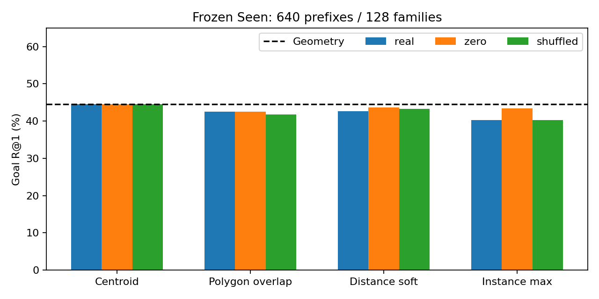
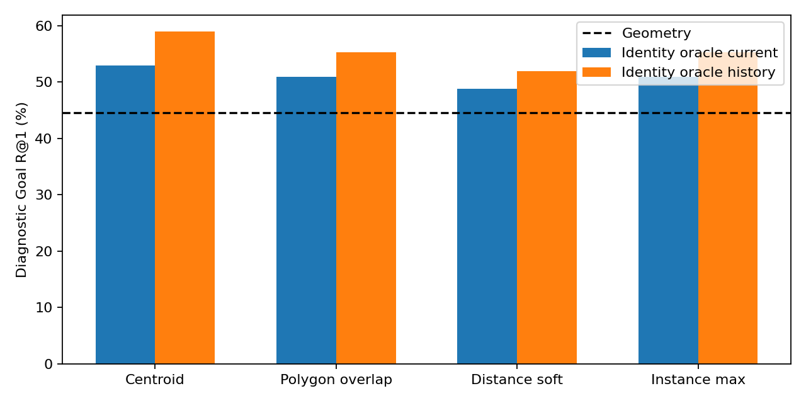
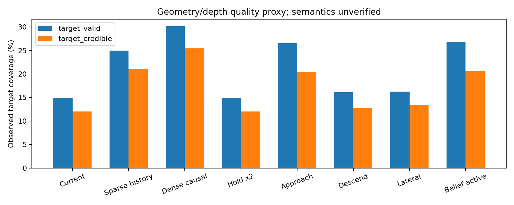
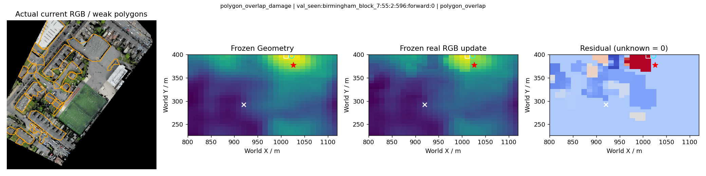
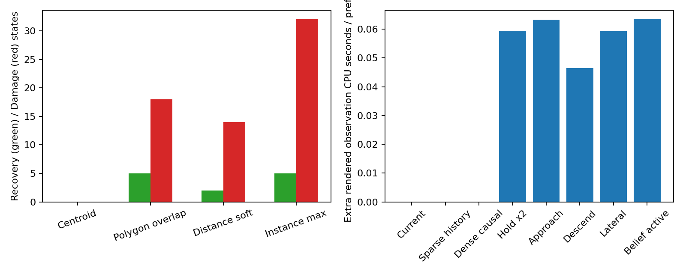

# GraphNav 视觉实例关联与观测覆盖验证（2026-10-11）

**本轮已完成 P0/P1 实际验证：Oracle 纠错上界成立，现有 Real RGB 校准/关联无法在固定 Seen 上安全改善 Goal；不继续融合训练或闭环。** 所有新模型训练、新 Backbone 编码、GAT、导航训练、Unseen 次数均为0。

## 1. 执行范围与冻结协议

独立分支 `research/visual-goal-association-20261011`，起点 `350f99d3a55d305969f934e31fea6faf08d05fe8`。复用冻结 A3 E1_seed1 缓存及既有 SigLIP2 / AerialVG+CityNav Projection Head。未更改 CityNav 数据、地图 Split、28×28候选、XY20m 成功判据或导航协议；保留全部旧权重与结果。

主人口：每个 split 固定640个正向 prefix /128 families；Dev4地图、Seen23地图，不是完整CityNav Seen全集。任何GT可见性均不筛选正式Goal人口。既有公开视觉短语缓存提供 Dev269 / Seen242 个状态的高分辨率ROI特征，其余保持Unknown。

运行前冻结[协议](../experiments/visual_goal_association/protocol.json)：256个 Dev 校准配置（4映射×2 score mode×8 gain×2 confidence×2 history），按Goal R1/Net Recovery/最少误伤/最小gain排序。配置与主执行源SHA在正式Seen前写入[freeze.json](assets/visual_goal_association/evidence/freeze.json)。Seen只运行一次固定配置对照，没有据结果重新选参数。后续审计/画图只读取既有结果。

Real / Pixel-Zero / 同类Pixel-Shuffled / 主Identity Oracle均使用同样的640状态、784候选和同一批已观测特征实例。单独 `all_cached_rois` Oracle 是扩大可用实例的覆盖上界，不冒充与共同特征主对照完全等价。GT身份仅在Oracle及事后指标中出现；正常评分函数和观察策略不接收GT目标身份/位置。

原有零RGB控制保留目标Polygon/边界形状，避免将形状变化误当成独立RGB贡献。完整逐样本结果及地图/family Bootstrap（2000次、seed20261011）保存于[证据目录](assets/visual_goal_association/evidence)。Dev地图少于5，地图CI不稳定；Seen不据小样本属性百分比改选模型。

## 2. 四种已实现关联与数值处理

- **Centroid**：兼容既有轮廓顶点均值到最近网格；只有已观察实例可关联。
- **Polygon–Grid Overlap**：真实Polygon先与实际相机footprint相交，再计算与原网格cell面积交叠；每实例最大权重归一化，同cell多个实例按交叠加权平均。不是人工Mask。
- **Distance-weighted Soft**：到已观察Polygon的距离，sigma为cell半对角线、截断2sigma，且仅支持实际footprint相交cell；同cell加权平均。
- **Instance-level**：按地图实例身份保留因果已访问视图，质量加权聚合分数并合并历史已观察支持；以overlap权重传播最强实例，避免先平均不同实例。没有将ID作为语义输入。

共同历史是同episode截至cutoff的缓存帧，未来step断言拒绝。所有未关联cell残差严格为0。大网格cell相交footprint不等于其全部像素被观察，报告不把它当精确分割覆盖。

数值消融：raw score或按当前观察实例标准化（std下限0.05、截断±3），confidence使用旧学习值或既有RGB/投影质量；gain固定网格0/0.025/0.2/0.5/1/2/4/8。没有训练任何关联神经模块。

Dev选定配置：

| 映射 | score | confidence | gain | history | Dev R@1 | Dev Recovery/Damage/Net |
|---|---|---|---:|---|---:|---:|
| centroid | standardized | quality | 0 | False | 67.19% | 0/0/0 |
| polygon_overlap | standardized | learned | 2 | True | 68.59% | 23/14/9 |
| distance_soft | raw | quality | 0.5 | True | 69.22% | 17/4/13 |
| instance | standardized | learned | 2 | True | 67.34% | 18/17/1 |

Dev Geometry R1=67.19%。Soft的+2.03pp（17纠错/4误伤）只是开发结果，不是独立验证；冻结后没有沿该配置继续搜索Seen。

## 3. P0 固定 Seen：真实视觉重排序

Recovery为原静态错误355状态中变正确的数量；Damage为原静态正确285状态中变错误的数量；Net=Recovery−Damage，非独立实例数。R1/4/8按原XY20m，NE为米。几何基线逐状态R1/4/8及NE与旧已缓存正式结果核验一致（NE容差1e-4）。

| 方案 | R@1 | R@4 | R@8 | NE/m | Recovery | Damage | Net | R1差值/pp 地图95%CI |
|---|---:|---:|---:|---:|---:|---:|---:|---|
| geometry | 44.53% | 60.16% | 72.66% | 33.98 | 0 | 0 | 0 | +0.00 [0.00, 0.00] |
| centroid_selected_real | 44.53% | 60.16% | 72.66% | 33.98 | 0 | 0 | 0 | +0.00 [0.00, 0.00] |
| polygon_overlap_selected_real | 42.50% | 62.19% | 73.59% | 34.95 | 5 | 18 | -13 | -2.03 [-5.61, 0.82] |
| distance_soft_selected_real | 42.66% | 61.41% | 73.12% | 34.28 | 2 | 14 | -12 | -1.88 [-4.81, 0.33] |
| instance_selected_real | 40.31% | 61.25% | 73.12% | 34.79 | 5 | 32 | -27 | -4.22 [-8.64, -0.48] |

最佳安全配置仍是Centroid/gain0。不能把Polygon的R@4改善或Soft的开发收益写成目标定位成功；Instance max传播在Seen显著误伤，最强实例并不代表正确实例。

| 映射 | Real R1 | Zero R1 | Shuffled R1 | Real−Zero/pp 地图CI | Real−Shuffled/pp 地图CI |
|---|---:|---:|---:|---|---|
| centroid | 44.53% | 44.53% | 44.53% | +0.00 [0.00, 0.00] | +0.00 [0.00, 0.00] |
| polygon_overlap | 42.50% | 42.50% | 41.72% | +0.00 [-1.82, 1.42] | +0.78 [-1.37, 3.06] |
| distance_soft | 42.66% | 43.59% | 43.28% | -0.94 [-3.04, 0.84] | -0.62 [-2.11, 0.31] |
| instance | 40.31% | 43.44% | 40.31% | -3.12 [-6.15, -0.33] | +0.00 [-1.42, 1.30] |

四种方法均未通过Real独立贡献、≥+1pp定位及纠错安全门槛。Oracle通过，不意味着应继续当前视觉融合训练。

## 4. 视觉分数是否真正影响排序

| 映射 | Top1改变状态数 | 正确区域最佳rank平均改善 | 平均关联cell覆盖 |
|---|---:|---:|---:|
| centroid | 0 | +0.00 | 0.79% |
| polygon_overlap | 108 | +2.13 | 11.75% |
| distance_soft | 81 | +0.82 | 15.60% |
| instance | 128 | +3.02 | 11.75% |

“正确区域rank改善”指GT成功半径内最好cell排名，可同时发生Top1退化；排名变化和净纠错不是同一指标。全部逐样本文件保存static/updated Top1、目标rank、实例分数/置信度、history视图数和changed/known cell。

真实Head置信度范围 0.258–0.462，全部4929 ROI中confidence≥0.5的比例为0。默认0.5阈值会拒绝全部信号；本轮没有这种隐性屏蔽。旧gain0.025/阈值0的centroid残差绝对最大值在640状态平均仅 0.0066，静态Top1/Top2平均margin为0.1287。

在静态错误且有共同视觉目标实例的20状态中，19/20（95%）Centroid已能关联成功区域，10/20有目标所在cell多实例冲突。可计算的17状态，要超过原静态赢家的gain必要下界均值9.73；这还不保证超过其他一起上升的错误候选。增大gain只解除数值屏蔽，不能解决错误语义排序。

Seen网格cell平均尺寸12.16×11.47m，最大边14.29m，640状态都有20m内合法候选（无候选量化上界失败）。ROI碰撞确实存在，但不是当前零纠错的唯一或主导解释。

## 5. Oracle：关联链路的纠错上界

Identity Oracle只知道哪个**已观察实例**是目标，将其全部关联cell抬到静态场最大值之上，实例内由原Geometry排序。没有用真实目标坐标选最优cell，也没有使用GT决定观察方向。大型/不规则对象的“目标实例已识别”仍不等于其目标位置已识别。

| 映射 | 共同实例 Current R1 / Recovery | 共同实例 History R1 / Recovery | 全缓存 Current R1 / Recovery | 全缓存 History R1 / Recovery |
|---|---|---|---|---|
| centroid | 47.50% / 19 | 50.31% / 37 | 52.97% / 54 | 58.91% / 92 |
| polygon_overlap | 46.88% / 15 | 48.75% / 27 | 50.94% / 41 | 55.31% / 69 |
| distance_soft | 46.41% / 12 | 48.12% / 23 | 48.75% / 27 | 51.88% / 47 |
| instance | 46.88% / 15 | 48.75% / 27 | 50.94% / 41 | 55.31% / 69 |

全部这些Oracle Damage=0。共同实例Centroid当前19次纠错、历史37次；全缓存当前54次、历史92次，Oracle门槛通过。Polygon/Soft传播范围更广，使原Geometry在目标大Polygon内部或周围选到成功半径之外，所以其身份Oracle反而低于Centroid。Identity ceiling不是理想坐标Oracle，也不是可部署效果。

独立案例：全缓存当前静态错误且目标有效55状态/33 families/31对象；共同特征仅20状态/15 families/13对象，历史40状态仍仅15 families/13对象。当前有效≥50**状态**不满足≥50独立案例，且人工确认属性标签仍为0。

## 6. 为什么属性匹配提升21.43pp却没有Goal Recovery

原有固定14状态弱监督属性R1：9/14=64.29%。**保持同一模型原始score及同一judged候选，只将判定改为原始目标身份时为6/14=42.86%；全部当前ROI实例竞争时为3/14=21.43%。** 多个同颜色汽车可满足描述，但不等于同一目标；后一个gallery扩大结果不与原属性指标假装等价。

失败链路已定位：①只有少量原始目标在当前高质量ROI与公开短语缓存交集中；②属性多正例成绩对唯一目标绑定要求较弱，候选扩大后对原始身份排序更差；③confidence不是可靠目标后验，默认阈值可全部屏蔽；④gain0.025太弱，增大后将更多错误候选推上去；⑤网格冲突与大Polygon位置歧义加重传播，但Oracle证明Centroid本身已经可以纠错。不能只改映射或放大残差来修复语义身份不足。

特别纠正此前“18个”的口径：它指静态Top1错、正确目标还在Top8、当前目标ROI有效的交集。640正向状态有355静态错误，目标有效的错误状态实际55个；Top8交集仍18个，不是全部可见错误样本。

## 7. P1：当前视域失败归因

保持原ROI规则：90%可见、256像素、最短边8、RGB/patch support≥0.9、最多32 ROI。更严格的“可信几何证据”额外要求目标mask depth-valid≥0.9，单独报告而不修改旧过滤规则。Depth是垂直高度代理，不能验证真实遮挡，Polygon不是人工分割，可信几何也不等于语言语义真值。

| 当前诊断 | 状态数 |
|---|---:|
| outside_fov | 245 |
| too_few_native_pixels | 51 |
| valid_geometric_roi_semantics_unverified | 77 |
| invalid_agl | 28 |
| fov_clipped | 134 |
| roi_quality_cap_32 | 20 |
| valid_roi_depth_insufficient | 18 |
| insufficient_rgb_source | 66 |
| projection_or_subpixel_failure | 1 |

实际再渲染的Current ROI与原缓存选择差异为 **0**，Dev同样为0。没有改变过滤规则来制造覆盖增长。进入FOV后失败进一步区分边界裁剪、原生像素不足、RGB无源、patch支持/投影、32个ROI质量cap与depth不足。

## 8. P1：历史与合法主动观察

Current+cached history只用原有prefix缓存；Dense causal history重放原始CityFlight中截至当前cutoff的全部已访问位置，不读取后续帧。新增动作按原公开map/pose/ground/legal limits：最多2次、XY≤50m、Z≤10m、AGL10–100m、保持yaw。非法初始位置不修正、不捏造动作。

Approach/Descend/Lateral方向由冻结Geometry Top1给出；belief-active复用原Top8概率×(1−observed confidence)，看到一帧后更新公开几何观测mask，静态Goal不重训。GT只用于动作完成后的目标覆盖统计。原始正射图仅环境私有renderer访问，政策获得实际当前crop。

这些新视图是在合法虚拟访问位置**实际渲染**的CityNav RGB/Depth，不是记录过的人类主动航拍，也不是真实物理飞行。只验证预算/覆盖及身份Oracle，没有为这些新图编码或宣称Real导航收益。Hold在同样两个机会重复当前观察，隔离额外budget带来的假提升；所有活动策略相同机会数，实际动作不足2时如实记录。

| 策略 | 目标有效率 | 目标可信几何率 | 静态错且可信：状态/family/对象 | Top8实例cell覆盖 | 平均额外观测/运动步 | 平均额外CPU秒 |
|---|---:|---:|---|---:|---:|---:|
| current | 14.84% | 12.03% | 45/28/26 | 8.07% | 0.000/0.000 | 0.0000 |
| cached_history | 25.00% | 21.09% | 82/28/26 | 15.51% | 0.000/0.000 | 0.0000 |
| dense_causal_history | 30.16% | 25.47% | 96/37/34 | 21.60% | 0.000/0.000 | 0.0000 |
| hold | 14.84% | 12.03% | 45/28/26 | 8.07% | 1.181/0.000 | 0.0594 |
| approach | 26.56% | 20.47% | 69/35/32 | 18.57% | 1.181/0.948 | 0.0633 |
| descend | 16.09% | 12.81% | 47/28/26 | 9.45% | 1.181/1.106 | 0.0464 |
| lateral | 16.25% | 13.44% | 51/31/28 | 9.08% | 1.181/1.181 | 0.0592 |
| belief_active | 26.88% | 20.62% | 68/35/32 | 19.49% | 1.181/1.177 | 0.0634 |

Top8覆盖是具有有效实例ROI并以centroid关联的候选cell比例，不是整个FOV像素覆盖。额外运动步与额外观测调用分开，Hold的图像调用不是移动。详细路径长度/pose/action/计算成本在逐样本文件。Dense history在真实在线过程没有增加未来动作，但离线重放有计算成本；不能当成免费新增观测。

| 策略 | 可信几何覆盖相对Current/pp 地图CI | 相同预算相对Hold/pp 地图CI |
|---|---|---|
| cached_history | +9.06 [5.60, 13.03] | 非同一额外观察预算 |
| dense_causal_history | +13.44 [9.19, 17.89] | 非同一额外观察预算 |
| approach | +8.44 [5.69, 11.28] | +8.44 [5.69, 11.28] |
| descend | +0.78 [0.16, 1.41] | +0.78 [0.16, 1.41] |
| lateral | +1.41 [0.62, 2.29] | +1.41 [0.62, 2.29] |
| belief_active | +8.59 [5.88, 11.43] | +8.59 [5.88, 11.43] |

## 9. 历史/主动观察的可纠错上界

以下Oracle只利用实际已观察到的目标实例ID与其公开centroid，保持同一个冻结Geometry和784候选；目标坐标仅事后判成功。它是覆盖增加的身份上界，没有新视觉评分，因此不能当作主动策略的Real RGB增益。

| 策略 | 身份Oracle R1 | Recovery | Damage | 深度可信且Oracle可纠错状态数 |
|---|---:|---:|---:|---:|
| approach | 57.03% | 80 | 0 | 67 |
| belief_active | 57.03% | 80 | 0 | 66 |
| cached_history | 58.91% | 92 | 0 | 79 |
| current | 52.97% | 54 | 0 | 44 |
| dense_causal_history | 61.56% | 109 | 0 | 93 |
| descend | 53.12% | 55 | 0 | 45 |
| hold | 52.97% | 54 | 0 | 44 |
| lateral | 53.91% | 60 | 0 | 50 |

这回答“最多能多获得多少证据”，不是理论无限预算上界；限于当前两动作、固定prefix和现有模拟相机。历史里存在但高分辨率语义缓存未编码的帧，已在coverage和成本中指出；本轮没有假设其语义可区分或把它纳入已完成视觉纠错。

## 10. 分层验收与停止判断

| 门槛 | 结果 |
|---|---|
| 合成关联/合法策略/因果历史测试 | 20项新测试全部通过；全部未观察cell Residual=0 |
| Oracle纠错上界 | 通过，共同实例Centroid当前19/20可见错误恢复；全缓存54次恢复，0误伤 |
| ≥50独立错误且可信实例 | 按各策略state/family/object统计，语义人工确认0；不将重复prefix或单纯几何覆盖当作独立语义验证成功 |
| Real独立贡献 | 四方法全部失败，Real−Zero及Real−Shuffled地图CI未同时下界>0 |
| Goal ≥+1pp且地图CI下界>0 | 四方法全部失败 |
| Recovery>Damage且Net>0 | 固定Seen四方法全部失败；Centroid gain0为0/0 |
| 同预算主动覆盖 | {"approach": true, "descend": true, "lateral": true, "belief_active": true}；这是几何/depth覆盖门槛 |

Oracle成立而Real失败，后续优先验证**唯一实例语义监督与可弃权的置信度校准**，并补足真正独立实例；停止当前融合训练，不试更大GAT或更强gain。只有未来同协议通过独立RGB与定位/安全门槛才提出闭环SR/SPL验证；本轮不提交闭环实验方案来暗示已经准备扩大训练。

## 11. 失败案例、资源与复现

保存7组真实Current RGB、弱Polygon、Geometry、Real更新与Residual图，含各方法纠错/误伤及“身份正确但Polygon内部位置错误”。[案例索引](assets/visual_goal_association/cases/cases.json)。GT红星只用于事后可视化，RGB均来自当前visited pose。

P0缓存准备 Dev 151.86s / Seen 165.68s；评价 Dev 32.10s / Seen 34.22s。P1实际环境渲染 Dev 15855帧、742.58s；Seen 13733帧、740.19s。CPU并行运行独立任务，实际耗时包含地图冷加载与Polygon投影，不将额外轻量评分当作完整导航延迟。新GPU编码/训练成本为0。

最终回归 **295 passed, 1个既有rasterio warning**；新20项几何/Unknown/合法动作/未来视图拒绝测试全部通过。代码编译通过；逐状态冻结Geometry R1/4/8、NE与旧结果一致。权重、数据、大缓存仍只在本地；[README实际命令](../experiments/visual_goal_association/README.md)，配置、Seed、manifest输入SHA、冻结代码SHA和原始JSONL都已保存。校准最初过早读取尚未完成prepare输出而失败，保留失败目录；正式 `calibration_dev_verified` 等待缓存完成后执行，没有覆盖旧结果。

实验完成后仅移除coverage.py一行空白行尾空格；执行时的冻结SHA保留，提交版AST与执行版完全一致，[审计](assets/visual_goal_association/evidence/whitespace_cleanup.json)。未更改配置、数值、动作或重新运行Seen。

提交SHA在提交完成后的 `runs/visual_goal_association/commit.json` 和交付回复记录，避免报告自引用提交哈希。

## 12. 下一步最值得验证的假设

1. **完整语句中的目标身份约束没有进入属性匹配指标。** 用≥50独立实例的人工核验目标/竞争对象集，分开“颜色语义满足”与“原始实例身份”，并加入真正可判断的同类负例；冻结现有表示，先验证身份排序和Real−Zero，不训练大网络。
2. **低confidence和极小gain只是屏蔽，不是安全校准。** 用Train内部Dev的实例错误/缺目标查询做可弃权校准，条件在真实观察质量上；在固定Seen门槛下检验误伤是否下降。禁止把无图或无法判断的实例作负例。
3. **稀疏prefix缓存丢掉了已访问历史证据。** 先把本轮已经识别出的因果有效历史ROI补进冻结编码器缓存，独立保存来源/step/footprint，再测实例身份与纠错。新增观察覆盖只能提供素材，不能替代语义验证。
4. **大Polygon还需要实例内位置约束。** Oracle结果表明扩大支持面会受Geometry错误局部峰影响。优先验证已有语言中“边缘/旁边/方位”的保守位置约束和显式实例到cell证据，不改成功半径、不换候选集。

这些是下一轮待验证假设，本报告不把它们写成已完成收益。
