# CityNav TRAIN 空间方向词参考系独立实验

日期：2026-11-06。分支：`experiment/citynav-direction-frames-20261106`。版本：direction-frames v1。

## 结论与适用范围

**不能把 CityNav 中的 left/right 或 front/behind 作为统一、确定的世界坐标方向约束。** 完整扫描原始 TRAIN 的 22,002 条 episode，在 24 张地图发现 28,077 次指定方向词出现。严格绑定并排除轮廓相交/近边界后保留 212 对（180 个目标对象）。在这一保守子集中，四个主要方向词即使分别选择最有利的世界坐标轴，其 90° 扇区一致率也只有 33–44%。更强的反例是：同一真实目标、同一参照物、同一 ΔXY，出现了 4 组正反词描述。

这足以否定“全部指令遵守统一固定轴约定”的强命题；**不能**据此估计整个数据集里不同描述参考系的真实混合比例。保守解析的覆盖率低，所选样本偏向具名地标与简单句式，其他指令仍不可外推。统计上更集中也不等于已经证明描述者采用该参考系。

## 数据来源与隔离

- 仅打开 `original_citynav/citynav_train_seen.json`：22,002 条；没有读取 Val/Test，也未用其校准方向。
- 使用 `cityrefer_original/objects.json` 与 `processed_descriptions.json`；后者只记录来源，不用其无作用域的 landmarks 列表建立关系。原始对象库有 34 张地图，本分析仅使用 TRAIN 出现的 24 张地图。
- GT 仅在文本解析和唯一名称解析完成后进入离线几何层；没有模型推理、训练或权重加载。Geometry、Relation、PGVB 网络均未改动。
- 原始输入 SHA256、参数和软件版本见 [manifest.json](results/manifest.json)。全部 TRAIN episode 及目标 GT 见 [episodes_train.csv](results/episodes_train.csv)，目标轮廓见 [target_catalog_train.json](results/target_catalog_train.json)，全部 TRAIN 地图具名对象（含同名候选）轮廓见 [reference_catalog_train.json](results/reference_catalog_train.json)；底图和 TIF SHA256 见 [raster_manifest.json](results/raster_manifest.json)。

TRAIN 指令与 CityRefer 的同一 `ann_id` 原文比较发现 539 条不完全一致，详见 [annotation_alignment_audit.json](results/annotation_alignment_audit.json)。本实验将相应候选关系排除，未依据相似文本或 GT 强行重配。重复英文保留为不同原始 annotation，但另有唯一英文、唯一配对加权敏感性统计。

## 提取协议与数量

主统计用大小写不敏感的完整单词边界，逐次记录 left/right/front/behind/back/rear/above/below/top/bottom/north/south/east/west。另扫描 leftmost/rightmost、复合地理词、upper/lower/backyard 等，见 [extended_lexemes.json](results/extended_lexemes.json)，不混入单词统计。词次数、指令数、唯一英文数不能混用。

严格可接受关系要求：目标为主句/明确前置关系的主语，关系后紧接同地图唯一完整具名对象；允许标点与冠词正规化，不作模糊别名匹配；多个同名对象不选最近对象。匿名车/树、介词链、子区域、多个参照物协调、未定指代均不猜测。`car in a parking lot behind Church` 不转成 car behind Church；`behind the yard of Church` 不把 Church 当直接参照物。`right next to`、`West Midlands`、`front yard`、`rear bumper`、序数/局部位置和对角复合方向分别记录排除。

“绑定数”包括被轮廓检验排除的样本；“有效数”仅表示可做位移角分析，不表示某种方向假设正确。对每个参考系还另做完整轮廓的方向显著性判定。
| 词 | 出现次数 | 含词 episode | 唯一英文 | 绑定数 | 有效数 | 排除或 ambiguous |
| --- | --- | --- | --- | --- | --- | --- |
| left | 5220 | 4693 | 4331 | 83 | 35 | 5185 |
| right | 6039 | 5128 | 4696 | 106 | 41 | 5998 |
| front | 5289 | 4814 | 4781 | 138 | 30 | 5259 |
| behind | 4886 | 4731 | 4378 | 177 | 75 | 4811 |
| back | 718 | 682 | 660 | 5 | 2 | 716 |
| rear | 16 | 13 | 13 | 0 | 0 | 16 |
| above | 710 | 574 | 564 | 18 | 7 | 703 |
| below | 547 | 485 | 458 | 12 | 3 | 544 |
| top | 1285 | 1229 | 1138 | 0 | 0 | 1285 |
| bottom | 1012 | 939 | 892 | 0 | 0 | 1012 |
| north | 440 | 394 | 391 | 20 | 14 | 426 |
| south | 362 | 319 | 318 | 19 | 5 | 357 |
| east | 62 | 62 | 62 | 0 | 0 | 62 |
| west | 1491 | 1265 | 1150 | 0 | 0 | 1491 |

几何/绑定无法进入主角度分析：27,865/28,077 = **99.2%**。这包含非关系词与保守解析漏检，不能称为“99% 指令使用了未知参考系”。全部 14,829 条含方向词 episode 中，212 条有有效配对（1.4%）。

逐词、逐原因、逐作用域的全部计数见 [exclusion_reasons.csv](results/exclusion_reasons.csv)；每次出现的原文、字符偏移、目标 ID、候选参照 ID、规则和状态见 [occurrences.csv](results/occurrences.csv) / [occurrences.json](results/occurrences.json)。有效集已做助手英文作用域审读，记录于 [accepted_scope_audit.csv](results/accepted_scope_audit.csv)；它不是人工标注金标准，也不是独立审稿。
| 主要排除原因（前12项） | 次数 |
| --- | --- |
| reference_not_uniquely_named | 6437 |
| no_explicit_relation | 5648 |
| ordinal_extremum_or_part | 4252 |
| indirect_reference_np | 3507 |
| direction_in_proper_name | 1507 |
| part_or_unresolved_relation | 1355 |
| preceding_relation_scope_uncertain | 1301 |
| embedded_or_indirect_subject | 1187 |
| duplicate_landmark_name | 805 |
| subject_uncertain | 485 |
| ambiguous_overlap_or_near_boundary | 358 |
| part_attribute_or_extremum | 310 |

## 坐标校准：已证实与未证实

对 TRAIN 的 24 张地图逐一读取 TIF affine：均为无旋转栅格，列增加对应 +X，行增加对应 −Y，因此 **图像向右=+X，图像向上=+Y**。这来自独立地图元数据，不来自目标—参照物方向拟合。所有 24 个 TIF 的 CRS 均为空，缺少经纬度控制点和官方地理变换参数，故**真实地理北向未校准**。图和表只标 +X/+Y，绝不把 +Y 写成北。详见 [coordinate_audit.json](results/coordinate_audit.json)。

已查阅 [CityRefer 原论文](https://arxiv.org/html/2310.18773)，其地图配准使用人工选择的对应点和几何变换；当前 objects JSON 不含这些参数。官方 SensatUrban 仓库的[坐标系统问题 #63](https://github.com/QingyongHu/SensatUrban/issues/63)也没有给出可复用的坐标定义。本实验没有从目标 GT 或 north 词的最佳轴倒推地理北，再将其当独立证据。地理词在下面仅作**语言标签对照组**，不计算“真实北向准确率”。

原始六维 pose 为 `[x,y,z,look_dx,look_dy,look_dz]`，初始 yaw=`atan2(look_dy,look_dx)`；五维兼容格式的 yaw 按 radians 处理。仅取 trajectory[0]，不取当前/末端 yaw。描述来自 CityRefer，而轨迹是另一个导航阶段的记录；[原始注释界面](https://arxiv.org/html/2310.18773)使用可交互的 3D 场景，导出的当前对象文件没有记录每条描述的相机姿态。因此初始 yaw 只是待验证代理，绝不是已知描述 yaw。

## 几何与统计定义

ΔXY = target_positions[0].xy − reference.position.xy；θ=`atan2(ΔY,ΔX) mod 360°`。参照点为对象标注 position（不假装等同于 Polygon 面积质心）；同时保存目标 position、GT 偏差、轮廓、面积、相交面积、最近边界距离。没有用 marker_positions 代替目标 GT。

预设主容差 **1m**。缺失/非法轮廓不修补而排除；相交、接触、最近边界距离 ≤1m 或位移范数 ≤1m 标为 ambiguous。角度层只对剩余不相交配对统计。另对每个假设轴 u，投影**全部轮廓顶点**：若 min(T·u)−max(R·u)>1m 则 consistent；若 max(T·u)−min(R·u)<−1m 则 opposite；其余 ambiguous。线性投影的极值位于顶点，故该检验覆盖完整多边形边界，不是取几个质心。较大的地标也使用同一完整边界检验。

主角度一致率 = θ 位于候选方向 ±45° 扇区的比例；圆集中度 `R=|mean(exp(iθ))|`，越接近1越集中。表中角度偏差是相对指定轴的 circular absolute error。A 的轴是从四条 XY 轴中分别挑最优，仅是描述性拟合；不预设 left/right/front 的轴，也不强制正反词互为反向。提供按目标 ID 哈希分为5折的交叉拟合（同一目标所有描述同折），以及 leave-one-map-out 控制，全部限于 TRAIN。

置信区间同时保存 Wilson 95% 和按 `(map,target_id)` cluster bootstrap 95%（1,000次，固定 seed=20261106）。正文优先 cluster CI；条件是当前已选子集和固定预测结果，不覆盖解析误差、选择偏差或词轴模型选择不确定性。单一对象/小样本的 bootstrap 可退化，须同时参考 Wilson 区间；不作大样本结论。0.5/1/2m 敏感性见 [geometry_tolerance_sensitivity.csv](results/geometry_tolerance_sensitivity.csv) 与 [polygon_hypotheses.csv](results/polygon_hypotheses.csv)。

## A：固定世界坐标方向

| 词 | n | 拟合最佳轴 | 90°一致率 | cluster 95% CI | 均值绝对偏差 ° | 圆集中度 R |
| --- | --- | --- | --- | --- | --- | --- |
| left | 35 | −Y | 42.9% | [25.7, 60.0]% | 64.5 | 0.327 |
| right | 41 | −X | 43.9% | [27.9, 60.0]% | 62.4 | 0.544 |
| front | 30 | −X | 36.7% | [20.0, 53.4]% | 79.3 | 0.182 |
| behind | 75 | −Y | 33.3% | [19.4, 48.7]% | 78.0 | 0.204 |
| back | 2 | +Y | 50.0% | [0.0, 100.0]% | 94.7 | 0.194 |
| above | 7 | −X | 71.4% | [42.9, 100.0]% | 26.2 | 0.891 |
| below | 3 | +Y | 66.7% | [0.0, 100.0]% | 52.7 | 0.772 |
| north | 14 | −X | 64.3% | [35.7, 85.7]% | 50.0 | 0.555 |
| south | 5 | +X | 80.0% | [40.0, 100.0]% | 44.8 | 0.586 |

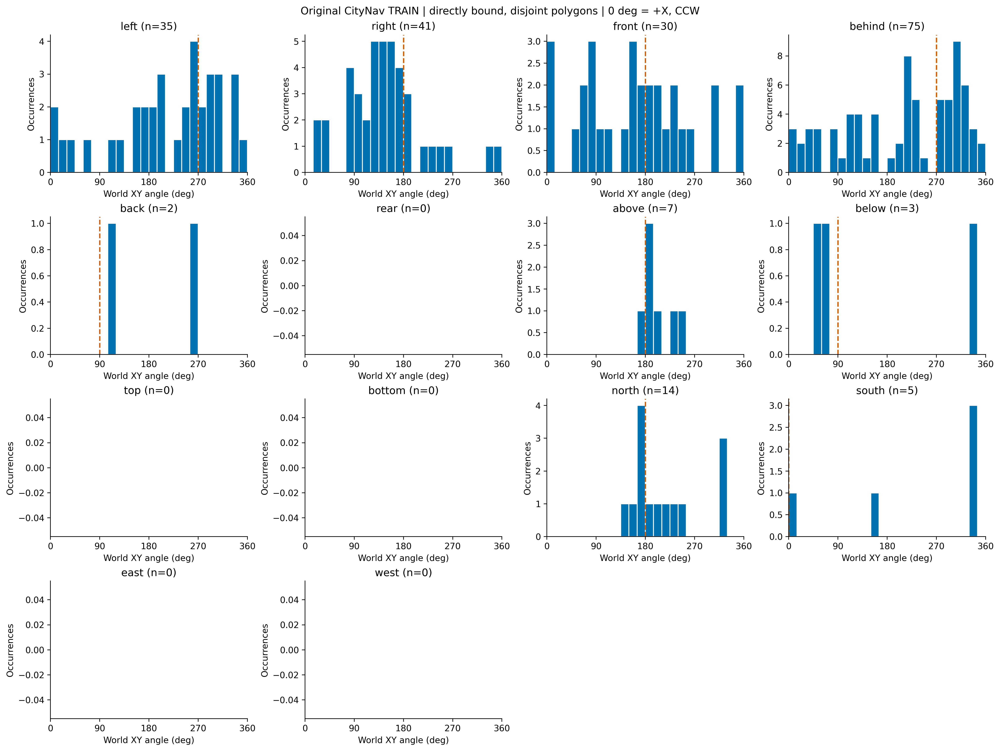

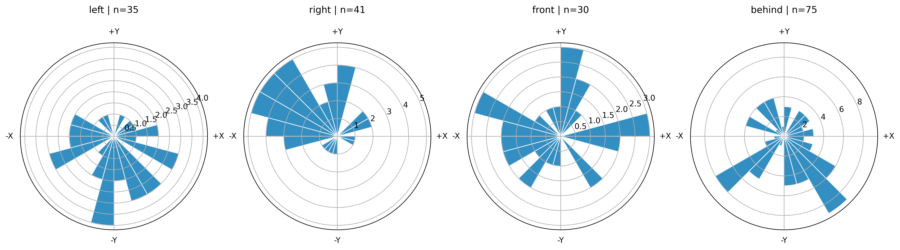

四个主要方向词的方向不统一；left 和 right 的最优轴甚至不是相反轴，因此也不支持统一正交世界方向字典。这里最佳轴并不等于推荐约定。允许任意旋转、事后挑选一个最有利的90°扇区，其覆盖上界分别为：
| 词 | 任意旋转后最优90°覆盖上界 |
| --- | --- |
| left | 42.9% |
| right | 63.4% |
| front | 43.3% |
| behind | 44.0% |

完整来源见 [free_axis_upper_bound.json](results/free_axis_upper_bound.json)。这避免了“只是最佳方向刚好落在对角线上”的解释，但仍不是总体覆盖率估计。

## B/C/D：参考系对比

B：θ−初始 yaw；C：θ−atan2(reference.y−start.y, reference.x−start.x)。其预设语义偏移为 front=0°、left=+90°、behind/back/rear=180°、right=270°。C 起点与地标距离 ≤1m 不可评估。D 只接受独立可信的有向地标朝向；本地对象 schema 仅有 position/dimension/contour，没有 heading/facade/入口朝向字段，因此覆盖率为0。道路/车辆的 Polygon 长轴存在180°歧义，不能当作 front 朝向；计算的无符号长轴仅作工件记录，不参与 D 的方向成功率。

下表在各词共同支持集上比较；A 为按目标对象交叉拟合，B/C 为上述预设语义，D 不可评估。覆盖率分母分别是该词的全部出现次数和几何有效数。
| 词 | 假设 | n | 词次数覆盖 | 有效配对覆盖 | 一致率 | cluster 95% CI | 相对A改善及95%CI |
| --- | --- | --- | --- | --- | --- | --- | --- |
| left | A_world_crossfit | 35 | 0.7% | 100% | 42.9% | [25.7, 60.0]% | 0.0% [0.0, 0.0]% |
| left | B_initial_yaw | 35 | 0.7% | 100% | 25.7% | [11.4, 40.0]% | -17.1% [-37.1, 2.9]% |
| left | C_start_landmark_LOS | 35 | 0.7% | 100% | 17.1% | [5.7, 31.4]% | -25.7% [-45.7, -5.7]% |
| left | D_landmark_heading | 0 | 0% | 0% | 不可评估 | — | — |
| right | A_world_crossfit | 41 | 0.7% | 100% | 43.9% | [27.9, 60.0]% | 0.0% [0.0, 0.0]% |
| right | B_initial_yaw | 41 | 0.7% | 100% | 19.5% | [7.5, 32.6]% | -24.4% [-46.3, -2.4]% |
| right | C_start_landmark_LOS | 41 | 0.7% | 100% | 17.1% | [5.0, 29.3]% | -26.8% [-45.0, -9.7]% |
| right | D_landmark_heading | 0 | 0% | 0% | 不可评估 | — | — |
| front | A_world_crossfit | 30 | 0.6% | 100% | 26.7% | [12.1, 43.3]% | 0.0% [0.0, 0.0]% |
| front | B_initial_yaw | 30 | 0.6% | 100% | 20.0% | [6.9, 33.3]% | -6.7% [-24.1, 12.5]% |
| front | C_start_landmark_LOS | 30 | 0.6% | 100% | 13.3% | [3.3, 25.0]% | -13.3% [-27.6, 0.0]% |
| front | D_landmark_heading | 0 | 0% | 0% | 不可评估 | — | — |
| behind | A_world_crossfit | 75 | 1.5% | 100% | 33.3% | [19.4, 48.7]% | 0.0% [0.0, 0.0]% |
| behind | B_initial_yaw | 75 | 1.5% | 100% | 20.0% | [11.4, 30.3]% | -13.3% [-27.6, 1.5]% |
| behind | C_start_landmark_LOS | 75 | 1.5% | 100% | 17.3% | [8.8, 26.0]% | -16.0% [-32.9, 1.3]% |
| behind | D_landmark_heading | 0 | 0% | 0% | 不可评估 | — | — |
| back | A_world_crossfit | 2 | 0.3% | 100% | 0.0% | [0.0, 0.0]% | 0.0% [0.0, 0.0]% |
| back | B_initial_yaw | 2 | 0.3% | 100% | 50.0% | [0.0, 100.0]% | 50.0% [0.0, 100.0]% |
| back | C_start_landmark_LOS | 2 | 0.3% | 100% | 0.0% | [0.0, 0.0]% | 0.0% [0.0, 0.0]% |
| back | D_landmark_heading | 0 | 0% | 0% | 不可评估 | — | — |

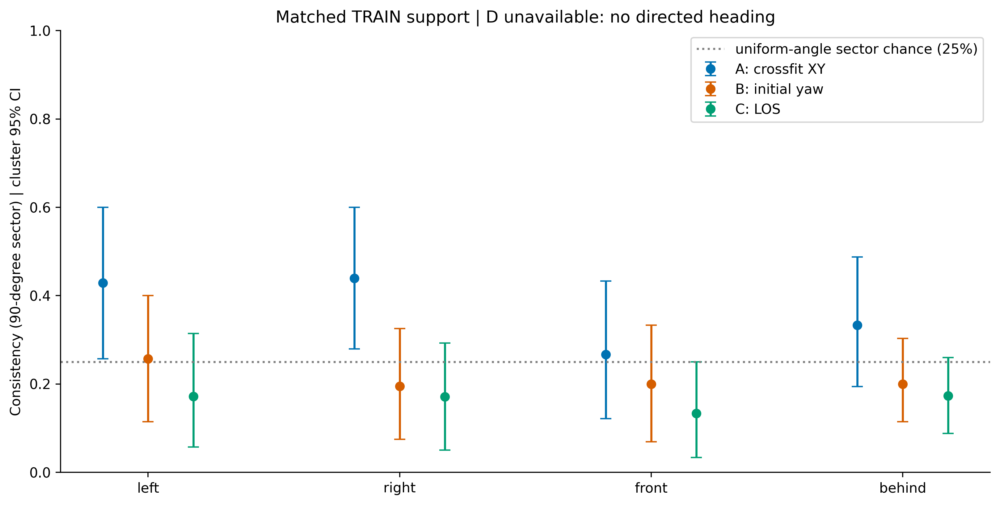

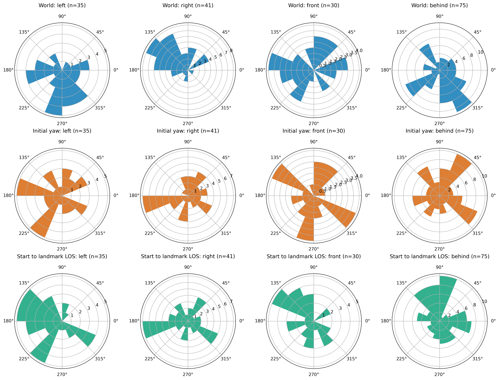

初始 yaw 和起点—地标 LOS 在本子集没有带来更高总体一致率；它们各有少量落入正确扇区的实例，不能称为已经解释了这些描述。B/C 改善区间与0重叠的词仍无法排除小幅改善，但没有证据将 yaw 作为通用规则。旋转后圆集中度的完整数据见 [frame_concentration.csv](results/frame_concentration.csv)。即使集中度变化而语义轴不对，也不能将其判为关系正确。

above/below 是平面位置还是高度尚需单独辨别，north/south/east/west 是地理语义；本实验不为它们预设 UAV 平面 left/front 语义。因此 B/C 对这些词的一致率列为不可评估，仍导出旋转后的角分布集中度。所有14词×4假设的样本覆盖、角偏差和 CI 见 [hypotheses.csv](results/hypotheses.csv)；D 无角偏差或 CI，而不是零误差。

### 完整轮廓边界检验

| 词 | 假设 | 不相交配对 | 轮廓可判定 | 轮廓 ambiguous | 条件一致率 | cluster 95% CI |
| --- | --- | --- | --- | --- | --- | --- |
| behind | A_world | 75 | 20 | 55 | 65.0% | [38.9, 84.2]% |
| behind | B_initial_yaw | 75 | 16 | 59 | 56.2% | [31.2, 81.2]% |
| behind | C_start_landmark_LOS | 75 | 20 | 55 | 50.0% | [28.6, 73.7]% |
| front | A_world | 30 | 9 | 21 | 66.7% | [33.3, 88.9]% |
| front | B_initial_yaw | 30 | 8 | 22 | 25.0% | [0.0, 62.5]% |
| front | C_start_landmark_LOS | 30 | 7 | 23 | 0.0% | [0.0, 0.0]% |
| left | A_world | 35 | 12 | 23 | 75.0% | [50.0, 100.0]% |
| left | B_initial_yaw | 35 | 11 | 24 | 72.7% | [45.5, 100.0]% |
| left | C_start_landmark_LOS | 35 | 7 | 28 | 57.1% | [14.3, 85.7]% |
| right | A_world | 41 | 16 | 25 | 75.0% | [56.2, 93.8]% |
| right | B_initial_yaw | 41 | 13 | 28 | 38.5% | [15.4, 69.2]% |
| right | C_start_landmark_LOS | 41 | 10 | 31 | 30.0% | [0.0, 60.0]% |

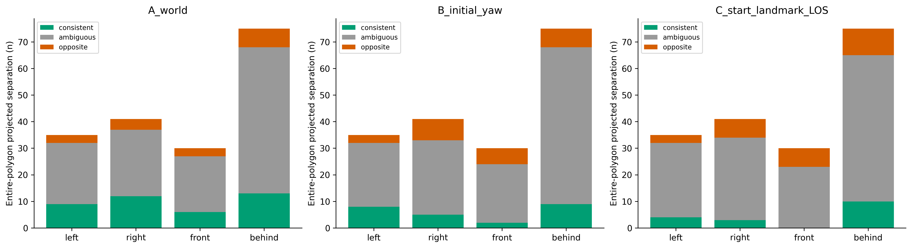

轮廓条件一致率的分母排除了投影 ambiguous，不可直接与全体角度一致率混用；A 的轮廓方向仍来自同一 TRAIN 的最佳轴，不是额外独立确认。按参照物面积的每对结果均在 [polygon_checks.csv](results/polygon_checks.csv)，包含大型轮廓全部顶点的投影结果。

## 地图与对象类别分组

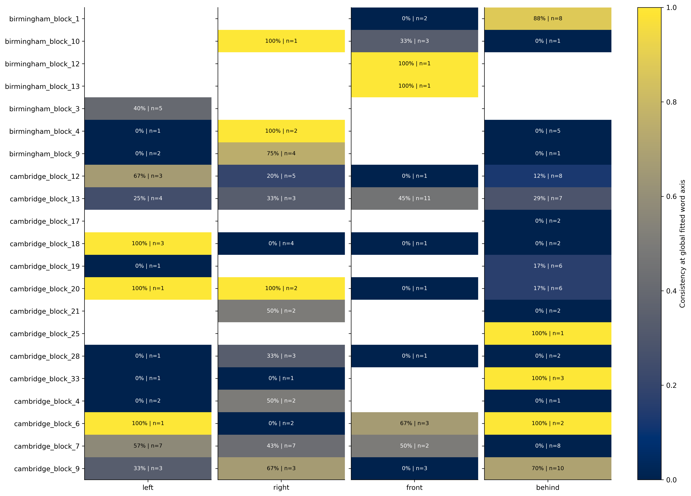

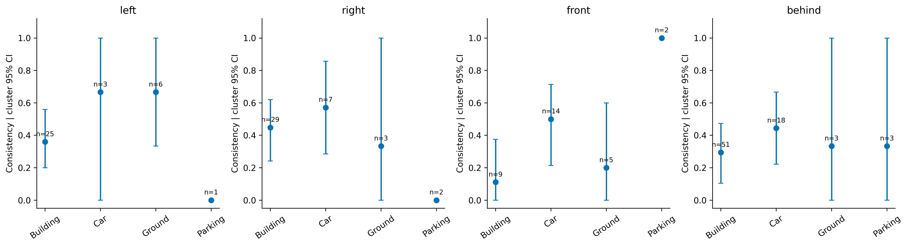

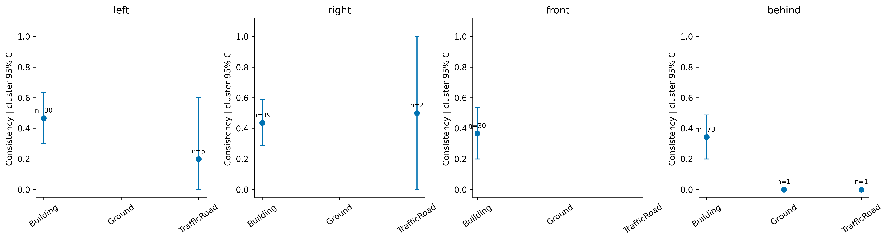

分组一致率使用**全体 TRAIN 拟合的同一词轴**；各组重新拟合的最优轴另列 `local_best_axis_deg`。这两个数不能混称为地图约定准确率。下面仅列每词 n≥3 的地图；小样本差异不是不同地图约定的证明。
| 词 | 地图 | n | 全局词轴一致率 | cluster 95% CI | 本地图事后最佳轴 |
| --- | --- | --- | --- | --- | --- |
| behind | birmingham_block_1 | 8 | 87.5% | [62.5, 100.0]% | −Y |
| behind | birmingham_block_4 | 5 | 0.0% | [0.0, 0.0]% | +X |
| behind | cambridge_block_12 | 8 | 12.5% | [0.0, 42.9]% | −X |
| behind | cambridge_block_13 | 7 | 28.6% | [0.0, 66.7]% | −X |
| behind | cambridge_block_19 | 6 | 16.7% | [0.0, 50.0]% | +X |
| behind | cambridge_block_20 | 6 | 16.7% | [0.0, 60.0]% | −X |
| behind | cambridge_block_33 | 3 | 100.0% | [100.0, 100.0]% | −Y |
| behind | cambridge_block_7 | 8 | 0.0% | [0.0, 0.0]% | +X |
| behind | cambridge_block_9 | 10 | 70.0% | [0.0, 93.3]% | −Y |
| front | birmingham_block_10 | 3 | 33.3% | [0.0, 100.0]% | +Y |
| front | cambridge_block_13 | 11 | 45.5% | [16.7, 80.0]% | −X |
| front | cambridge_block_6 | 3 | 66.7% | [0.0, 100.0]% | −X |
| front | cambridge_block_9 | 3 | 0.0% | [0.0, 0.0]% | +X |
| left | birmingham_block_3 | 5 | 40.0% | [0.0, 80.0]% | −X |
| left | cambridge_block_12 | 3 | 66.7% | [0.0, 100.0]% | −Y |
| left | cambridge_block_13 | 4 | 25.0% | [0.0, 75.0]% | +X |
| left | cambridge_block_18 | 3 | 100.0% | [100.0, 100.0]% | −Y |
| left | cambridge_block_7 | 7 | 57.1% | [14.3, 100.0]% | −Y |
| left | cambridge_block_9 | 3 | 33.3% | [0.0, 100.0]% | +Y |
| right | birmingham_block_9 | 4 | 75.0% | [25.0, 100.0]% | −X |
| right | cambridge_block_12 | 5 | 20.0% | [0.0, 60.0]% | +Y |
| right | cambridge_block_13 | 3 | 33.3% | [0.0, 100.0]% | +X |
| right | cambridge_block_18 | 4 | 0.0% | [0.0, 0.0]% | +Y |
| right | cambridge_block_28 | 3 | 33.3% | [0.0, 100.0]% | +X |
| right | cambridge_block_7 | 7 | 42.9% | [14.3, 85.7]% | +Y |
| right | cambridge_block_9 | 3 | 66.7% | [0.0, 100.0]% | −X |

地图/目标类别/参照类别的全部行与95% CI 见 [groups.csv](results/groups.csv)。地图差异存在于分布层面，但在同一地图、同一配对都观察到正反说法，故**每张地图单独设一套固定词轴也不能解释全部描述**。不能将不同地图的类别组成、地标朝向分布或描述者视角混合所致差异认作地图规范。跨地图泛化数据见 [leave_map_out.json](results/leave_map_out.json)。

## 正反方向与最强反例

| 词对 | n1/n2 | 圆均值夹角 ° | 距180°偏差 ° |
| --- | --- | --- | --- |
| left/right | 35/41 | 133.4 | 46.6 |
| front/behind | 30/75 | 146.4 | 33.6 |
| above/below | 7/3 | 162.6 | 17.4 |
| north/south | 14/5 | 144.7 | 35.3 |

圆均值 R 小时均值方向本身不稳定，不能把上表当作可靠有向坐标。真正交换目标和参照物的文本证据另行枚举：本严格子集存在 7 对，见 [reverse_statements.json](results/reverse_statements.json)。没有观测到的反向陈述不以 θ+180° 人工构造充数。

### 同一配对反向描述 1

`birmingham_block_4`，target=21，reference=2 (perry barr methodist church)；θ=176.57°，Polygon 最近距离=4.56m。两条均来自 TRAIN，并与 CityRefer 原文和 ann_id 精确对齐。

1. This gray roofed house is second house to the right of Perry Barr Methodist Church, with a white and a gray car parked in front.
2. The gray house that is two houses to the left of the Perry Barr Methodist Church.

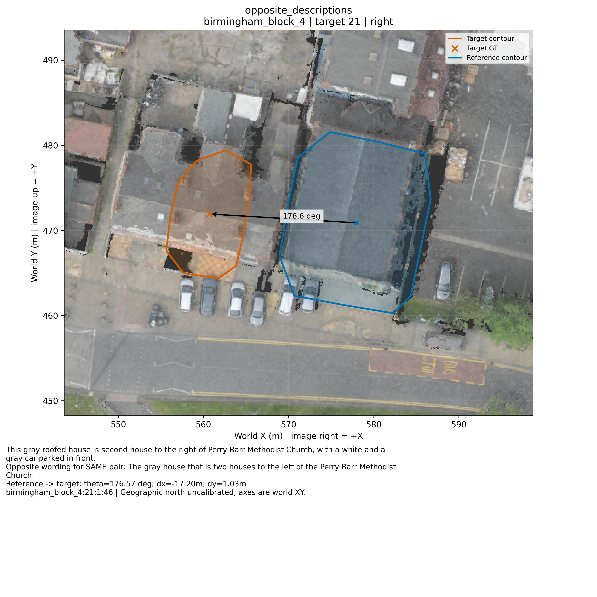

### 同一配对反向描述 2

`cambridge_block_13`，target=231，reference=107 (camden house)；θ=163.92°，Polygon 最近距离=15.06m。两条均来自 TRAIN，并与 CityRefer 原文和 ann_id 精确对齐。

1. This is a light blue car parked in front of Camden House. There is empty spots on its left and right sides. There is a white car further on its left.
2. A blue car is parked behind the Camden House, Emmanuel collage Library is at the back side

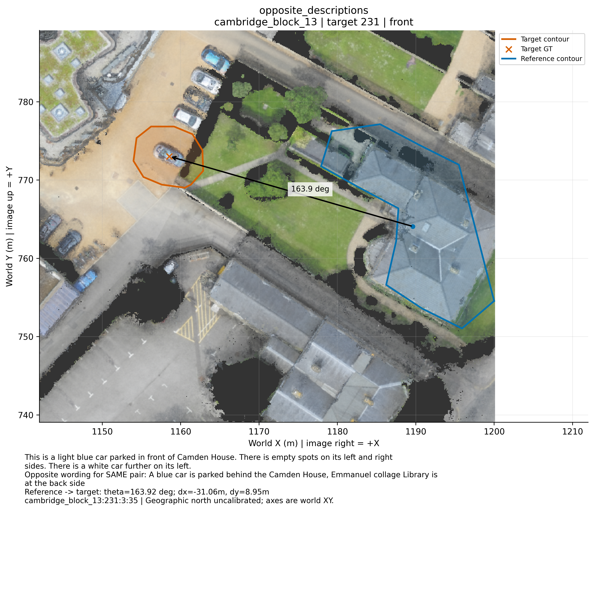

### 同一配对反向描述 3

`cambridge_block_28`，target=8，reference=9 (pembroke college boat club)；θ=179.32°，Polygon 最近距离=9.49m。两条均来自 TRAIN，并与 CityRefer 原文和 ann_id 精确对齐。

1. This brown roofed building is directly to the right of the Pembroke College Boat Club building.
2. The large brown and gray building to the left of Pembroke College Boat Club.

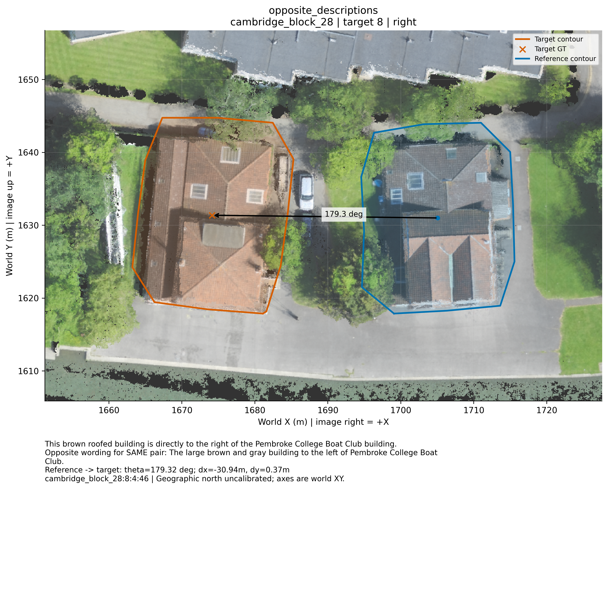

### 同一配对反向描述 4

`cambridge_block_28`，target=285，reference=53 (broadmeadows)；θ=105.89°，Polygon 最近距离=3.45m。两条均来自 TRAIN，并与 CityRefer 原文和 ann_id 精确对齐。

1. This is a blue car parked in front of Broadmeadows on Midsummer Meadows. On its left there are two cars, one black and one red.
2. The blue car parked at the back of the Broadmeadows building.

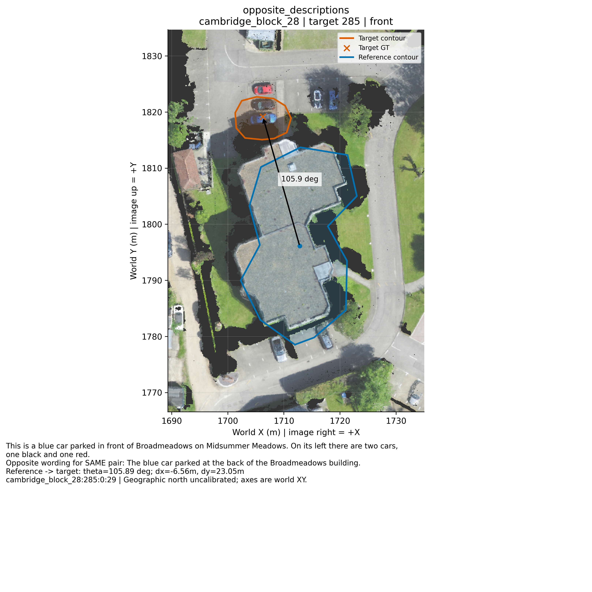

这些例子反驳的是“存在一个能无矛盾解释所有词的固定世界词典”，并不证明描述错误：描述者可能采用不同视角、自身朝向，或存在注释噪声。当前元数据无法区分这些原因。

## above/below/top/bottom 的语义

| 词 | 有效配对 | ΔZ>1m | ΔZ<−1m | |ΔZ|≤1m |
| --- | --- | --- | --- | --- |
| above | 7 | 3 | 3 | 1 |
| below | 3 | 1 | 1 | 1 |
| top | 0 | 0 | 0 | 0 |
| bottom | 0 | 0 | 0 | 0 |

above 样本既有目标高度低于参照物，也有高于；below 也存在反向高度差。直接把 above=更高、below=更低不成立。这里 ΔZ 是两个标注位置之差，**不是相对地面高度**，建筑与地面实例的高度基准也不同，不能据此精确分类高度语义。英文中确有 `when viewed aerially`、道路 vertical/horizontal、row/top/bottom 等地图/图像布局语境，但它们没有统一的图像旋转角记录。

可复核的定性结论是：这些词具有地图/视图布局和对象局部/序数等多种用法，不宜整体映射到世界 +Y/−Y，也不宜整体当高度关系。主集 above=7、below=3，top/bottom 以区域/局部/序数语义被保守排除，没有足够数据估计各语义在全体指令中的比例。参见 [height_semantics.json](results/height_semantics.json) 和逐项排除账本。

## 符合与无法判断案例

“符合”仅表示符合该词在当前子集事后拟合的世界轴，并且完整轮廓通过1m边界检验；不是该参考系的独立证明。无法判断案例保留真实目标、可见具名上下文及排除原因；未绑定的上下文用灰色轮廓显示，不画目标—地标关系箭头。

### fits_fitted_world_axis

`cambridge_block_18:32:3:63`

This dark gray roofed building is the farthest building to the left of Catholic Church of Our Lady and the English Martyrs, south of 14 Union Road.

Reference -> target: theta=287.41 deg; dx=25.34m, dy=-80.82m

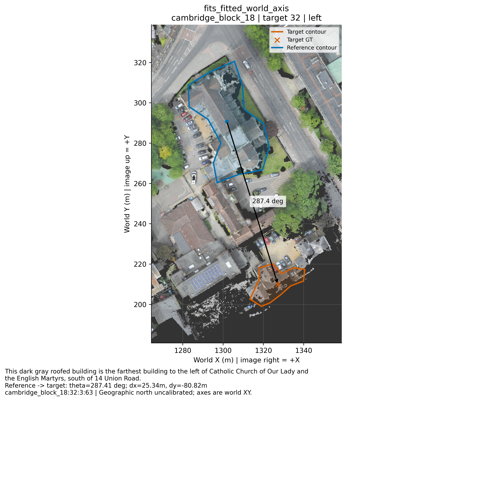

### fits_fitted_world_axis

`cambridge_block_21:110:5:35`

The dark gray long building to the right of the Grafton building on Fitzroy Lane.

Reference -> target: theta=187.57 deg; dx=-64.78m, dy=-8.61m

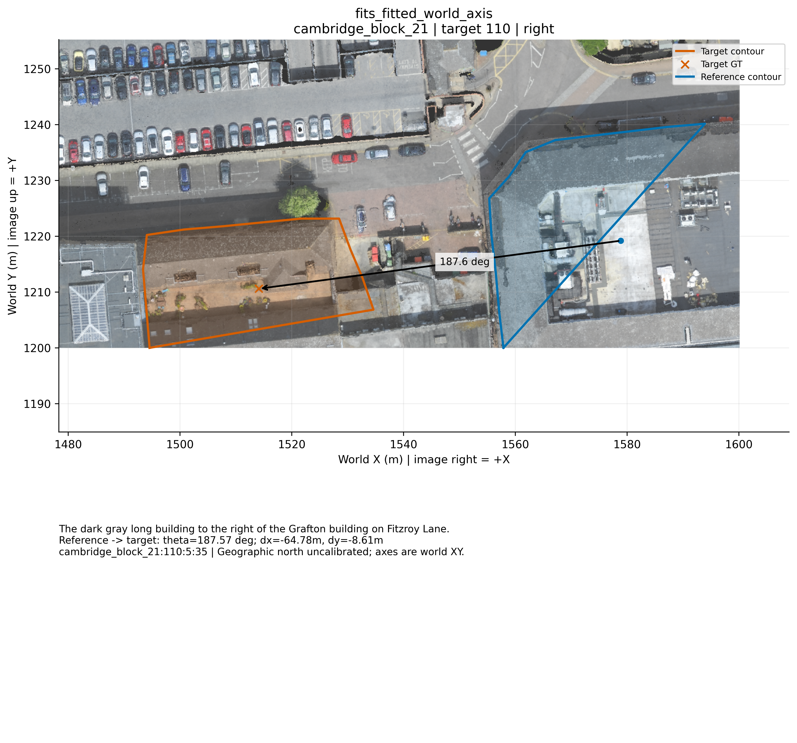

### fits_fitted_world_axis

`cambridge_block_13:485:0:11`

The ground behind the Downing College Chapel that has grass and one tree on one side and 3 threes on the other. The three trees are close to the Master's Lodge.

Reference -> target: theta=300.62 deg; dx=54.91m, dy=-92.77m

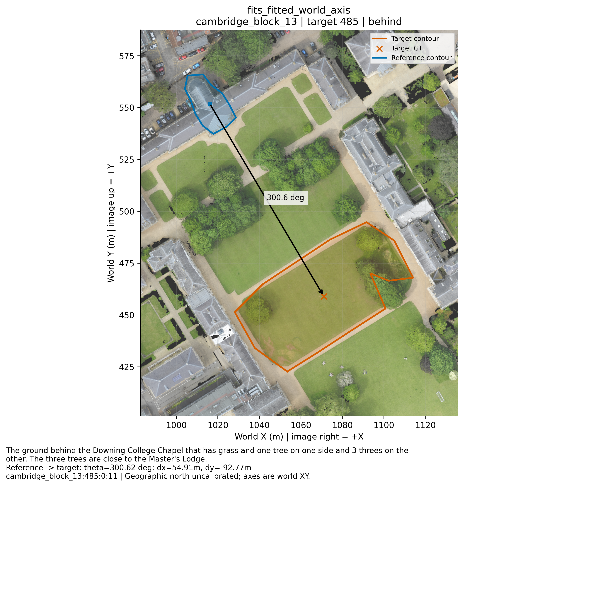

### fits_fitted_world_axis

`cambridge_block_21:235:2:14`

The black car above the Grafton West building. It is on the middle side of the parking lot with a grey car above it and a white car with red marks below it. To the right of the black car is a dark blue car.

Reference -> target: theta=184.64 deg; dx=-52.38m, dy=-4.25m

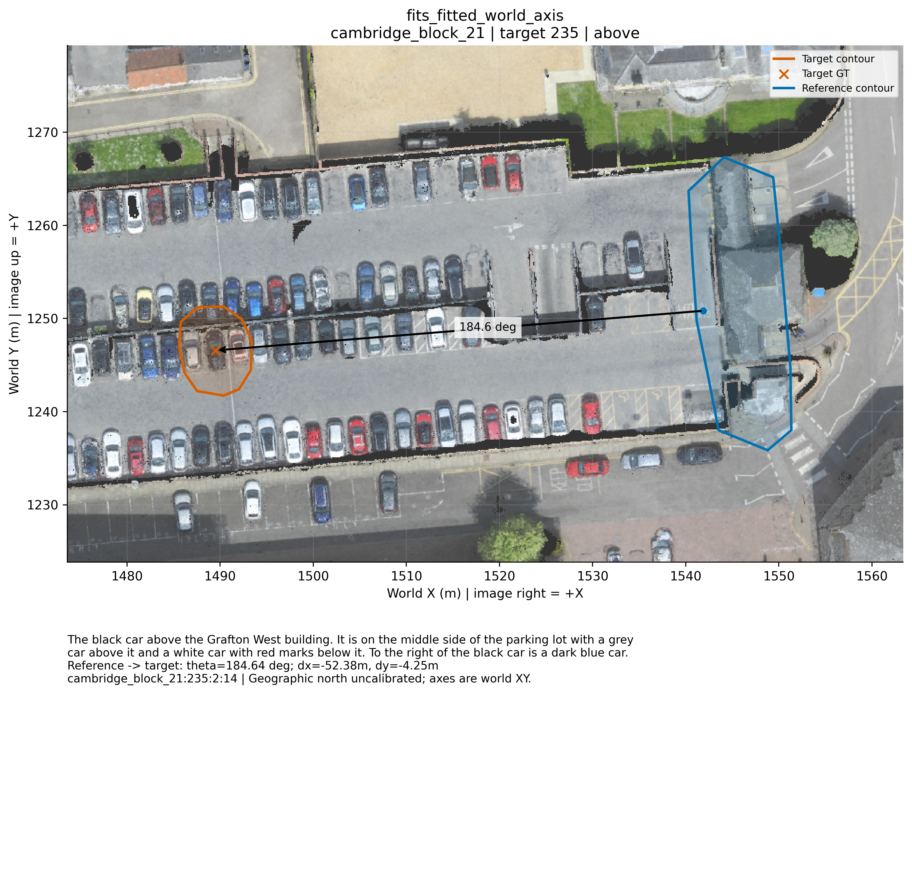

### fits_fitted_world_axis

`cambridge_block_9:113:4:33`

The square shaped building found below the Warehouse building, there's Bridge Street just below the building. There's a white circle on the roof of the building.

Reference -> target: theta=56.57 deg; dx=14.06m, dy=21.30m

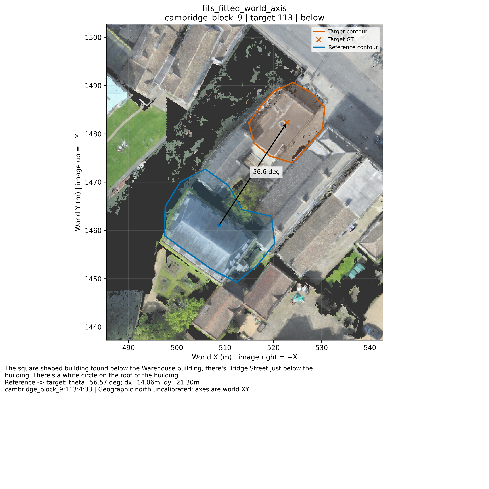

### unresolved_ambiguous_overlap_or_near_boundary

`birmingham_block_1:12:5:7`

On the right side of Willmore Road, this building has a gray roof and is third one from the top.

Reference -> target: theta=204.58 deg; dx=-16.36m, dy=-7.48m

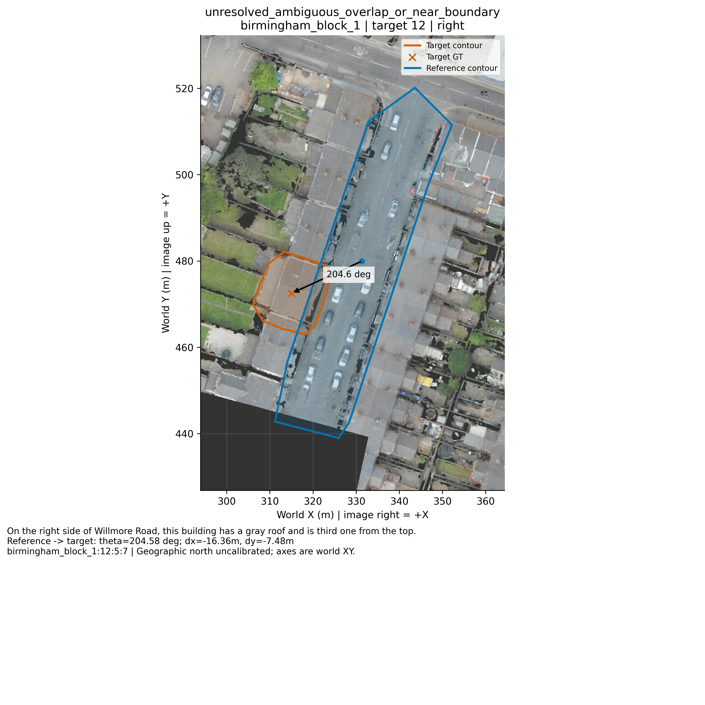

### unresolved_indirect_reference_np

`birmingham_block_1:10:2:56`

The gray house on Willmore Road that is 2 houses to the left of the gray house at the intersection with Wellington Road.

No target-reference angle assigned

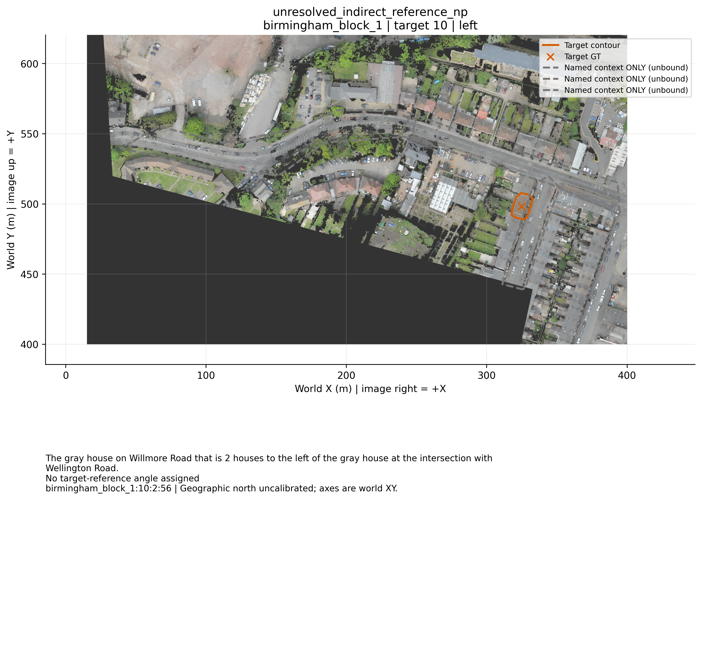

### unresolved_duplicate_landmark_name

`birmingham_block_1:37:0:58`

This is a building with a tall brown roof. It's on a road behind Wellington Road. There is a black and a silver car parked in front of it. To the right of the building is a building with a darker roof and on the left is a building that looks very similar to this one.

No target-reference angle assigned

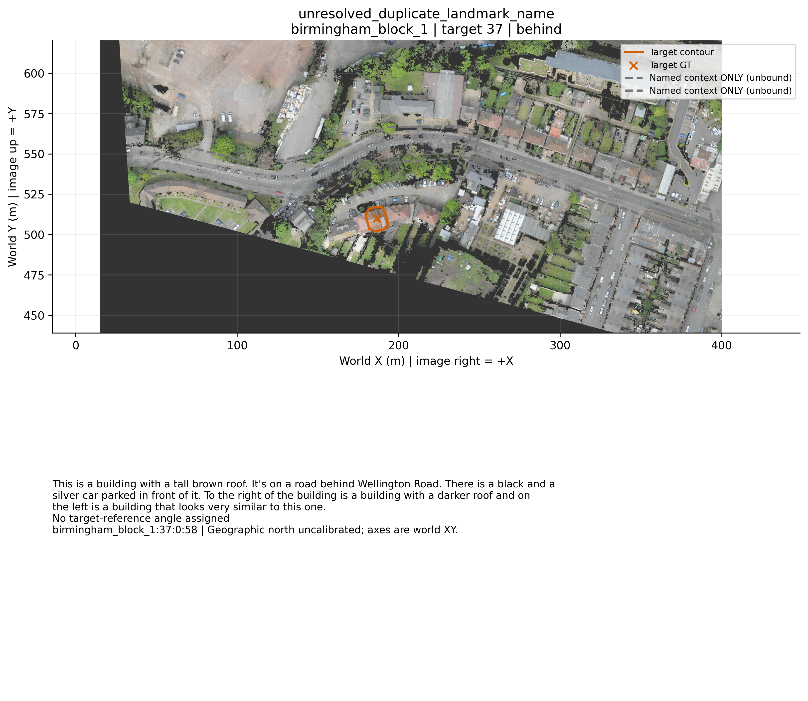

## 对 GeomBelief 的建议与最终回答

1. **left/right 固定世界方向？不成立。** 有广泛角度分散和同配对正反描述，不能硬编码 left=−X、right=+X，也不能用当前事后最佳轴替代。
2. **front/behind 统一方向？不成立。** 两词分布分散，也出现同配对 front/behind；自身朝向或视角是候选解释，但未被证明。
3. **above/below 是高度还是地图位置？语义混合。** 样本否定全体按高度符号解释；存在视图布局语境；未证明统一地图上/下。top/bottom 多为局部或排序，不当作外部方向强行统计。
4. **地图使用不同约定？不能证明。** 各地图统计模式有差异，但样本少且构成不同，同地图内部已存在冲突。每图固定词轴也无法满足全部指令。
5. **UAV yaw 能解释一部分？仅有统计兼容样本，未证明解释。** 初始 yaw 代理在共同支持集未提高整体一致率，且不是描述相机姿态。
6. **无法确定参考系的占比？** 全体指令中真实未知参考系的比例**不可识别，不能给出可靠百分比**。可确定的是99.245%的词出现未进入有效绑定/几何统计；全部描述缺少独立的标注相机 pose 记录（100%），但这不等于100%未知参考系：地理词有明确的地理语义，专名/部件等词次根本不要求方向参考系。有效212对也没有描述相机记录，不将假设匹配率冒充参考系已确定比例。
7. **GeomBelief 应增加参考系建模。** 保留世界 XY 作为地图/几何表达坐标；语言关系增加参考系候选、作用域、置信度和 unknown 状态，边缘化或混合世界/视图/起点视线/自身朝向假设。只有显式地理词且地理映射校准后，才可采用强地理约束。当前 yaw 不应自动成为默认描述 yaw。未在本实验实现任何网络改动或训练。

## 审查状态

已实际调用本地 `codex:adversarial-review` 插件，但服务连续重连并报告 failed phase，没有返回任何审查结论，随后通过插件正常取消失败任务。**外部对抗审查未完成**；没有把测试通过当作独立审查通过。命令、任务ID和原始日志见 [review/STATUS.md](review/STATUS.md)。

## 可复现性与限制

运行入口见 [README.md](README.md)，分析测试见 [test_analysis.py](test_analysis.py)，可执行工件检查见 [verify.py](verify.py)。全部 PNG 为320dpi，并保存 PDF；底图是实际 TRAIN 对应地图 PNG，轮廓/GT/角度均来自标注，无人工构造结果。

最主要限制是低覆盖率：仅精确名称和简单作用域进入主集；没有声称解析召回率或总体参考系比例。匿名参照物没有用 GT 距离猜配，缺失地理配准没有从 north 统计补齐，缺失 directed heading 没有用目标向量拟合，Polygon 相交没有用质心掩盖。后续如果获得描述相机记录、官方经纬度控制点或独立人工关系标注，应再扩展覆盖。当前结果足以否定严格统一约定，而不是确定替代参考系。
