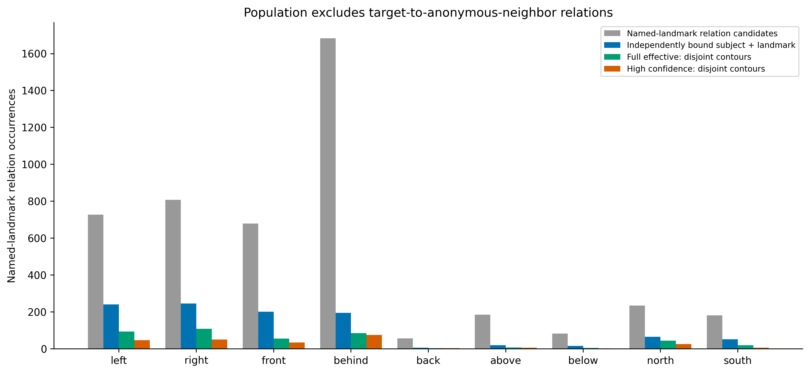
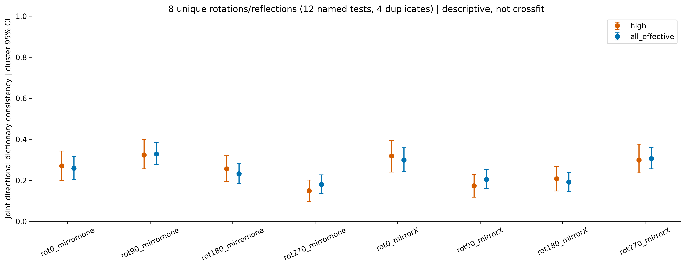
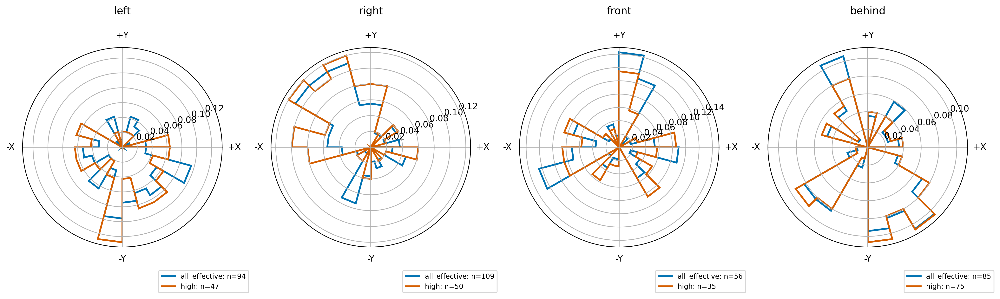
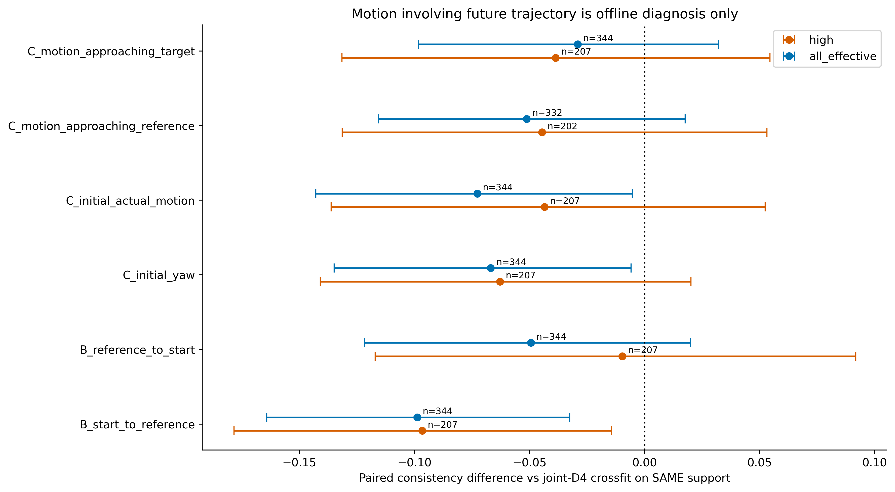
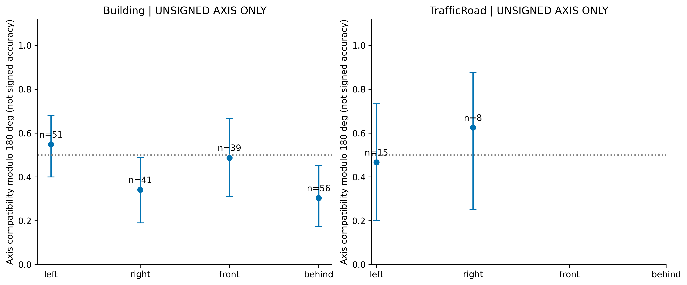
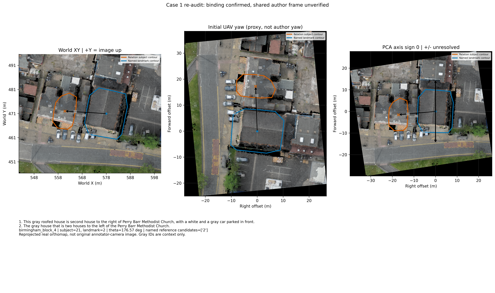
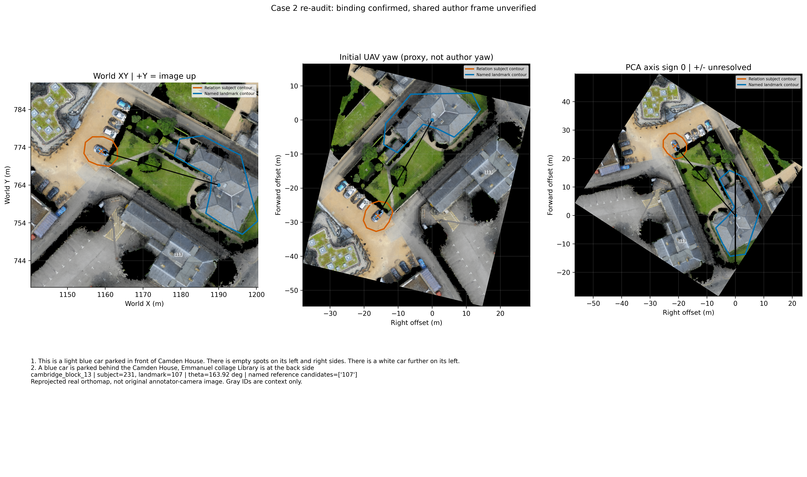
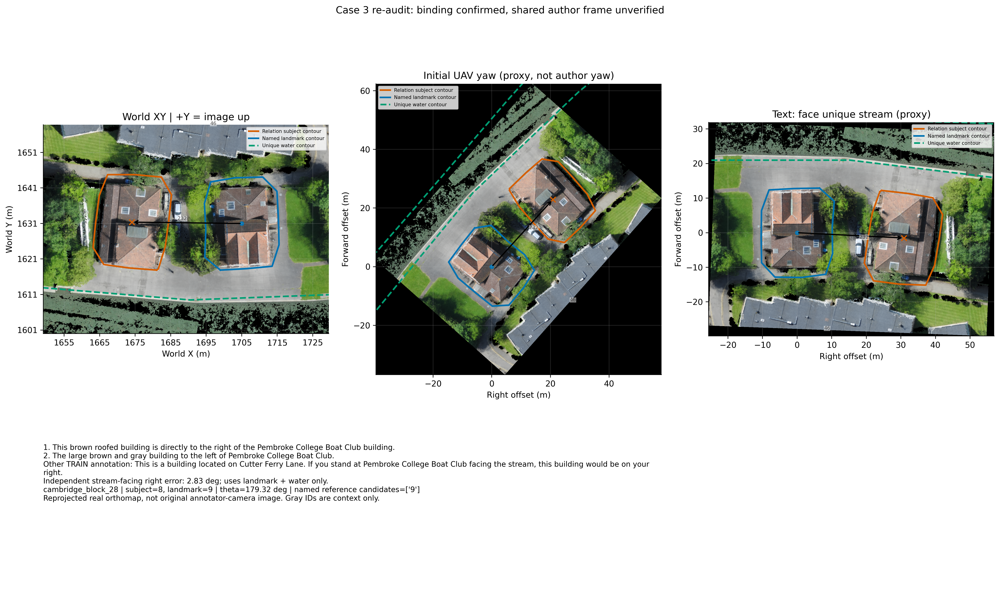
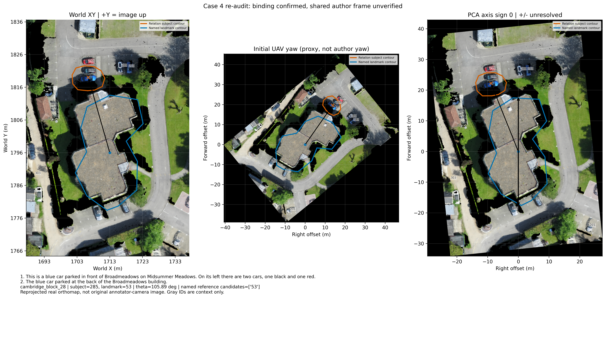
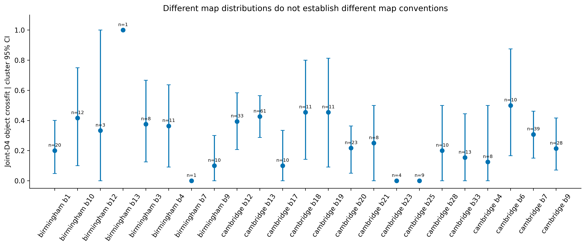

# CityNav 地标关系参考系续验 v2

日期：2026-11-06。基于 `e6ddb09`，分支 `experiment/citynav-direction-frames-20261106`。本报告取代v1中将四组正反描述直接作为统一约定反证的过强解读。

## 范围与当前判断

**只研究具名地标作为真实参照物的方向关系。** 不研究目标与匿名车、树、车位之间的大量方向词。关系主语可能是导航目标，也可能是上下文停车场/房屋等；若上下文主语不能独立定位，就不计算位移，绝不用内部目标GT代替。主账本和覆盖率分母均已按这个范围重建。

四组候选反例的地标名称在对应地图内均唯一，原文与对象索引能对齐；但**没有一组可以确认“两条使用同一已知参考系却真实矛盾”**。其中船屋案例另有TRAIN原文明说“站在船屋处、面朝河流看右侧”，按独立水体轮廓构造的候选视向误差仅 2.83°。因此应把“绑定/作用域正确”“共享描述视角已知”“标注真实矛盾”分成三个判断。

统一坐标假设仍可检验；本次对整套方向词词典联合测试旋转/镜像，并按关系主语对象交叉拟合。结果若低，只说明这些候选在当前可靠配对上解释力有限，不能证明某种尚未识别的统一局部定义不存在。相反，个别视角案例符合也不能证明整个数据集都使用该视角。

## 数据与隔离

- 原始 CityNav TRAIN：22,002条，24张地图；CityRefer原始对象。未读取Val/Test、未训练、未改Geometry/Relation/PGVB。
- spaCy 3.7.5 + en_core_web_sm 3.7.1 是冻结的通用文本解析器，仅接收英文指令；未接收GT、轨迹、坐标或图像，也没有在CityNav上训练。
- `text_relations.py` 的实体类型仅含 id/name/category。先保存文本绑定账本与SHA256，再由独立阶段读取坐标检验。
- 同名非道路地标不消歧；同名道路全部路段作为复合道路保留，medium档，不按目标位置挑段。若主语本身是多个同名路段且不能独立定位，则排除。
- 图像为真实TRAIN地图正射图。没有原始描述相机图像或pose记录，重投影图不假装是原始描述视角。

输入哈希、模型版本、主账本哈希和范围定义见 [manifest.json](results/manifest.json)。文本推理与几何阶段的分离见 [extract.py](extract.py) 和 [geometry_frames.py](geometry_frames.py)。[spaCy官方文档](https://spacy.io/usage/linguistic-features#dependency-parse)说明其依存分析为模型预测；本实验没有把预测单独视作高置信证据。

## 解析复核、置信度与覆盖率

v1存在两类可复核的漏检：把 `with a gray roof` 这样的外观属性误判为间接主语；539条原文不完全一致中510条仅大小写/空白差异。本次固定采用大小写和空白正规化核对相同ann_id，不作语义重配。原始方向出现账本仅用作历史对照，非地标关系词次不进入v2主统计。

改进不仅增加样本，也纠正新的错误：依存模型会把“车在停车场里，停车场在地标左侧”挂成车—地标。现在同时检查依存路径、其他通用实体名词、介词容器、关系从句及协调参照。证据冲突即排除；例如具名上下文后 `that/which` 指代不清，不强行绑定。匿名关系主语未独立定位时保留上下文未解决状态。

置信分数是**预先定义的规则分数，不是校准过的正确概率**。high≥0.95：唯一名称与明确主语/关系作用域证据一致；medium约0.80–0.85：独立名称存在、主语解析可用，但含道路定位短语、唯一指代代理、道路多段或复合对象等限制；真正未解决的作用域不混入有效集。完整有效集包含high+medium；二者都必须通过同样的有效Polygon和边界距离要求。

主账本共有 **4,659 个地标关系候选**；独立绑定 1,042 个，其中high 679 个。完整几何有效集（轮廓不相交且距离>1m）为 **423** 个，high子集为 **250** 个。所有比率只针对地标关系候选，不再用全体目标方向词作分母。
| 词 | 地标关系候选 | 绑定 | high绑定 | 完整几何有效 | high几何有效 | 轮廓ambiguous | 非法轮廓 |
| --- | --- | --- | --- | --- | --- | --- | --- |
| behind | 1684 | 195 | 179 | 85 | 75 | 106 | 4 |
| right | 808 | 246 | 125 | 109 | 50 | 137 | 0 |
| above | 185 | 20 | 17 | 7 | 6 | 13 | 0 |
| south | 181 | 52 | 25 | 20 | 6 | 32 | 0 |
| left | 727 | 241 | 118 | 94 | 47 | 146 | 1 |
| north | 234 | 65 | 39 | 44 | 26 | 20 | 1 |
| front | 679 | 201 | 159 | 56 | 35 | 144 | 1 |
| below | 83 | 16 | 11 | 5 | 2 | 11 | 0 |
| back | 57 | 6 | 6 | 3 | 3 | 2 | 1 |
| top | 8 | 0 | 0 | 0 | 0 | 0 | 0 |
| west | 6 | 0 | 0 | 0 | 0 | 0 | 0 |
| bottom | 6 | 0 | 0 | 0 | 0 | 0 | 0 |
| east | 1 | 0 | 0 | 0 | 0 | 0 | 0 |

已绑定关系主语角色：`annotated_target`=1042。未能独立定位的上下文主语绝不使用annotation target的位置。
| 主要排除原因（前10） | 地标关系候选数 |
| --- | --- |
| surface_dependency_scope_disagreement_or_embedded_np | 2280 |
| duplicate_nonroad_landmark_name | 661 |
| relative_clause_named_context_attachment_ambiguous | 276 |
| non_target_relation_owner | 159 |
| coordinated_reference_uncertain | 107 |
| compound_direction_not_single_axis | 44 |
| back_rear_part_or_unknown | 29 |
| relation_owner_unresolved | 20 |
| front_part_not_in_front | 18 |
| part_or_region_not_external_pair | 14 |

完整逐条证据见 [text_relations.csv](results/text_relations.csv)，包括真实主语角色、命名参照物候选、依存路径、表面作用域检查、分数、排除原因和v1状态；[exclusions.csv](results/exclusions.csv)提供全部原因。未声称对全体地标关系达到完整召回，也未用目标GT提高匹配率。

## 几何协议与统计

对固定绑定的关系主语S、地标L计算 ΔXY=S−L；若S是导航目标，位置取原始target_positions；若S是独立具名上下文对象，取该对象position，不取导航目标GT。唯一地标沿用原始position；整条同名道路使用全部路段Polygon并集的面积质心，同时完整轮廓仍为全部路段并集。单对象原始position与Polygon质心不是同一量，均保留供核查。

非法Polygon不修补。主容差1m；相交、接触、最近距离≤1m或位移≤1m为ambiguous，不进入主角度一致率。每个假设方向另用全部轮廓顶点投影检验：S整体超出L>1m为consistent，反向整体超出为opposite，其余为方向不显著。角度一致率为±45°扇区；另外保存有容差的半平面一致率及严格轮廓条件一致率。不能将三者混用。

95% CI按 `(map, relation_subject_id)` 做1,000次cluster bootstrap，保留同对象多条描述的相关性；同一对象全部关系在同一交叉拟合折。CI条件于当前解析/已选预测，未覆盖解析误差和整个候选选择过程的不确定性。所有调参式候选选择只在TRAIN内的拟合折进行，不触碰Val/Test。

## A：联合地图词典与图像方向

以 image-left/right/up/down 为**待测试词典**，定义候选 left=−X、right=+X、front/above=+Y、behind/back/below=−Y，然后对整套词典共同施加0/90/180/270°旋转和X/Y镜像。这里front对应图像上方只是候选，未预认其成立。12个命名测试只有8个不同线性变换；等价关系见 [map_transformations.json](results/map_transformations.json)。逐词四轴扫掠另存 [word_axis_sweep.csv](results/word_axis_sweep.csv)，不把逐词独立最优轴当统一词典。

当前TIF affine只独立确认图像向右=+X、向上=+Y。仍无CRS/经纬度控制点，真实北向不可评估；不从north词或目标GT拟合地理北。独立地理校准信息没有增加。

按主语对象划5折，在4折选择一套**全局联合词典**，应用于另1折；同时提供leave-map-out。下表是对象交叉拟合，不是同样本事后最优。
本轮四个主要方向词合并后的联合词典交叉拟合一致率为：high **27.5%**（n=207，95% CI [20.8, 35.1]%）；完整有效集 **30.2%**（n=344，95% CI [25.1, 35.4]%）。这不支持这些旋转/镜像候选能对当前地标关系提供高一致性的统一有向约定。
| 集合 | 词 | n | 一致率 | cluster 95% CI | 平均角偏差 ° |
| --- | --- | --- | --- | --- | --- |
| high | ALL_MAIN | 207 | 27.5% | [20.8, 35.1]% | 80.2 |
| high | behind | 75 | 21.3% | [9.0, 33.8]% | 83.4 |
| high | front | 35 | 34.3% | [20.0, 51.4]% | 86.0 |
| high | left | 47 | 23.4% | [12.5, 35.4]% | 87.2 |
| high | right | 50 | 36.0% | [22.4, 49.1]% | 64.9 |
| all_effective | ALL_MAIN | 344 | 30.2% | [25.1, 35.4]% | 80.9 |
| all_effective | behind | 85 | 14.1% | [6.5, 24.1]% | 92.9 |
| all_effective | front | 56 | 25.0% | [13.0, 38.5]% | 99.6 |
| all_effective | left | 94 | 40.4% | [29.2, 51.5]% | 68.3 |
| all_effective | right | 109 | 36.7% | [26.9, 47.1]% | 72.7 |

交叉拟合逐条预测与每折选择见 [crossfit_predictions.csv](results/crossfit_predictions.csv) 和 [crossfit_folds.json](results/crossfit_folds.json)。比v1更严格的整套词典约束能避免 left/right各自选出不相反方向后仍被称为统一坐标定义。

另在保持绑定和交叉拟合词典不变的条件下，比较原始position、Polygon面积质心和主语至地标最近边界的位移角，见 [anchor_sensitivity.csv](results/anchor_sensitivity.csv)。这些只检验几何锚点敏感性，不重新拟合词典或挑选参照物，更不作为独立视角证据。

## B/C：局部视线与无人机运动

B分别测试起点→地标与地标→起点，正前方翻转180°，left/right/front/behind使用同一固定偏移。参照物始终是该关系真正绑定的地标，不是最近具名对象。C测试初始视线yaw、初始首段≥3m水平位移、首次最接近地标Polygon之前的≥3m入向运动、首次最接近原始导航目标GT之前的≥3m入向运动。静止转向不生成运动方向，起点已经最接近地标而没有入向段时不可评估。

初始yaw是导航轨迹的初始视线，不是描述者yaw。其余运动需要未来轨迹，全部仅离线诊断；接近导航目标的窗口额外依赖目标GT，属于GT-conditioned诊断。即使分数较高，也不能用于部署Belief或当作描述参考系独立证据。
| 集合 | 假设 | 共同支持n | 一致率 | 95% CI | 同支持A一致率 | 相对A差值 | 差值95% CI |
| --- | --- | --- | --- | --- | --- | --- | --- |
| high | B_reference_to_start | 207 | 26.6% | [20.3, 33.0]% | 27.5% | -1.0% | [-11.7, 9.2]% |
| high | B_start_to_reference | 207 | 17.9% | [13.0, 23.0]% | 27.5% | -9.7% | [-17.8, -1.4]% |
| high | C_initial_actual_motion | 207 | 23.2% | [17.6, 29.2]% | 27.5% | -4.3% | [-13.6, 5.2]% |
| high | C_initial_yaw | 207 | 21.3% | [16.3, 26.7]% | 27.5% | -6.3% | [-14.1, 2.0]% |
| high | C_motion_approaching_reference | 202 | 22.8% | [16.9, 29.1]% | 27.2% | -4.5% | [-13.1, 5.3]% |
| high | C_motion_approaching_target | 207 | 23.7% | [18.4, 30.1]% | 27.5% | -3.9% | [-13.1, 5.4]% |
| all_effective | B_reference_to_start | 344 | 25.3% | [20.5, 30.1]% | 30.2% | -4.9% | [-12.2, 2.0]% |
| all_effective | B_start_to_reference | 344 | 20.3% | [16.2, 24.5]% | 30.2% | -9.9% | [-16.4, -3.3]% |
| all_effective | C_initial_actual_motion | 344 | 23.0% | [18.7, 27.3]% | 30.2% | -7.3% | [-14.3, -0.5]% |
| all_effective | C_initial_yaw | 344 | 23.5% | [19.0, 28.0]% | 30.2% | -6.7% | [-13.5, -0.6]% |
| all_effective | C_motion_approaching_reference | 332 | 25.0% | [20.5, 29.9]% | 30.1% | -5.1% | [-11.6, 1.8]% |
| all_effective | C_motion_approaching_target | 344 | 27.3% | [22.8, 32.0]% | 30.2% | -2.9% | [-9.8, 3.2]% |

每种假设、每个词的角偏差、覆盖率和严格轮廓结果均见 [hypothesis_summary.csv](results/hypothesis_summary.csv)，不可评估原因/覆盖见 [availability.csv](results/availability.csv)。不同支持集不能直接比较；表中差值已逐条匹配相同对象—地标关系。未来运动还做了地图内方向词随机化诊断，见 [future_motion_controls.json](results/future_motion_controls.json)；它不能消除导航轨迹与目标几何的结构性相关。

## D：地标自身轴与道路方向

使用完整地标轮廓均匀周长采样256点做PCA，λmax/λmin≥2才报告可靠无向轴。将轴规范为[0,180°)，**同时**测试轴的0/180°，建筑另测法向90/270°。从不逐样本选择更符合GT的符号。道路另测试起点附近边界切线的双向轴，以及按初始运动向量选符号的道路轴；后者是导航运动代理，前者可能受端帽/曲路影响，均不是已验证的道路有向中心线或行驶规则。

仅有PCA或轮廓不能独立确定建筑入口/正面，汽车有向朝向也没有可信字段；原始标注中Car和Parking均无具名对象，当前没有独立绑定的停车场车道。不能根据目标附近的车或停车场位置临时选择一个最符合关系的局部轴。故这些项保持不可评估，而非凭空赋heading。
| 集合 | 假设 | 几何有效主方向关系数 | 可评估数 | 覆盖率 | 不可评估原因 |
| --- | --- | --- | --- | --- | --- |
| high | D_road_axis_sign0 | 207 | 8 | 3.9% | 形状/起点代理，不是已验证有向heading |
| all_effective | D_road_axis_sign0 | 344 | 23 | 6.7% | 形状/起点代理，不是已验证有向heading |
| high | D_road_local_tangent_start_sign0 | 207 | 8 | 3.9% | 形状/起点代理，不是已验证有向heading |
| all_effective | D_road_local_tangent_start_sign0 | 344 | 23 | 6.7% | 形状/起点代理，不是已验证有向heading |
| high | D_building_axis_offset0 | 207 | 116 | 56.0% | 形状/起点代理，不是已验证有向heading |
| all_effective | D_building_axis_offset0 | 344 | 187 | 54.4% | 形状/起点代理，不是已验证有向heading |
| high | D_verified_building_facade | 207 | 0 | 0.0% | no directed heading annotation/verified image cue |
| all_effective | D_verified_building_facade | 344 | 0 | 0.0% | no directed heading annotation/verified image cue |
| high | D_verified_car_heading | 207 | 0 | 0.0% | no directed heading annotation/verified image cue |
| all_effective | D_verified_car_heading | 344 | 0 | 0.0% | no directed heading annotation/verified image cue |
| high | D_parking_lane | 207 | 0 | 0.0% | no independently bound parking lane |
| all_effective | D_parking_lane | 344 | 0 | 0.0% | no independently bound parking lane |
| high | A_true_geographic_north | 207 | 0 | 0.0% | no independent geodetic calibration |
| all_effective | A_true_geographic_north | 344 | 0 | 0.0% | no independent geodetic calibration |

把方向误差按180°取模得到的无向轴兼容性仅是“沿轴/横轴”的检验：left/right或front/behind的正反已被抹去，均匀角度基线是50%，不是有向扇区的25%。该量绝不作为方向一致率或已确定参考系比例。

## 四组候选反例逐例复核

以下图在同一真实地图上分别显示世界轴、首条描述对应导航初始yaw代理、以及无向PCA候选（船屋例为文本指定面向水体的候选视向）。原图从未记录标注相机，这些是正射图坐标重投影，不是恢复的描述者图像。灰色邻居ID仅为视觉核查上下文，未用于目标GT反选参照物。

### 案例1：birmingham_block_4，主语21—地标2

参照名：`perry barr methodist church`，同名候选=['2']；ΔXY=[-17.203125, 1.03125]m，θ=176.57°，轮廓距离=4.56m。

1. This gray roofed house is second house to the right of Perry Barr Methodist Church, with a white and a gray car parked in front.
2. The gray house that is two houses to the left of the Perry Barr Methodist Church.

**作用域：** 两条都是房屋相对于具名教堂的方向，含第二/两个房屋的沿街计数。不是车—车关系。

**局部排列/自身方向：** 连排房屋与Aston Lane局部排列可能影响计数方向；道路没有独立的行进正向或观察者位置。

**图像核查：** 真实正射图显示目标为教堂旁的灰屋顶连排房屋部分，目标与教堂轮廓分离；图像中目标位于教堂的−X侧。

**视角证据：** 原始TRAIN描述没有给出这两条的描述相机姿态。教堂朝街或观察者面朝教堂的左右可相反，但不能据目标方向挑选。

**判断：** 绑定与方向修饰对象可确认；共享同一有向世界参考系时不兼容。局部计数/视角是否不同不可确定，不能确认真实标注矛盾。

### 案例2：cambridge_block_13，主语231—地标107

参照名：`camden house`，同名候选=['107']；ΔXY=[-31.0625, 8.953125]m，θ=163.92°，轮廓距离=15.06m。

1. This is a light blue car parked in front of Camden House. There is empty spots on its left and right sides. There is a white car further on its left.
2. A blue car is parked behind the Camden House, Emmanuel collage Library is at the back side

**作用域：** 两条主语均为同一蓝车，参照为唯一Camden House；第一条的其他left/right描述邻车，已排除在本实验之外。

**局部排列/自身方向：** 场地含草坪、停车区及相邻建筑，front/behind可能描述立面、场地或视点；没有可靠入口/正面朝向记录。

**图像核查：** 蓝车、停车区与Camden House完整轮廓可见；蓝车位于参照位置−X/+Y侧。原图没有独立确认建筑正面。

**视角证据：** 同目标另有TRAIN描述“car parked facing the Camden House”，它给出车朝向与地标的联系，但不能证明两条front/behind使用相同视角。

**判断：** 同一对象—地标的表面正反用词成立；未发现同名误绑。真实语义参考系未固定，尚不能确认标注矛盾。

### 案例3：cambridge_block_28，主语8—地标9

参照名：`pembroke college boat club`，同名候选=['9']；ΔXY=[-30.9375, 0.3671875]m，θ=179.32°，轮廓距离=9.49m。

1. This brown roofed building is directly to the right of the Pembroke College Boat Club building.
2. The large brown and gray building to the left of Pembroke College Boat Club.

**作用域：** 两条主语均为同一棕屋顶建筑，参照为唯一Pembroke College Boat Club。

**局部排列/自身方向：** 同目标的另一条TRAIN描述明确指定“stand at Pembroke College Boat Club facing the stream ... on your right”；这是独立的文本视角证据。

**图像核查：** 目标与船屋在河岸附近并列，目标位于船屋−X侧；唯一Water对象可独立提供面向水面的候选方向。

**视角证据：** 面向河流候选轴只由船屋位置和唯一Water轮廓的最近点构成，不使用目标GT选择轴或符号；它不是恢复的原始相机yaw。

**判断：** 不应当把这组直接认定为真实标注矛盾；存在已明说的河流面向参考系，能检验视角解释，但不能把第2条的视角自动赋给第4/5条。

独立水体ID=367。只从船屋指向唯一Water边界最近点，候选面向=272.15°，其右侧=182.15°，实际主语方向误差=2.83°。此方向计算未用目标GT选符号。它支持原文明说的那一条视角关系，但不证明另外两条使用同一视向。

### 案例4：cambridge_block_28，主语285—地标53

参照名：`broadmeadows`，同名候选=['53']；ΔXY=[-6.5625, 23.046875]m，θ=105.89°，轮廓距离=3.45m。

1. This is a blue car parked in front of Broadmeadows on Midsummer Meadows. On its left there are two cars, one black and one red.
2. The blue car parked at the back of the Broadmeadows building.

**作用域：** front与at the back均直接修饰蓝车相对于Broadmeadows建筑的关系；邻车left不纳入主统计。

**局部排列/自身方向：** 建筑北侧（仅指图像上侧，不声称地理北）停车区与建筑固有front/back可能不同；建筑轮廓主轴没有正反。

**图像核查：** 同一蓝车、黑车和红车排列及Broadmeadows轮廓可见，蓝车位于建筑位置−X/+Y侧。

**视角证据：** 未找到入口、立面正向或两条描述的相机记录，不能凭车辆位置定义建筑front。

**判断：** 唯一绑定可确认；这组是未确定参考系的正反用词候选，不是已证实的同参考系真实标注矛盾。

原始TRAIN描述、ann_id、初始pose、marker/GT、唯一名称清单、完整对象和Polygon见 [four_case_reaudit.json](results/four_case_reaudit.json)。没有把这4组直接记作“真实标注矛盾=4”；当前**已确认的同参考系真实矛盾为0，真实矛盾数量不可识别**，不等价于证明数据没有噪声。

## 地图分组与范围限制

按地图、关系主语类别、地标类别、视图/朝向词提示分组，详见 [group_summary.csv](results/group_summary.csv) 和 [crossfit_strata.csv](results/crossfit_strata.csv)。关键字提示包括facing/viewed/vertical等，它们可能描述物体朝向而非描述者视角，不能把“有提示”自动认作已知观察参考系。小样本地图差异不构成各地图有独立约定的证据。

## 结论与下一步依据

1. **v1需要收窄的结论：** 低覆盖率、四个词分别事后挑轴、正反描述没有共同视角记录，都不足以断言CityNav完全没有相对统一的局部方向定义。四组案例是需要解释的证据，不是已经确认的标注矛盾。
2. **统一世界/图像词典：** 本轮已扩展高可信文本解析并联合测试8种不同旋转/镜像；按对象和地图留出验证的分数、角偏差和CI如上。若一致性低，则这些具体候选尚无充分支持；不将“未支持”偷换成“所有未测参考系都不存在”。
3. **视角解释：** 船屋面向河流那条有独立文本与地图支持，是明确的局部参考系兼容案例。但不能把它推广到无视角记录的其他描述。
4. **运动与自身朝向：** 一些未来运动代理可有更高统计分数，特别是接近目标的GT条件化窗口；这不是描述参考系的独立确认，也不能进入部署Belief。无向PCA、道路切线与已验证正面/行驶方向必须分开。
5. **工程建议：** 目前保持世界XY作为几何存储；不要根据本实验的事后最优变换硬改方向词约定。具名地标关系应保留主语、作用域、局部参考系候选和unknown；有明确面向文本时可用独立地标/水体/道路证据约束。未在本次实现网络改动。

当前有效集仍不是地标关系全集：匿名上下文主语、模糊别名、复杂作用域以及重叠轮廓会被排除。没有用部署不可得信息提升绑定，也不报告全体数据“未知参考系”的伪精确比例。用户原消息在“Polygon PCA 主轴具有”处截断，本次按其180°无正反歧义处理；随后明确的“只研究地标关系”已作为主统计范围。

## 验证、审查与复现

完整运行命令见 [README.md](README.md)，独立复算工件检查见 [verify.py](verify.py)，测试包含真实四例绑定、容器作用域、同名地标、地标关系范围门控及±轴不能混选等。外部对抗审查真实执行状态单独记录在 [review/STATUS.md](review/STATUS.md)，不把自测等同于独立审查通过。
