# CityNav 具名地标关系的局部参考系验证 v3

日期：2026-11-06。基于 v2 分支 `experiment/citynav-direction-frames-20261106` 的 `a942369e3e5306701a38ee8666526c4e01a021c0`，独立分支 `experiment/citynav-local-frame-rules-20261106`。

## 结论先行

**发现了有独立文本与地图支持的局部解释规则，但尚未发现能覆盖大多数 left/right/front/behind 的统一生成规则。** 最有力的新证据是“从具名道路 B 进入具名道路 A，沿 A 看左右”；明确面向水体的船屋例也成立，但它是 v2 已知开发案例。普通建筑的 PCA、邻接道路和起点连线多数只能形成候选方向，不能认定为描述者实际参考系。

必须区分两种结果：单一明确可计算方向的硬一致率，以及多个未知方向按预先固定权重平均的**候选兼容度**。后者可用于概率建模，但不是“已经预测对了描述者朝向”。所有数值均来自原始 TRAIN 与 CityRefer 对象；未读取 Val/Test，未训练导航、BERT 或图网络，未修改 Geometry/Relation/PGVB。

## 1. 人群、绑定与覆盖率

完整 TRAIN 为 22,002 条导航样本，24 张地图。只追踪以具名地标为参照物的方向关系；匿名邻车/树等不纳入分母。保留实际关系主语，不能定位的上下文对象不替换成导航目标。每条原始候选都有解析置信度、绑定/作用域排除原因。

v2 的 1,042 个已绑定配对完整冻结，423 个不相交有效配对与其中 250 个高置信配对保持原状。仅增加一项独立的实体类型消歧：名称/语句明确是 Road/Street/Lane 等道路时，在同名对象中保留所有 `TrafficRoad` 分段，不挑选最接近目标的分段，不把同名 Building/Footpath 当作道路。新增 307 个绑定；其他重复建筑名或作用域不明样本继续排除。扩展后全部方向词有效 569、高置信 317。

本报告主分析只取 left/right/front/behind（back/rear 依 v2 语义归一为 behind）。v2 主分析 344/207，扩展主分析 425/243。423/250 包含其他方向词，不能直接与四词表的分母混用。

| 归一方向词 | 具名地标候选 | 已绑定 | 不相交有效 | 高置信有效 | 绑定/作用域排除 | 几何非有效 |
| --- | --- | --- | --- | --- | --- | --- |
| above | 185 | 25 | 11 | 9 | 160 | 14 |
| back | 57 | 6 | 3 | 3 | 51 | 3 |
| behind | 1684 | 204 | 93 | 80 | 1480 | 111 |
| below | 83 | 22 | 7 | 2 | 61 | 15 |
| bottom | 6 | 0 | 0 | 0 | 6 | 0 |
| east | 1 | 0 | 0 | 0 | 1 | 0 |
| front | 679 | 204 | 58 | 36 | 475 | 146 |
| left | 727 | 319 | 129 | 63 | 408 | 190 |
| north | 234 | 122 | 69 | 39 | 112 | 53 |
| right | 808 | 331 | 145 | 64 | 477 | 186 |
| south | 181 | 115 | 53 | 21 | 66 | 62 |
| top | 8 | 0 | 0 | 0 | 8 | 0 |
| west | 6 | 1 | 1 | 0 | 5 | 0 |

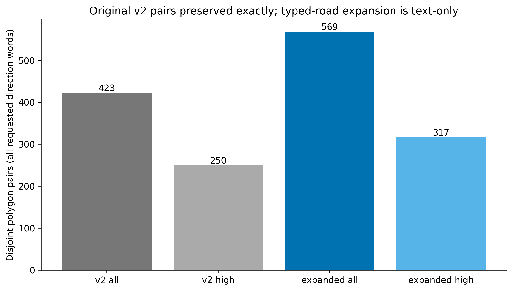

`binding_expansion.csv` 可逐条核查新增绑定；`relations.jsonl.gz` 包含全部 4,659 个候选。`exclusion_reasons.csv` 不把解析失败、绑定失败、Polygon 重叠及方向不显著混为同一种原因。规则分值是审计优先级，未经人工概率校准。

## 2. 无目标 GT 的参考方向构建

推断模块 `infer.generate(public_input)` 仅接收原文、关系范围、主语/地标标识、地标轮廓、其他具名对象/水体与起点。场景明确剔除关系主语 Polygon/坐标。GT 位于独立 `evaluation_gt.jsonl.gz`，只供评价与案例图使用；未来轨迹及 UAV yaw 均不进入本次推断。

约定参考朝向 h 的前/左/右/后为 h、h+90°、h−90°、h+180°，这是被检验的数学定义，不是预设世界 left=−X。明确指定的观察/行进语义才允许输出单一方向，否则输出带来源的候选及 unknown。具体规则：

- **显式 stand at L facing stream**：具名 L 与唯一水体独立绑定，使用水体最近岸边法向作为视线代理；保留视点扰动散度。它不是恢复出的作者相机 yaw。
- **on A when coming from B**：A/B 都是具名道路，A 轮廓 PCA 特征值比≥8，独立交汇/最近间距≤12m，交点沿 A 主轴处于外侧四分之一时，方向取从交点进入 A 内部。交点在中部、道路不够直或拓扑不明则保留±。这是道路中心线代理，不能保证复原每条实际通行路线。
- **facing L from named region**：有来源区域时计算区域→L；视点沿来源 Polygon 扰动导致方向散度>30°，只记候选，不能把来源道路上的任意点当成已知观察点。
- **建筑主轴**：按均匀边界采样 PCA，保留主轴/次轴的四种方向；不存在可核验入口/正面时不定符号。
- **建筑→提及道路**：使用独立道路区域最近点形成“可能朝路”的建筑学先验，只记候选，不宣称道路一侧一定是建筑正面。
- **地标→起点、起点→地标、地标→其他具名对象**：均输出候选；没有文本许可不自动充当真实视线。两个非主语具名地标的方向句可形成共享视角约束，但“共享同一视角”本身仍是假设。

同类型候选平分该类型质量，各类型平分总质量，不因某类枚举方向多而放大其权重。禁止按 GT 最小误差取 max/any-best；显式方向彼此冲突时保持 unknown。路由规则见 `routing_rules.csv`，逐候选证据见 `all_frame_candidates.csv`。

| 参考方向类型 | 四词已绑定中可构建 | 单一明确方向 | 四词不相交可用 | 涉及地图 |
| --- | --- | --- | --- | --- |
| building_PCA_axis | 462 | 0 | 187 | 20 |
| explicit_road_away_from_named_junction | 16 | 16 | 5 | 5 |
| explicit_stand_face_water | 1 | 1 | 1 | 1 |
| explicit_view_from_named_region | 3 | 0 | 0 | 2 |
| landmark_to_mentioned_road | 457 | 0 | 183 | 20 |
| landmark_to_other_named | 595 | 0 | 249 | 21 |
| landmark_to_start | 1051 | 0 | 425 | 23 |
| named_pair_shared_frame_constraint | 5 | 0 | 2 | 4 |
| road_unsigned_axis | 224 | 0 | 100 | 21 |
| start_to_landmark | 1051 | 0 | 425 | 23 |
| view_road_horizontal | 3 | 0 | 2 | 3 |
| view_road_vertical | 11 | 0 | 5 | 5 |

这些类型相互重叠，不能将行数相加。地标连起点几乎人人可计算，并不等于其有语义支持。

### 简单规则与 BERT 轻量路由

先按文本划分 observer / road_travel / image_layout / intrinsic_candidate / unknown 五类银标签。冻结本地 `bert-base-uncased`，实体名称替换为类别，关系范围与完整指令共同编码，attention-mask 均值池化为 768 维，再拼接参照物类别 5 维及提及数 1 维。StandardScaler + balanced LogisticRegression（C=1，最多600次，门限0.60）仅拟合文本规则银标签。没有以 GT 最优方向作为监督。输出概率未经作者参考系标签校准。

1,349 条绑定关系、1,273 个不同掩码文本；只对四词的 1,058 条绑定关系进行路由交叉验证，几何不合格样本可用于文本银标签拟合，不能用于方位一致性分母。对象分组5折及逐地图留出；测试集重复原始英文从训练折剔除。完整 TRAIN 重拟合的小模型另外保存，未参与报告的交叉验证得分。BERT 文档与分组交叉验证概念分别参考 [Hugging Face](https://huggingface.co/docs/transformers/model_doc/bert)、[scikit-learn](https://scikit-learn.org/stable/modules/generated/sklearn.model_selection.GroupKFold.html)；本实验实际对象折是固定 hash 分组，非调用 GroupKFold。

## 3. 评价纪律与基线

一般方位采用参照物到关系主语位移 atan2，扇区误差≤45°记成功；Polygon 完整边界的重叠/间距检验沿用 v2（1m容差），不因质心看似正确而放行。多候选得分为固定方向质量落入正确扇区的总和；角误差也按固定权重求均值。

**world-fallback hybrid**：有局部候选时用其兼容度，unknown 时保留世界基线；因此没有删除难例。净改善是同一总体逐样本差值均值。另报条件兼容度、总体候选覆盖、覆盖加权兼容度和 unknown。世界基线对 v2 子集直接复用其冻结的交叉拟合联合轴字典；扩展集在其他 TRAIN 分组拟合全局共享 D4 字典（8个不同旋转/镜像），从未逐样本选最佳字典。地图图像右=+X、上=+Y 有独立 affine 依据；没有 CRS，不称 +Y 为真实北方。

95% CI 默认按关系主语对象聚类 bootstrap 1,000次；完整 JSON 另给具名参照物与地图聚类敏感性分析。小样本硬二元率额外提供 Wilson CI，避免 1/1 的 bootstrap [1,1] 被误认为确定证据。所有统计是 TRAIN 内部探索性验证；规则、阈值与船屋例不是预注册，分组交叉验证不等于全新外部数据验证。

## 4. 主要结果：兼容度不等于辨认出真实朝向

下表是对象分组5折。总体列为保留 unknown 世界回退的结果；CI 是总体配对净差的对象聚类区间。所有百分比保留原分母。

| 样本集 | 方法 | 候选覆盖 | 条件兼容度 | 加权角误差 | 世界基线 | 总体 hybrid | 净改善及95% CI (pp) |
| --- | --- | --- | --- | --- | --- | --- | --- |
| v2_all | semantic_candidates | 122/344 (35.47%) | 40.16% | 74.37° | 30.23% | 39.24% | +9.01 pp [5.74, 12.57] |
| v2_all | bert_router | 120/344 (34.88%) | 39.48% | 75.03° | 30.23% | 38.48% | +8.25 pp [4.78, 11.94] |
| v2_high | semantic_candidates | 92/207 (44.44%) | 38.45% | 76.01° | 27.54% | 33.03% | +5.50 pp [0.00, 10.77] |
| v2_high | bert_router | 90/207 (43.48%) | 38.19% | 76.04° | 27.54% | 33.03% | +5.50 pp [0.00, 10.77] |
| expanded_all | semantic_candidates | 135/425 (31.76%) | 39.81% | 74.77° | 31.53% | 39.24% | +7.71 pp [4.96, 10.71] |
| expanded_all | bert_router | 133/425 (31.29%) | 39.19% | 75.38° | 31.53% | 38.62% | +7.09 pp [4.27, 10.11] |
| expanded_high | semantic_candidates | 101/243 (41.56%) | 38.24% | 75.78° | 30.45% | 39.76% | +9.31 pp [5.05, 13.61] |
| expanded_high | bert_router | 99/243 (40.74%) | 38.01% | 75.81° | 30.45% | 39.35% | +8.90 pp [4.65, 13.14] |

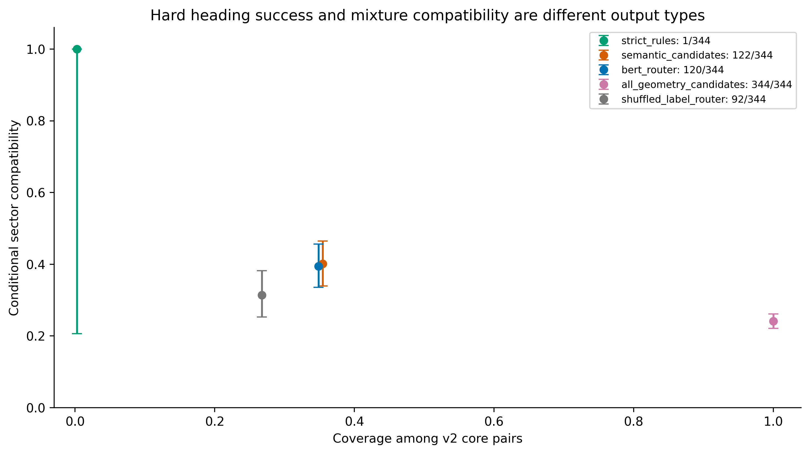
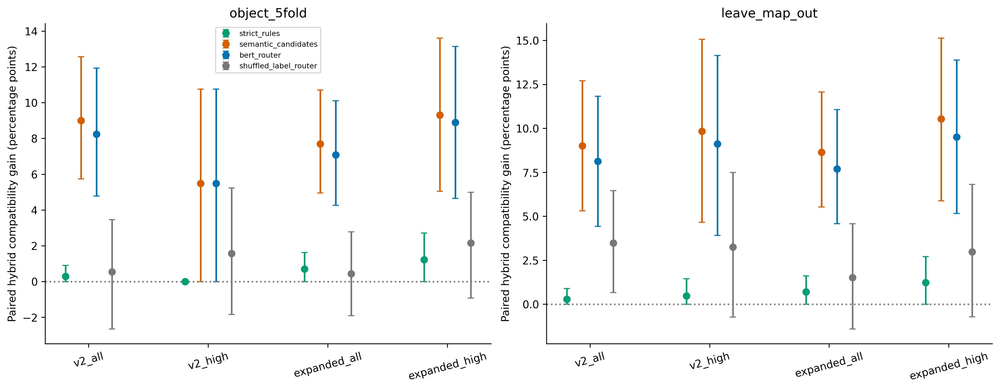

逐地图留出结果：

| 样本集 | 方法 | 覆盖 | 条件兼容度 | 世界→总体 hybrid | 净改善95% CI (pp) |
| --- | --- | --- | --- | --- | --- |
| v2_all | semantic_candidates | 122/344 | 40.16% | 27.91% → 36.92% | +9.01 [5.31, 12.71] |
| v2_all | bert_router | 118/344 | 38.98% | 27.91% → 36.05% | +8.14 [4.44, 11.83] |
| v2_high | semantic_candidates | 92/207 | 38.45% | 18.84% → 28.68% | +9.84 [4.66, 15.07] |
| v2_high | bert_router | 88/207 | 37.36% | 18.84% → 27.96% | +9.12 [3.92, 14.15] |
| expanded_all | semantic_candidates | 135/425 | 39.81% | 30.12% → 38.76% | +8.65 [5.54, 12.08] |
| expanded_all | bert_router | 131/425 | 38.74% | 30.12% → 37.82% | +7.71 [4.58, 11.08] |
| expanded_high | semantic_candidates | 101/243 | 38.24% | 29.22% → 39.76% | +10.55 [5.89, 15.13] |
| expanded_high | bert_router | 97/243 | 37.24% | 29.22% → 38.73% | +9.52 [5.16, 13.90] |

**不能把约39%候选兼容度叫做真实朝向识别准确率。** 对建筑无向轴，正反方向都保留，平均角误差仍约75°；未知符号没有被解决。普通规则与 BERT 相近且规则略好，没有发现引入 BERT 路由带来的净增益。

### 相同覆盖率的关键消融

不给 BERT 已覆盖样本任何方向信息，只用均匀0–360°朝向（一般扇区期望兼容度25%），其余样本仍用完全相同世界回退。这样消除了“只把过于自信的世界预测软化”的伪提升。

| 验证 | 比较（总体配对差） | 差值及对象95% CI (pp) | 地图聚类95% CI (pp) |
| --- | --- | --- | --- |
| object_5fold | BERT_geometry_beyond_uniform_same_support | +5.05 [2.72, 7.42] | [3.14, 6.76] |
| object_5fold | mentioned_road_facing_prior_ablation | +5.52 [2.96, 8.33] | [3.52, 7.72] |
| object_5fold | BERT_versus_simple_semantic_rules | -0.76 [-1.78, 0.00] | [-1.74, 0.00] |
| leave_map_out | BERT_geometry_beyond_uniform_same_support | +4.80 [2.49, 7.18] | [2.73, 6.76] |
| leave_map_out | mentioned_road_facing_prior_ablation | +6.10 [3.45, 8.98] | [3.94, 8.07] |
| leave_map_out | BERT_versus_simple_semantic_rules | -0.87 [-2.05, 0.07] | [-2.49, 0.24] |

几何相对均匀先验仍有正的统计改善，说明收益不完全来自软化预测。道路朝向建筑的候选先验贡献较大，但此消融同时改变候选组成/支持，不是独立确定真实正面的证据。BERT 仍未优于简单语义规则。

四词分项（v2 有效集，对象折，BERT）：

| 词 | n | 覆盖 | 条件兼容度及对象CI | 平均角误差 | 总体净差 (pp) |
| --- | --- | --- | --- | --- | --- |
| behind | 85 | 72/85 | 37.67% [29.30, 47.16] | 76.90° | +22.50 |
| left | 94 | 2/94 | 12.50% [0.00, 25.00] | 90.00° | -0.80 |
| front | 56 | 45/56 | 44.44% [34.82, 53.78] | 70.11° | +19.64 |
| right | 109 | 1/109 | 0.00% [0.00, 0.00] | 132.52° | -0.92 |

按地图、解析置信度、语义类别的完整分项在 `breakdown.csv`，按主语类别在 `subject_category_breakdown.csv`。小组与重复同一地标的样本不是独立重复实验，见参照物/地图聚类 CI。

## 5. 明确方向的硬检验及道路专属判据

扩展425个一般方位有效配对中只有6个能由严格规则给出单一方向，且全在 cambridge_block_28。扇区3/6=50.00%，Wilson 95% CI [18.76%,81.24%]；排除已知船屋开发例后为2/5=40.00%，CI [11.76%,76.93%]。这不支持把明确规则泛化到所有四词，更没有 front/behind 广泛成功的独立证据。

“道路右侧”常指沿路的横向半平面，不一定在道路质心的±45°右扇区；道路 Polygon 也可能包含路边对象。为此另建**次要道路横向评价集**：参照物为道路、left/right、独立 PCA 比≥8，主语完整 Polygon 在独立中心线一侧且边界裕量>1m。资格判定不使用语言符号挑侧，也不改变原不相交主评价集。它是另一种几何谓词，不能与344个样本的扇区基线直接相减。

| 道路次要集方法 | 覆盖/116 | 条件道路侧一致性 | 匹配世界侧基线→总体 | 净改善及95% CI (pp) |
| --- | --- | --- | --- | --- |
| strict_rules | 9/116 | 88.89% | 41.38% → 45.69% | +4.31 [0.88, 8.41] |
| semantic_candidates | 14/116 | 75.00% | 41.38% → 47.84% | +6.47 [2.65, 10.53] |
| bert_router | 13/116 | 73.08% | 41.38% → 46.98% | +5.60 [2.21, 9.65] |

严格9例覆盖7.76%，8/9=88.89%，Wilson CI [56.50%,98.01%]，涉及3张地图、5个参照物组；按参照物聚类条件CI约[56.96%,100%]。道路次要集高置信子集51例，严格规则覆盖8例，7/8符合；完整值见 `roadside_high_subset.csv`。净差使用在**相同道路侧训练支持**上拟合的全局世界半平面字典。逐地图留出严格净差也是+4.31pp。不能把同一道路上几个相邻建筑当成许多独立地标，只有3张地图的地图bootstrap同样不稳定。道路视角是最值得继续验证的局部规则，但样本仍少，且存在反例。

## 6. 负对照

随机化300次，固定支持集；参考方向随机旋转、参考方向包在样本间置换。路由训练标签打乱另计支持变化。单侧 Monte Carlo p 是探索性值，未作多重检验校正，不构成因果证明。

| 集/方法 | 对照 | 覆盖 | 真实条件值 | 随机均值 | 随机95%区间 | MC p |
| --- | --- | --- | --- | --- | --- | --- |
| v2_all/bert_router | independent_random_rotation | 120 | 39.48% | 24.97% | [21.42, 29.13] | 0.0033 |
| v2_all/bert_router | permuted_reference_frame_packages | 120 | 39.48% | 25.95% | [22.19, 30.17] | 0.0033 |
| roadside_secondary/strict_rules | independent_random_rotation | 9 | 88.89% | 41.30% | [11.11, 66.67] | 0.0066 |
| roadside_secondary/strict_rules | permuted_reference_frame_packages | 9 | 88.89% | 61.44% | [33.33, 88.89] | 0.0664 |

标签打乱路由在 v2 主集覆盖 92/344，条件兼容度 31.39%，总体净差 +0.55pp，95% CI [-2.65, 3.47]pp。不是与原模型相同覆盖，故只作为补充。道路严格规则的方向包置换 p≈0.066，达不到常用0.05门限；不应只挑显著的随机旋转结果宣传。

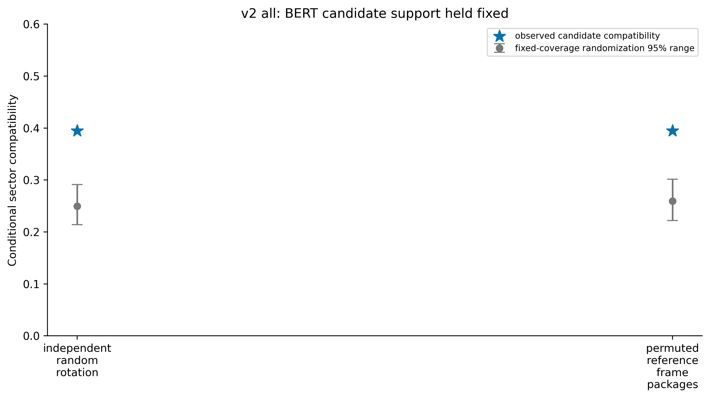
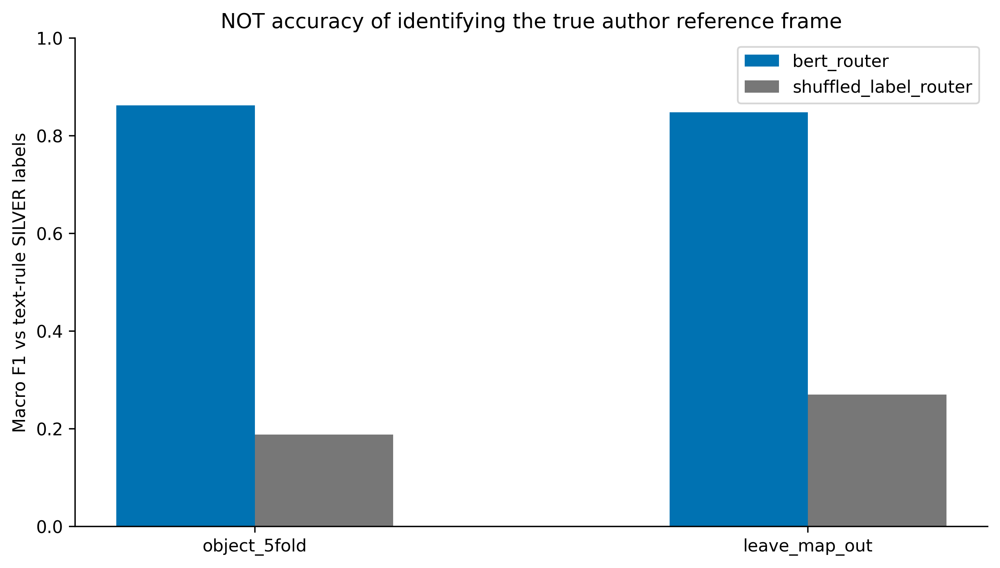

BERT 对象折银标签准确率97.16%、macro-F1=0.8625；逐地图银标签准确率97.45%、macro-F1=0.8480。这仅说明能复现文本启发式类别，**不是对真实作者参考系的识别率**。`router_quality_silver.json` 保留混淆矩阵及标签打乱结果。

## 7. unknown 与完整输出

4,659个具名地标方向候选中，3,310个绑定/作用域未解，均输出 unknown，而非丢弃。1,349个绑定中，17个明确可计算、344个有语义支持但候选多解、988个未知。四词共有3,898个候选，1,058个绑定；严格单一方向只有17/3,898=0.44%，所以按全四词候选分母单一方向未确定比例为99.56%。该比例受解析覆盖限制，不代表99.56%的原始语言没有真实视角。

扩展主分析中明确方向6/425，故单一方向 unknown=98.59%；BERT 候选覆盖133/425=31.29%，无候选支持68.71%，但有候选的样本也未必具有已知单一朝向。v2 主分析 BERT 候选覆盖120/344=34.88%，落到全部3,898个四词候选仅3.08%。这些分母必须与39%左右的条件兼容度一起阅读。

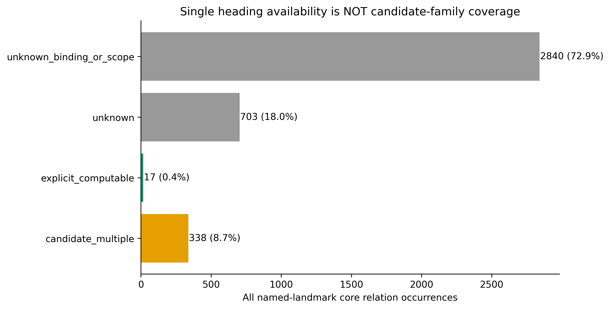

## 8. 真实案例审计

图左为真实 RGB 地图裁剪，叠加地标/关系主语轮廓、GT 与绝对世界 XY；右为独立参考方向下的前后左右扇区或多候选。Polygon 和坐标来自原始数据，只有扇区是数学叠加。案例为解释性挑选，不用于统计估计；不确定例按预定类别/ID选取。原始英文、ID及证据保存在 `case_index.json`。坐标标注不声称有真实北方校准。

### known_boathouse — `cambridge_block_28:8:2:142`

> This is a building located on Cutter Ferry Lane. If you stand at Pembroke College Boat Club facing the stream, this building would be on your right.

v2 已知开发例，不能当作新验证。唯一水体与 Boat Club 独立绑定，最近岸边方向272.153°，right期望182.153°，GT方位179.320°，误差2.833°。文本确实指定观察方式，但相机位置与注释者 yaw 未恢复。

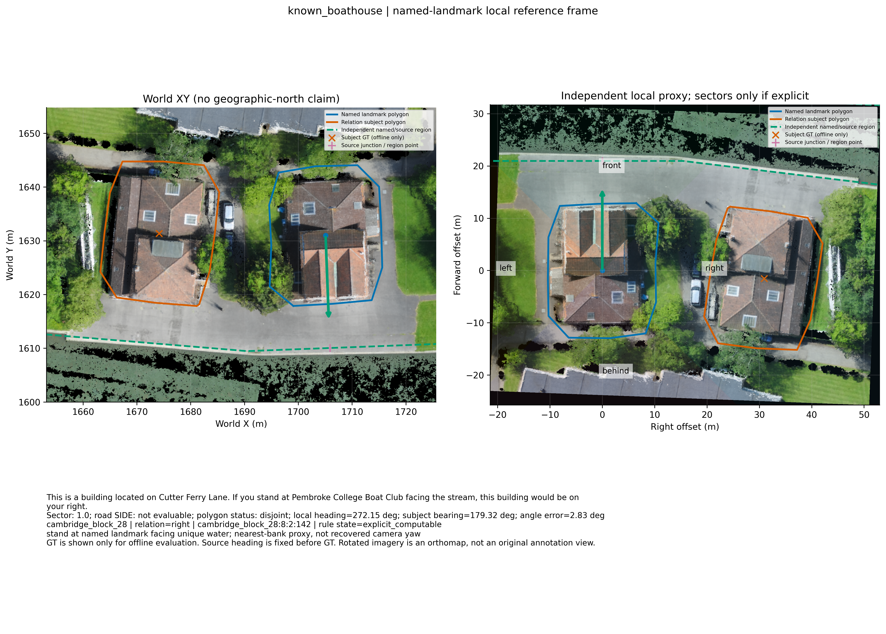

### new_route_agreement — `cambridge_block_28:165:2:32`

> The fourth grey building on the right of the Acrefield Drive when coming from the Manhattan Drive.

从 Manhattan Drive 进入 Acrefield Drive 的道路拓扑可独立确定主轴符号，目标在右侧，扇区与完整轮廓道路侧均通过。

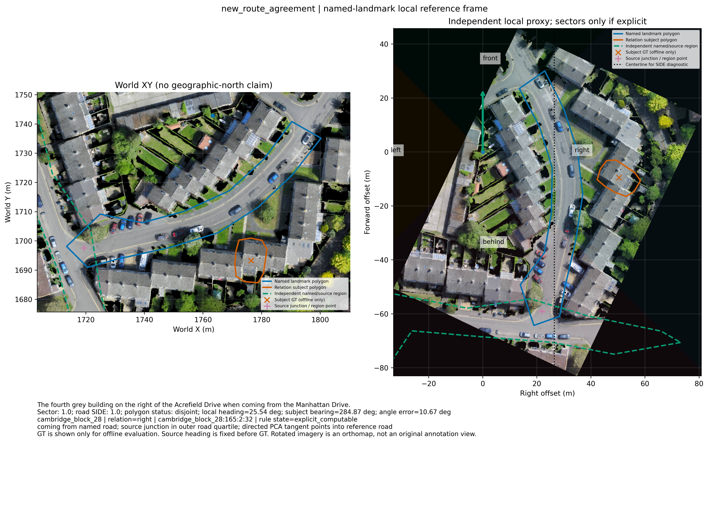

### sector_vs_roadside — `cambridge_block_28:174:5:26`

> The first building on the right of the Acrefield Drive, when coming from the Manhattan Drive.

相同进入方向，Acrefield 第一栋建筑右侧成立，但相对道路质心方位偏差56.56°，不满足45°扇区。这说明应匹配道路侧关系谓词，不能简单翻转朝向来迎合扇区GT。

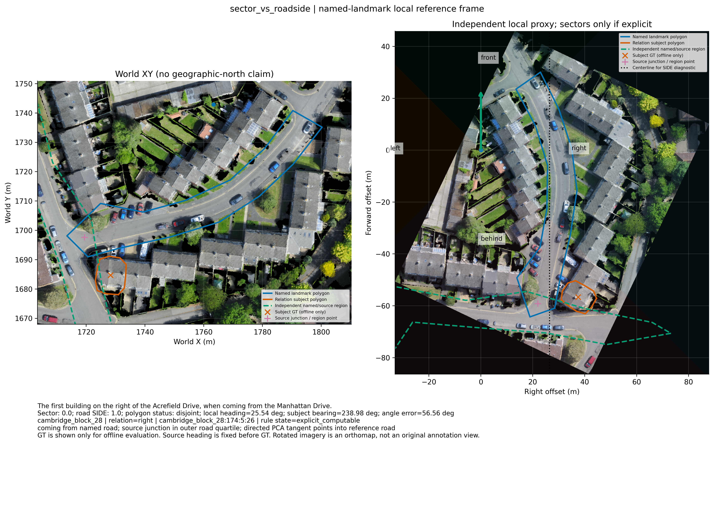

### new_map_roadside — `cambridge_block_33:53:3:54`

> Coming from Beche Road this is the third house on the left of Priory Road.

另一个地图的 Priory Road 案例，完整轮廓道路侧成立；原Polygon交叠使其不能算入一般不相交扇区集。

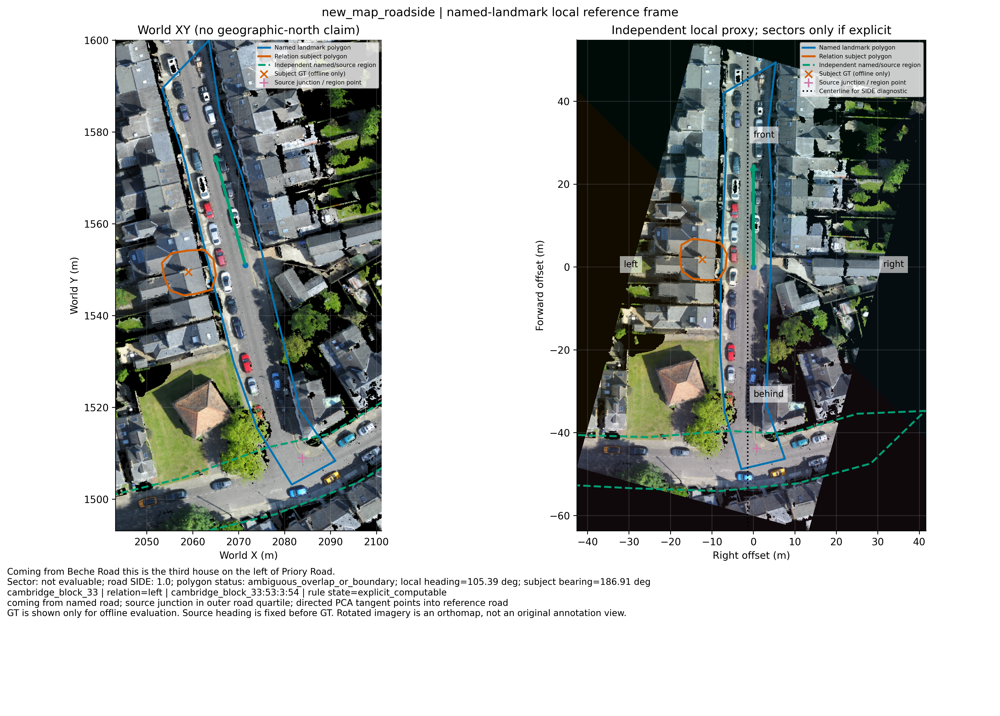

### new_junction_roadside — `cambridge_block_21:95:3:42`

> The third building that is located on the left of the Short Street when coming from the Four Lamps Roundabout Road.

Short Street/Willow Walk 一带提供另一地图的有向道路证据；仍是直线代理，不能视作验证了所有道路拓扑。

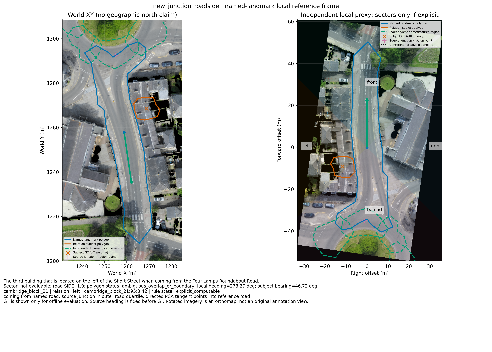

### route_proxy_conflict — `cambridge_block_28:17:3:26`

> The third building on the right of the Abbey Road when coming from the Walnut Tree Avenue.

Abbey Road 从 Beche Road 进入的中心线代理与标注冲突，扇区误差约176.03°，道路侧也失败。保留原方向与反例；可能涉及道路曲率/真实路线、语言作用域或标注差异，未独立确定原因，不称为已证实标注错误。

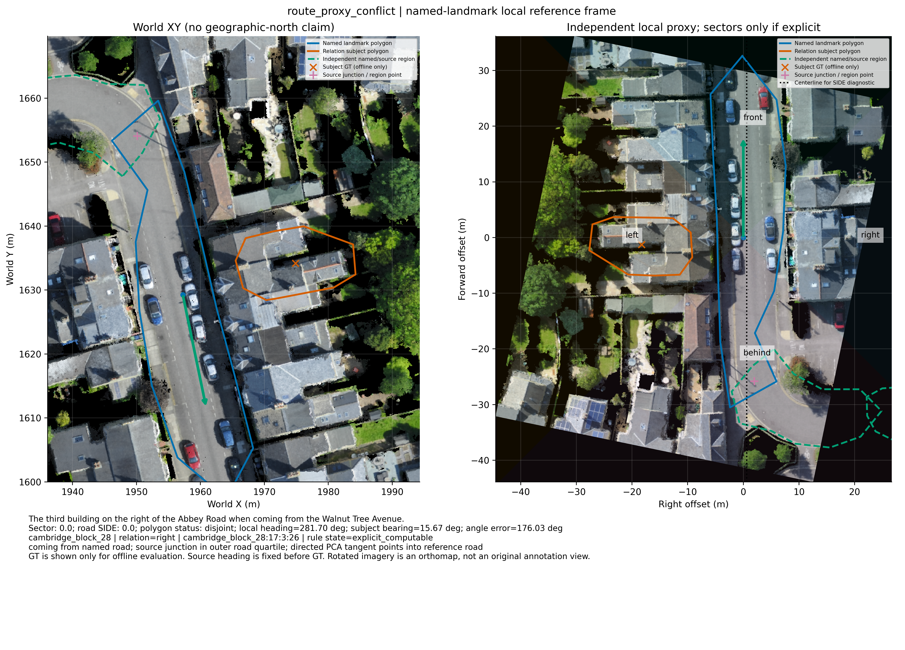

### observer_region_uncertainty — `cambridge_block_13:20:3:24`

> This building is to the right of Link Building when looking at them from Tennis Court Road

语言指定从具名道路看，但道路来源区域较宽，不能独立定位观察点。保留候选和 unknown，不能用目标GT选最合适的路段。

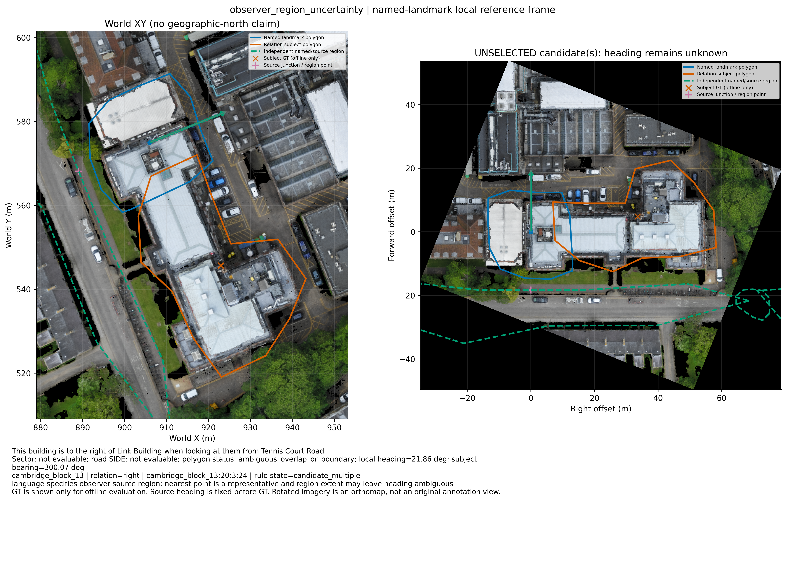

### unsigned_building_unknown — `birmingham_block_10:46:2:22`

> A white van parked in front of the Weighbridge Offices againnst the buiklding. There is a black car with a green sticker in the window in front of it.

建筑轮廓有主轴，但没有可靠入口/正面证据，四种方向保留；GT只显示对象相对位置，不用于决定哪一面是前。

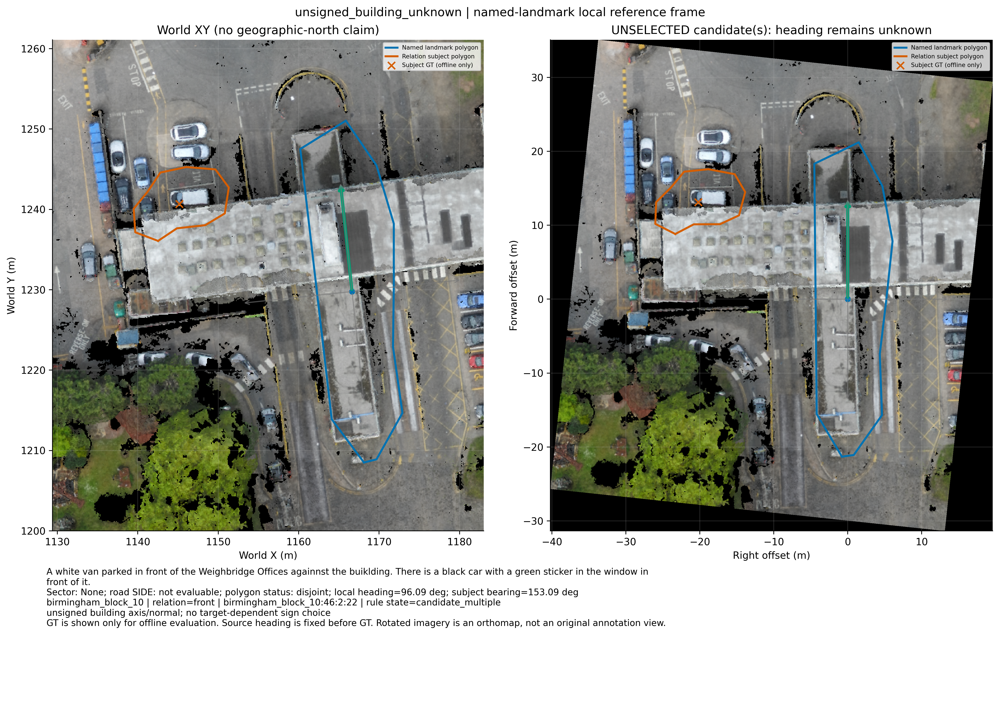

## 9. 对 GeomBelief 的建议与五个问题的回答

1. **是否找到可泛化局部规则？** 找到可复现的、局限于明确语义结构的规则及正向统计相关性；“从B进入A沿路判断侧别”跨3张地图有8/9的有限证据。一般扇区明确方向3/6、排除旧船屋2/5，尚不足以认定四词存在统一局部生成规则。世界固定轴也没有被本实验确立。
2. **哪类语言最有用？** 具名起点/观察点 + facing目的区域，以及道路A + coming from道路B，可消除纯几何轴的符号歧义。只有 front/behind 或只有建筑PCA通常不足以确定朝向；多个地标若没有明确语义角色，仍无法独立选出作者视角。
3. **修正参考系提高多少？** v2同支持对象折 BERT候选 hybrid 30.23%→38.48%（+8.25pp，对象CI[4.78,11.94]）；其中相对同覆盖均匀朝向的额外收益+5.05pp，地图留出额外+4.80pp。这是候选兼容度收益，不是硬方向识别提升。严格道路侧另有8/9、全116样本+4.31pp，谓词和人群均不同。高置信对象折净差区间接近/包含0，不夸大稳定性。
4. **现在是否有必要增加参考系预测网络？** 建议先增加参考系变量与多假设接口、显式语义规则及unknown机制；不支持立即投入复杂预测网络。简单规则没有输给本次BERT银标签路由，缺少独立作者视角/建筑正面/道路通行标签。世界轴可作为回退候选，不能继续作为无条件唯一约定。下一步优先补充独立视角与道路侧关系标注，再评估网络是否超越规则。
5. **若训练语言图网络，应输出什么？** 节点包括文本关系主语、具名参照物、其他明确提及地标、水体/道路区域、观察/起始点、道路交汇与无向局部轴候选。边包括有向主语—参照物关系（方向词、语句范围、直接/间接）、facing/from/along角色、道路连接及候选轴来源。特征包括BERT语义/角色范围、参照物Polygon几何、独立地标间向量、PCA特征值比、交点位置、视点区域散度与±符号歧义；禁止将目标GT位置、未来轨迹或GT最优方向送入推断。输出关系绑定分布、参考系类别分布、多峰方向/无向轴与符号分布、绑定unknown/类型unknown/符号unknown及置信度来源；不能用单一最优角度标签掩盖歧义。

## 10. 可复核性与限制

完整文件索引及复跑命令见 [README.md](README.md)。公开输入、冻结推断、BERT特征、逐样本评价、完整unknown输出、折划分、权重模型、CSV与JSON均随本分支提交；原始大数据/预训练权重仅记录SHA，不复制。所有高清图为320dpi PNG和矢量PDF。

这是 TRAIN 上的观察性分析，启发式参数与实体类型消歧仍可能有系统误差。没有可靠真实北方、立面/入口朝向、注释者拍摄视角或逐条真实参考系标签；未证明作者遵循本实验的代理方向。正相关、跨组统计改善和明确语义案例应当分层解释。跨地图CV只评估现有地图集合，不是新城市的外部验证。

自动检查详见 `results/verification.json`；外部 adversarial-review 的真实调用和返回状态详见 `REVIEW.md`，不能将本地自检当成外部审查通过。
