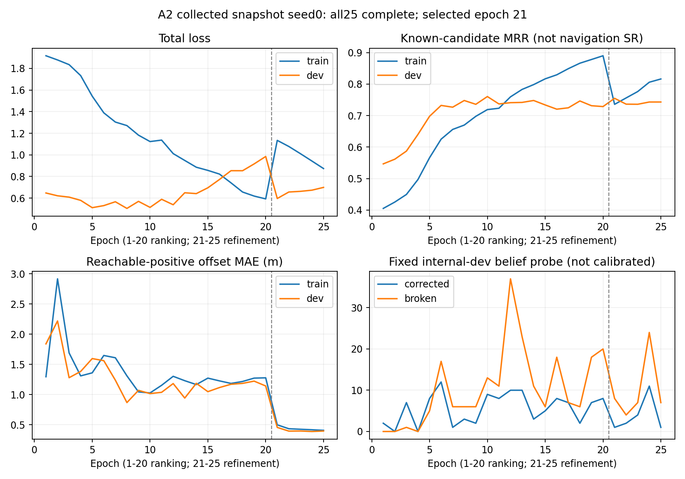

# A2 已采数据训练完成（2026-10-28）

08:07完成全部20轮排序与5轮局部精修，服务正常退出（code0）。每轮31415个训练观测、4618个内部验证观测均完整遍历。25轮Checkpoint、优化器步数及TensorBoard31类/775条标量已核验；曲线与history最大浮点误差3.54e-6以内。原始采集已停止，未扩大数据或使用任何benchmark调参。

按照预先固定的内部验证MRR/偏移误差/loss规则，在全部5轮精修完成后选中第21轮。SHA256：`44c57a2af9ecc8dcacbb4c7813fcb6c7d414f286969f0ef4f1d13edbbf84db8b`。

选中模型内部验证可信候选MRR=0.754772、Top1=0.606186、可达正例偏移MAE=0.457085m。这些仅为有已核实正负监督候选上的训练诊断，不是完整候选Recall或闭环SR。

选中模型的固定未校准内部Belief探针，在4618个观测中修正1个、破坏8个，不能据此宣称导航提升；该探针也不授权运行时启用门控。当前独立校准运行中，仍需实际闭环pilot及冻结，然后才进入完整Val-Seen2470/Val-Unseen2697评估。若校准或闭环安全条件不成立，保持门控关闭并如实报告。

大型权重与TensorBoard保留服务器：`runs/a2_waldo_landmark_20261027/training_collected/`。选中权重为`best.pt`；逐轮权重为`epoch_01.pt`至`epoch_25.pt`。曲线原始数据为`training_collected_curves.csv`；产物核验见`TRAINING_ARTIFACT_VERIFICATION.json`。
