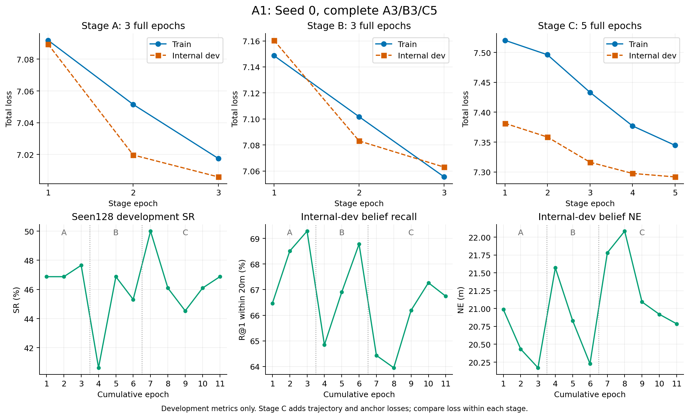

# A0/A1 完整验证结论（Seed=0）

A1 已完成 A3/B3/C5 全部训练。最终权重按预先规定的 Seen128 SR、SPL、训练内部验证 Recall 选择，冻结后完成 Val-Seen 2470 和 Val-Unseen 2697 全部闭环评估。A0 使用既有正式完整训练归档；本对比不属于两组匹配重训的因果验证。

| 验证集 | 指标 | A0 | A1 | A1−A0 |
|---|---|---:|---:|---:|
| Seen (2470) | SR (%) | 47.611 | 45.789 | -1.822 |
| Seen (2470) | OSR (%) | 55.668 | 59.555 | +3.887 |
| Seen (2470) | SPL (%) | 46.003 | 40.686 | -5.316 |
| Seen (2470) | NE (m) | 29.119 | 29.812 | +0.693 |
| Seen (2470) | nDTW (%) | 30.398 | 30.381 | -0.017 |
| Seen (2470) | sDTW (%) | 16.918 | 16.177 | -0.741 |
| Seen (2470) | False_Stop_Rate (%) | 52.389 | 54.274 | +1.885 |
| Seen (2470) | 最终 Belief R@1/20m (%) | 47.444 | 45.672 | -1.772 |
| Seen (2470) | 最终 Belief R@8/20m (%) | 78.277 | 77.700 | -0.577 |
| Unseen (2697) | SR (%) | 22.544 | 24.805 | +2.262 |
| Unseen (2697) | OSR (%) | 31.702 | 37.746 | +6.044 |
| Unseen (2697) | SPL (%) | 21.821 | 22.080 | +0.260 |
| Unseen (2697) | NE (m) | 51.533 | 50.722 | -0.811 |
| Unseen (2697) | nDTW (%) | 25.623 | 26.183 | +0.560 |
| Unseen (2697) | sDTW (%) | 8.454 | 9.178 | +0.724 |
| Unseen (2697) | False_Stop_Rate (%) | 77.440 | 75.019 | -2.421 |
| Unseen (2697) | 最终 Belief R@1/20m (%) | 22.471 | 24.673 | +2.202 |
| Unseen (2697) | 最终 Belief R@8/20m (%) | 50.504 | 53.938 | +3.434 |

A1 在 Unseen 上 SR 提升 2.262 个百分点，NE 降低 0.811m；但 Seen SR 下降 1.822 个百分点，SPL 下降 5.316 个百分点，因此不能表述为全面提升。Unseen SPL 的配对区间包含零。OSR 的提升也不能替代最终停止成功率或路径效率。

SR 的逐 Episode 配对 bootstrap 95% 区间：Seen −3.198 至 −0.486 个百分点；Unseen +1.075 至 +3.411 个百分点。精确 McNemar 双侧 p：Seen 0.01082，Unseen 0.0001335。另已报告 query-cluster SR 区间；这些区间反映 Episode/Query 不确定性，不代表跨训练种子不确定性。

最终权重来自 C 阶段第 1 轮最佳快照，但 C 阶段 5 轮全部执行完毕后才确定最终模型，未使用完整 Seen/Unseen 结果重选。False-Stop 以 policy-stop 次数为分母；Recall 以唯一 map+instruction 查询为单位，分别报告初始、首次观测和最终 Belief，最终观测时刻可能因模型轨迹而异。

## 训练曲线

TensorBoard 的 A3/B3/C5 记录数、步号及 Train/Dev Loss、Seen128 SR 与 history.json 逐点一致；曲线中的 Seen128 仅用于开发选模，不替代两个完整验证集结论。

## 完整证据

- `RESULTS.md`、`results.json`：全部指标、目标 Recall、逐地图结果和配对统计。
- `metrics.csv`、`by_map.csv`：可复用结果表。
- `training_curves.csv/png/pdf`：11 轮训练曲线及原始数据。
- `completion_verification.json`：A0/A1 共 10,334 条保存轨迹独立重算，逐 Episode 与逐地图导航指标最大差异为零。
- `recall_verification.json`：全部保存轨迹与查询级 Recall 独立重算一致。
- `training_inventory.json`、`frozen_pair.json`：完整训练、权重 SHA 与冻结时间。

大文件保留服务器：`/home/20261024_1/Workspace/.workspace/joint-rgb-geometry-retrain-20261027/runs/joint_rgb_geometry_A1_20261027`。既有 A0/A1 原始结果和权重未改写。
