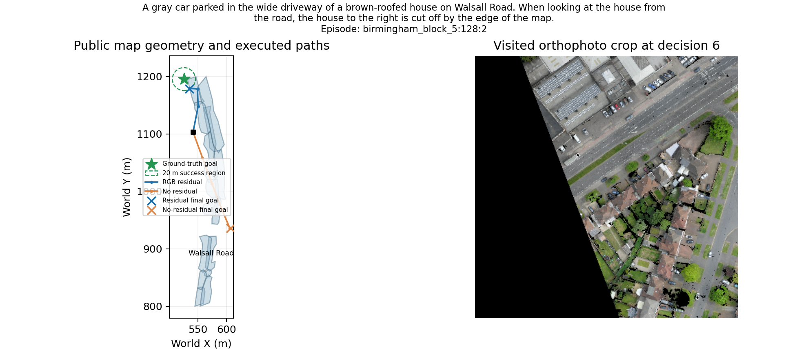
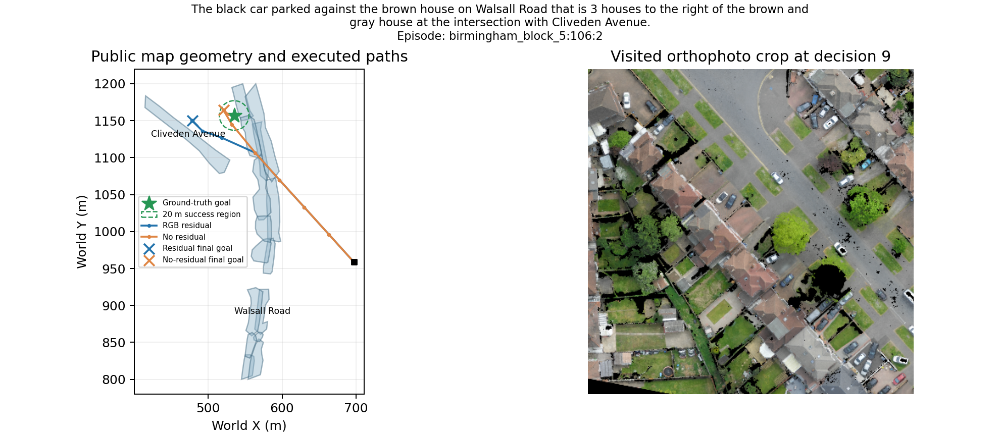
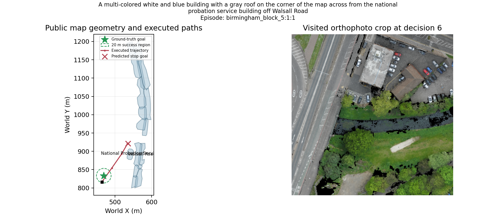
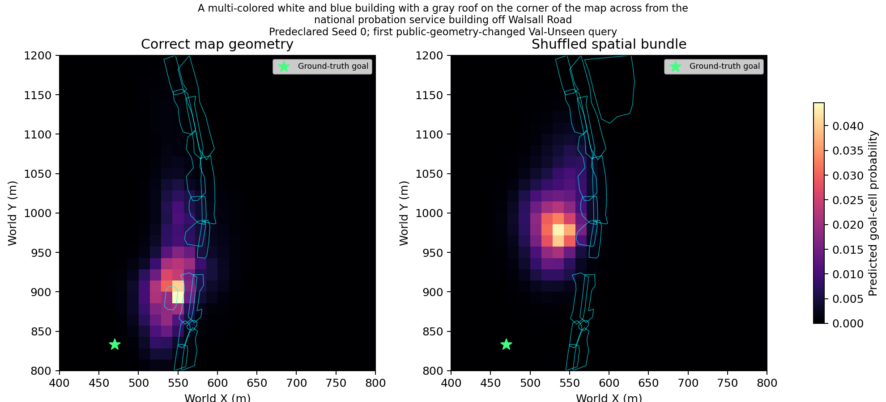
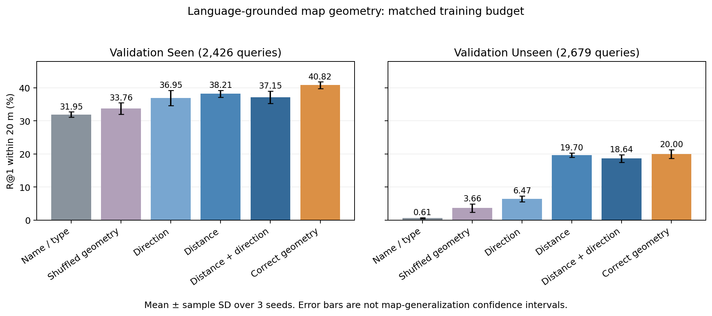

# GeomBelief qualitative cases

Images are crops of the real CityNav orthophoto at actual executed poses. The environment uses an orthographic crop and a surface-height-derived vertical-depth proxy, not a perspective occlusion renderer or a separately captured onboard photograph. Only the visited crop and its support metadata enter the policy. Map polygons, language, goal annotations and trajectories come from recorded public inputs and evaluation-only GT. English figure labels; no invented paths.

## visual_improved

Episode `['birmingham_block_5', 128, 2]`; val_unseen; NE 19.59 m. Source trace and SHA: qualitative_manifest.json.

## visual_degraded

Episode `['birmingham_block_5', 106, 2]`; val_unseen; NE 57.02 m. Source trace and SHA: qualitative_manifest.json.

## false_stop

Episode `['birmingham_block_5', 1, 1]`; val_unseen; NE 110.04 m. Source trace and SHA: qualitative_manifest.json.

## Correct versus shuffled geometry belief

Actual normalized model probabilities, predeclared Seed0 and first Val-Unseen query with changed public node geometry; no result-based selection. Cyan outlines are the geometry supplied to each model. Recipient language and landmark names are unchanged. Separately budget-matched trained models; not a same-weight feature intervention. Source IDs, donor and checkpoint SHAs: belief_figure_manifest.json.

## Aggregate static localization

Actual complete validation results; bars are three-seed means and error bars are sample standard deviations, not cross-map confidence intervals. Exact inputs are recorded in static_figure_manifest.json.
