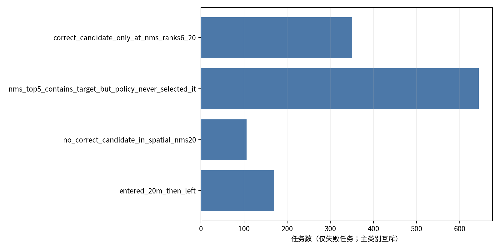
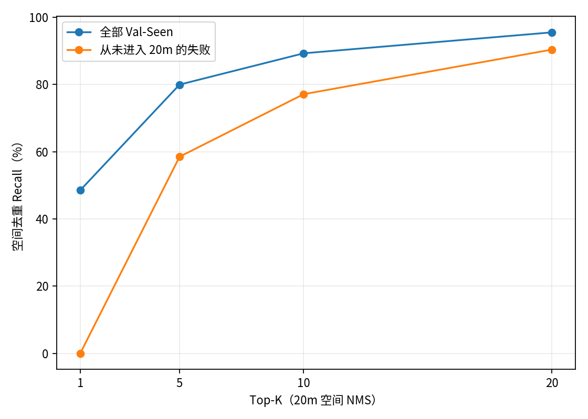
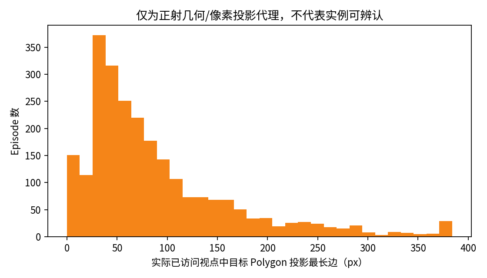

# UnifiedPGVB-V2 Val-Seen 导航失败与 Top-K 可纠正性诊断

日期：2026-11-07
基准闭环：Commit `4e0758e`，HETT Refined CityNav Val-Seen，seed=42。
本报告分析扩展地标绑定组（旧绑定作配对对照）。**没有训练模型，没有修改 Geometry、Controller、Stop 或 Checkpoint，也没有重跑闭环。**

## 结论摘要

- 扩展绑定组完整覆盖 **2,470/2,470**：SR **48.54%**（1,199/2,470）、OSR **55.43%**（1,369/2,470）、SPL **47.15%**、NE **30.83 m**、nDTW **29.89%**。旧绑定组 SR 为 47.25%；配对后新增成功53条、原成功变失败21条，净增32条（+1.30个百分点）。
- 1,271条失败中，1,101条从未进入目标20m，170条曾进入后又离开。失败主因按互斥分类为：全图空间去重 Top-5 含目标20m位置、策略却从未选中该候选 **644条**；仅在 Top-6–20 有位置候选 **351条**；空间去重 Top-20 没有位置候选 **106条**；曾进入后离开 **170条**。
- 因此首要瓶颈是**初始 Goal 排序/候选选择**。644条是目标中心20m邻域命中代理，不能称为确认的正确物理实例。实际导航头输入的原始20候选中，636/644条已包含该位置；闭环配置却每个决策都选候选槽0，候选探索关闭。
- Stop方面，2,470条全部以 `policy_stop` 结束，终端守卫异常为0，Goal大于20m跳变为0。170条“经过目标又离开”发生在策略继续驶向另一个固定错误Goal时；现有证据不支持把全部停止在目标外的失败归咎于Stop Head。
- 真实轨迹姿态上的目标Contour投影代理显示，Top-5位置命中的644条中，540条曾有最长边≥32px且短边≥16px的投影，首次达到该代理尺寸后中位只剩3个动作。它不包含遮挡/实例可辨认标签，不能据此说视觉能救回540条。

## 数据与口径

- 评测分母固定为扩展绑定组完整2,470条；旧/新配对各2,470条，无候选和失败均保留。
- GT目标位置、目标ID和Contour只在闭环结束后用于评分、轨迹回放及RGB投影分析，从未进入查询绑定、Belief、候选选择、动作或停止决策。
- **空间去重 Top-K**：对固定 Geometry 28×28全网格按logit排序，以20m半径做空间NMS，统计是否有一个网格点落在GT目标中心20m内。它是目标位置覆盖代理，不是实例匹配标签，也不等于控制器会访问这些候选。
- **原始候选预算**：另统计模型传给冻结候选/Trajectory head的前20个未去重网格点。它与全网格NMS Top-K不同。
- 局部5×5 Soft Decoder、全网格空间NMS及原始20候选是三个不同集合。本报告的候选排名都用全网格28×28空间NMS；不会把Soft Decoder R@20（历史记录50.65%）混作闭环Top-K或SR。
- 本次闭环实际为 **V2 Geometry + Pose、无RGB融合、无OSM**，配冻结GraphNav Stage1 Trajectory/Stop；每一步Belief固定，候选探索数为0。RGB-D仅在闭环之后按已经记录的Pose重新渲染作几何像素投影代理。
- 历史manifest标注FP32，但实际冻结Geometry与Trajectory head前向启用了CUDA BF16 autocast，TF32关闭；两个绑定组一致，因此配对有效，但不能称这次是全FP32运行。

## 全量闭环表现与互斥主因

| 互斥主类别 | 任务数 | 占失败数 | 解释 |
|---|---:|---:|---|
| Top-5有20m位置候选，策略没有选择它 | 644 | 50.7% | 其中636个位置候选在实际原始Top-20输入预算内；策略每一步均选择候选槽0。 |
| 位置候选仅在空间NMS第6–20位 | 351 | 27.6% | 其中197个目标邻域落在实际原始Top-20候选输入里；其余需要扩大候选获取/解码范围。 |
| 空间NMS Top-20没有20m位置候选 | 106 | 8.3% | 这是当前最直接的初始空间覆盖缺口。 |
| 曾进入目标20m后离开 | 170 | 13.4% | Goal固定；轨迹经过目标邻域后继续朝选定Goal移动。不是动态Goal跳变证据。 |
| **失败合计** | **1,271** | **100%** | 互斥，优先按是否曾进入目标半径分类。 |

完整Recall对照：

| 候选口径 | R@1 | R@5 | R@10 | R@20 |
|---|---:|---:|---:|---:|
| 全部2,470条：28×28全网格空间NMS | 48.54% (1,199) | 79.96% (1,975) | 89.27% (2,205) | 95.51% (2,359) |
| 从未进入20m的1,101条：全网格空间NMS | 0% (0) | 58.49% (644) | 77.11% (849) | 90.37% (995) |
| 从未进入20m的1,101条：实际原始候选输入 | 0% (0) | 43.05% (474) | 61.31% (675) | 75.84% (835) |

Top-5命中任务的Top-1与最佳20m区域logit差：中位 **0.328**，P75 **0.588**，P90 **0.869**。这表明一部分错误峰值与目标区域分数接近，但不能单凭分差证明视觉重排可正确工作。

从未进入目标20m组中，空间NMS排名6–10的205条里有156条目标邻域在实际原始Top-20输入，排名11–20的146条里有41条在输入预算中；排名6–20合计351条中仅197条在该候选预算中。候选分数差（Top-1减最佳GT20m区域logit）在Top-5位置命中组中位0.328、P90 0.869；在原始Top-20里有正确位置的未进入组中位0.418、P90 1.266。分值只表示Geometry热图间隔，不是校准概率。

## 类别与语言关系分层

目标类别来自CityRefer对象类型的规则归一，不代表人工复核标签。每行的Top-5/20是全网格NMS位置覆盖；never-enter Top-5是其未进入20m失败子集计数。

| 目标类 | n | SR | NMS R@5 | NMS R@20 | 从未进入20m | 其中NMS Top-5命中 |
|---|---:|---:|---:|---:|---:|---:|
| Building | 1,057 | 39.92% | 76.06% | 93.76% | 558 | 323 |
| Car | 1,226 | 56.61% | 84.18% | 96.98% | 447 | 270 |
| Ground | 131 | 41.98% | 75.57% | 96.18% | 71 | 40 |
| Parking | 56 | 50.00% | 71.43% | 94.64% | 25 | 11 |

语言关系分层是关键词启发式代理，不能当作正确解析结果：直接关系词代理1,481条（SR 42.20%，NMS R@5 76.91%，未进入20m 755，其中Top-5命中438）；间接/多实体代理880条（SR 60.91%，NMS R@5 87.16%，未进入288，其中Top-5命中184）。这组差异值得后续用人工核验关系标签复查，不足以证明直接关系模块是当前最大因果瓶颈。

## RGB历史可观测性：只作几何投影代理

在Top-5位置命中的644条未进入20m失败中：604条目标Contour曾投影进入实际轨迹已访问的384×384视野；603条投影最长边≥16px；540条满足最长边≥32px且短边≥16px；604条至少有投影区域像素通过renderer的有效深度检查。达到32×16px代理的时刻后平均剩余2.97个动作、中位3个。

全体1,101条未进入20m失败中，952条有几何投影支持、948条曾达16px、821条曾达32×16px代理。该“Depth有效”是由高度/DSM渲染得到的地面有效性，不是遮挡感知的真实相机深度。Contour是地面几何，不是像素分割标注。不能推断目标可辨认、RGB模型会匹配正确车辆/建筑，也不能将这些数量直接算成可恢复SR。

同类干扰物数量代理曾用“裁剪多边形顶点到画幅后再填充”的简化计算，可能把画外物体误计为可见。本报告不使用其均值作证据，也不报告为识别难度指标。案例图选择的是实际闭环访问帧中投影尺寸最大的帧作图示；该帧仅用于事后可视化，不参与任何先前时刻的可用性判断。可观测时间统计则使用按轨迹顺序首次达到像素代理阈值的时刻。当前没有人工实例可见性标签，真实同类实例干扰量仍未知。

## 地标绑定改动：53纠正、21破坏

新绑定输入相较旧查询共改变834条。配对闭环中53条由失败变成功、21条由成功变失败，净增32条；全部74条的公开地标查询Polygon/语义输入均变化。变化类别：纠正组14条从无锚点变为有锚点、33条增加锚点、5条替换/作用域变化、1条其他查询变化；破坏组对应为3、10、7、1条。

这些是导航结果变化，不是独立解析准确率：目前没有2,470条人工关系图作为绑定/作用域真值。1,446条查询含同一显示名称的多个Polygon片段；目录中也有1,446条查询的同名项对应多个对象ID（如道路被切成多个线段）。它们可能是同一道路/多部件实体的分段，不能直接称为“同名不同地标”或解析错误。无公开Anchor任务30条，其中28条失败。实体作用域错误与真正的同名不同实体数量无法在没有人工实体聚类/关系图的条件下确认。

- [纠正：Nike Factory Store补入查询](cases/case_0121.jpg)：旧查询无锚点，新查询加入地标后成功。图中左/中分别是旧/新Geometry Belief、目标及实际轨迹，右侧是已访问RGB的GT轮廓几何投影。
- [纠正：道路交叉口增加 Birchfield Road](cases/case_0433.jpg)：旧查询含The Broadway，新查询增加Birchfield Road，导航成功。
- [纠正：增加 Bragg Road](cases/case_0463.jpg)：以完整指令和地图查询变化记录结果，是否语义绑定正确仍需人工标签确认。
- [破坏：Police Custody Suite 相关新增锚点示例](cases/case_0806.jpg)：扩展绑定后失败。此例提示实体作用域/错误加入风险，但不能代替人工判定。

HTML包含全部2,470条可搜索任务表，以及74条绑定结果改变案例的配对Belief、Polygon、实际轨迹和RGB投影图。

## 下一步优化顺序

1. **B：Top-K候选选择/视觉实例验证（优先）**。当前可量化的最大直接缺口是644条失败中Top-5已有目标位置代理；其中636条位于实际原始Top-20候选输入预算内，而本次每一步都只选slot 0。先做严格因果候选重排诊断，标签必须验证实例身份；先测候选获得时的时间/ROI质量，不要把20m邻近当作视觉正例。
2. **A：Geometry空间关系与候选覆盖（第二）**。106条未进入全网格NMS Top-20；另有160条在全图NMS Top-20内但未进入实际原始Top-20候选输入。它们是扩大几何覆盖/候选预算的定位代理上限，共266条从未进入20m任务可能需要该方向，但属于理论触及空间，不是可恢复SR预测。准确的直接/间接归因还缺少独立关系解析标签。
3. **C：历史证据/动态Goal（第三）**。本次Goal没有>20m跳变，Belief不更新；这组结果没有支持“动态Goal更新不稳定”是主要瓶颈。RGB-D历史位置可以作为以后候选视觉验证的合法观测源，但目前只是投影代理。
4. **D：Controller/Stop（第四）**。所有任务以policy_stop结束，守卫异常为0；停止目标通常是错误选定Goal。170条经过真目标后离开可能值得回放检查，但现有记录不支持整体放宽Stop或更换Stop Head。

**可覆盖数量的证据边界：** 候选重排序优先检查644条（实际候选预算可触及636条）；Geometry/候选扩展可检查全网格NMS Top-20未覆盖的106条及“全图NMS有、原始候选预算无”的160条。两类相互口径不同、可能重叠于方案流程，不得相加成预期SR增益；也未确认目标实例匹配。当前只能给出可诊断的上限集合，不能给真实可恢复任务数。

## 文件

- [交互式任务/案例页面](index.html)
- [完整逐任务 CSV（2,470条；含全网格空间NMS Top-20/原始Top-20坐标、logit及事后GT距离）](per_episode_attribution.csv)
- [逐决策回放 CSV（19,294行）](per_step_replay.csv)
- [历史RGB-D投影代理 CSV](historical_rgbd_projection_proxy.csv)
- [绑定纠正/破坏74条配对 CSV](public_binding_corrected_damaged_74.csv)
- [诊断汇总 JSON](diagnostic_summary.json)
- [复现实验脚本：回放与统计](../../../../scripts/analyze_v2_navigation_failure_attribution.py)
- [复现实验脚本：候选预算/分组/可视化整理](../../../../scripts/finalize_v2_navigation_failure_attribution.py)

## 最终回答

**主要瓶颈是固定Geometry初始Top-1目标选择错误，而不是有证据支持的Stop异常或动态Goal跳变。** 在1,271条失败中，644条（50.7%）在全28×28空间去重Top-5已有GT目标中心20m命中位置，但控制策略从未选择非Top-1候选；其中636条候选位置进入了实际原始Top-20输入预算。这回答的是“位置候选可纠正性”，不是“真实实例正确候选”的人工确认结果。

目前优先推进视觉/多模态候选验证与重排序，随后提高Geometry关系/候选覆盖。视觉分支是否能区分实际目标还未被这次诊断证明；关系词归因仅为启发式统计。严格能承诺的潜在改进空间是候选集合计数，不能声称预计SR提升多少。
