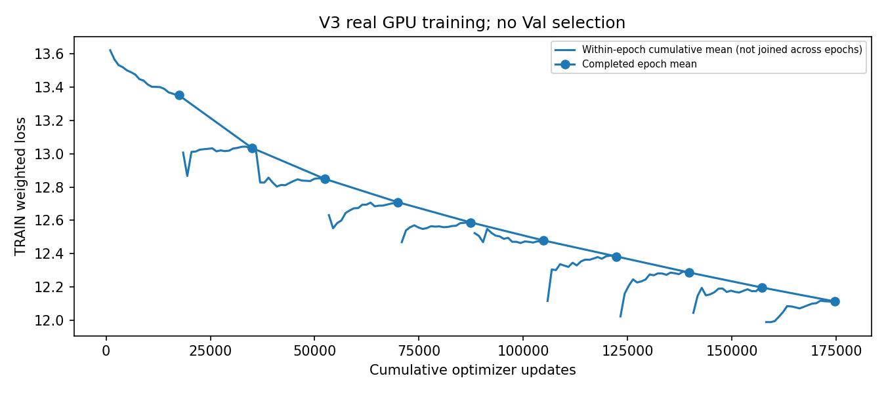
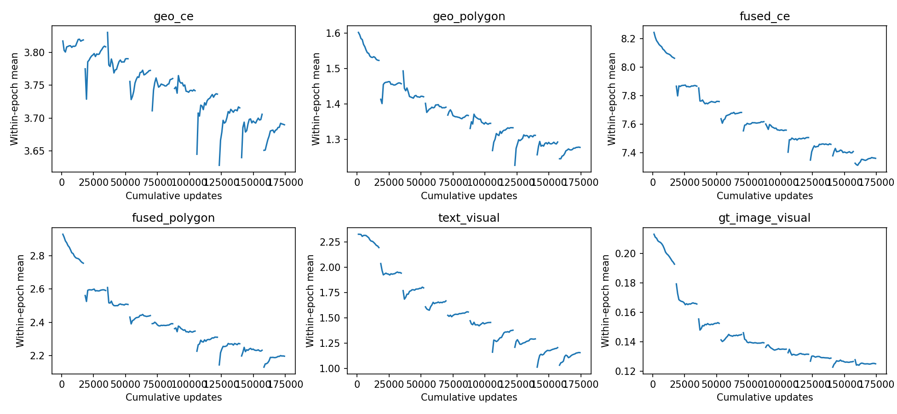

# UnifiedPGVB-V3 完整TRAIN训练与评测

完整TRAIN输入21878条；本阶段拟合17473条、物理目标留出4405条，物理分组重叠0。初始化V2曾使用TRAIN，内部留出不是完全未见泛化。

当前已完成完整Epoch：10；训练结束：False。

Geometry和轻量视觉模块训练，BERT/SigLIP2冻结并读取缓存；seed42，原权重保留。四小时累计训练预算，至少三轮后连续两轮相对Loss改善<0.5%提前停止。未修改Stop=0.3、1mm守卫或Horizon。

训练视点由公开地标选择，属于离线地图引导观测；不能作为无人机真实已看到的图像。导航/初始Goal评测使用真实起点及因果历史，保留原yaw，存在需检查的训练—部署分布差异。Polygon/Depth均是弱监督/2.5D代理，不是人工像素真值。

|Epoch|拟合样本|TRAIN Loss|本轮Wall秒|GPU峰值GiB|
|---|---:|---:|---:|---:|
|1|17473|13.351958|756.05|0.144|
|2|17473|13.035805|754.36|0.144|
|3|17473|12.849371|768.52|0.144|
|4|17473|12.709686|771.59|0.144|
|5|17473|12.587823|771.58|0.144|
|6|17473|12.479380|762.26|0.144|
|7|17473|12.383111|757.38|0.144|
|8|17473|12.286377|766.43|0.144|
|9|17473|12.195989|776.39|0.144|
|10|17473|12.112471|775.50|0.144|

## 全量评测状态

Top-K按384×384稠密世界网格原始排序，未做空间去重，不能直接与旧784网格的Top-K作横向比较；Top1/NE使用相同20m世界距离判据。

硬件：NVIDIA RTX PRO 6000 Blackwell Workstation Edition，PyTorch可见总显存94.96GiB；Torch 2.8.0+cu128 / CUDA 12.8。上表显存是PyTorch张量峰值分配量，不含CUDA上下文或首次视觉编码阶段。BERT/SigLIP2缓存版本均与原Stage1记录一致。

尚无全部2470条Val-Seen定位结果；不报告子集作为正式效果。

尚无完整闭环结果，不宣称SR提升。

## TRAIN输入长度核验

bert: 上限96 tokens，截断11/21878（0.05%）。
siglip: 上限64 tokens，截断250/21878（1.14%）。
这仅说明大范围文本截断不成立，不代表关系理解正确。本轮不改变token上限。

## 实际更新覆盖

优化器一阶动量和初始权重差异已核验；这不是每个历史batch都收到梯度的保证。Geometry未使用的旧GNN分支及零规则输入不应当宣称已训练。

|模块|非零动量参数张量/总数|
|---|---:|
|geometry|49/70|
|scale|1/1|
|visual_gain|1/1|
|vision_proj|4/4|
|depth_proj|4/4|
|pose_proj|2/2|
|bert_to_visual|2/2|
|cross_attention|4/4|
|visual_text|4/4|
|visual_head|4/4|
|teacher_head|2/2|

固定yaw=0的TRAIN视点使视觉Pose投影sin(yaw)列没有训练梯度；原Controller并非此列，未改动。部署保留原始yaw，此分布差异需要在TRAIN检验，不能因维度匹配就宣称跨yaw泛化已验证。

实际轮末快照见archived_epochs.json。归档从第三轮开始；最终全量评测仍用last.pt，不根据Val选择最低分/最高分Checkpoint。

## TRAIN监督几何一致性

{"queries": 21878, "point_outside_contour_1mm": 1112, "point_contour_distance_gt20m": 19, "point_registration_offset_gt1m": 0, "point_registration_offset_gt20m": 0, "invalid_polygon": 17}
这是监督侧的地图几何检查，不是像素GT或可见性准确率。未据此修改标签或删除任务。

推理时延须区分policy逐步耗时和含Query初始化耗时；环境正射渲染不计入原policy计时口径。Geometry-only跳过不参与决策的SigLIP编码，已通过TRAIN GPU几何logits一致性核验。

训练原始日志/权重留在服务器：`/home/20261024_1/Workspace/2027-CVPR/GraphNav/runs/unified_v3_full_s42_20261106`。本报告只汇总真实文件，不预测未完成结果。
