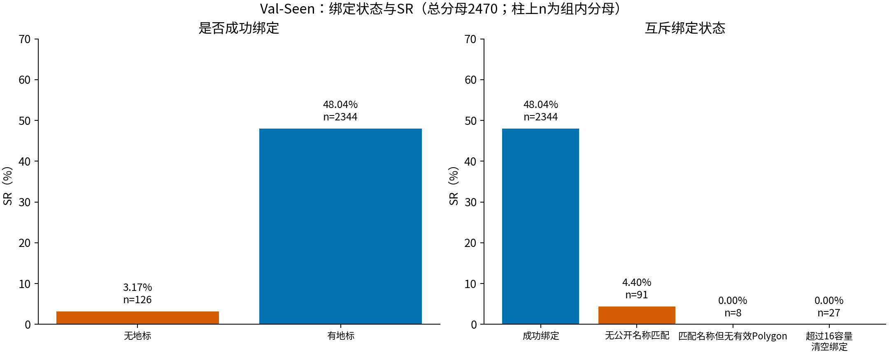
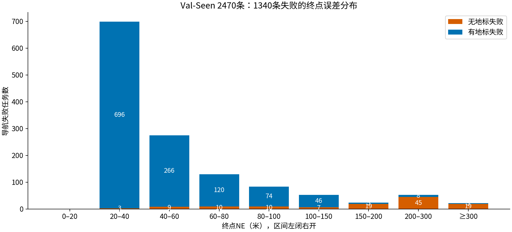
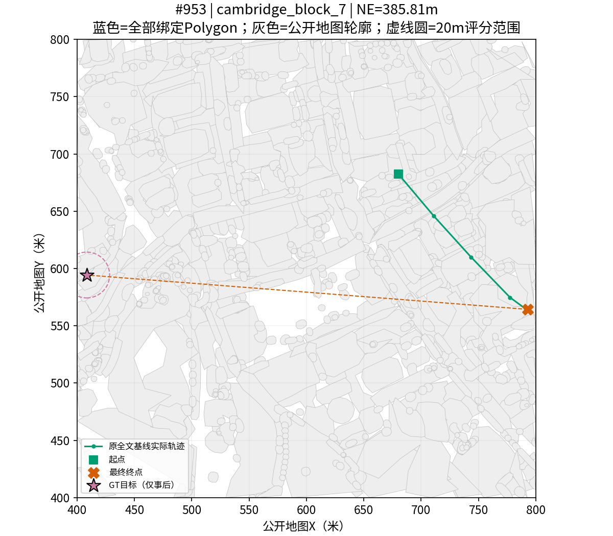
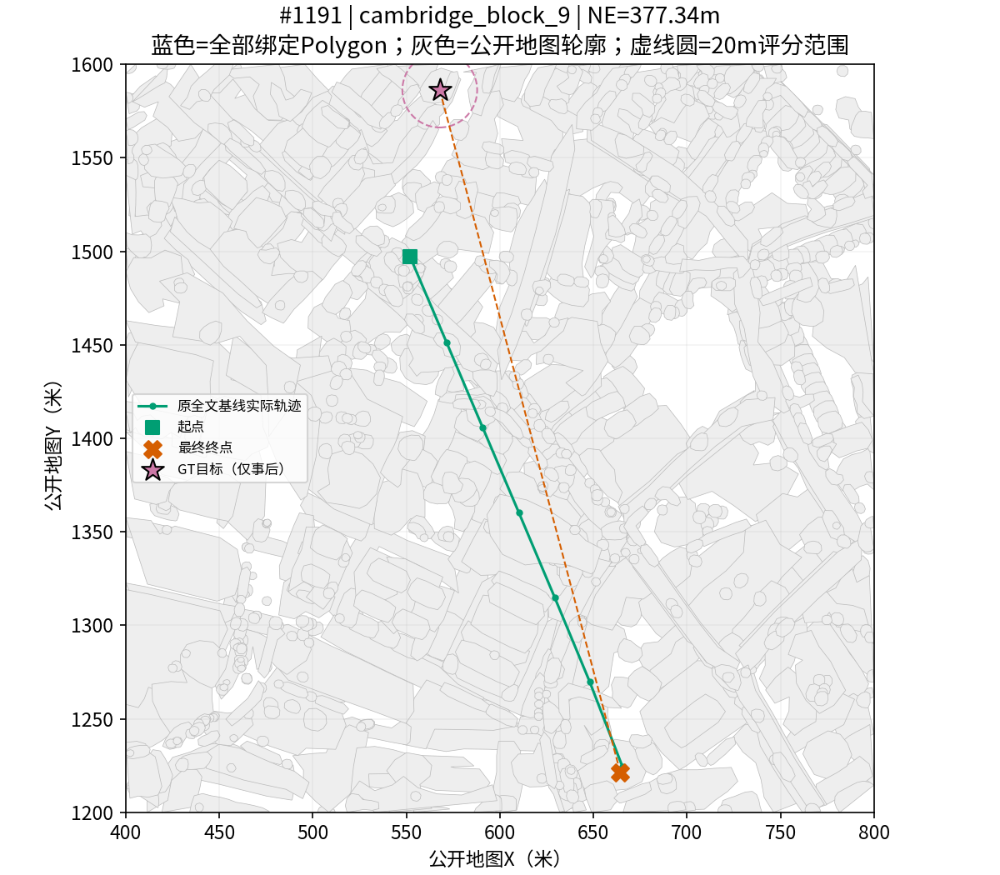
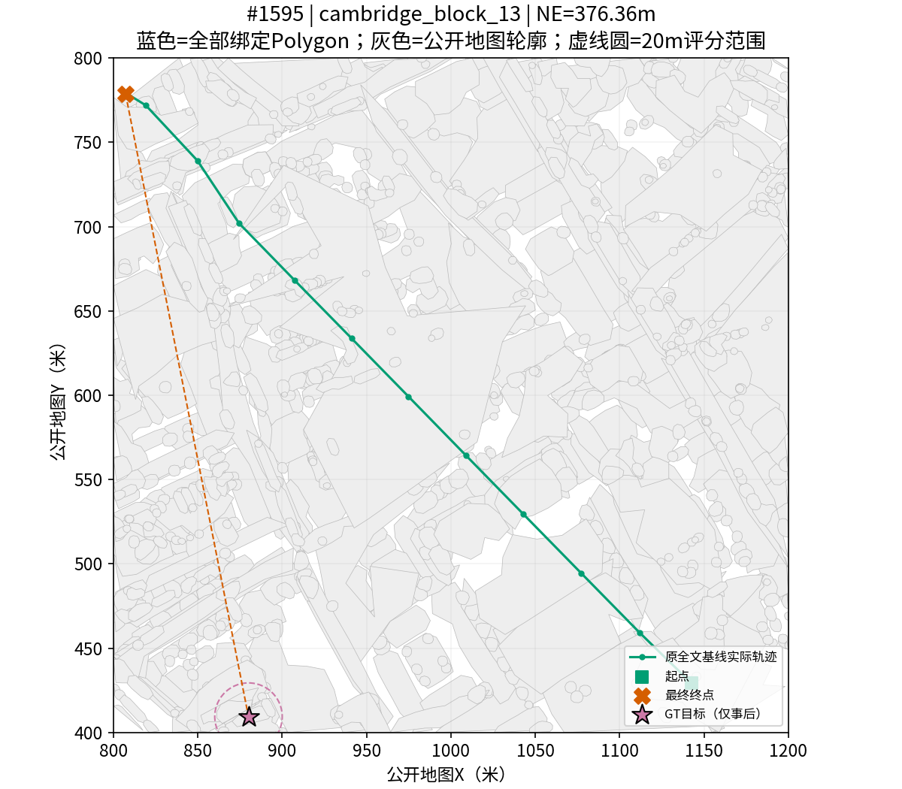
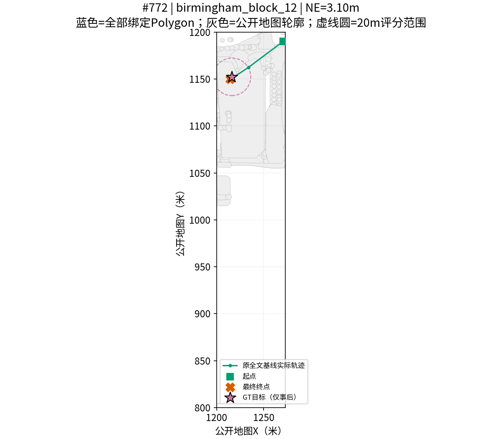
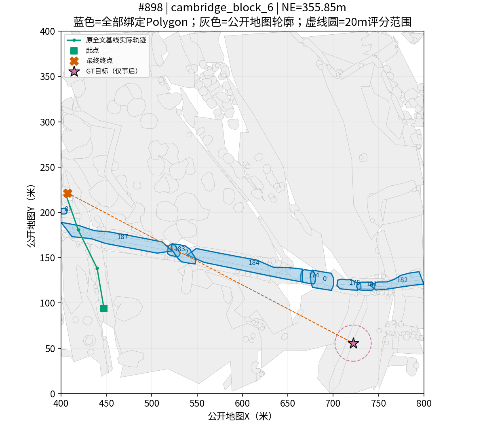
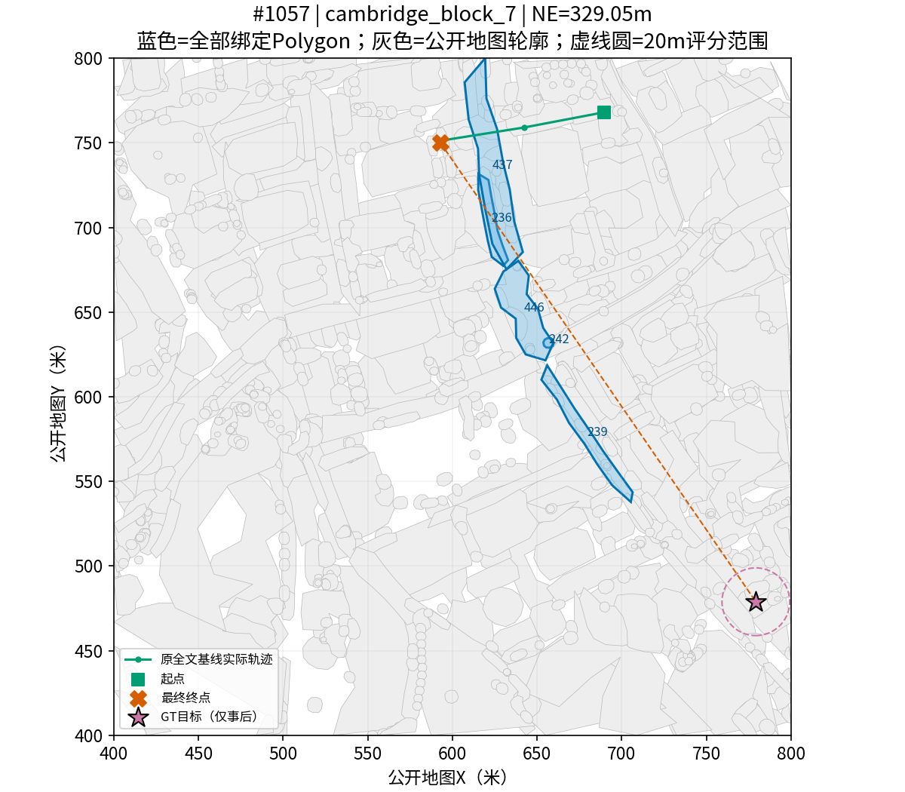
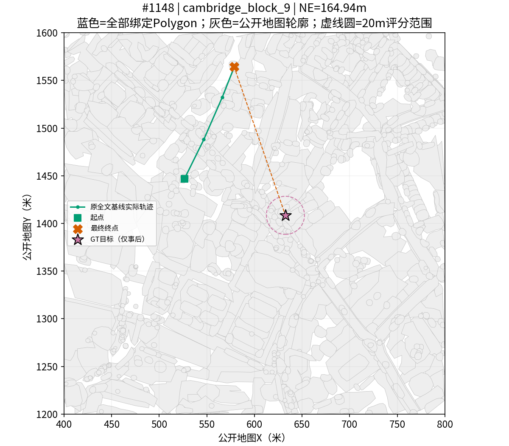
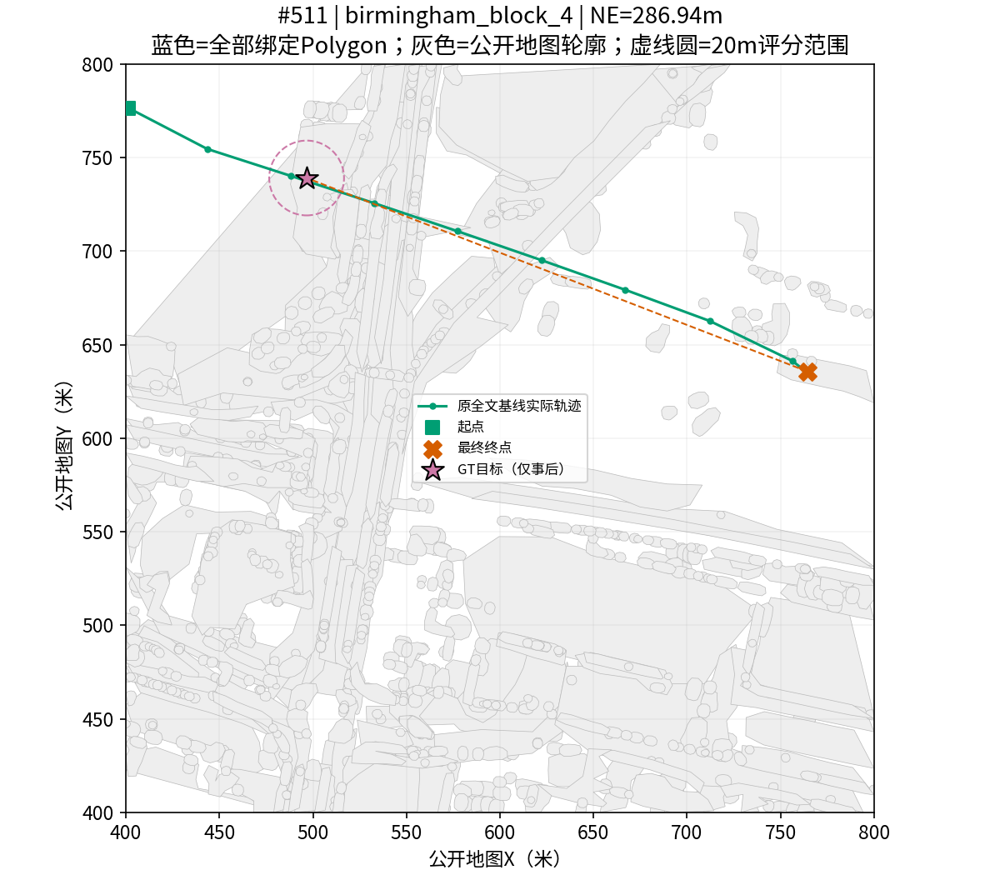

# Val-Seen 地标绑定失败与导航误差关联分析

日期：2026-11-06。范围：已有 **2470/2470** 条原全文基线真实闭环记录；没有重新训练、推理、导航或运行Test。TRAIN的1221条无地标未纳入任何Val-Seen统计。

**关键结果：1340条导航失败中，122条没有成功绑定地标（9.10%）；126条无地标任务中122条失败（96.83%），2344条有地标任务中1218条失败（51.96%）。≥100米的152条失败中，90条无地标，62条有地标。最大NE为385.8116米。**

## 1. 数据来源与严格对齐

以PR27 `6bc7dc3` 为源版本。读取PR25归档 `paired2470.csv`、`episodes2470.json`，并读取服务器原全文基线 `unified_v2_text_ablation_s42_20261105/eval_full_text` 的 predictions、manifest及2470份public_record；另对照 `unified_angle_only_s42_20261106/val_seen_predicted_angles` 的2470份public_record。两套公开输入逐条完全相同。统计结局始终使用 baseline_SR/baseline_NE，图册使用原全文基线轨迹，未混用角度模型轨迹。

核查：CSV与manifest各2470条、Episode ID与索引均唯一、索引0–2469完整；原基线predictions按Episode ID连接，并校验index与start_pose。原始Val-Seen annotation按Episode ID校验逐条指令。原始终点XY至目标XY重新算NE，与CSV/原日志一致；SR严格为0或1，NE有限且非负，SR等价于NE≤20米。缺失0、重复0、错位0。

使用原 `PublicNames + public_text_record(full_text,max_landmarks=16)` 重现绑定；按顺序比较全部Polygon ID与完整归一化轮廓。GT目标未进入匹配器，只用于上述事后评分与可视化。所有输入路径、SHA256、逐记录哈希见 `provenance.json`；可独立审计的原始公开输入、轨迹、评分与事后目标见 `verified_evidence.jsonl.gz`。

修复现有分析脚本的校验缺口：拒绝重复Episode ID、非连续/重复index、NaN/Inf/负NE和小数SR；加入可选原始annotation/基线predictions核对，防止同地图任务互换未被发现。synthetic测试覆盖同地图记录互换、轨迹/评分损坏、乱序输入与重复ID。正式报告要求这些增强核查全部通过。

## 2. 绑定覆盖率与故障类型

|互斥状态|任务数 / 2470|占全量|成功|失败|SR|
|---|---:|---:|---:|---:|---:|
|成功绑定|2344|94.90%|1126|1218|48.04%|
|无公开名称匹配|91|3.68%|4|87|4.40%|
|匹配名称但无有效Polygon|8|0.32%|0|8|0.00%|
|超过16容量，清空绑定|27|1.09%|0|27|0.00%|

绑定成功2344/2470（94.90%），未绑定126/2470（5.10%）。无公开名称匹配只表示当前公开目录/匹配器没有命中，不能等同于指令没有提及具名地点；案例中有明确名称仍未命中。

以下为**非互斥事件**，统一检查全部2470条：无效Polygon涉及75条任务、75次警告；其中8条最终完全无锚点，其余67条仍绑定了有效Polygon。超过16个有效Polygon的任务27条，全部回退无锚点。同一匹配名称对应多个公开ID的任务1401条（56.72%）；这里按匹配器返回的公开ID组定义，允许组中存在无效轮廓，不代表全部多实例均送入网络。不能把这些事件与互斥状态相加。

## 3. SR、失败与NE

SR/失败率为组内分母；全量分母始终2470。NE以米计，分位数使用排序后的线性插值。

|组|N|成功|失败|SR|失败率|NE均值|中位数|P75|P90|P95|P99|最大值|
|---|---:|---:|---:|---:|---:|---:|---:|---:|---:|---:|---:|---:|
|全量|2470|1130|1340|45.75%|54.25%|37.9596|22.3225|41.5472|77.4748|121.9988|297.6526|385.8116|
|有地标|2344|1126|1218|48.04%|51.96%|29.6472|20.9674|36.5824|63.1421|83.4912|135.1344|355.8461|
|无地标|126|4|122|3.17%|96.83%|192.5968|202.3880|271.8688|330.7805|348.1807|377.0977|385.8116|
|全部失败|1340|0|1340|0.00%|100.00%|60.4415|38.3528|63.8897|110.1011|214.0615|331.1117|385.8116|
|有地标且失败|1218|0|1218|0.00%|100.00%|46.5980|35.7261|54.8588|82.5938|100.7545|163.3441|355.8461|
|无地标且失败|122|0|122|0.00%|100.00%|198.6490|206.9695|273.1346|331.9846|348.8550|377.1369|385.8116|

无地标相对有地标的失败率差为 **44.86个百分点**，失败风险比 **1.863**。列联表（行：无/有地标；列：失败/成功）为 `[[122, 4], [1218, 1126]]`。Fisher双侧p=2.96e-28，优势比OR=28.196。Fisher将Episode视作独立观测，这个假设对同目标多指令并不充分。

因此增加按 `(map_name,target_id)` 的整组bootstrap：449个物理目标组，10000次，有效10000次，seed=20261106；失败率差95%百分位区间 **[40.27, 49.03]个百分点**，风险比区间 [1.739, 1.998]。此区间检验同目标内相关性的敏感性，未控制地图空间相关性、描述难度或模型偏差，不是随机实验因果区间。

|城市分层|无地标失败/N|无地标失败率|有地标失败/N|有地标失败率|
|---|---:|---:|---:|---:|
|birmingham|47/51|92.16%|419/794|52.77%|
|cambridge|75/75|100.00%|799/1550|51.55%|

在这份已完成的Val-Seen记录上，无地标组失败率明显更高；聚类区间未跨0，表明按物理目标聚类后该差异仍稳定。多数失败（1218/1340，90.90%）仍发生在有地标组，不能把全部失败解释为覆盖率问题。

## 4. 终点误差分布

区间统一为左闭右开：[0,20)、[20,40)……[300,+∞)。SR用≤20米，因此NE恰好20米成功但归入第二距离箱；当前数据无此边界样本。远距离口径采用历史说明中的≥100米，当前恰好100米样本为0，所以与>100米计数一致。

|NE区间（米）|全量任务|其中失败|无地标任务|无地标失败|有地标失败|
|---|---:|---:|---:|---:|---:|
|[0,20)|1130|0|4|0|0|
|[20,40)|699|699|3|3|696|
|[40,60)|275|275|9|9|266|
|[60,80)|130|130|10|10|120|
|[80,100)|84|84|10|10|74|
|[100,150)|53|53|7|7|46|
|[150,200)|24|24|19|19|5|
|[200,300)|53|53|45|45|8|
|[300,inf)|22|22|19|19|3|

≥100米失败152/1340（11.34%，占全量6.15%），其中无地标90/152（59.21%）。该组在无地标失败中的占比为90/122（73.77%），有地标失败中的占比为62/1218（5.09%）。全量NE均值37.9596米、最大385.8116米；不是只看成功样本或截断误差。

## 5. 典型案例图册

[下载并用浏览器打开完整离线图册](cases.html)。包含8例、原始指令与中文翻译、全部公开Polygon背景、全部实际绑定Polygon、原基线实际轨迹、起点、目标与终点。蓝色为模型实际锚点，灰色是公开地图轮廓；没有GT选Polygon。坐标保留原地图X/Y，未经核验不标地理北向。案例选择用于覆盖故障类型，不是随机抽样或因果证据。

### #953 无地标且失败：最大NE

Episode ID `['cambridge_block_7', 73, 2]`；NE 385.8116米；无公开名称匹配；实际Polygon IDs `[]`。

> A small house with a serrated roof next to the brown fisher building ( Queen’s college)

中文：棕色 Fisher 大楼（Queen’s College）旁边，一栋锯齿状屋顶的小房子。

公开名称未命中；需要核查 Fisher / Queen’s College 的拼写、别名和公开目录覆盖。末端与目标相距很远，无法从此案例单独判定缺失绑定是原因。

### #1191 无地标且失败：具名描述未命中

Episode ID `['cambridge_block_9', 379, 2]`；NE 377.3426米；无公开名称匹配；实际Polygon IDs `[]`。

> A square shaped riverside ground with a big tree at the corner of the ground situated at the left side of Pepy's Library

中文：Pepy’s Library 左侧、河边一块方形场地，场地角落有一棵大树。

指令包含具体名称但未命中当前公开匹配器。名称格式、所有格或目录缺项是待查假设；不可根据目标坐标反选图形。

### #1595 无地标且失败：间接空间关系

Episode ID `['cambridge_block_13', 482, 5]`；NE 376.3629米；无公开名称匹配；实际Polygon IDs `[]`。

> A triangular green park with trees behind the Keynes building car park.

中文：Keynes 大楼停车场后方，一个有树的三角形绿色公园。

名称未匹配与“建筑—停车场—公园”的间接关系同时存在；即使补齐名称，关系作用域和目标理解仍需验证。

### #772 无地标但成功：反例

Episode ID `['birmingham_block_12', 21, 4]`；NE 3.0988米；无公开名称匹配；实际Polygon IDs `[]`。

> The gray car at the bottom of the 2nd column of cars from the right in the top right corner of the large parking lot to the right of Manchester => Bournemouth (all stations) footpath.

中文：Manchester ⇒ Bournemouth（所有站点）步道右侧的大停车场右上角，从右数第二列最底端的灰色汽车。

公开名称未命中，但终点仍在20米内。完整指令、冻结模型先验和起点等都可能提供信息；仅凭成功无法判断使用了何种线索。

### #898 有地标却远距离失败

Episode ID `['cambridge_block_6', 103, 2]`；NE 355.8461米；成功绑定；实际Polygon IDs `['0', '174', '178', '181', '182', '183', '184', '187', '2', '81']`。

> The rectangular field next to the Schoolhouse building on the left side along Fen causeway road.

中文：沿 Fen Causeway 道路左侧、Schoolhouse 大楼旁边的长方形场地。

有Polygon不等于绑定语义与关系定位正确；可能涉及同名实例、左右参照系、目标区域理解或Belief选择。图中全部绑定实例均保留，不用GT挑选。

### #1057 有地标却远距离失败：序数关系

Episode ID `['cambridge_block_7', 107, 5]`；NE 329.0521米；成功绑定；实际Polygon IDs `['236', '239', '242', '437', '446']`。

> The third dark building from Fitzwilliam's house along Trumpington street road.

中文：从 Fitzwilliam’s House 沿 Trumpington Street 道路数，第三栋深色建筑。

序数关系要求沿道路排序；已有锚点不保证模型完成计数与实例消歧。不能将远距离失败直接归于某一模块。

### #1148 容量溢出且失败

Episode ID `['cambridge_block_9', 154, 4]`；NE 164.9374米；超过16容量，清空绑定；实际Polygon IDs `[]`。

> The dark gray building on Bridge Street to the right of the St Clement’s building.

中文：Bridge Street 上、St Clement’s 大楼右侧的深灰色建筑。

超过16个有效公开Polygon触发原有全清空回退。这是可审计的覆盖损失，但修复必须以指令和公开信息作完整组处理，不能按GT截取。

### #511 Polygon无效且失败

Episode ID `['birmingham_block_4', 24, 2]`；NE 286.9423米；匹配名称但无有效Polygon；实际Polygon IDs `[]`。

> The black car in front of another black car and beside a white car parked against the One Stop building.

中文：One Stop 大楼前，停在另一辆黑车前面、白车旁边的黑色汽车。

名称命中但公开几何无效，未形成有效锚点。应检查源几何和修复前后语义一致性；不能因为附近存在目标就另选Polygon。

## 6. 结论与后续实验设计

绑定覆盖缺失与失败存在强统计关联，且无地标失败中有较多远距离误差；容量溢出和非法几何是可直接审计的输入覆盖缺口，值得优先修复。但本次不能确认“未绑定直接导致失败”，也不能把122条无地标失败或远距离子集当作可恢复失败数量。指令复杂度、公开目录覆盖、城市/地图、目标类型、序数/间接关系和训练—在线绑定差异均可能共同影响分组结果。

覆盖率是值得验证的候选瓶颈；全量成功覆盖已达94.90%，且多数失败有锚点，所以不能据此认定它是全系统主要瓶颈。无地标但成功的4例全部来自Birmingham block 12，亦不能将其泛化为无地标策略可靠。

下一阶段建议独立预注册配对修复实验（**本次只设计，不执行**）：

1. 修复规则只看原始指令与公开地图目录。区分无名称可用、名称/别名漏匹配、几何无效、完整组容量溢出；人工审核者不看GT、NE、SR。名称未具名的指令不因目标GT补锚。公开几何修复须可追溯；容量方案保留同名完整组/无GT空间选择规则，不按目标距离截断。
2. 冻结同一checkpoint、完整指令、起点、模型、Controller/Stop、步数和随机种子；只改变公开绑定。在全部2470条上对原绑定/修复绑定执行同任务配对真实闭环，未受影响任务也保留在全量分母。原归档可作协议一致性参考，若软件/随机性变化则须另跑同期原绑定对照。训练不变；不运行Test。
3. 在执行前用独立TRAIN或公开合成样本固定修复规则与版本SHA，不使用本报告Val-Seen结局挑规则或checkpoint。当前Val-Seen已经被分析，未来在同集的提升仅作诊断性估计，不能冒称独立泛化验证。
4. 报告全量2470配对SR变化、纠正/破坏、NE分位数与最大值、≥100米失败变化及受影响子集分母；对二元配对结果给McNemar精确检验，并按物理目标聚类bootstrap配对SR/NE差值。检验实际网络收到的Polygon集合与完整轮廓，另外报告无地标覆盖改善。GT只用于最终评分，不能参与名称、实例选择或调参。
5. 只有受控干预后才能估计修复的增量作用；若提升来自容量/几何/名称同时修改，应进一步分解干预。不得把本次相关性比例当作修复后SR上限或预期收益。

## 7. 产物与复现

- `per_episode.csv`：2470行，Episode ID、原指令、互斥状态、名称命中数、Polygon ID、有效几何数、警告、同名多实例事件、SR/NE、起终点与事后目标、输入哈希。
- `summary.json`：分组统计、NE分位数、距离箱、关联检验与聚类区间。`distance_bins.csv`为图表原始计数。
- `provenance.json`、`verified_evidence.jsonl.gz`：来源及逐记录证据。`cases.json`与`cases.html`：可浏览案例及其数据。PNG/SVG图表均可独立使用。
- 复现命令见 `reproduce.sh`。使用项目已有 `aerialvg_env`；本机配置中的 `~/anaconda3` 不存在，因此使用项目说明指定的已有环境解释器，未改环境配置。

检验使用SciPy Fisher exact和固定seed的NumPy聚类bootstrap；仅本次预定主要分组检验，城市分层为描述性敏感性检查。案例解释是待验证假设。

验证：32项相关CPU测试通过；`verify_val_seen_binding_report.py`从压缩证据独立重算2470条终点NE、SR、分组分位数与图册一致性通过（`VALIDATION.json`）。图册已在Firefox headless实际打开，预览见 `browser_preview.png`。

审查限制：已实际调用 `codex-companion.mjs adversarial-review --wait --scope working-tree`；服务反复重连后返回 `workspace routing discovery timed out`，没有有效审查结论，不能记为审查通过。原始输出见 `adversarial_review_attempt.txt`。这不是自动审批拒绝。
